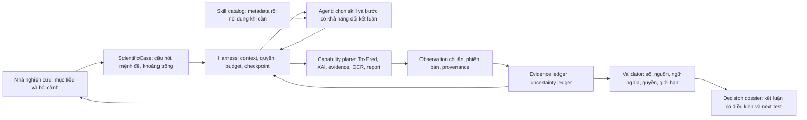
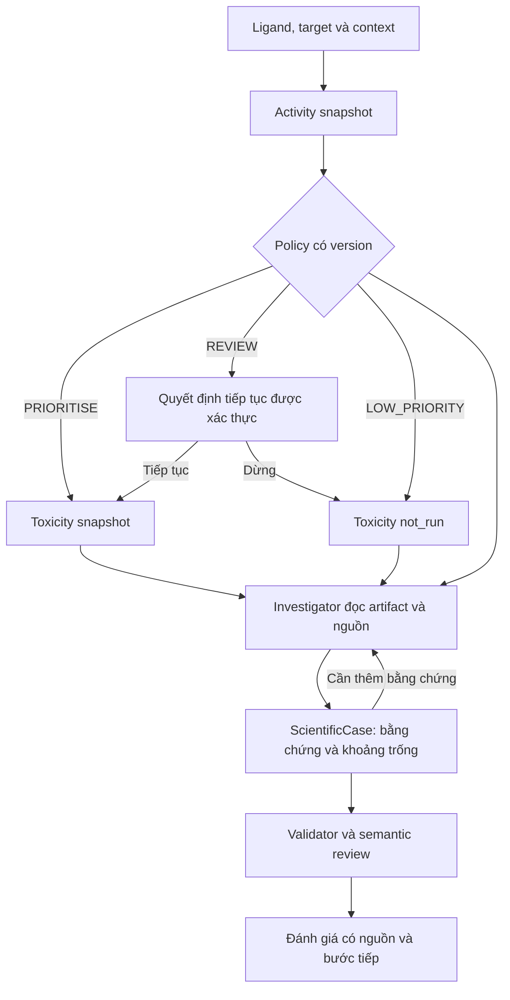

# ToxAgent agent architecture: compiled design and literature sources

Compiled 2026-11-07 from branch `feat/core-agent-loop` at `7e741a6`. Verbatim copies of existing project documents, no new analysis. Documents removed from the tree were recovered from git history at the commit named in each section. Citations are as the original authors wrote them and have not been re-verified.

## Contents
1. Agent layer overview — `docs/agent-layer/README.md`
2. Agent layer architecture (current) — `docs/agent-layer/architecture.md`
3. Research design: problem and claim — `docs/research/README.md`
4. Hypotheses H1–H3 — `docs/research/hypotheses.md`
5. Status (as of 2026-10-30) — `docs/research/status.md`
6. Architecture proposal 2026-10-28 (with literature [I1–I6], [A1–A7]) — `git 4465a1e:docs/internal/spec/TOXAGENT_AGENT_ARCHITECTURE_PROPOSAL_2026-10-28_VI.md`
7. RETHINK 2026-09-25 (ReAct, ChemCrow, Agent Skills, context engineering, SkillsBench, benchmark map) — `git history: docs/RETHINK_TOXAGENT_AGENTIC_RESEARCH_EVALUATION_VI.md`
8. Agent benchmark review & proposal (literature map §6) — `git history: docs/TOXAGENT_AGENT_BENCHMARK_REVIEW_AND_PROPOSAL_VI.md`
9. Architecture & benchmark enablement review 2026-09-16 — `git c84a8c4^:docs/TOXAGENT_AGENT_ARCHITECTURE_AND_BENCHMARK_ENABLEMENT_REVIEW_VI.md`
10. Agent layer & benchmark proposal 2026-10-20 (R1–R10) — `repo root (untracked)`
11. ADR 0001 — Three deployment boundaries — `docs/adr/0001-three-boundary-topology.md`
12. ADR 0002 — No aggregate toxicity verdict — `docs/adr/0002-no-aggregate-verdict.md`
13. ADR 0003 — Product-owned state, relational store, transactional outbox — `docs/adr/0003-product-owned-state.md`
14. ADR 0004 — Runtime pinning and the provider contract — `docs/adr/0004-runtime-pinning.md`
15. ADR 0009 — The agentic workflow boundary — `docs/adr/0009-agentic-workflow-boundary.md`
16. ADR 0010 — Adaptive decision support builds on the gateway, not the dormant kernel — `docs/adr/0010-adaptive-decision-support-boundary.md`
17. ADR 0011 — One control plane, server-owned decision state, and an evaluation spine that says what it graded — `docs/adr/0011-benchmark-enablement-and-single-control-plane.md`
18. ADR 0012 — A durable scientific case on the live path, and investigation methods as loadable skills — `docs/adr/0012-scientific-case-and-skill-catalog.md`
19. ADR 0014: Activity artifacts are bound to a subject, and a policy is scoped to one context — `docs/adr/0014-activity-subject-identity-and-policy-scope.md`


---

# Part 1. Agent layer overview

> Source: `docs/agent-layer/README.md`

## The agent layer

Written for engineers working on this repository.

The agent layer is the part of the control plane that turns a researcher's
toxicology question into an answer whose every number cites the artifact it
came from. It sits between the HTTP API and the model runtime, and it owns the
state the model is not allowed to own.

### What it is not

- **Not the workflow.** Activity screening → policy decision → optional
  toxicity prediction is executed by the server, deterministically. A
  scientific conclusion the agent reaches never overrides a policy decision or
  replaces a prediction.
- **Not a safety verdict.** Every answer carries the limitations its sources
  require. A margin is a ratio of two measurements; whether it is acceptable is
  a judgement about the conditions they were measured under.
- **Not on by default.** Each capability here is behind a rollout flag whose
  default is off. A deployment with every flag off answers from the artifacts
  it already holds, as it did before this layer existed.

### The one-paragraph version

A message is admitted, bound to one subject (a molecule's analysis, or one
activity screening), and a run is created. The server decides which of four
serving routes the question takes, builds a goal contract and a view of the
case, and dispatches one model turn with only the tools that route allows. The
model reads artifacts, retrieves evidence, runs determinate procedures and
writes to the case through typed operations; it never edits state directly. It
submits a draft answer, which a hard validator checks field by field, and then
an independent reviewer turn judges each claim against the sources it cites.
Only what passes is released, and the run records why it stopped.

### Which document

| Question | Document |
|---|---|
| What are the parts, and what happens in what order? | [architecture.md](architecture.md) |
| How do I run one turn and see it work? | [running.md](running.md) |
| How do I add a tool, an operation, a procedure? | [extending.md](extending.md) |
| How do I run the arms and read the results? | [benchmark.md](benchmark.md) |
| How does a user run the agent on their own AI key or ChatGPT sign-in? | [ai-connections.md](ai-connections.md) |
| Why is it built this way, and what is proven? | [../research/](../research/) |

### Where the code is

Everything below is under `backend/control/src/toxagent/`.

| Path | What lives there |
|---|---|
| `application/investigation/` | The layer's logic: router, goal contract, case view, procedures, case service, claim review, release gate, skills |
| `domain/scientific_case/` | The case: its model, its typed operations, claim dependencies, researcher values |
| `domain/` | Measurement values, evidence relations, observations, stop reasons, gaps, subjects |
| `harness/gateway/` | Turn assembly and dispatch: context, case hooks, release, completion |
| `tools/` | The tool registry, the capability profiles, and each tool definition |
| `validation/` | The answer schemas, the hard validator, the deterministic fallback |
| `platform/flags.py` | Every rollout flag, with its owner and its removal condition |
| `connections/`, `harness/owner_hosts.py` | Users' AI connections: providers, probes, model lists, encrypted secrets, ChatGPT sign-in, private runtime hosts |

The benchmark lives beside it, in `backend/control/evals/investigation/`.


---

# Part 2. Agent layer architecture (current)

> Source: `docs/agent-layer/architecture.md`

## Architecture of the agent layer

Written for engineers working on this repository.

### The path of one turn

```
message
  │  admission: intent, subject binding, budget          application/conversation/
  ▼
run ──► turn assembly                                    harness/gateway/context.py
  │       route ─ goal contract ─ case view ─ profile
  ▼
model turn (one dispatch)                                harness/gateway/runtime_gateway.py
  │       reads artifacts, retrieves evidence,
  │       runs procedures, writes the case through
  │       typed operations
  ▼
submit_grounded_answer ──► hard validator                validation/answer/
  │                          every number cites a field
  │                          every required limitation declared
  ▼
reviewer turn (independent)                              application/investigation/claim_review.py
  │       one verdict per claim, against its sources
  ▼
release ──► answer, or the grounded part, or nothing     application/investigation/release_gate.py
  │
  ▼
run result: disposition, review status, stop reason
```

Everything the model did is recorded: each tool call with its phase and
duration, each rejected draft with its violations, each review verdict with its
reason, and the contract the turn actually read.

### Subject binding

A decision-support message is bound to **one** subject when it is accepted: the
analysis or the activity screening it names, or the session's only one. Two
subjects and no selection is a clarification, never the first one.

The binding travels frozen in the run envelope to the gateway, the case, the
decision state and the dossier. It is what makes "another screening of the same
ligand is another subject" enforceable rather than advisory: evidence retrieved
for one subject cannot be cited as direct evidence about another.

Flag: `subject_binding_v1`.

### The four serving routes

A question's *intent* says which pipeline runs. Its *route* says how much
investigation it deserves. The router is deterministic and spends no model
call.

| Route | Taken when | Runs as |
|---|---|---|
| `read_explain` | The subject and its artifact are bound, the question is shaped as a read, and nothing in it asks for a judgement | Profile `decision_support_read`: artifact reads and the answer. No search, no case writes, no skills, no calculations |
| `investigate` | Anything asking for a judgement, and the default | The full loop, profile `decision_support` |
| `update` | A researcher value is in force that the previous run of this subject did not see, or a changed premise left claims stale | The full loop; the contract names each new value and asks what it changes *and* what it leaves unchanged |
| `compare_batch` | Comparison wording **and** more than one candidate | The full loop plus `compare_candidates`; one row per candidate, from that candidate's own artifact |
| `undetermined` | No subject bound, or a comparison asked for with one candidate | Profile `decision_support_read`; the contract asks the clarifying question first |

Two rules the router will not break:

- **A keyword never decides a research question.** Any assessment marker
  ("contradict", "margin", "should we", "why") outranks every read marker, so
  "what is the margin" does not reach the cheap route.
- **A changed premise outranks the wording.** A value read off a stale claim is
  wrong whatever the question looked like.

Routing decisions carry reason codes, and the benchmark reports routes and
their cost separately from task success.

Code: `application/investigation/router.py`. Flag: `investigator_contract_v1`.

### The goal contract

One projection, written once per turn, of what the run was asked to do: the
route, the bound subject, what must be answered, the actions available (the
tool names the registry resolved for this turn's profile — not a wish list),
the admitted budget, and the typed stop conditions.

It has no `gold` parameter and cannot be given one; a unit test asserts the
parameter set. Required claims come from the question, never from a hidden
benchmark answer.

A contract is not editable mid-run: a contract that changed would let a run
that answered a different question look like one that answered this one.

Code: `application/investigation/goal_contract.py`.

### The scientific case

Per session and subject, carried across turns. Four groups of data: context the
researcher supplied, hypotheses, an evidence ledger with scopes, and
uncertainties — plus actions, derived claims and a conclusion.

**It is append-only, through typed operations.** The model may send nine of
them (`set_question`, `add_hypothesis`, `revise_hypothesis`, `record_evidence`,
`record_uncertainty`, `resolve_uncertainty`, `record_action`,
`propose_next_test`, `set_conclusion`); the rest belong to the researcher or
the server. Every operation is logged, and the case snapshot must equal the
replay of its log.

Four things in it are worth knowing about:

**Measurement values** (`domain/measurement_value.py`). A declared value
becomes the set of values it permits, in canonical units, with the conversion
recorded. This separates three questions that were one string comparison
before: are these the same measurement (identity), is this the same number
written differently (representation), and do these two numbers agree
(numeric). A µM record and an nM record are no longer "different"; `> 30 µM`
against a "below 10 µM" rule is a determinate no, while `< 30 µM` is
undetermined. Two disjoint values are *not* a contradiction unless the caller
declares what counts as a real difference, because that is an assay judgement.

**Researcher values** (`domain/scientific_case/values.py`). The context log is
already an ordered set of versions per key, so correcting a value appends a
second item and the first stays citable: `case_value:free_cmax@v2` resolves the
same way in every later run. A value nobody verified is `user_asserted` — the
weakest standing, never the strongest — and carries the limitation that says
so. `sme_verified` cannot be awarded by a run.

**Claim dependencies** (`domain/scientific_case/dependencies.py`). A derived
claim records its inputs as *references*, its rule and its assumptions. A
justification that copied the number would still look valid after the number
changed, which is the bug this exists to prevent. When a premise moves,
`affected()` walks transitively, and a claim is marked `needs_reassessment` only
when *every* justification lost a premise — one standing route means the claim
is not in doubt. Nothing is deleted: the earlier answer was computed from those
inputs, and the next answer has to be able to say what changed.

**The case view** (`application/investigation/case_view.py`). What the turn
actually sees, in six groups: the subject and contract; the observations with
their identifiers; the conclusion in force and what changed; evidence,
counter-evidence and the metadata records did not state; open gaps, prior
searches and budget left; and the skills for this task. It carries
*references and counts*, and says how many it withheld — content stays behind a
tool.

Flag: `scientific_case_v1`.

### Tools and procedures

Tools are registered per capability profile, and a profile is a small closed
set — a unit test enforces a ceiling, because a large roster costs money and
misroutes. There is no shell, no filesystem and no raw web access in any
conversational profile.

`run_scientific_procedure` is one tool for five determinate operations over
records the run already read:

| Procedure | Answers |
|---|---|
| `normalise_measurements` | Each record's value in canonical units, with the conversion and the decisive fields it did not state |
| `deduplicate_by_origin` | One record per experiment — two rows of one measurement are not two independent sources |
| `compare_measurements` | Whether two records' scopes are comparable, then whether their values agree under a declared tolerance |
| `check_dependencies` | Which derived claims a changed premise left stale, plus unresolved references and cycles |
| `compare_candidates` | The session's candidates on one declared criterion, grouped by scale, never a combined score |

The procedure name is an enum, so an unknown one is a schema refusal before any
code runs. A procedure reaches no provider, so a repeat is free and a frozen
benchmark can replay it. A procedure proposes; the investigator commits.

Code: `application/investigation/procedures.py`,
`tools/definitions/procedures.py`. Flag: `scientific_procedures_v1`.

### Gaps and stopping

Seven kinds of unresolved requirement, typed because they are not
interchangeable: `identity_or_scope`, `no_relevant_evidence`, `span_not_read`,
`measurement_unresolved`, `disagreement_unexplained`, `only_researcher_has_it`,
`provider_or_corpus`. A run that reports "insufficient" without saying which of
the seven it hit has told the researcher nothing they can use.

A run ends on one of eight stop reasons. Three distinctions in them matter:

- `provider_failure` is **not** `insufficient_evidence`. One says the product
  could not look; the other says the science is unsettled.
- `answered_from_artifacts` is not `insufficient_evidence` either: the answer
  read what the run already held and there was nothing to search for.
- `needs_user_input` names the input only the researcher has.

An access failure is **recorded**, not inferred from an empty result: an empty
result and a refused request look alike afterwards and mean opposite things.

Code: `domain/investigation_gap.py`, `domain/decision_state.py`.

### Verification and release

Three gates, in order, and each one can only subtract:

1. **The hard validator** (`validation/answer/`). Every number in the prose
   must be a claim; every numeric claim must cite an observation field that
   holds that value; every limitation the cited sources require must be
   declared. A quoted passage must name the locator it came from. This is
   mechanical and cannot be argued with.
2. **The semantic reviewer** (`claim_review.py`). An independent turn, one
   verdict per claim, judged against a bundle the *server* assembles: the
   passages the claim quotes, the measured value the record states, the scope
   this run's relations declared, and — for a computed value — its formula and
   every input with its provenance. For a researcher-supplied input the bundle
   says so, because a cited record does not have to make the researcher's
   statement.
3. **The release gate** (`release_gate.py`). Under `strict-reviewed-v1` an
   accepted answer is a *candidate*; one bounded repair turn is allowed; what
   the reviewer still blocks is withheld. A run can publish the grounded part
   and withhold the rest (`partial_facts`), which is more useful than
   publishing nothing and honest in a way publishing everything is not.

If a model spends both attempts and still fails validation, the server writes a
**deterministic fallback** containing no model text at all — only facts read
from the run's own bound subject, each with its field path. It answers about
*that* subject, never whichever analysis the session touched last.

### Budget

One effective budget per run, named by a preset so it is a recorded fact rather
than whatever the environment happened to say. It counts every logical tool
invocation, reserves slots for the submission, the review and the repair, and
caps invalid calls so a malformed-call loop cannot spend a run. Each call is
recorded under its phase: `investigator`, `hard_correction`, `review_initial`,
`semantic_repair`, `review_final`.

Code: `application/runs/budget.py`, `tools/runner.py`.

### State ownership

| State | Owner | The model's access |
|---|---|---|
| Session, run, budget | Server | None |
| Subject binding | Server, at admission | Read, through the contract and the subject line |
| Analyses, screenings, policy decisions | Workflow | Read, through tools, by id |
| Evidence records and full text | Server, on retrieval | Read, through tools |
| Scientific case | Server, through typed operations | Nine operations, through one tool |
| Observations | Whichever component produced them | Cite by id and field path |
| Answers, drafts, reviews, releases | Server | Submit a draft; never release |

The single rule behind the table: the model proposes, the server records. Every
value in a released answer resolves to a stored field, which is what makes an
answer auditable after the fact.


---

# Part 3. Research design: problem and claim

> Source: `docs/research/README.md`

## The research design

Written for reviewers assessing what this system claims and whether the
evidence supports it. For how to build and run it, see
[../agent-layer/](../agent-layer/).

### The problem

A toxicology question is answered from measurements that were made under
conditions, by predictors with domains of applicability, and from exposures
only the researcher knows. The failures that matter are not fluency failures:

- **Two measurements of one quantity read as a contradiction**, because one is
  in µM and the other in nM, or one is a bound (`> 30 µM`) and the other a
  point value.
- **Two reports of one experiment counted as two independent sources**,
  because a database record restates the paper it came from.
- **A measurement about one target applied to another**, because both
  mention the compound.
- **A corrected input leaving stale conclusions behind**, because nothing
  recorded which conclusion was computed from it.
- **"No evidence found" standing for four different situations**: nothing was
  searched, nothing relevant exists, a provider was down, or only the
  researcher has the input.

Each one produces an answer that reads as confident and is wrong in a way the
reader cannot see. The design question is what mechanism makes those failures
detectable and attributable, rather than how to make the prose better.

### The claim being tested

That a scientific investigator built on three mechanisms — measurement
semantics, dependency-tracked revision, and gap-driven acquisition — answers
these questions better than a generic agent with the same tools, the same
model and the same gates.

**The primary comparison is D vs C**: the domain design against a strong
generic agent. D vs B (a fixed workflow) is secondary, and asks the narrower
question of whether an agent is needed at all. Locking a weak C and declaring D
the winner would produce a number nobody can use.

**Novelty is not claimed as proven.** Truth maintenance, adaptive retrieval and
tool orchestration all have precedents. What may be contributed is the
formalisation for *measurement* evidence, the specific coordination of these
mechanisms, and controlled evidence that they matter. See
[hypotheses.md](hypotheses.md).

### How to check it

| Document | Contains |
|---|---|
| [hypotheses.md](hypotheses.md) | H1–H3: the mechanism, the controls, the metrics, what would falsify each |
| [evaluation.md](evaluation.md) | Arms, case sets, metrics, blinding, and the reading rules |
| [status.md](status.md) | What is implemented, what has been measured, and what is still open |

The measurement reports themselves are kept internally, under `docs/results/`
in the development repository, each naming the commit it ran on.

### What is true today, stated plainly

The mechanisms of H1 and H2 are implemented and run end to end. H3's mechanism
is partial. **No hypothesis has been tested on scientifically meaningful
data.** Everything measured so far used synthetic engineering fixtures with
invented compounds and numbers, one trial per case, graded by language models
rather than subject-matter experts. Those runs are evidence that the machinery
works. They are not evidence about toxicology, and the scorer says so in its
own output.

### The standards this holds itself to

- **A dimension is a measurement; there is no total score.** Precision and
  coverage trade against each other, and one number hides which was given up.
- **Agreeing by default and doubting everything are both failures.** An agent
  that endorses every predictor call catches no errors; one that challenges
  every call catches them all and attacks the correct calls too. They are
  measured separately, because a single score hides both.
- **A withheld answer stays in the denominator.** Not answering is an outcome,
  not an absence of one.
- **Gold is declared, not assumed.** Every case says whether its gold is
  SME-verified or a synthetic engineering fixture.
- **Targets are locked before the test split is seen**, and the results and
  protocols of earlier studies are kept as their own history rather than
  revised after the fact.


---

# Part 4. Hypotheses H1–H3

> Source: `docs/research/hypotheses.md`

## H1–H3

Written for reviewers assessing what this system claims.

Each hypothesis names a mechanism, the controls it is varied against, the
metrics it is judged on, and what would falsify it. In every case the arms
share the model, the tools, the budget, the output schema, the validator, the
reviewer and the frozen inputs; only the mechanism under study differs.

The common identity guards — a measurement about another target is not direct
evidence about this one — stay on for **every** arm. Removing them would
produce a baseline that fails for a reason unrelated to the hypothesis.

---

### H1 — Measurement semantics

**Claim.** Separating identity, representation and numeric constraint reduces
false contradictions and the misapplication of evidence.

**Mechanism.** A declared value becomes the set of values it permits, in
canonical units, with the conversion recorded. Three questions that were one
string comparison become three:

| Layer | Question | Example of the failure it prevents |
|---|---|---|
| Identity | Are these the same measurement? | A hERG IC50 cited against an EGFR estimate |
| Representation | Is this the same number written differently? | 0.3 µM and 300 nM read as two different results |
| Numeric | Do these two numbers agree? | `> 30 µM` and `< 10 µM` read as a contradiction, or as agreement |

Two deliberate refusals. An unknown unit is unknown, not a wildcard: two
unrecognised unit strings that happen to match are still not interconvertible.
And two disjoint values are **not** a contradiction unless the caller declares
the fold difference that counts as a real one, because how far apart two
measurements of one quantity may legitimately sit is a property of the assay,
not of the arithmetic.

**Controls.** Paired cases that hold the measurement fixed and vary how it is
*written* or *blocked*: unit equivalence (nM/µM), exact vs censored, same
ligand on a different target or variant, missing assay context, and duplicate
records of one experimental origin. Then an ablation that removes the
representation layer while keeping tools and knowledge identical.

**Metrics.** False-contradiction rate; correct refusals to compare; how often
an undetermined comparison is reported as undetermined rather than resolved to
one side.

**What would falsify it.** The ablated arm matching the full arm on paired
cases — the layer would then be adding cost without changing conclusions. Or
the full arm refusing comparisons that are in fact valid, trading false
contradictions for false incomparability.

**"Undetermined" is a correct answer** on the cases built for it, and the gold
says so. An arm that always commits is not thereby better.

---

### H2 — Revision with dependencies

**Claim.** Structured dependencies update the right claims, preserve the
unrelated ones, and cost less than re-synthesising from the transcript.

**Mechanism.** A derived claim records its inputs as references, its rule and
its assumptions. When a premise moves, the graph is walked transitively, and a
claim is marked for reassessment only when *every* justification lost a
premise — one standing route means the claim itself is not in doubt.

Nothing is deleted. The earlier answer was computed from those inputs, and the
next answer has to be able to say what changed.

This is scoped truth maintenance, not a full TMS: the scope is what a server
can check — numeric and identity rules. A dependency cycle is reported as a
finding, not raised as an error, because a graph that is not sound still has to
produce an answer.

**Controls.** Generic ReAct with the full transcript; ReAct with a good
summary; the previous investigator without dependencies; the current one. Same
observations, same guidance content.

**Metrics.** Required-update accuracy (did the claims that had to change,
change); preservation accuracy (did the unrelated ones survive); stale-claim
rate; task success; total cost.

**What would falsify it.** Transcript-based ReAct matching it on both update
and preservation. The interesting failure is asymmetric: marking everything
scores perfectly on required-update and fails preservation, and the two must
therefore be reported together.

**The case gold must include the hard case**: a claim whose premise changed but
which has a second, still-standing justification. An implementation that marks
it is wrong, and one that silently keeps it without recording the lost route is
also wrong.

---

### H3 — Gap-driven acquisition

**Claim.** Explicit information needs spend the budget on sources that could
change the answer.

**Mechanism.** Seven typed gaps, and an action that must state which gap it
closes. A run that stops says which gap it stopped on, so "insufficient" is
attributable rather than a shrug.

**Controls.** The adaptive policy against a fixed acquisition schedule, over
the same case and the same procedures, with evidence-given separated from
frozen retrieval.

**Metrics.** Acquisition cost; decisive-evidence recall; task success.
Explicitly **not** the number of papers read, which rewards reading more.

**What would falsify it.** A fixed schedule reaching the same decisive evidence
at the same or lower cost. On a small corpus this is likely, and that is worth
reporting rather than hiding: the mechanism's value should scale with how much
there is to not read.

**Status: the weakest of the three.** The gap vocabulary exists and the
contract declares the gap for one calculation. Ranking candidate actions by
what they would discriminate is not implemented, so H3 cannot currently be
tested as stated.

---

### Engineering controls, not contributions

Context compilation, batching, caching and durable execution are measured for
operational effect only. They are not scientific reasoning results. If one of
them is turned on, the baseline arms get it too — otherwise the comparison
measures the optimisation rather than the design.


---

# Part 5. Status (as of 2026-10-30)

> Source: `docs/research/status.md`

## Status

Written for reviewers assessing what this system claims. As of 2026-10-30, on
`main` at `e5275df`.

### Summary

The agent layer runs end to end: a question is routed, given a contract and a
case view, investigated with typed tools, validated field by field, reviewed
claim by claim, and released or withheld with a recorded reason. The mechanisms
of H1 and H2 exist and work in a live run. **No hypothesis has been tested on
scientifically meaningful data**, and the semantic reviewer still withholds
correct answers often enough to be the main obstacle to measuring anything.

### Mechanisms

| Mechanism | State | Note |
|---|---|---|
| Measurement semantics (H1) | Implemented | Three layers separated; unit and comparator no longer read as identity differences |
| Researcher values as citable versions | Implemented | A value the researcher states is citable, versioned, and declared unverified |
| Claim dependencies (H2) | Implemented | Transitive; a second standing justification keeps the claim; nothing deleted. Currently reachable through one calculation (the exposure margin), because that is the only one the server performs |
| Typed stops and gaps | Implemented | Eight stop reasons, seven gaps; provider failure separated from insufficient evidence |
| Goal contract, case view | Implemented | Contract cannot be handed gold; view carries refs and counts what it withheld |
| Four serving routes | Implemented | The route selects the capability profile, so a read can do less |
| Scientific procedures | Implemented | Five procedures behind one allowlisted tool |
| Verification per claim type (§9.1) | **Partial** | The reviewer is shown a computed value's formula and inputs; verifying a derived number by recomputation instead of by the reviewer is not done |
| Gap-driven action selection (H3) | **Partial** | Vocabulary and one calculation's requirements exist; ranking actions by what they would discriminate does not |
| Workers, caching, model routing, durable resume | Not implemented | Deliberately deferred until traces show the benefit |

### What has been measured

**2026-10-22, four arms, 12 synthetic technical cases, live on
`openai/gpt-6-luna`.** Reported in full in the protocol v2 live report and the
benchmark briefing of that date, kept internally under `docs/results/`.

- 48/48 primary attempts completed without infrastructure error.
- Task success (two graders): A2 3, B2 1–3, C2 7–9, D2 6, of 12.
- **C2 matched or beat D2** at ~60% of the tokens. On this set, the domain
  design showed no advantage.
- Four product or arm defects, not model properties, accounted for most
  failures: the reviewer blocking correct inferential claims; a
  researcher-supplied value being uncitable (T5 was 0/2 for every arm); the
  fallback reading the session's active analysis instead of the run's subject;
  and arm B being unable to retrieve on toxicity-only cases.
- Two *measurement* defects were found by running the study and fixed before
  scoring.

**2026-10-29/30, arm E, same 12 cases, several runs.** Not a graded study; a
check that the new layer runs and a source of defects. Recorded here because
the fixes it produced are in `main`, not because its outcomes are results.

- No infrastructure errors in the final run; no live provider calls.
- The four defects above are fixed. T5 went from 0/2 for every arm to a
  published margin of 30 computed from the researcher's exposure and recorded
  as a derived claim.
- Routes were taken as intended; the read route used 4–6 tool calls against a
  median of 10 for investigate.
- Eight defects were found only by running it live, including two that would
  have invalidated a study: an arm reaching live ChEMBL on a frozen case set,
  and a refused submission recording no reason.

**All of this used invented compounds and numbers, one trial per case, and
language-model graders — one of them not blind.** It is evidence about
machinery.

### Open, in the order it matters

1. **The semantic reviewer withholds correct claims.** It is the main cause of
   withheld answers, and it limits every measurement taken through the release
   gate. The remaining work is verifying derived numbers by recomputation
   rather than by judgement, and measuring the reviewer's own false-accept and
   false-block rates.
2. **SME-verified gold for the pilot.** Until it exists, no number is about
   toxicology.
3. **A tool-matched generic control.** C2 must be raised to a generic agent
   with code execution, dev-tuned to parity, with a scientific owner
   confirming it — the same standard B was held to.
4. **H3 cannot be tested as stated** until action selection names the gap it
   discriminates.
5. **H1 and H2 need their case sets.** The paired axes and the four controls
   are declared; the cases, with gold that includes "undetermined is correct"
   and the second-justification case, are not written.
6. **Routing errors are unmeasured**: no gold states the route a turn should
   take.
7. **Procedures were never chosen by the model** in any live run. A tool the
   model does not reach for cannot help, and the reason is not yet known.
8. **Statistical power.** The technical set is two dependency clusters. A real
   comparison needs enough clusters for its interval to mean something.

### What would change the conclusion

If, with SME gold and a tool-matched C, D or E does not beat C on the paired
cases H1 and H2 are built for, then the domain design does not pay for itself
at this scale, and that is the finding. The design is written so that it can
produce that answer: the mechanisms are flagged, the arms are
configuration-only, and the ablations are declared in advance.


---

# Part 6. Architecture proposal 2026-10-28 (with literature [I1–I6], [A1–A7])

> Source: `git 4465a1e:docs/internal/spec/TOXAGENT_AGENT_ARCHITECTURE_PROPOSAL_2026-10-28_VI.md`

## Đề xuất kiến trúc agent cho ToxAgent: brainstorm và quyết định thiết kế

Ngày: **28/10/2026**.  
Căn cứ repository: **feat/agent-benchmark-master-plan**, head kiểm tra lại vẫn là **2f3c337463986d6eeed229f32f16b95403172259**.  
Tài liệu nền: **ToxAgent_Literature_Design_Benchmark_Review_VI_2026-10-28.md**.

Đây là bản đề xuất, chưa phải implementation hay kết quả benchmark. Các cấu hình số minh họa phải được tune trên dev. Không thay source repository trong lượt brainstorm này.

### 1. Quyết định mình đề xuất

Xây **một investigator làm việc trên Scientific Case, được đặt trong workflow thực thi xác định, với các scientific procedures có kiểu và worker theo nhu cầu**.

Tách rõ:

- **Workflow thực thi** giữ quyền chạy predictor, policy, stage, snapshot và release.
- **Investigator** quyết định câu hỏi còn thiếu gì, đọc gì tiếp theo, hiểu các bằng chứng và đề xuất kết luận.
- **Case** là trạng thái khoa học bền vững: claims, measurement scope, sources, assumptions, dependencies và revisions.
- **Procedures** xử lý việc xác định bằng code: chuẩn hóa, unit conversion, xử lý comparator, truy vấn batch, deduplicate và phép tính.
- **Verifier** kiểm field/rule bằng code; dùng một bước semantic review có giới hạn cho suy luận cần phán đoán.
- **Workers** chỉ mở khi có phần tìm kiếm/đọc tài liệu độc lập; trả evidence packet, không tự sửa kết luận chung.

Số lượng module không phải số lượng agent. MVP chỉ cần một vai trò LLM chính; reviewer là một call/role có mục tiêu. Workers là phần mở rộng có thể bật theo loại tác vụ.

Đối với sản phẩm, kiến trúc này nhắm vào **thời gian để nhà nghiên cứu kiểm chứng được một assessment**. Đối với paper, phần đáng kiểm tra là **measurement-aware evidence acquisition và cập nhật kết luận theo dependencies**.

### 2. Các phương án brainstorm

Đánh giá dưới đây là judgment thiết kế, chưa phải kết quả so sánh thực nghiệm.

| Phương án | Điểm mạnh | Điều cần kiểm chứng/chi phí | Vai trò mình chọn |
|---|---|---|---|
| Workflow RAG mạnh | Dễ tối ưu, dễ debug; phù hợp report lặp lại và task đã rõ | Bị hạn chế khi câu hỏi và nguồn làm thay đổi kế hoạch | Baseline B và đường phục vụ những task ổn định |
| Generic agent với công cụ và code | Linh hoạt, tác vụ mới không cần viết workflow riêng | Có thể xử lý nguồn tốt nhưng vẫn cần contract cho claims và revisions | Baseline C mạnh; học thiết kế môi trường từ Biomni |
| Team chuyên gia nhiều agent | Tìm nhiều hướng độc lập, cô lập context từng task | Overhead; cùng sai hoặc diễn giải scope khác nhau; khó quy nguyên nhân | Chỉ dùng cho breadth/batch đã đo được lợi ích |
| Case-based investigator trong durable workflow | Tận dụng repo hiện có; hỗ trợ provenance, revision, bounded actions | Cần chứng minh Case giúp quyết định thay vì chỉ ghi log | **Phương án chính** |
| Agent được huấn luyện SFT/RL theo miền | Có thể giảm prompting và học policy từ trajectories | Cần môi trường, reward, gold, data và compute đáng tin | Giai đoạn sau, sau khi benchmark ổn |

Hai loại baseline đầu vẫn rất đáng đầu tư. Nếu generic agent với môi trường tốt đã đủ, đó là lựa chọn sản phẩm hợp lý. Không nên cố thiết kế D phức tạp để tạo khác biệt hình thức.

### 3. Học gì từ industry và các scientific agents?

#### 3.1. Các nguồn mới bổ sung

| Nguồn | Kỹ thuật/cách làm có mô tả công khai | Áp dụng cho ToxAgent |
|---|---|---|
| [NovoScribe, case study với Novo Nordisk](https://claude.com/customers/novo-nordisk) [I1] | Nội dung chuyên gia duyệt, RAG, case-specific variables, người dùng review | Tách nội dung chuẩn khỏi observation từng case và assessment được đề xuất |
| [Replit Agent, case study của LangChain](https://www.langchain.com/breakoutagents/replit) [I2] | Role có phạm vi; dynamic context; restricted DSL và tracing | Procedures rõ input/output; worker có hợp đồng; trace hỗ trợ sửa lỗi |
| [Anthropic: context engineering](https://www.anthropic.com/research/effective-context-engineering-for-ai-agents) [I3] | Quản lý những gì vào context, tool outputs ngắn và retrieval theo nhu cầu | Compile context từ Case và evidence refs, hạn chế nạp lại transcript/raw records |
| [Anthropic: advanced tool use](https://www.anthropic.com/research/advanced-tool-use) [I4] | Tool search, programmatic calling và usage examples | Gộp xử lý batch trong code; nạp capability phù hợp; ví dụ cho tool phức tạp |
| [Temporal: agent memory/state](https://docs.temporal.io/ai/featured/memory-state-stripe) [I5] | Memory khác execution state; resume/retry cần checkpoint và idempotency | Persist từng bước và kết quả; không dùng chat summary để đoán bước đã hoàn tất |
| [LangChain: runtime behind production deep agents](https://www.langchain.com/blog/runtime-behind-production-deep-agents) [I6] | Harness và runtime là hai trách nhiệm khác nhau | Cải thiện loop không bắt buộc thay control plane hiện có |
| [Biomni, Science 2026](https://pubmed.ncbi.nlm.nih.gov/42424436/) [A1] | Retrieval-augmented planning, môi trường công cụ và code execution | Chọn capability theo goal và compose hành động; thêm scope/revision của ToxAgent |
| [Biomni-R0, model card](https://huggingface.co/biomni/Biomni-R0-32B-Preview) [A2] | RL từ tương tác trong biomedical environment | Hướng học policy về sau, không thay thế việc xây evaluator |
| [OpenScholar, Nature 2026](https://www.nature.com/articles/s41586-025-10072-4) [A3] | Retrieval bổ sung từ feedback và citation verification | Kiểm những required claims chưa có căn cứ, tránh search lại toàn bộ |
| [Doyle, truth maintenance](https://groups.csail.mit.edu/medg/people/doyle/publications/) [A4] | Ghi lý do và dependencies để duy trì/cập nhật beliefs | Căn cứ lịch sử cho revision; không tuyên bố dependency tracking là ý tưởng mới |

Các nguồn commercial là public deployment/vendor case studies, không phải kiểm chứng độc lập về ROI hoặc về tác dụng của từng thành phần kiến trúc. Những lựa chọn áp dụng ở cột cuối là **suy luận của bản đề xuất**.

NovoScribe cho một ví dụ sản phẩm quan trọng: output dùng nội dung đã được chuyên gia duyệt cộng với biến của từng case, rồi đưa vào review. Case study báo giảm 90% writing time, nhưng số đó không phải benchmark toxicology agent và không được chuyển thành lời hứa cho ToxAgent. [I1]

Replit cho thấy một sản phẩm có thể có nhiều roles với công cụ được giới hạn và trace rõ; case study không chứng minh mọi bài toán đều cần multi-agent. [I2]

#### 3.2. Cách phối hợp các tiền lệ

- Từ **Biomni**: đầu tư action environment, chọn tài nguyên và thực thi chương trình.
- Từ **OpenScholar/PaperQA2**: retrieval là một vòng điều tra có mục đích và có kiểm citation.
- Từ **industry harnesses**: context có cấu trúc, procedures, checkpoints, cache, observability.
- Từ **ToxAgent/domain**: measurement scope, quan hệ evidence, uncertainty, provenance và revision.
- Từ **truth maintenance**: conclusion phụ thuộc vào inputs và assumptions; thay premise thì kiểm lại phần liên quan.

Không cần tái lập toàn bộ một general-purpose biomedical platform. ToxAgent nên có môi trường nhỏ hơn, được kiểm kỹ cho những câu hỏi activity/toxicity đã chọn.

### 4. Kiến trúc tổng thể

~~~mermaid
flowchart TD
    Q["Câu hỏi hoặc bằng chứng mới"] --> R{"Task và subject"}
    R -->|Tra cứu| F["Đọc artifact và dựng câu trả lời"]
    R -->|Điều tra hoặc cập nhật| I["Investigator"]
    I <-->|Context và patch| C["Scientific Case"]
    I --> P["Scientific procedures và evidence tools"]
    I -.-> W["Worker độc lập khi cần"]
    W --> E["Evidence packets"]
    P --> E
    E --> N["Normalize, scope và provenance"]
    N --> C
    I --> D["Candidate claims"]
    D --> V["Field, rule và semantic checks"]
    F --> V
    V -->|Sửa có giới hạn| I
    V --> O["Assessment và phần chưa giải quyết"]
~~~

Vòng agent chỉ điều phối phần điều tra. Activity → policy → optional toxicity vẫn do workflow/server thực thi. Kết luận khoa học không tự thành quyền override policy hoặc thay prediction.

#### 4.1. Bốn route phục vụ

| Route | Ví dụ | Cách chạy |
|---|---|---|
| Read/explain | “pIC50 và stage status là gì?” | Đọc artifact; template hoặc một bước giải thích ngắn |
| Investigate | “Nguồn thực nghiệm có phản bác prediction không?” | Vòng investigator trên Case |
| Update | “Tôi bổ sung assay/exposure; đánh giá đổi gì?” | Tính affected claims rồi điều tra phần liên quan |
| Compare/batch | “So sánh các ứng viên trong context này” | Procedures batch; Case/subject riêng; tổng hợp theo tiêu chí đã khai báo |

Router kiểm explicit subject và artifact trước. Với câu hỏi mơ hồ, có thể dùng classifier nhỏ nhưng phải có route “chưa xác định”. Không dùng keyword “safe” để tự quyết toàn bộ câu hỏi nghiên cứu. Đo routing errors và cost riêng.

Read/explain không bắt buộc mở hypotheses hay tải skills. Batch không tự tạo một fusion score activity–toxicity.

### 5. Scientific Case: bộ nhớ có cấu trúc dùng được cho hành động

#### 5.1. Bốn nhóm dữ liệu

1. **Observations:** prediction snapshot, assay record, stage status và giá trị người dùng cung cấp, mỗi loại có producer/provenance.
2. **Evidence assessments:** claim nào được hỗ trợ/phản bác/trong context nào; passage và scope tương ứng.
3. **Derived conclusions:** input claims, inference rule, assumptions, trạng thái đề xuất/phát hành và version.
4. **Investigation state:** goal, required claims, gaps, hành động đã thử, reason for stop và budget còn lại.

Một hypothesis “supported” chưa đồng nghĩa một chân lý đã được xác minh. Trạng thái phải nói rõ được hỗ trợ bởi nguồn nào và trong phạm vi nào.

#### 5.2. Measurement scope và numeric constraints

Tách ba lớp thay vì so chuỗi tất cả fields:

| Lớp | Câu hỏi |
|---|---|
| Identity/context | Cùng ligand, target/variant, endpoint, method và context cần thiết không? |
| Representation | Hai giá trị có khác unit/alias nhưng tương đương sau chuẩn hóa không? |
| Numeric constraint | Exact/range/censored value cho phép kết luận gì theo task rule? |

Giữ raw value và canonical value cùng conversion. Missing metadata là unknown, không phải wildcard. Một alias được normalize không tự làm hai assay tương đương. Hai số khác nhau cũng không tự thành scientific contradiction; phải xét measurement uncertainty và context.

#### 5.3. Dependencies để cập nhật đúng phần liên quan

Ví dụ một margin claim dựa vào IC50, free Cmax, unit compatibility và công thức đã định nghĩa:

~~~json
{
  "claim": "exposure_margin",
  "inputs": ["assay_measurement_v1", "user_exposure_v1"],
  "rule": "ratio_same_concentration_unit",
  "assumptions": ["exposure_context_compatible"],
  "status": "proposed"
}
~~~

Khi Cmax được sửa:
- Tạo observation version mới, giữ lịch sử.
- Đánh dấu margin và những kết luận dùng margin cần tính/kiểm lại.
- Giữ nguyên predictor observation.
- Không chạy lại literature search trừ khi context/exposure mới tạo gap mới.

Nếu một claim còn một justification khác hợp lệ, việc mất một premise không được tự động xóa claim. MVP có thể đánh dấu “needs_reassessment”; giai đoạn sau hỗ trợ nhiều justification sets. Claim cycles và unresolved references phải được phát hiện.

Đây là **truth maintenance có phạm vi**, không phải hệ thống chứng minh mọi kết luận sinh học. Rule numeric/identity có thể kiểm bằng code; scientific interpretation vẫn cần evidence và đánh giá.

#### 5.4. Memory nào vào context?

Context view gửi cho investigator chỉ gồm:
- Task/subject đang khóa và dữ kiện bắt buộc.
- Observations liên quan cùng identifiers.
- Kết luận hiện hành, những gì vừa thay đổi.
- Evidence liên quan, counter-evidence và missing metadata.
- Gaps chưa giải quyết, lần tìm trước và budget.
- Chỉ dẫn/skills cần cho task đó.

Raw full text, hàng trăm assay rows và lịch sử đầy đủ nằm ngoài prompt; tool trả refs để đọc thêm. Summary có thể giúp navigation nhưng không thay raw evidence trong verification.

Tách procedural memory (skills đã review), episodic memory (Case history) và execution state (step results). Không tự chuyển một thành công tình cờ thành skill được dùng ở mọi case.

### 6. Investigator: vòng điều tra có mục tiêu

#### 6.1. Lập goal contract ngắn

Đầu vào user được chuyển thành:
- Subject và endpoint/context.
- Những câu hỏi phải trả lời.
- Dữ kiện nào cần có để trả lời.
- Các hành động được phép.
- Budget và stop conditions.

Required claims xuất phát từ câu hỏi, không được lấy từ hidden benchmark gold. Không ép mọi lookup thành tám giả thuyết.

#### 6.2. Vòng quyết định

~~~text
read the current case view
identify the unresolved requirement that matters most
choose an admissible action, or answer/ask/stop
execute with a bounded procedure
validate and normalize returned artifacts
commit a small case patch with provenance
repeat only if a required question remains unresolved
~~~

Những gap chính:
- Identity/scope chưa xác định.
- Thiếu evidence phù hợp.
- Có record nhưng chưa đọc decisive span.
- Measurement extraction/units chưa giải quyết.
- Có bất đồng cần kiểm context.
- Thiếu input chỉ người dùng có.
- Provider/corpus không cung cấp được dữ liệu.

Ưu tiên ban đầu dùng rules minh bạch và phán đoán của investigator. Chưa gọi là tối ưu expected value of information khi chưa có utility/predictive model được kiểm chứng.

#### 6.3. Counter-evidence và stopping

Tìm phản chứng khi đang chuẩn bị đưa ra claim quyết định và có nguồn hợp lý để kiểm. Không bắt lookup đơn giản tìm thêm paper cho đủ “research”.

Stop reasons:
- Câu hỏi đã được giải quyết trong scope.
- Cần thông tin người dùng.
- Nguồn có thể truy cập không giải quyết được.
- Provider failure ngăn tiếp tục.
- Budget exhausted.

Provider failure và thiếu bằng chứng khoa học là hai kết quả khác nhau. “Insufficient” phải nói thiếu gì và việc đó hạn chế claim nào.


#### 6.4. Một cơ chế research có thể làm cụ thể hơn: chọn phép phân biệt

Khi có bất đồng, investigator giữ các explanations cạnh tranh, ví dụ:
- Prediction không khớp measurement trong đúng scope.
- Assay/readout khác nên hai nguồn chưa so trực tiếp được.
- Identifier hoặc variant đã bị ánh xạ sai.
- Nguồn thứ hai chỉ lặp lại cùng một thí nghiệm.

Mỗi candidate action phải ghi **gap hoặc explanation mà kết quả có thể phân biệt**. Đọc assay metadata có thể phân biệt khác readout; đọc thêm một review chung có thể không giải quyết được gap đó.

Bản đầu có thể rank actions theo thứ tự:
1. Có giải quyết identity/scope blocker không?
2. Có nhắm vào required claim quyết định chưa có căn cứ không?
3. Nguồn có khả năng truy cập và chứa dữ liệu cần thiết không?
4. Có tái dùng observation đã có trước khi search mới không?
5. Chi phí còn phù hợp budget không?

Khả năng truy cập có thể dựa trên metadata và lịch sử provider; khả năng chứa dữ liệu là estimate cần kiểm trên dev. Khi chưa học xác suất các outcomes, đây là heuristic có hướng đích, không phải Bayesian information gain.

Benchmark có thể thiết kế các case mà mỗi action mở một evidence packet, mỗi packet có cost và scope rõ. So policy với fixed search, random admissible action và generic ReAct trên cùng environment. Một hidden oracle dùng để phân tích upper bound không được cung cấp cho agent.

Nếu policy thắng chỉ do được thêm metadata, cấp metadata đó cho các controls. Nếu không thắng sau control, giữ phần representation/revision có ích và bỏ claim acquisition mới.

### 7. Procedures, tool surface và code execution

#### 7.1. Hai tầng công cụ

**Primitives** là những tool hiện có: đọc artifact, search, read record/passages, case update và submit answer.

**Procedures** là tổ hợp có kiểu của những thao tác xác định, ví dụ:
- Resolve subject context.
- Thu assay records từ providers được chỉ định.
- Chuẩn hóa measurements, unit và comparators.
- Deduplicate theo nguồn gốc thí nghiệm.
- Tính derived quantities từ observation refs.
- Kiểm dependency và stale claims.

Investigator vẫn chọn procedure, parameters và hành động tiếp theo. Bên trong procedure là code ổn định. Đây không phải một fixed scientific workflow bắt mọi câu hỏi đi cùng một chuỗi.

#### 7.2. Khi nào dùng programmatic orchestration?

Dùng cho batch queries, filtering, joins, conversions và xử lý intermediate records. Kết quả vào context gồm dữ kiện liên quan, counts, exclusions và refs để drill down.

Không để một summary che counter-evidence: procedure phải khai các tiêu chí lọc, rejected records/reasons và những trường còn thiếu.

MVP nên dùng một allowlisted procedure runner hoặc DSL có kiểu trên backend. Khi cần phân tích dữ liệu mở rộng mới thêm sandbox code execution với SDK tool access giới hạn và artifact outputs có provenance. Không cần cấp general shell cho mọi assessment.

Nếu một procedure gọi mười tools nội bộ, benchmark phải ghi mười sub-operations và toàn bộ usage. Không dùng một API call để che ngân sách; tất cả arms có cùng procedure access.

#### 7.3. Tool/skill discovery có điều kiện

Giữ core capability nhỏ; capability hiếm mới tải schema/hướng dẫn khi cần. Nếu toolset hiện đã ngắn và dễ chọn, thêm một bước tool search có thể tăng latency mà không có lợi.

Skills nên chứa:
- Khi nào áp dụng.
- Input cần có.
- Những thao tác/rules có thể dùng.
- Failure modes.
- Một vài ví dụ canonical.
- Những suy diễn không được phép từ dữ liệu đó.

Ví dụ skill “compare assays” hướng dẫn tìm context quyết định và cách xử lý unknown; nó không được quyền ghi một claim là đúng chỉ vì workflow đã chạy hết.

Giữ nội dung domain tương đương cho C trong nghiên cứu để tách giá trị kiến thức khỏi cơ chế agent.

### 8. Workers: tách công việc, giữ kết luận tập trung

Worker có ích khi có hai câu hỏi có thể giải độc lập, ví dụ:
- Truy assay records.
- Đọc primary paper và passage thực nghiệm.

Bắt đầu với fan-out nhỏ, ví dụ tối đa hai workers như một cấu hình thử trên dev. Lookup không cần worker. Chỉ thêm worker thứ ba khi có lợi ích đo được.

Mỗi worker nhận goal, subject, source scope, output schema và budget; trả:
- Records/passages đã đọc.
- Measurements extracted và uncertainty.
- Relevance/scope assessment đề xuất.
- Access failures, exclusions và provenance.

Workers không tự cập nhật shared Case hay đưa final development posture. Investigator kiểm packet và commit qua một revision. Concurrent database reads có thể chạy song song; write coordination cần kiểm version.

Hai workers đọc lại cùng một paper không tạo hai nguồn độc lập. Có diversity nguồn cũng chưa đủ chứng minh independence; phải theo origin/measurement lineage.

### 9. Verification và answer compilation

#### 9.1. Kiểm theo loại claim

| Loại | Kiểm bằng gì? |
|---|---|
| Artifact fact | Field value, identity, version và source resolver |
| Extracted numeric fact | Locator, table context, unit/comparator và normalization |
| Derived numeric claim | Approved calculation, input refs và dimensional checks |
| Scope relation | Context/identity rules; semantic review khi cần interpret |
| Scientific assessment | Premise set, evidence relevance, counter-evidence và assumptions |
| Recommendation | Basis, scope, điều kiện thay đổi và phần chưa biết |

Bước LLM review không phải một expert độc lập chỉ vì đổi prompt hay đổi model. Nó là bộ kiểm cần đo false accept và false block trên human gold.

#### 9.2. Chữa vấn đề reviewer hiện tại

Phân biệt:
- Claim quan sát: “model báo X”.
- Claim được trích: “assay báo Y”.
- Claim suy ra: “X và Y bất đồng theo rule/context Z”.

Reviewer phải thấy cùng lúc X, Y, rule và scope. Không đòi một paper viết “model ToxAgent đang sai”. Numeric calculations do code kiểm; reviewer không tính nhẩm lại.

Review tập trung vào claims quyết định và derived relations; field lookups đơn giản có thể chỉ cần hard checks. Trong experimental arms, reviewer policy phải được giữ chung để không quy lợi ích riêng của gate cho investigator.

#### 9.3. Phát hành phần có căn cứ

Hard errors về subject, nonexistent sources hoặc numeric transformation phải sửa. Với phần diễn giải chưa đủ:
- Sửa hoặc thu hẹp claim trong số vòng cho phép.
- Phát hành những facts đã xác minh, nói rõ assessment nào chưa hoàn tất.
- Nếu claim thiết yếu không được hỗ trợ, ghi thiếu input/evidence.
- Đo thông tin mất sau repair, không chỉ tỷ lệ gate pass.

Answer được dựng từ claims đã phân loại và refs; LLM có thể diễn đạt nhưng renderer giữ đúng số, đơn vị và status. Claim compiler là interface kiểm tra được, không phải bằng chứng rằng hệ thống không bao giờ hallucinate.

### 10. Runtime và chi phí

Giữ control plane, database, gateway và runtime adapter hiện có trước. Áp dụng những nguyên tắc durable execution vào các khoảng trống đã tìm được; không cần migrate sang LangGraph/Temporal chỉ để có tên framework.

#### 10.1. Trạng thái thực thi

Mỗi step lưu request, result/ref, status, attempt và usage. Case patch có revision check. Resume dùng completed-step results thay vì đoán từ transcript. Đối với step dang dở, retry phải có idempotency theo loại thao tác; không hứa exactly-once cho external calls.

Awaiting user input phải giải phóng worker. Provider lỗi có bounded retry/backoff và được ghi là access failure, không thành “không có evidence”.

#### 10.2. Cache

Tách:
- Provider/record cache.
- Frozen passage/parser cache.
- Procedure result cache.
- Prompt prefix cache nếu provider hỗ trợ.

Cache key cần identity, parameters, source version, model/policy/procedure version liên quan. Answer cũ không tự hợp lệ khi có exposure hoặc evidence mới. Cache reuse cần xuất hiện trong trace.

#### 10.3. Model routing

Dùng code cho exact operations. Có thể dùng model rẻ cho extraction/routing đã được kiểm chứng, model mạnh cho integration khó. Escalation dựa trên schema failures, scope ambiguity, unresolved critical claims và dev-measured performance; không chỉ dựa self-confidence.

Main architecture comparison dùng cùng backbone. Mixed-model configuration là một product efficiency experiment riêng.

#### 10.4. Đo cái gì để vận hành?

Một trace cần trả lời được:
- Chi phí nằm ở acquisition, case/skill operations, synthesis hay review?
- Nguồn quyết định đã tìm được chưa?
- Failed task do retrieval, interpretation, input schema hay release?
- Retry/resume có lặp action hoặc mất context không?
- User cần bao lâu để xác minh đúng assessment?

Không cần lưu chuỗi suy luận nội bộ dài; action rationale ngắn, inputs/outputs, artifacts và state deltas là các đối tượng kiểm tra chính.

### 11. Một case chạy qua kiến trúc

Đây là dữ liệu giả định để minh họa contract, không phải đánh giá một hợp chất thực.

#### Lượt 1: đối chiếu prediction

User: “Model báo non-blocker, nhưng tôi thấy một paper đo IC50 0,3 µM. Hai kết quả có mâu thuẫn không?”

1. Router gắn đúng frozen analysis và tạo goal đối chiếu.
2. Investigator đọc prediction, threshold/model scope, xác minh paper và measurement.
3. Procedure chuẩn hóa IC50, giữ raw unit và locator; kiểm ligand/target/assay context.
4. Một record khác target được giữ như contextual; bản ghi database trích lại chính paper không được đếm thành phép đo độc lập.
5. Nếu context tương thích và task rule phân loại khiến hai phía bất đồng, đề xuất claim “prediction và measurement bất đồng theo rule này”.
6. Nếu assay context chưa đủ, kết luận comparability chưa xác định thay vì ép một phía thắng.
7. Verifier nhận prediction, measurement, rule và scope cùng lúc.
8. Output giữ riêng model observation, experimental observation, assessment và missing context.

Threshold trong một benchmark phải được khai báo. Một ngưỡng như 10 µM trong fixture không tự trở thành chuẩn safety phổ quát.

#### Lượt 2: thêm exposure

User: “Free Cmax trong context này là 0,01 µM; tính margin giúp tôi.”

1. Persist user input thành observation với provenance và verification status.
2. Kiểm exposure context/unit có tương thích với calculation đã chọn.
3. Procedure tính 0,3 / 0,01 = 30.
4. Derived claim liên kết hai input versions và rule.
5. Những assessment phụ thuộc exposure được xem xét lại; predictor snapshot giữ nguyên.

Kết quả 30 là một phép tính theo inputs, không tự chứng minh nguy cơ lâm sàng chấp nhận được. Nếu chưa kiểm được comparability, hệ thống có thể trình bày calculation có điều kiện thay vì khẳng định interpretation.

#### Lượt 3: thay đổi context

Nếu người dùng chuyển sang target khác, hệ thống xác định subject mới và tái dùng phần identity/general context phù hợp. Measurement hERG không được biến thành direct evidence về target mới.

Nếu người dùng sửa exposure từ 0,01 thành 0,02 µM trên cùng context, chỉ các downstream claims liên quan cần tính/kiểm lại. Không xóa lịch sử hoặc tự chạy lại predictor.

Giá trị sản phẩm là user thấy rõ **đã thay đổi gì, giữ nguyên gì, và vì sao**.

### 12. Ánh xạ vào repository hiện có

Các paths dưới đây là nơi phát triển đề xuất; không hàm ý các chức năng mới đã tồn tại đầy đủ.

| Nền hiện có | Thay đổi đề xuất |
|---|---|
| domain/scientific_case/ | Thêm claim justifications/dependencies, revision status; tái sử dụng event log |
| domain/evidence_relation.py | Tách compatibility khỏi raw unit/comparator equality; giữ unknown |
| research/measurement.py và normalization.py | Numeric constraints, canonical units và origin references |
| application/investigation/ | Compile Case view, affected-claim resolver, gap selection và review packets |
| harness/context.py | Ghép task/Case view vào context; chỉ dẫn ngắn; procedural knowledge tải có điều kiện |
| harness/gateway/ | Route và bounded investigation loop; resume và typed stop |
| tools/definitions/ và registry | Procedures có kiểu, version và permissions; adapters tới tools hiện có |
| persistence/ và report/ | Versioned claim lineage, output từ claims đã được chấp nhận |
| evals/investigation/ | Evidence-given, update pairs, cost accounting và matched-information controls |

Giữ một nguồn trạng thái chính. Không tạo một agent kernel/state machine khoa học song song rồi đồng bộ ngược về Case sau. Không cần thêm graph database: nodes/edges có thể là relational records và typed projections.

Một logical interface tối thiểu:
- Read current Case view.
- Read bound artifacts.
- Search/read evidence.
- Execute approved scientific procedure.
- Propose a Case patch.
- Submit grounded answer.
- Delegate bounded evidence task, khi feature đó bật.

Đây là interface logic, không phải yêu cầu rename tất cả MCP tools đã có.

### 13. Phần nào là research contribution?

#### H1: measurement semantics

Representation tách scope, units và censored constraints giúp giảm false contradiction và sai áp dụng evidence.

Kiểm bằng paired cases:
- nM/µM tương đương.
- Same ligand nhưng khác target/variant.
- Exact/censored records.
- Thiếu assay context.
- Duplicate source có cùng experimental origin.

Giữ tools/knowledge giống nhau; ablate phần representation/reasoning cần xét. Common identity guards vẫn giữ cho mọi arm.

#### H2: revision có dependencies

Structured dependencies giúp update đúng claim và bảo toàn facts không liên quan, đồng thời giảm chi phí so với tái tổng hợp từ history.

Controls: generic ReAct với transcript; ReAct với summary tốt; D2 cũ; phiên bản D mới. Cùng observations và nội dung hướng dẫn.

Metrics: required-update accuracy, preservation accuracy, stale-claim rate, task success và total cost. Khi chỉ một premise thay đổi nhưng claim có một justification khác, gold phải mô tả trường hợp đó.

#### H3: acquisition theo gaps

Explicit information needs giúp dùng budget vào nguồn có thể thay đổi câu trả lời.

So adaptive policy với fixed acquisition schedule trên cùng Case/procedures. Tách evidence-given khỏi frozen retrieval. Đo acquisition cost, decisive evidence recall và task success, không chỉ số paper đọc.

**Novelty của H1–H3 chưa được chứng minh.** Claim dependencies/truth maintenance, adaptive retrieval và tool orchestration đều có tiền lệ. Đóng góp có thể nằm ở formalization cho measurement evidence, cơ chế phối hợp cụ thể và bằng chứng đối chứng.

#### Controls về engineering

Context compilation, batching, caching và durable execution cần đo hiệu quả vận hành; chúng không tự là scientific reasoning novelty. Nếu bật một cải tiến chung, cho B/C cùng quyền dùng để không tạo baseline yếu.

Đối với bài mới, khóa primary D mới so với C mạnh trước test. D so với B kiểm nhu cầu agent. Giữ kết quả/protocol cũ như lịch sử riêng, không sửa mục tiêu sau khi đã thấy output.

### 14. Thứ tự triển khai mình chọn

| Đợt | Phạm vi | Kết quả cần nhìn thấy |
|---|---|---|
| 1 | Sửa F1–F4, user observations và subject-bound fallback; review baseline B | Case reference đi qua product; baseline không thua vì lỗi plumbing |
| 2 | Case view gọn, normalized measurements và claim dependencies | Một update thay đúng downstream claims; context không cần nạp cả history |
| 3 | Goal/gap contract và scientific procedures | Investigator có thể chọn đường đọc phù hợp, dừng đúng và log rõ lý do |
| 4 | Claim-set verification, output compilation và budget accounting | False block/false accept được đo; partial answer vẫn hữu ích |
| 5 | Optional workers, caching/model routing theo traces | Có lợi ích chất lượng/latency/cost so với cấu hình không bật |

Mỗi đợt có feature flag và diagnostic cases; scientific study dùng cấu hình đã freeze. Không coi unit/e2e pass là bằng chứng chất lượng khoa học.

Bắt đầu pilot real-source với SME trước khi huấn luyện controller. Chỉ train khi logs cho thấy failure có thể học được và reward đáng tin:
- Đầu tiên có thể train/rerank evidence relevance hoặc measurement extraction.
- Sau đó distill action selection từ trajectories được kiểm.
- RL là hướng nghiên cứu riêng khi có môi trường và split đủ tốt; reward không chỉ là tự đánh giá của agent.
- Giữ unseen compounds/measurements/documents và task families ngoài training.

### 15. Những phần mình để sau

- **Swarm chuyên gia cố định:** chỉ thêm khi độc lập context hoặc breadth thật sự tạo lợi ích.
- **Bayesian fusion score activity–toxicity:** cần định nghĩa predictive target, data và calibration riêng.
- **Autonomous self-improving skills:** kỹ năng có thể được đề xuất từ failures, nhưng phải review/version/evaluate trước dùng rộng.
- **Full RL agent:** Biomni-R0 là tiền lệ đáng theo dõi, không chứng minh training luôn là bước tiếp theo phù hợp.
- **Thay runtime framework:** ưu tiên chức năng thiếu và compatibility thay vì một migration lớn.
- **General-purpose biomedical environment:** mở rộng theo use cases đã kiểm, không dựa vào số lượng tools.

Đây là thứ tự đầu tư cho phạm vi hiện tại, không phải kết luận rằng các hướng trên không có giá trị.

### 16. Sản phẩm cuối nên đem lại gì?

Một assessment nên hiển thị:
1. Model và policy đã thực sự báo gì.
2. Evidence thực nghiệm nào liên quan trực tiếp.
3. Điểm thống nhất/bất đồng và điều kiện so sánh.
4. Phần chưa biết và dữ liệu nào có thể giải quyết.
5. Thay đổi so với assessment trước.
6. Nguồn và phép tính có thể mở để kiểm.

Các nhãn “proposed”, “supported within scope”, “needs reassessment” cần phục vụ việc hiểu nội dung, không đẩy thuật ngữ implementation vào flow của nhà nghiên cứu.

Thước đo sản phẩm nên gồm time-to-verified-answer, số thao tác kiểm nguồn, lỗi nghiêm trọng và cost per successful task. “Agent viết dài và nghe như chuyên gia” không phải tiêu chí đủ.

### 17. Nguồn và mức độ đọc

#### Industry

- **[I1] Novo Nordisk / Anthropic.** [Novo Nordisk accelerates clinical documentation and drug development with Claude](https://claude.com/customers/novo-nordisk). Đọc case study; các lợi ích là customer/vendor-reported. Không dùng headline draft generation như thời gian toàn bộ approval.
- **[I2] LangChain / Replit.** [Replit Agent case study](https://www.langchain.com/breakoutagents/replit). Đọc cognitive architecture, context, restricted DSL và evaluation. Là case study về một phiên bản sản phẩm, không khẳng định kiến trúc hiện tại hoàn toàn không đổi.
- **[I3] Anthropic.** [Effective context engineering for AI agents](https://www.anthropic.com/research/effective-context-engineering-for-ai-agents). Đọc nội dung context/tool design; không dùng các số tiết kiệm làm forecast cho ToxAgent.
- **[I4] Anthropic.** [Introducing advanced tool use on the Claude Developer Platform](https://www.anthropic.com/research/advanced-tool-use). Đọc tool discovery, programmatic calls, examples và applicability. Features vendor-specific có thể được hiện thực bằng backend abstraction khác.
- **[I5] Temporal.** [Agent memory and state](https://docs.temporal.io/ai/featured/memory-state-stripe). Đọc phân biệt context/memory/state, retry và idempotency. Không mặc định ToxAgent cần Temporal.
- **[I6] LangChain.** [The Runtime Behind Production Deep Agents](https://www.langchain.com/blog/runtime-behind-production-deep-agents). Dùng khái niệm harness/runtime và runtime capabilities, không xem là benchmark agent intelligence.

#### Academic và scientific systems

- **[A1] Huang et al., Science (2026).** *Autonomous biomedical research with an artificial intelligence agent.* DOI: [10.1126/science.adz4351](https://doi.org/10.1126/science.adz4351). [Publication metadata/abstract](https://pubmed.ncbi.nlm.nih.gov/42424436/). Method details được đối chiếu với [preprint 2025](https://pmc.ncbi.nlm.nih.gov/articles/PMC12157518/), [author PDF](https://www-cs-faculty.stanford.edu/people/jure/pubs/biomni-biorxiv25.pdf) và [official code](https://github.com/snap-stanford/Biomni). Publisher full text bị chặn; không khẳng định mọi chi tiết implementation của preprint trùng bản journal.
- **[A2] Li et al., technical report/model preview (2025).** *Biomni-R0.* [Model card](https://huggingface.co/biomni/Biomni-R0-32B-Preview), [report link](https://biomni.stanford.edu/blog/biomni-r0-technical-report). Model card/official README truy xuất được; report page không đọc được. Chỉ dùng thông tin RL/environment ở mức xác minh đó, không viện dẫn SOTA như kết quả đã tái lập.
- **[A3] Asai et al., Nature (2026).** *Synthesizing scientific literature with retrieval-augmented language models.* DOI: [10.1038/s41586-025-10072-4](https://www.nature.com/articles/s41586-025-10072-4). Đọc phương pháp ở review trước và truy xuất lại self-feedback/citation verification.
- **[A4] Doyle, Artificial Intelligence (1979).** *A truth maintenance system.* [Author bibliography](https://groups.csail.mit.edu/medg/people/doyle/publications/), [publisher](https://www.sciencedirect.com/science/article/abs/pii/0004370279900080). Dùng làm tiền lệ về lý do/dependencies cho belief maintenance; không tuyên bố ToxAgent tái lập đầy đủ TMS.
- **[A5] Skarlinski et al., preprint (2024).** [Language agents achieve superhuman synthesis of scientific knowledge](https://arxiv.org/html/2409.13740v2). PaperQA2/ContraCrow đã được đọc ở review trước; iterative retrieval và contradiction detection là tiền lệ.
- **[A6] Wadden et al., EMNLP (2020).** [Fact or Fiction: Verifying Scientific Claims](https://aclanthology.org/2020.emnlp-main.609/). Căn cứ cho claim–evidence–rationale.
- **[A7] Combs et al., Frontiers in Toxicology (2026).** [ToxPipe: integrating AI into toxicoinformatics](https://www.frontiersin.org/journals/toxicology/articles/10.3389/ftox.2026.1907845/full). Đã đọc ở review trước. Kết quả lợi ích không nhất quán trong thiết lập của họ củng cố nhu cầu kiểm chứng từng cơ chế.

Toàn bộ đề xuất lựa chọn route, schema mở rộng, procedures, worker contracts và rollout là **tổng hợp thiết kế cho ToxAgent**, không được gán thành kiến trúc nguyên bản của bất kỳ nguồn nào.


---

# Part 7. RETHINK 2026-09-25 (ReAct, ChemCrow, Agent Skills, context engineering, SkillsBench, benchmark map)

> Source: `git history: docs/RETHINK_TOXAGENT_AGENTIC_RESEARCH_EVALUATION_VI.md`

## Tái định hình ToxAgent: từ giao diện gọi mô hình thành cộng sự điều tra khoa học

> **Ngày:** 25/09/2026 · **Đọc workspace tại commit:** `ad66022`  
> **Loại tài liệu:** đề xuất nghiên cứu và thiết kế; chưa phải kết quả benchmark mới hay cam kết hiệu năng.  
> **Thực thi:** backlog và trạng thái tại [`backlog/SCIENTIFIC_INVESTIGATION_BACKLOG.md`](backlog/SCIENTIFIC_INVESTIGATION_BACKLOG.md).  
> **Bốn câu hỏi:** Agent phải có năng lực gì vượt predictor? Kiến trúc nào tạo ra năng lực đó? Có thể mở rộng bằng skills/harness tới đâu thay vì viết workflow riêng? Đánh giá bằng chuẩn nghiên cứu nào?

### 1. Luận điểm và quyết định đề xuất

**Định nghĩa lại sản phẩm:** ToxAgent là một *scientific investigation copilot* cho nghiên cứu độc tính và hoạt tính phân tử. Một lượt làm việc của nó không chỉ trả lời “mô hình dự đoán bao nhiêu”, mà phải xác định câu hỏi nghiên cứu, chọn phép kiểm tra cần thiết, đối chiếu dự đoán với chứng cứ độc lập, làm rõ điểm mâu thuẫn, nêu điều chưa biết và đề xuất thí nghiệm có khả năng thay đổi quyết định. Người nghiên cứu giữ quyền kết luận cuối cùng.

**Định nghĩa lại “predictive + explainable”:**

- **Predictive** có hai tầng. Tầng số học là dự đoán từng endpoint của ToxPred, có model ID, threshold, phiên bản và phạm vi áp dụng. Tầng quyết định là dự báo có điều kiện về *điều gì cần kiểm chứng tiếp và kết quả nào sẽ làm thay đổi nhận định*. Agent không được biến suy luận ngôn ngữ thành một xác suất độc tính mới khi không có mô hình/hiệu chuẩn tương ứng.
- **Explainable** có ba đối tượng khác nhau: (1) vì sao mô hình cho ra điểm số theo phương pháp attribution; (2) chứng cứ thực nghiệm/tài liệu nào ủng hộ hoặc phản bác một nhận định khoa học; (3) vì sao agent chọn hành động và dừng ở kết luận hiện tại. Heatmap của mô hình chỉ trả lời đối tượng (1), và ngay cả đối tượng đó cũng phải qua kiểm định fidelity. Không trộn ba tầng vào một đoạn văn “cơ chế gây độc”.
- **Agentic** được đo bằng khả năng đổi hướng điều tra khi thông tin mới xuất hiện, biết hỏi lại, biết tìm chứng cứ phản biện, biết dừng và biết nói điều gì sẽ làm mình đổi ý. Số tool call, số vai trò agent hoặc độ dài report không phải thước đo năng lực này.

**Khuyến nghị kiến trúc:** giữ một runtime điều tra có quyền chọn hành động trong tập capability đóng; bổ sung một `ScientificCase`/“hồ sơ điều tra” bền vững làm đối tượng sản phẩm trung tâm. Xây **harness mỏng, ổn định** để quản lý quyền, trạng thái, context và kiểm chứng; đưa phương pháp nghiên cứu thay đổi thường xuyên vào **skills được chọn/nạp theo nhu cầu**, thay vì mã hóa từng đường điều tra thành workflow. Server giữ dữ liệu chuẩn; model chọn giả thuyết, skill và bước kế tiếp. Report là một cách xuất hồ sơ.

**Khuyến nghị đánh giá:** bắt đầu bằng benchmark ngoài phù hợp năng lực: AstaBench/LitQA2 và BioASQ cho nghiên cứu tài liệu; SciFact cho xác minh claim; TDC/MoleculeNet/MoleculeACE cho predictor; bài toán XAI phân tử công bố để kiểm tra explainer. Chạy **giao thức gốc** khi muốn so sánh với cộng đồng. Mọi phiên bản chuyển giao sang ToxAgent phải mang nhãn “adapted/domain transfer” và không được báo như điểm leaderboard gốc. TAB-Suite tiếp tục làm regression sản phẩm, không đóng vai benchmark độc lập duy nhất.

### 2. Chẩn đoán workspace: khoảng cách giữa code và năng lực nghiên cứu

Tôi đọc đường chạy hiện tại, thay vì suy từ tên thư mục hoặc các plan cũ:

| Bằng chứng trong workspace | Ý nghĩa đối với ba vấn đề |
|---|---|
| [`harness/gateway.py`](../backend/control/src/toxagent/harness/gateway.py) giao reasoning loop cho OpenCode/DSH; control plane sở hữu session, tool, observation, validated answer. | Nền tảng tool-use có thật; không cần viết lại toàn bộ runtime. Nhưng đối tượng mà agent đang tối ưu vẫn là **một câu trả lời được accept**, chưa phải một cuộc điều tra khoa học có thể tiếp nối. |
| [`domain/decision_state.py`](../backend/control/src/toxagent/domain/decision_state.py) đã lưu goal, proposition, refs, coverage và stop reason; [`record_decision_plan`](../backend/control/src/toxagent/tools/definitions/decision_plan.py) cho model đề xuất plan nhưng flag mặc định tắt. | Đây là mầm của hồ sơ điều tra, không phải khoảng trắng hoàn toàn. Tuy nhiên coverage hiện được tính từ quan hệ do **chính đáp án được accept** ghi ra; nó chứng minh có ref, chưa chứng minh claim đúng, nguồn đủ, hoặc phản chứng đã được tìm. |
| [`harness/context.py`](../backend/control/src/toxagent/harness/context.py) hướng dẫn model khi nào tìm evidence, cách giới hạn claim và submit answer. | Phần “chiến lược” hiện nằm nhiều trong prompt. Cần biến mục tiêu, câu hỏi mở, chứng cứ, mức bất định và lý do dừng thành sản phẩm hiển thị và chấm được. |
| [`agent/kernel.py`](../backend/control/src/toxagent/agent/kernel.py) tự ghi `SUPERSEDED`, không nằm trên live path. | Không hồi sinh một kernel thứ hai vì tên nghe “agentic” hơn. Tận dụng mô hình case/plan hữu ích, đưa vào đường chạy thực, tránh hai nguồn sự thật. |
| [`flags.py`](../backend/control/src/toxagent/flags.py) để `decision_state_plan_tool`, `evidence_pipeline_v2`, `report_orchestrator_v2` mặc định tắt. | Một capability đã có code không đồng nghĩa người dùng mặc định nhận được nó. Thiết kế mới cần chốt theo *effective product* và có paired evaluation trước khi bật. |
| [`evals/runner.py`](../backend/control/evals/runner.py) và báo cáo [TAB-Suite live 17/09](TAB_SUITE_LIVE_RESULTS_2026-09-17.md): 63 task hiện có, nhiều task live bị skip, semantic/SME chưa chấm, baseline pass^3 = 22/31 trong tập cùng được grade; có `infra_error` và lỗi safety. | Điểm hiện tại nói nhiều về contract, reliability và một ít hành vi agent. Nó chưa chứng minh năng lực tổng hợp khoa học hay tính đúng của citation. Không lấy tỷ lệ pass đó làm “chất lượng khoa học” của ToxAgent. |
| [`semantic.py`](../backend/control/evals/graders/semantic.py) có rubric và giao diện judge, nhưng chỉ gate sau khi hiệu chỉnh bằng SME. | Kết cấu đã có; nút thắt thật là bộ nhãn chuyên gia và kiểm tra claim–evidence, không phải thêm tên rubric. |

#### Sửa một nhận thức rất quan trọng về GNN

Theo [manifest model đang serve](../backend/predictor/registry/models/herg-tox21-chemberta-v1.yaml), hERG và Tox21 hiện dựa trên **ChemBERTa**. API giải thích dùng gradient theo token rồi chiếu sang nguyên tử/bond trong [`toxpred/application/explain.py`](../backend/predictor/src/toxpred/application/explain.py). [SMILESGNN ClinTox](../backend/predictor/registry/models/clintox-smilesgnn-v1.yaml) đang **bị chặn** vì thiếu tokenizer có định danh được kiểm chứng. GNN/GNNExplainer trong research legacy không được mặc nhiên gọi là capability production. Tài liệu [BM1](BM1_explainer_benchmark_analysis.md) mô tả một thời điểm và đường code cũ; cần đọc như lịch sử nghiên cứu.

Điểm khó hơn: [XAI benchmark hiện có](../backend/predictor/evals/xai/README.md) ghi nhận gradient × input trên panel 42 phân tử không thắng rõ đối chứng xóa nguyên tử ngẫu nhiên (hERG 15/34, Tox21 NR-AR 14/35). Phép xóa cũng có hạn chế do tạo phân tử ngoài phân phối, nên kết quả **không kết luận explainer vô dụng**. Nó đủ để cấm diễn giải heatmap thành bằng chứng cơ chế. Đề xuất agent phải công bố mức tin cậy của từng lớp giải thích.

### 2.1 Ba hướng sản phẩm đã cân nhắc

| Hướng | Lợi ích | Giới hạn | Quyết định |
|---|---|---|---|
| **A. Chatbot biết gọi nhiều tool hơn** | Giao nhanh trên hạ tầng hiện tại; phù hợp hỏi đáp số liệu và tìm một nguồn. | Kết quả vẫn là một câu trả lời, khó tiếp tục ca nghiên cứu, khó biết agent thực sự đã loại trừ giả thuyết nào. | Giữ như chế độ tác vụ ngắn, không dùng làm tầm nhìn sản phẩm. |
| **B. Copilot điều tra theo hồ sơ ca** | Nối prediction, attribution, chứng cứ và quyết định vào một vòng lặp có thể kiểm tra; hỗ trợ nhà nghiên cứu bổ sung dữ liệu qua nhiều lượt. | Cần case state, UI và SME eval; nguy cơ phức tạp nếu làm quá rộng ngay. | **Chọn làm kiến trúc đích**, triển khai theo các lát L1–L2. |
| **C. Nhà khoa học tự trị thiết kế/đặt thí nghiệm** | Có thể tiến tới tối ưu hóa vòng học thực nghiệm ở L3–L4. | Chưa có uncertainty được hiệu chuẩn, outcome thí nghiệm, quyền hành động và benchmark prospective để biện minh. | Giữ là hướng nghiên cứu sau khi B chứng minh giá trị; không mô tả là năng lực hiện có. |

Một lưu ý khoa học xuyên suốt: trạng thái `applicability` hiện tại dựa trên quy tắc nguyên tố, **không phải** bộ phát hiện ngoài phân phối được học từ train data. Agent phải nói đúng phép kiểm tra đã chạy; không diễn dịch `ok` thành “trong miền huấn luyện” hoặc “đáng tin cậy/an toàn”. Xem [kiến trúc ToxPred](PREDICTOR_ARCHITECTURE.md) và [model card](MODEL_CARD.md).

### 3. Trải nghiệm đích: một “ca điều tra”, không chỉ một chat turn

#### 3.1 Đơn vị công việc

Một `ScientificCase` nên chứa:

1. **Câu hỏi quyết định:** ví dụ “Có nên ưu tiên hợp chất A cho bước xác minh hERG tiếp theo trong chương trình R&D này?”; tách mục tiêu nghiên cứu khỏi quyết định an toàn/lâm sàng.
2. **Đối tượng và bối cảnh:** cấu trúc đã chuẩn hóa, endpoint, loài/assay/nồng độ nếu có, phiên bản predictor, người yêu cầu, dữ liệu nào được phép truy cập.
3. **Các mệnh đề cạnh tranh:** tín hiệu mô hình, giả thuyết cơ chế, giả thuyết do khác biệt assay/exposure, khả năng dữ liệu chưa đủ. Mỗi mệnh đề có điều kiện phản bác.
4. **Sổ cái chứng cứ:** kết quả mô hình, attribution, dữ liệu thí nghiệm, paper và nguồn regulatory được phân loại riêng; mỗi claim gắn source span/field, phạm vi áp dụng, thời điểm, trạng thái `supports / contradicts / contextual / insufficient`.
5. **Sổ cái bất định:** thiếu endpoint, sai số/hiệu chuẩn mô hình, miền áp dụng, OCR mơ hồ, tài liệu xung đột, độ phù hợp giữa assay và câu hỏi. `unknown` là dữ liệu, không phải lỗi văn phong.
6. **Các hành động đã thử và vì sao:** mục đích tìm kiếm, lựa chọn tool, kết quả, chi phí, quyết định tiếp tục/đổi hướng/dừng.
7. **Kết luận có điều kiện:** posture R&D, điều có thể nói, điều chưa thể nói, thí nghiệm hay dữ liệu có khả năng đổi kết luận, và người cần phê duyệt bước ngoài hệ thống.

Report, chat answer, bảng so sánh và UI “investigation board” đều là các view của cùng hồ sơ. Điều này biến memory từ tóm tắt đoạn chat thành một trạng thái nghiên cứu có provenance.

#### 3.2 Một ca minh họa (không dùng số liệu giả làm kết quả)

Người dùng hỏi: “Tín hiệu hERG của A có đáng lo trước khi chọn thí nghiệm tiếp theo không?”

| Predictor/giải thích đơn lẻ | ToxAgent ở trạng thái đích |
|---|---|
| Trả xác suất hERG, threshold, attribution. | Xác định score chỉ phản ánh endpoint hERG; kiểm tra model ID, assay và giới hạn applicability. |
| Có thể tô sáng một phần cấu trúc. | Nêu rõ vùng tô sáng là tín hiệu attribution của mô hình, chưa phải cơ chế hay xác nhận thực nghiệm. |
| Không xử lý câu hỏi quyết định. | Hỏi thêm exposure/assay khi thiếu; tìm nghiên cứu liên quan; tách dữ liệu trực tiếp trên A với analogue và cơ chế suy đoán. |
| Không có điều kiện đổi ý. | Trình bày hai khả năng có thể phân biệt bằng thí nghiệm, đề xuất phép đo có giá trị nhất cho quyết định, và dừng nếu chứng cứ hiện tại không đủ. |

Năng lực “mạnh hơn” ở đây là **chọn và kiểm tra thông tin để hỗ trợ quyết định**, không phải phát minh ra nhãn độc tính tổng hợp.

#### 3.3 Bậc năng lực, theo thứ tự có thể chứng minh

| Bậc | Năng lực sản phẩm | Điều kiện trước khi nói “đã có” |
|---|---|---|
| L0 | Dự đoán và provenance theo endpoint. | Model được admit; đánh giá đúng dataset/split; lỗi và endpoint unavailable trung thực. |
| L1 | Diễn giải có nguồn, phân biệt model score với bằng chứng thực nghiệm. | Claim–source đúng, citation hỗ trợ đúng claim, giới hạn XAI rõ. |
| L2 | Điều tra thích ứng: hỏi làm rõ, tìm phản chứng, xử lý mâu thuẫn, dừng hợp lý. | Trạng thái case bền vững, replay được; benchmark multi-turn và evidence verification đạt. |
| L3 | So sánh nhiều ứng viên và ưu tiên phép thử tiếp theo theo tác động lên quyết định. | Benchmark retrospective/prospective cho ranking và giá trị thông tin; baseline “predictor-only” bị vượt một cách có ý nghĩa. |
| L4 | Học từ kết quả thí nghiệm mới của người dùng, cập nhật hồ sơ và hiệu chuẩn. | Có data governance, versioning, đánh giá temporal; tuyệt đối không ngầm thay đổi predictor đã phát hành. |

L1–L2 là hướng product gần hạn. L3–L4 là giả thuyết nghiên cứu cần chứng cứ, chưa phải lời hứa hiện tại.

### 4. Kiến trúc đề xuất: tự chủ ở câu hỏi khoa học, chặt ở dữ liệu



#### 4.1 Vòng điều tra nên được định nghĩa bằng nghĩa khoa học

`Frame question → inspect known facts → propose competing explanations → choose next information → compare support and counterevidence → update uncertainty → decide whether to ask, investigate, answer or stop`.

Đây là ứng dụng của vòng “reason + act + observe” trong [ReAct](https://arxiv.org/abs/2210.03629) và ý tưởng agent dùng các công cụ chuyên môn như [ChemCrow](https://www.nature.com/articles/s42256-024-00832-8). **Suy luận thiết kế của tài liệu này:** với ToxAgent, vòng đó phải để lại hồ sơ kiểm tra được và có chốt khoa học ở đầu ra; các paper trên không chứng minh sẵn tính đúng của ToxAgent.

Model có thể đề xuất hành động tiếp theo, nhưng server kiểm tra capability, dữ liệu được phép đọc, budget, identity và schema. Model có thể đổi kế hoạch sau phản chứng; server không ép một pipeline tìm kiếm cứng cho mọi câu hỏi. Với yêu cầu thuần tra cứu số hoặc OCR, đường deterministic hiện tại vẫn nhanh và dễ kiểm định hơn.

#### 4.2 Chọn hành động theo “giá trị cho quyết định”

Một agent nghiên cứu phải giải thích tại sao nó gọi tool. Ở giai đoạn đầu, dùng thứ tự ưu tiên có thể kiểm tra: **khả năng trả lời câu hỏi quyết định > mức bất định còn lại > khả năng nguồn mới phân biệt các giả thuyết > chi phí/độ trễ > rủi ro diễn giải**. Ví dụ, nếu câu hỏi chỉ hỏi score đã có, đọc observation thay vì search; nếu hai nghiên cứu bất đồng do assay khác nhau, tìm đúng metadata assay trước khi đọc thêm abstract tương tự.

Không gắn nhãn “expected information gain” định lượng cho heuristic này. Nghiên cứu về [active learning cho dự đoán phân tử](https://proceedings.mlr.press/v198/zhou22b.html) cho thấy uncertainty và diversity có ích khi chọn mẫu, nhưng muốn có *value of information* thực sự phải định nghĩa outcome, mô hình bất định, giá thí nghiệm và policy chọn mẫu rồi kiểm định trên dữ liệu retrospective/prospective. Đó là nghiên cứu L3, không phải một field mới trong JSON.

#### 4.3 Ba tầng giải thích phải độc lập

| Tầng | Đầu ra đúng | Kiểm định bắt buộc |
|---|---|---|
| **Model attribution** | “Theo phương pháp X, các token/atom này ảnh hưởng score của endpoint Y theo hướng Z.” | Đúng model/head; sanity check theo [Adebayo et al.](https://proceedings.neurips.cc/paper/8160-sanity-checks-for-saliency-maps.pdf), ổn định theo cách viết SMILES, fidelity và đối chứng; với GNN có thể tham chiếu [GraphFramEx](https://proceedings.mlr.press/v198/amara22a/amara22a.pdf) và [benchmark XAI phân tử](https://pmc.ncbi.nlm.nih.gov/articles/PMC9782255/), nhưng không tự nhận điểm leaderboard khi dataset/phương pháp khác. |
| **Scientific explanation** | Claim về assay/cơ chế, nguồn thực nghiệm, nguồn phản bác, điều kiện áp dụng. | Claim–evidence verification; SME review; phân biệt quan sát thực nghiệm, tương quan, giả thuyết và nhân quả. |
| **Agent decision explanation** | Vì sao hỏi thêm/tìm nguồn này/dừng; mệnh đề nào đã được giải quyết; bằng chứng nào làm đổi posture. | Replay trace và case state; thay một nguồn bằng phản chứng xem agent có sửa kết luận; chấm lý do dừng độc lập với độ dài văn bản. |

Đặc biệt, không để `agent_synthesis` làm nguồn tự chứng minh cho chính mình. Mỗi câu kết luận phải truy ngược được đến observation/evidence hoặc được đánh dấu rõ là giả thuyết chưa kiểm chứng.

#### 4.4 Gắn vào code hiện tại theo lát cắt nhỏ

1. **Nâng `DecisionSupportStateV1` thành case state dùng được qua nhiều turn.** Giữ `run_id` để audit từng lượt; thêm `case_id`, claim ledger, uncertainty ledger, competing hypotheses và versioned updates. Không ghi đè observation cũ. Tách “coverage theo ref” khỏi “coverage theo chất lượng bằng chứng”.
2. **Đóng gói phương pháp `critique` thành skill được chọn khi cần:** tìm claim thiếu nguồn, source không trực tiếp, mâu thuẫn chưa biểu diễn, OOD/assay mismatch và điều kiện làm đổi kết luận. Validator vẫn chặn lỗi cấu trúc ở mọi câu trả lời; không buộc mọi case đi qua một stage critique cố định. Đo skill bằng ablation trước khi giữ lâu dài.
3. **Đổi output chính thành `DecisionDossier` có cấu trúc:** câu hỏi, predictor facts, evidence for/against, explanation levels, missing information, next test, stop reason. Renderer xuất chat/report. Không buộc mọi turn phải là report dài.
4. **Đưa case lên UI:** hiển thị câu hỏi mở, nguồn thuận/nghịch, điểm chưa biết và “điều gì sẽ làm thay đổi nhận định”. Người dùng có thể sửa bối cảnh và cung cấp kết quả assay; agent cập nhật case, giữ lịch sử. Đây là thay đổi product làm cảm giác “agentic” hữu hình hơn việc thêm tên agent.
5. **Chỉ thêm agent chuyên vai khi có thắng lợi thực nghiệm.** Một reviewer độc lập có thể hữu ích cho claim support, nhưng là một model call/role được đo riêng, không phải lý do mặc định dựng swarm. Mỗi vai mới phải thắng baseline trên cùng case, cùng budget và không làm tăng lỗi khoa học.

#### 4.5 Trả lời thẳng: có thể scale bằng skills/harness không?

**Có, và đây nên là hướng mặc định để mở rộng *phương pháp làm việc* của ToxAgent.** Nhưng hiện workspace chưa vận hành theo kiểu đó. Một skill là tri thức/thủ tục giúp agent biết *khi nào* dùng capability và *cách* đọc kết quả; nó không tự tạo ra một endpoint dự đoán, quyền truy cập dữ liệu hoặc thuật toán chưa tồn tại. Hướng đích là **viết code ít lần để xây các primitive khoa học và harness dùng chung, sau đó thêm/sửa phần lớn năng lực điều tra bằng skill được phiên bản hóa**.

Cách phân biệt này sát với [Anthropic: workflows vs agents](https://www.anthropic.com/engineering/building-effective-agents): workflow đi theo đường code định trước; agent tự điều phối quá trình và tool trong giới hạn. [Agent Skills](https://www.anthropic.com/engineering/equipping-agents-for-the-real-world-with-agent-skills) dùng tên/mô tả để khám phá, chỉ nạp hướng dẫn và tài liệu tham chiếu khi cần. [MCP](https://modelcontextprotocol.io/specification/2025-06-18/server/tools) đưa ra tool model có thể tự chọn. **Suy luận cho ToxAgent:** chính tổ hợp *skill chọn động + capability có thật + case memory + validator* mới tạo ra mở rộng agentic; thêm nhiều file `SKILL.md` vào prompt tĩnh không đạt điều đó.

#### 4.6 Hiện trạng thực tế của skills trong repo

| Thành phần | Hiện đang làm gì | Khoảng cách tới “skill chọn động” |
|---|---|---|
| [5 skill report](../backend/control/src/toxagent/agent_profiles/report_build/profile.json) | Các `SKILL.md` diễn giải cách lắp report, XAI, evidence và preflight. | [`compose_report_profile()`](../backend/control/src/toxagent/harness/report_profile.py) đọc **tất cả** skill và mọi reference, ghép thành một prompt ở đầu report run. Model không chọn skill; thêm skill làm prompt dài hơn cho mọi ca. |
| [OpenCode profile](../backend/control/src/toxagent/agent_profiles/opencode/toxagent.json) | `skill`, `read`, `task`, shell và raw web đều bị deny; chỉ `toxagent_*` MCP được allow. | Runtime không gọi native `skill()` và không đọc reference theo nhu cầu. Quyền đóng hiện bảo vệ bề mặt thực thi; không nên mở shell/filesystem chỉ để nạp skill. |
| [Decision support](../backend/control/src/toxagent/harness/context.py) | Prompt chung dạy model khi nào đọc observation, tìm evidence, dừng; [`ToolRegistry`](../backend/control/src/toxagent/tools/registry.py) cho phép model tự chọn thứ tự tool trong profile. | Agent đã có một phần tự chủ ở tool choice, nhưng kiến thức chiến lược còn dồn vào prompt; chưa có thư viện skill mà model tự khám phá/kết hợp. |
| [Report orchestrator v2](../backend/control/src/toxagent/application/report_orchestrator.py) | Server chạy các stage theo thứ tự định sẵn, model chỉ tổng hợp. | Phù hợp để tạo artifact report lặp lại và khôi phục được. Nó **không** nên trở thành khuôn bắt buộc cho một cuộc điều tra mở, nơi agent cần tự quyết đọc nguồn nào và khi nào hỏi lại. |
| [Runtime profile và manifest](../backend/control/src/toxagent/harness/runtime_profiles.py) | Pin agent name, step cap, tool surface; prompt/report files có hash. | Có nền tảng audit tốt để mở skill động, nhưng chưa ghi *skill nào được giới thiệu, skill nào được nạp, phiên bản nào, và ảnh hưởng tới quyết định nào*. |

[OpenCode V1 hiện có tài liệu native skills](https://opencode.ai/docs/skills): skill hiện diện qua mô tả và model gọi `skill()` để nạp nội dung. Repo đang ghim profile kiểu V1 (`permission`, `maxSteps`). Trang [OpenCode V2](https://opencode.ai/v2/docs/skills) dùng giao diện cấu hình khác; đây là **phương án cần kiểm tra theo đúng runtime triển khai**, không phải lý do sửa config theo tài liệu mới rồi mặc định là tương thích. Cũng cần nhớ: nếu vẫn deny `read`, một skill native có reference riêng có thể không đọc được lớp tài liệu thứ ba. Thiết kế production bên dưới không phụ thuộc vào việc mở quyền file cho model.

#### 4.7 Stack đề xuất: mỗi lớp làm đúng một việc

| Lớp | Vai trò | Cần code khi nào? |
|---|---|---|
| **Scientific primitives / MCP tools** | Dự đoán endpoint, đọc observation, lấy evidence, phân tích assay, ghi case, submit dossier. Tool trả dữ liệu chuẩn và provenance, có schema/quyền rõ. | Khi cần nguồn dữ liệu, thuật toán, phép tính, side effect hoặc kiểu artifact mới. |
| **Harness mỏng** | Giao mục tiêu, công bố tool và skill khả dụng, duy trì case/checkpoint, giới hạn budget, thực thi tool, ghi trace, kiểm tra kết quả và cho model tiếp tục/dừng. | Xây một lần rồi tiến hóa có kiểm soát. Không chứa đồ thị quyết định kiểu “nếu hERG cao thì search, sau đó gọi XAI”. |
| **Skill library** | Phương pháp đánh giá evidence, xử lý nguồn mâu thuẫn, đọc XAI, đặt câu hỏi làm rõ, so sánh ứng viên, chọn phép kiểm tra tiếp theo; ví dụ và tài liệu tham chiếu. | Phần lớn thay bằng Markdown/metadata đã review, khi primitive cần thiết đã có. |
| **ScientificCase** | Câu hỏi, mệnh đề, nguồn thuận/nghịch, bất định, trạng thái và lịch sử; agent có thể quay lại sau nhiều turn. | Cần code cho contract/persistence ban đầu; nội dung điều tra phát triển bằng skill và tương tác. |

Đây là kiến trúc **hybrid**: control plane vẫn làm phần cần tính xác định như auth, provenance, số học, recovery, final validation; model tự chọn đường nghiên cứu. [Hướng dẫn context engineering của Anthropic](https://www.anthropic.com/engineering/effective-context-engineering-for-ai-agents) nhấn mạnh context ít nhưng đúng và nạp thông tin đúng lúc; điều này liên quan trực tiếp đến report profile hiện ghép trước toàn bộ skills/reference và audit prompt quá lớn trong [`prompt_budget.py`](../backend/control/src/toxagent/harness/prompt_budget.py).

#### 4.8 Thiết kế skill để dạy phán đoán, không giấu workflow trong Markdown

Một skill tốt mô tả **tình huống kích hoạt, câu hỏi phải kiểm tra, dấu hiệu nên đổi hướng, cách dùng những tool đã có, tiêu chuẩn dừng và dạng chứng cứ cần để lại**. Nó không ra lệnh luôn gọi `tool A → tool B → tool C` hoặc giả định mọi ca đều cần report. Ví dụ skill `assess-conflicting-evidence` có thể hướng dẫn: phân biệt compound trực tiếp với analogue; so endpoint, organism, assay, dose; tìm lý do bất đồng; nêu nguồn nào chưa thể so; hỏi lại nếu thiếu exposure. Với ca hai paper thật sự đối nghịch, agent có thể đọc cả hai. Với ca khác assay, agent có thể dừng để hỏi bối cảnh. Cùng một skill, nhiều đường hành động.

Gói đề xuất:

```text
scientific-skills/
  assess-conflicting-evidence/
    SKILL.md             # name + description chuẩn Agent Skills; hướng dẫn ngắn
    skill.manifest.json  # version, owner, allowed profiles, required capabilities,
                         # output contract, risk tier, eval set, content hash
    references/          # assay ontology, bảng chất lượng nguồn; nạp khi cần
```

`name`/`description` thuộc [định dạng Agent Skills](https://agentskills.io/specification) để model nhận ra khi cần nạp. `skill.manifest.json` là **đề xuất riêng cho ToxAgent**, không phải trường chuẩn của `SKILL.md`; nó phục vụ kiểm tra capability, quyền, version và eval. Skill **không thể tự cấp quyền tool** qua metadata. Nếu tool cần thiết vắng mặt, harness không quảng bá skill đó hoặc skill chỉ được dùng ở chế độ giải thích giới hạn, tùy manifest đã duyệt.

Đơn vị phát hành là `(skill_id, version, content_hash, required_capabilities, evaluator_version)`. Skill không được sửa âm thầm trong run đang chạy. Mọi run ghi cả **candidate skills được thấy** và **skills thật sự được nạp**; đó là điều kiện để giải thích lỗi chọn sai skill và so sánh A/B. Skill do model tự rút kinh nghiệm có thể lưu như **bản nháp để chuyên gia duyệt**, không tự kích hoạt production.

#### 4.9 Cách nạp động mà vẫn giữ bề mặt quyền đóng

**Thử nghiệm nhanh:** kiểm tra OpenCode V1 native `skill()` trên một profile cô lập, chỉ cho phép danh sách skill đã duyệt; đo khả năng khám phá/nạp và chi phí context. Cách này cần kiểm tra chính xác behavior của binary, đường tìm kiếm skill và quyền đọc references. Không bật toàn bộ skill từ HOME hoặc thư mục người dùng, không mở `read`/shell rộng.

**Đích production khuyến nghị:** control plane cung cấp 2–3 MCP primitive như `list_scientific_skills`, `read_scientific_skill`, `read_skill_reference`. Chúng trả **chỉ metadata lúc khám phá**, nội dung đã pin khi agent chọn, và reference đúng phần cần đọc. Run-scoped capability token giới hạn skill theo profile/case; server kiểm tra hash, owner, phiên bản và dependency. OpenCode/DSH chỉ thấy tool trong `toxagent_*`, nên cách này ít phụ thuộc khả năng đọc file của runtime. Skill text là nội dung hướng dẫn được duyệt nhưng đi qua tool output; policy hệ thống và validator vẫn có ưu tiên cao hơn, và content bên ngoài (paper/abstract) vẫn phải được gắn nhãn không tin cậy. Không dùng skill để vượt quyền hay sửa model fact.

Vòng harness tổng quát:

```text
Goal + case refs + invariants
  → liệt kê capability/skill metadata hợp lệ cho run
  → model quyết định: hỏi thêm | nạp skill | gọi tool | cập nhật case | nộp kết quả
  → server kiểm tra quyền, chạy tool, ghi observation và checkpoint
  → trả delta context có refs, budget và câu hỏi còn mở
  → lặp trong giới hạn; cuối cùng submit typed dossier hoặc dừng có lý do
```

Đây là **một loop dùng chung**, không phải code workflow riêng cho hERG, Tox21, XAI, evidence hay report. Report orchestrator có thể còn như *compiler* tạo tài liệu từ dossier đã điều tra; nó không quyết định thay agent mệnh đề nào cần nghiên cứu. MCP phân biệt tool, resource và prompt theo vai trò; nếu runtime hiện chỉ hỗ trợ tools ổn định, các `read_*` MCP tool ở trên là đường tương thích trước khi cân nhắc MCP resources ([MCP specification](https://modelcontextprotocol.io/specification/2025-06-18/server/tools)).

#### 4.10 Ranh giới thật của “không cần code”

| Muốn mở rộng | Skill/config đủ? | Vì sao |
|---|---|---|
| Dạy agent nhận biết xung đột assay, chọn nguồn mạnh hơn, hỏi thêm exposure hoặc giải thích giới hạn attribution. | **Thường có**, sau khi tool đọc dữ liệu và case contract đã tồn tại. | Đây là chiến lược suy luận và cách diễn đạt; phải kiểm tra bằng eval. |
| Thêm một phương pháp tổng hợp nhiều nguồn, mẫu review mới hoặc lời giải thích theo đối tượng đọc. | **Có thể**, nếu output contract đủ biểu đạt và validator chấp nhận. | Skill có thể đổi quy trình làm việc trong action space sẵn có. |
| Thêm truy cập ChEMBL/assay database, mô hình GNN mới, phép tính uncertainty, OCR mới, hoặc read/write kết quả lab. | **Không.** | Cần adapter/model artifact/permission/provenance và kiểm chứng định lượng. Markdown không tạo dữ liệu hay năng lực tính toán. |
| Thêm một kiểu artifact, quyết định tác động hệ thống, quyền user mới hoặc trạng thái sống qua nhiều phiên. | **Không chỉ bằng skill.** | Cần schema, persistence, auth, audit và UI/API tương ứng. |
| Tự nâng chất lượng predictor trên cùng checkpoint và cùng input. | **Không.** | Skill có thể chọn kiểm tra bổ sung hoặc phát hiện giới hạn; AUROC/hiệu chuẩn của predictor chỉ đổi khi thay model/data/protocol phù hợp. |

Cần đầu tư một lần vào **generic case update + typed dossier submission + skill catalog**. Hôm nay `PROFILES` và tool registration vẫn là Python [`registry.py`](../backend/control/src/toxagent/tools/registry.py), nên ngay cả thêm quyền tool cũng đụng code. Sau khi có catalog/allowlist từ manifest được validator kiểm tra, phần *kết hợp các primitive có sẵn* mới tiến tới “thêm skill không sửa backend”. Khẳng định “chỉ viết SKILL.md là scale vô hạn” sẽ sai với chính repo này.

#### 4.11 Thứ tự di chuyển có thể kiểm chứng

1. **Đo baseline skill hiện tại:** report profile ghép tĩnh, decision-support prompt chung, report v2 stage machine. Lưu token, first-pass, lỗi khoa học và trace.
2. **Tách skill khỏi prompt cố định:** chuyển 1–2 kỹ năng hẹp (`assess-conflicting-evidence`, `interpret-model-attribution`) sang catalog pin hash; agent nạp khi cần; giữ nguyên tool/schema/model/budget để đo tác động riêng của skill. Đừng chuyển cả năm report skill cùng lúc.
3. **Thêm case memory và general harness** sau khi phép đo chọn skill có tín hiệu; giữ run replay và typed final validation. Không sao chép `ScientificAgentKernel` đã superseded thành một runtime cạnh tranh.
4. **Giữ pipeline deterministic cho việc thực sự deterministic** như prediction, OCR preprocessing, render/export. Với điều tra mở, agent chọn nhánh. Nếu một bước cố định được chứng minh hữu ích, dùng nó như tool hoặc compiler; không biến mọi nhiệm vụ thành một đường stage cố định.

### 5. Đánh giá bằng benchmark đã công bố

#### 5.1 Bản đồ benchmark, chọn theo thứ thật sự đo

| Nguồn sơ cấp | Phù hợp với ToxAgent | Cách dùng và giới hạn |
|---|---|---|
| [AstaBench](https://github.com/allenai/asta-bench), đặc biệt LitQA2-FullText và PaperFindingBench | Năng lực agent tìm paper, đọc full text, chọn nguồn; có môi trường/tool chuẩn và baseline. | **Ưu tiên external agent benchmark.** Chạy task, tool và scorer gốc qua adapter riêng. Không lấy ScholarQA-CS2 (câu hỏi CS) làm điểm “toxicology”. Nếu đổi tool/corpus/question để hợp ToxAgent, báo là transfer eval, không so leaderboard. |
| [BioASQ Task 14b](https://bioasq.org/participate/challenges) | Truy xuất bài báo/snippet, exact answer và ideal answer trong biomedical QA do chuyên gia tạo; cho phép tham gia từng subtask. | Dùng giao thức chính thức cho các subtask mà agent hỗ trợ. Câu hỏi tiếng Anh và không chuyên biệt độc tính; đo research/evidence, không đo quyết định R&D trên một phân tử. |
| [SciFact](https://aclanthology.org/2020.emnlp-main.609/) | Tìm abstract hỗ trợ/phản bác claim và chỉ ra rationale. | Phù hợp để hiệu chỉnh `evidence_relation`/claim support. Chạy retrieval + verification hoặc oracle abstract đúng định nghĩa, báo tách. Không coi accuracy SciFact là chất lượng report toàn hệ thống. |
| [ChemBench](https://chembench.lamalab.org/) | Kiến thức/lập luận hóa học, gồm câu hỏi liên quan toxicity và confidence. | Chỉ là **kiểm tra kiến thức** của model hoặc agent với tool policy khai báo rõ; không chứng minh tool use hay điều tra nhiều bước. Ưu tiên sau ba benchmark trên. |
| [TDC ADMET hERG](https://tdcommons.ai/benchmark/admet_group/overview/), [MoleculeNet Tox21/ClinTox](https://pmc.ncbi.nlm.nih.gov/articles/PMC5868307/) | Độ đúng của predictor theo endpoint và split chuẩn. | **Track predictor riêng.** Muốn so leaderboard phải tái huấn luyện/đánh giá cùng data, label, split, protocol và kiểm tra trùng lặp train/test. Không đưa AUROC predictor vào “điểm agent”. TDC hERG không đồng nhất hiển nhiên với nhãn hERG của checkpoint hiện tại. |
| [MoleculeACE](https://github.com/molML/MoleculeACE) | Hiệu năng trên activity cliff, sát nhánh bioactivity đã có. | Dùng bộ dữ liệu và `cliff RMSE` theo protocol gốc cho model bioactivity. Việc agent giải thích cliff hay chọn assay tiếp theo là **bài toán chuyển giao**, phải ghi nhãn khác. |
| [Benchmark XAI phân tử](https://pmc.ncbi.nlm.nih.gov/articles/PMC9782255/) và [GraphFramEx](https://proceedings.mlr.press/v198/amara22a/amara22a.pdf) | Đối chiếu attribution với rationale/fidelity, sufficiency/necessity. | Benchmark cho explainer; với ChemBERTa token attribution chỉ có thể mượn protocol hoặc chuyển giao sau khi kiểm tra tính tương thích. Không áp điểm GNNExplainer lên hệ serve ChemBERTa. |
| [τ-bench](https://arxiv.org/abs/2406.12045) và [AgentDojo](https://proceedings.neurips.cc/paper_files/paper/2024/file/97091a5177d8dc64b1da8bf3e1f6fb54-Paper-Datasets_and_Benchmarks_Track.pdf) | Multi-turn/stateful tool use và robustness khi tool trả dữ liệu không đáng tin. | Dùng *phương pháp* (state predicates, lặp nhiều trial, utility cùng attack success). Domain gốc là retail/airline hoặc app khác; chạy nguyên bản chỉ đo general agent adapter, không đo độc chất học. TAB-Suite hiện mới mượn pattern, chưa hề chạy các benchmark này. |

Chạy AstaBench nguyên bản đòi hỏi một research adapter trong sandbox với bộ tool/corpus chuẩn của benchmark; profile ToxAgent production hiện dùng capability đóng và chưa đáp ứng giao diện đó. Điểm AstaBench tương lai vì thế sẽ đo **profile nghiên cứu mới được khai báo rõ**, không thể gán ngược cho deployment hiện tại. BioASQ cũng cần adapter chuyển đầu ra ToxAgent sang exact/ideal answer và citation đúng định dạng chính thức.

**Điểm phân biệt quan trọng:** Không có một benchmark công khai nào đo trọn vẹn “ToxAgent tư vấn bước R&D tiếp theo cho đúng phân tử, đúng assay, đúng evidence, đúng giới hạn”. Điều đó **không cho phép** tự đặt một điểm tổng và gọi nó chuẩn ngành. Kết quả phải là một scorecard: external benchmark nguyên bản + transfer study ghi rõ chỗ thay đổi + internal regression/SME audit. [ScienceAgentBench](https://arxiv.org/abs/2410.05080) và [DiscoveryBench](https://arxiv.org/abs/2407.01725) là mẫu tốt cho cách lấy task từ công bố khoa học, chuyên gia kiểm tra và chấm nhiều mặt; chính benchmark của họ thiên về code/data analysis nên chỉ dùng nguyên bản nếu ToxAgent thực sự có capability đó.

#### 5.2 Ba nhãn bắt buộc trên mọi kết quả

1. **`external-native`**: giữ nguyên tập task, split, corpus/tool policy và official scorer; báo version, subset, model, runtime, cost. Chỉ loại này mới đem so với kết quả công bố khi điều kiện còn tương đương.
2. **`published-data-transfer`**: dùng dữ liệu/annotation của paper nhưng chuyển thành câu hỏi ToxAgent, đổi tool hoặc đầu ra. Báo rõ phép biến đổi, license, phần bị loại, leakage và không so leaderboard. Đây là nghiên cứu miền, không phải tự bày bộ câu hỏi không nguồn.
3. **`product-regression`**: TAB-Suite, replay incident, fixture và security gates do repo sở hữu. Nó cần thiết cho release nhưng không phải chứng cứ độc lập về năng lực khoa học ngoài sản phẩm.

Mọi báo cáo ghi denominator: số task khám phá, chạy, pass, fail, skip, invalid, infra error. Không tính `skip` thành pass hoặc âm thầm bỏ task không tương thích. Với benchmark bên ngoài, giữ test set chưa chạm trong quá trình điều chỉnh prompt; dùng dev/validation để phát triển. Pin corpus, model artifact, prompt, tool schema, flags và version grader.

#### 5.3 Ma trận phép đo theo câu hỏi sản phẩm

| Câu hỏi | Phép đo chính | Baseline/đối chứng |
|---|---|---|
| Predictor dự đoán đúng endpoint? | AUROC/AUPRC, calibration/Brier, OOD/temporal/scaffold theo protocol nguồn; interval theo compound/scaffold. | Baseline trong TDC/MoleculeNet; không trộn với agent. |
| Agent trích đúng chứng cứ? | Document recall@k, evidence rationale F1, claim support precision, citation completeness; số unsupported claim. | BioASQ/SciFact official baseline; cùng corpus/tool. |
| Agent xử lý phản chứng? | Tỷ lệ cập nhật đúng posture khi nguồn mới đảo/chỉnh scope; claim nào đổi và vì sao; SME blind review. | Predictor-only; answer một lượt; agent không có critique, trên cùng case. |
| Agent chọn bước tiếp theo có ích? | Tỷ lệ next test được SME đánh giá là có thể phân biệt giả thuyết; trên data retrospective, mức cải thiện quyết định khi lộ kết quả theo thời gian. | Chọn phép thử phổ biến nhất/giá thấp nhất/ngẫu nhiên; chỉ tuyên bố gain khi vượt baseline trên held-out case. |
| Agent có đáng tin khi lặp? | pass^k theo case, critical failure, abstention hữu ích, false reassurance, false refusal; latency và cost riêng. | Cùng model, ngân sách, dữ liệu; repeated trials. |
| XAI mô hình có đáng dùng? | Invariance, model/data randomization, fidelity với đối chứng hợp lệ, rationale agreement khi có ground truth, stability theo endpoint. | Random attribution và explainer đơn giản; kiểm soát perturbation ngoài phân phối. |

Không đặt trước các ngưỡng như “95%” nếu chưa có cỡ mẫu, mức rủi ro và khoảng tin cậy. So sánh phiên bản agent theo **cùng case và cùng điều kiện**; bootstrap theo case (không coi các trial của cùng case là mẫu độc lập), công bố interval và toàn bộ lỗi critical. Một hard gate cấu trúc có thể 0 tolerance; nhận định khoa học như “nguồn có thực sự ủng hộ câu này” cần SME gold/judge được hiệu chỉnh. Regex không đủ làm bằng chứng quyết định semantic.

#### 5.4 Thiết kế nghiên cứu tối thiểu để chứng minh “agent hơn predictor”

Với các case từ nguồn công bố/corpus được cấp phép và được SME sàng lọc, khóa trước câu hỏi, dữ liệu được phép thấy và outcome chưa tiết lộ. Chạy bốn hệ trên cùng case: **(A)** predictor + template; **(B)** LLM với predictor snapshot; **(C)** agent hiện tại; **(D)** case-based investigator đề xuất. Chấm blind theo: phát hiện khoảng trống, độ đúng claim–evidence, xử lý mâu thuẫn, next test có khả năng đổi quyết định và lỗi overclaim. Đo thêm thời gian/chi phí. Đây là nghiên cứu chuyển giao, không phải điểm AstaBench/BioASQ.

Nếu D không cải thiện tính đúng hoặc quyết định so với C trong cùng budget, bỏ phần kiến trúc thêm vào. Nếu D chỉ viết report đẹp hơn mà không cải thiện chứng cứ hoặc hành động, mục tiêu “agentic” chưa đạt.

#### 5.5 Đánh giá riêng giả thuyết “skills giúp scale capability”

[SkillsBench (2026)](https://arxiv.org/abs/2602.12670) kiểm tra cùng task với/không có curated skill và ghi nhận **lợi ích trung bình nhưng cũng có task bị giảm hiệu năng**; skill tự tạo không mang lại lợi ích trung bình trong thí nghiệm của họ. Đây là chứng cứ để *đo từng skill*, không phải dự đoán điểm ToxAgent. Dùng protocol paired/ablation của họ trên task khoa học từ AstaBench/BioASQ/SciFact và trên case ToxAgent được SME chọn; kết quả nội bộ vẫn mang nhãn `product-regression` hoặc `published-data-transfer` theo §5.2, trừ khi chạy đúng benchmark gốc.

So sánh hai câu hỏi riêng để tránh ngộ nhận: **(a) nạp đúng skill có ích không? (b) agent có tự chọn đúng skill khi chỉ thấy tên/mô tả không?** Với cùng model, tool, case, budget và snapshot evidence, chạy: `no skill` → `skill được nạp sẵn` (đo chất lượng nội dung) → `metadata + tự chọn/nạp` (đo routing/selection). Sau đó mới ablate case memory; không so một hệ mới có thêm tool với baseline cũ rồi quy toàn bộ gain cho skill.

Ghi kết quả theo skill và theo case: trigger precision/recall, skill cần mà bỏ sót, skill không cần nhưng nạp, số skill và token nạp, tool-path diversity, claim support, chất lượng xử lý phản chứng, stop reason, first-pass, lỗi safety, latency và chi phí. Ít nhất một nhóm case phải cho skill **không liên quan** để đo false trigger; một nhóm thiếu capability phải xác nhận agent không dùng skill như lời hứa tool ảo. Có thể so 1 skill ngắn với “all skills static” và với “dynamic loading” để xem lợi ích đến từ kiến thức hay do tránh context bloat. Reviewer chuyên gia chấm mù các chiều ngữ nghĩa; validator kiểm tra hard facts.

Một skill chỉ được promote khi gain trên nhiệm vụ nó định phục vụ đi kèm không tăng unsupported claim, overclaim XAI, false reassurance hoặc lỗi quyền ở task khác. Pin `(skill hash, runtime version, model, tool schema, case snapshot)` và thử nhiều lần để thấy độ biến thiên. Đây là quá trình **release skill như một thành phần sản phẩm**, không chỉ review câu chữ rồi merge Markdown.

### 6. Lộ trình và tiêu chí thoát từng giai đoạn

| Giai đoạn | Việc làm | Sản phẩm kiểm chứng được |
|---|---|---|
| **P0 — Chốt sự thật** | Tạo capability matrix từ manifest/flags; kiểm kê skill ghép tĩnh, prompt cost và đường chạy report/ADS; sửa tài liệu ChemBERTa vs GNN legacy và XAI; khóa baseline/infra. | Một nguồn mô tả deployment và skill surface; không còn claim năng lực bị block; có trace baseline sạch, denominator và `infra_error` riêng. |
| **P1 — Benchmark ngoài và skill pilot** | Tạo adapter chuẩn cho AstaBench/BioASQ/SciFact; chạy dev subset; tách predictor TDC/MoleculeNet. Đồng thời đưa 1–2 skill hẹp vào catalog nạp động trong profile cô lập, giữ tool surface cố định. | Ít nhất một phép đo `external-native`; A/B `no skill`, `static skill`, `dynamic skill` có manifest hash, trace chọn skill và chi phí. Không tuyên bố điểm nào trước khi chạy. |
| **P2 — Harness/case MVP** | Mở rộng decision state thành case qua nhiều turn; thêm generic case update, skill catalog/read, evidence/uncertainty ledger và typed `DecisionDossier`; UI hiển thị case. | Một người dùng có thể tiếp tục ca, agent tự chọn skill/tool cho hai đường điều tra khác nhau trên cùng mục tiêu, xem nguồn thuận/nghịch và replay mọi chuyển trạng thái. |
| **P3 — Thử nghiệm khoa học có đối chứng** | SMEs chọn case từ paper/dataset được trích nguồn, blind grade A–D; ablation skill selection/content, case memory, evidence và XAI; adversarial counterevidence và missing data. | Scorecard có interval, lỗi critical, cost và false-trigger; quyết định giữ/bỏ từng skill/harness feature dựa trên gain thực tế. |
| **P4 — Quyết định phát hành** | Bật từng flag sau paired eval và SME review; theo dõi lỗi thực tế; chỉ sau đó tính L3 active testing/portfolio. | Không tăng false reassurance/unsupported claim; có cải thiện đo được ở evidence/decision; zero lỗi cấu trúc nghiêm trọng trong gate đã đăng ký. |

P0 cần sửa cả cách nói về sản phẩm, không đợi xây xong P2: nếu heatmap chưa đủ chứng cứ fidelity, UI/report phải hiển thị đó là attribution của model và giới hạn của nó. P1 và P2 có thể nghiên cứu song song, nhưng kết luận cải tiến phải dựa trên phép đo đã pin trước.

### 7. Ba quyết định chiến lược cần chốt

1. **Định vị:** chọn “copilot điều tra hỗ trợ R&D” thay cho “agent tự quyết chất an toàn/không an toàn”. Định vị này cho phép năng lực mạnh mà vẫn đúng phạm vi của dữ liệu hERG/Tox21.
2. **Ưu tiên năng lực:** đầu tư vào harness chung, skill nạp động cho evidence verification/xử lý mâu thuẫn và multi-turn case memory. Đây là phần predictor không làm được và TAB-Suite đang yếu. Chỉ thêm tool/model bằng code khi cần primitive khoa học thật, thay vì viết workflow riêng cho mỗi câu hỏi.
3. **Chuẩn chứng minh:** dùng AstaBench/BioASQ/SciFact làm trục ngoài; TDC/MoleculeNet/XAI làm trục khoa học từng component; nghiên cứu case có SME làm trục giá trị quyết định. Không gộp các trục thành một “ToxAgent score”.

**Câu hỏi nghiên cứu còn mở:** Có thể ước lượng giá trị của một assay mới trước khi chạy nó, dựa trên uncertainty đã hiệu chuẩn và chi phí thực tế không? Agent có đổi quyết định đúng khi evidence trái chiều xuất hiện không? Giải thích atom-level có vượt đối chứng đơn giản trên đúng model/head/data hiện đang serve không? Ba câu hỏi này là những thí nghiệm tạo ra năng lực mới; chúng không được giải quyết bằng cách thêm workflow hoặc prompt.

### 8. Nguồn và giới hạn của bản đề xuất

Nguồn ngoài được dẫn trực tiếp tại bảng và các luận điểm liên quan. Ưu tiên paper/proceedings, trang benchmark của tác giả và hướng dẫn official. Bản này là **targeted review**, không phải systematic review; chưa tải/rà soát license của từng dataset, chưa chạy benchmark ngoài, chưa thu nhãn SME và chưa kiểm tra provider live trong phiên viết. Các số TAB-Suite/XAI là kết quả đã ghi trong workspace tại thời điểm đọc, không phải phép đo mới. Những ví dụ về `ScientificCase`, skill catalog nạp động, critique và value-of-information là **đề xuất thiết kế** của tài liệu, không phải capability đã hoàn thành. Tài liệu OpenCode V1/V2 có thể thay đổi theo runtime; trước khi triển khai phải xác nhận lại trên phiên bản binary được pin.


---

# Part 8. Agent benchmark review & proposal (literature map §6)

> Source: `git history: docs/TOXAGENT_AGENT_BENCHMARK_REVIEW_AND_PROPOSAL_VI.md`

## Review benchmark agent và đề xuất TAB-Suite v3 cho ToxAgent

> **Ngày nghiên cứu:** 2026-09-16  
> **Phạm vi:** agent layer của `toxagent-control`, gồm routing, tool use, state, evidence, grounded answer, report orchestration, security và reliability.  
> **Tài liệu được review:** `agent_benchmark_v1.md`, `agent_benchmark_v2.md`, implementation trong `backend/control/evals/`, spec và audit agentic flow hiện hành.  
> **Kết luận ngắn:** Không nên triển khai nguyên xi v1 hoặc v2. Nên giữ các quyết định tốt của hai bản này, nhưng thay bằng một TAB-Suite v3 dựa trên outcome/state, có benchmark packs theo capability, task thật do SME xác nhận, claim-level grading, release set được bảo vệ bên ngoài repo và một protocol thống kê đúng nghĩa.

---

### 1. Câu trả lời trực tiếp

#### Benchmark hiện tại có literature review từ benchmark SOTA/industry không?

**Chưa đạt.**

- v1 hầu như không có literature review. Nó là một bản thiết kế nội bộ tốt về mặt kiến trúc, nhưng không chỉ ra quyết định nào được vay mượn từ benchmark nào, không có bibliography, không so sánh coverage hoặc phương pháp chấm với benchmark bên ngoài.
- v2 có nhắc một số ý đã xuất hiện trong literature như bias của LLM judge, held-out set, multi-turn và dual-use, nhưng chỉ dẫn nguồn cụ thể cho case study Urbina. Không có search protocol, bảng đối chiếu benchmark, tiêu chí chọn/bỏ nguồn, hoặc mapping từ từng benchmark bên ngoài vào ToxAgent.
- Cả hai bản gọi bộ tự thiết kế 120/130 task là “benchmark suite” nhưng chưa chứng minh task authenticity, độ khó, độ đại diện, inter-rater reliability, khả năng phân biệt hai agent version, hoặc tương quan với lỗi production.

#### Có benchmark SOTA/industry phù hợp không?

**Có, nhưng không có một benchmark công khai nào có thể dùng nguyên xi cho ToxAgent.** ToxAgent cần một benchmark nội bộ theo domain, lấy pattern đã được kiểm chứng từ nhiều họ benchmark:

1. **Tool calling và orchestration:** BFCL, API-Bank.
2. **Multi-turn + policy + final database state:** τ-bench/τ²/τ³-bench.
3. **Phân tích trajectory và partial progress:** AgentBoard.
4. **Prompt injection và tool security:** AgentDojo, ToolEmu.
5. **Misuse/dual-use:** AgentHarm, ChemSafetyBench, case study Urbina.
6. **Evidence và citation:** ALCE, RAGChecker, RAGTruth.
7. **Scientific-agent task authenticity:** ScienceAgentBench, LAB-Bench/LABBench2.
8. **Toxicology reasoning:** ToxReason và OECD (Q)SAR Assessment Framework.
9. **Expert-written rubric và worst-case reliability:** HealthBench.
10. **Industry implementation practice:** outcome + transcript + mixed graders, nhiều trial, production-failure replay theo hướng dẫn thực hành của Anthropic; final-response/single-step/trajectory split theo LangSmith.

#### ToxAgent nên benchmark agent layer như thế nào?

Không dùng một điểm tổng duy nhất. Cần đánh giá theo bốn lớp độc lập:

1. **Control-plane conformance:** auth, state, provenance, budget, recovery, deterministic validators.
2. **Agent capability:** chọn tool, lập kế hoạch, hỏi làm rõ, evidence research, report synthesis.
3. **Scientific communication:** numeric fidelity, endpoint semantics, uncertainty, citation support, semantic consistency.
4. **Safety and reliability:** injection, cross-session isolation, harmful optimization, false refusal, fault recovery và repeatability.

Kết quả release phải là một **scorecard nhiều chiều với hard gates**, không phải trung bình để lỗi an toàn bị che bởi điểm viết hay.

---

### 2. Phương pháp nghiên cứu và giới hạn

Đây là một **targeted literature review**, không phải systematic review theo PRISMA. Quy trình:

1. Đọc toàn bộ hai plan và phần evaluation của spec gốc.
2. Kiểm tra implementation thật: task schema, task bank, fixtures, hard gates, runner, manifests và audit live.
3. Tìm nguồn sơ cấp: paper, proceedings, official benchmark site, official product/engineering documentation và OECD guidance.
4. Chỉ giữ benchmark có ít nhất một pattern hữu ích trực tiếp cho ToxAgent: tool use, stateful multi-turn, evidence/citation, scientific work, toxicology, safety hoặc eval methodology.
5. Phân biệt rõ benchmark cho base model, benchmark cho agent/harness, benchmark domain khoa học và standard/guidance.

Giới hạn:

- Không chạy lại live model vì review này không được yêu cầu tiêu thêm provider credit và baseline đã có trong repo.
- Không đánh giá lại chất lượng predictor; model benchmark và agent benchmark phải tách riêng.
- SOTA thay đổi nhanh. Danh mục nguồn và benchmark nên được review lại mỗi 6 tháng.

---

### 3. Hiện trạng có bằng chứng trong repo

#### 3.1 Những gì đang chạy thật

Tại thời điểm review:

| Hạng mục | Hiện trạng kiểm tra từ repo |
|---|---:|
| Task JSON | **50** |
| Nhóm task | 6 nhóm: numeric 12, endpoint 8, report-QA 10, evidence 8, failure 6, adversarial 6 |
| Critical task | **17** |
| Ngôn ngữ | **44 EN, 6 VI** |
| Số user turn/task | 6 task có 1 turn, 43 task có 2 turn, 1 task có 3 turn; không có task dài hạn |
| Fixture được task tham chiếu | **9** |
| Hard gate có code | **10** |
| Model-rubric grader chạy thật | **Không**; kết quả được ghi `deferred` |
| SME grader chạy thật | **Không**; kết quả được ghi `deferred` |
| Sealed release set | **Không có** |
| OCR/bioactivity/report-build task trong bank 50 task | **Không có coverage đầy đủ** |

Nguồn repo: [eval README](../backend/control/evals/README.md), [task schema](../backend/control/evals/schema/task.schema.json), [hard gates](../backend/control/evals/graders/hard_gates.py), [grader registry](../backend/control/evals/graders/__init__.py), [task generator](../backend/control/evals/build_tasks.py).

#### 3.2 Baseline live có thể dùng

Full sweep gần nhất được ghi rõ trong progress document thực thi **35/50 task live-compatible**:

- pass@1 theo bốn sweep: 65,71% → 77,14% → 85,71% → 82,86%;
- sweep cuối: 29/35 pass;
- critical: 10/11 pass;
- nhiều failure ban đầu là lỗi task/grader/prompt/schema, không chỉ lỗi agent;
- chưa đạt `pass^3=100%` cho critical set và chưa có full baseline đồng nhất cho toàn bộ capability mới.

Nguồn repo: [Agentic layer progress §14](spec/TOXAGENT_AGENTIC_LAYER_PROGRESS_VI.md) và các manifest dưới `backend/control/evals/manifests/`.

Audit ngày 2026-09-13 còn phát hiện các failure class chưa nằm trong task bank hiện tại:

- report được accept dù executive summary mâu thuẫn với explanation;
- evidence retrieval persist tài liệu không liên quan;
- profile/budget được ghi một kiểu nhưng runtime dùng kiểu khác;
- report latency/token/tool-error quá cao;
- first-pass validation thấp;
- telemetry usage bị lặp;
- eval environment chưa hermetic/portable.

Nguồn repo: [Agentic flow audit](audit/AGENTIC_FLOW_AUDIT_2026-09-13_VI.md).

#### 3.3 Hệ quả

Benchmark mới không được bắt đầu từ con số 120 hay 130. Nó phải bắt đầu từ **failure taxonomy đã quan sát**, sau đó mới mở rộng bằng task SME và benchmark-inspired variants. Nếu không, suite sẽ có coverage rộng trên giấy nhưng bỏ sót đúng lỗi production mà ToxAgent đang có.

---

### 4. Review `agent_benchmark_v1.md`

#### 4.1 Điểm tốt nên giữ

1. Tách **predictor benchmark** khỏi **agent benchmark**.
2. Giữ three-boundary topology và xem control plane là source of truth.
3. Dùng frozen, integration và live modes.
4. Hard gate đứng trước quality scoring.
5. Đo numeric fidelity, provenance, cross-session isolation, denied tool, latency/cost và first-candidate rate.
6. Không dùng `pass@k` làm headline cho user-facing path; quan tâm consistency qua nhiều trial.

#### 4.2 Vấn đề nghiêm trọng

| Vấn đề | Bằng chứng | Tác động |
|---|---|---|
| Không có literature review | Không có bibliography hay benchmark mapping | Không biết thiết kế đã kế thừa gì, bỏ sót gì, hoặc đang lặp lại lỗi benchmark cũ nào |
| Mô tả proposed state như implemented state | Nói 120 task/12 gate/file tree hoàn chỉnh; repo có 50 task/10 gate | Roadmap và estimate sai baseline |
| JSON mẫu không hợp schema | Dùng `description`, `text`, thiếu `schema_version`, `title`; category/gate mới chưa có trong enum | Không thể nạp bằng runner hiện tại |
| Tier-2 rubric thiếu 60% trọng số | Hai weighted dimensions chỉ cộng 40% | Không thể tính score được mô tả |
| URL validity giao cho LLM judge | URL existence/resolution là phần có thể kiểm deterministic | Tăng chi phí và giảm độ tin cậy không cần thiết |
| `must_mention` dễ chấm sai | Audit live đã cho thấy model diễn đạt đúng bằng từ đồng nghĩa nhưng fail string match | Benchmark đo phrasing thay vì capability |
| Trộn component quality vào agent quality | OCR recognition accuracy và predictor/bioactivity quality nằm chung suite | Không xác định lỗi do agent, predictor hay OCR |
| Không có task lifecycle/SME sign-off | `build_tasks.py` được xem như nguồn tạo task chính | Dễ có answer key sai và grader bug |
| Ngưỡng release không có căn cứ | 80/85/95/98%, 3/5 trial được đưa ra không power analysis | Green/red có vẻ chính xác nhưng không có ý nghĩa thống kê rõ |
| Thiếu production feedback loop | Không có sampling từ trace thật, incident replay, drift | Suite nhanh lỗi thời |

#### 4.3 Kết luận cho v1

V1 là **architecture sketch hữu ích**, không phải benchmark specification có thể triển khai trực tiếp. Có thể giữ nhiều tư tưởng kiến trúc, nhưng task bank, schema, grader và release statistics cần thiết kế lại.

---

### 5. Review `agent_benchmark_v2.md`

#### 5.1 Cải thiện đúng so với v1

1. Thêm traceability invariant ↔ gate ↔ task.
2. Nhận diện judge bias và yêu cầu human calibration.
3. Thêm held-out set, grader/schema versioning, baseline snapshot và risk register.
4. Bổ sung multi-turn, misuse resistance, false refusal và regression gate.
5. Ghi nhận nhu cầu stratified fixtures và fingerprint rõ ràng cho activity cliff.
6. Sửa dependency order: cần seed labels của SME trước khi calibrate judge.

Các hướng này phù hợp với literature hiện đại về agent eval.

#### 5.2 Những điểm vẫn sai hoặc chưa đủ

##### A. Không code-aware

V2 tự ghi rằng không truy cập được repo. Vì vậy nó tiếp tục giả định 120-task v1 đã tồn tại và xây 130 task trên baseline không có thật. File tree, schema v2, 16 gate, judge ensemble, sealed set và baselines trong tài liệu đều chưa tồn tại.

Mẫu task v2 vẫn không hợp schema hiện tại: dùng `$schema`, `text`, `assistant_turn_ref`, category mới và field mới mà runner không hiểu.

##### B. “Deterministic hard gate” bị dùng quá phạm vi

Các gate như `no_causal_attribution_overclaim` hoặc `no_malicious_optimization_assistance` không thể đáng tin nếu chỉ là regex. Chúng phụ thuộc phủ định, ngữ cảnh, mục đích, quan hệ giữa nhiều turn và target. Nên tách:

- structural checks deterministic;
- policy/outcome checks dựa trên state và tool side effects;
- semantic checks bằng expert rubric đã calibrate.

##### C. Diễn giải sai applicability domain hiện tại

V2 mô tả `applicability: ok` là “nằm trong phạm vi huấn luyện”. Nhưng invariant gốc nói `element_rules_v1` chỉ là kiểm tra nguyên tố cơ bản, **không phải learned OOD và không chứng minh in-distribution**. Benchmark không được ép agent nói một điều chính hệ thống không biết.

Gold behavior đúng là: mô tả chính xác rule đã chạy, không nâng nó thành bằng chứng về safety hoặc model reliability.

##### D. Judge ensemble chưa nhất quán

- Tài liệu yêu cầu “tối thiểu 2 judge” nhưng blocking verdict lại yêu cầu “2/3 judge”. Cần chọn tối thiểu 3 hoặc định nghĩa majority cho từng số judge.
- Dùng ensemble mọi task rất tốn chi phí. Cách tốt hơn là một judge đã calibrate cho bulk scoring, deterministic graders nơi có thể, và second/third judge cho disagreement/high-risk sample.
- `url_validity` không nên là LLM blocking dimension; resolver và evidence store phải chấm.
- Position swap chỉ có ý nghĩa với pairwise judging; nhiều rubric trong v2 là pointwise.

##### E. Protocol SME và agreement metric chưa chặt

- Hai reviewer phù hợp với Cohen's κ; Fleiss' κ phù hợp với nhiều rater cố định hơn. Với prevalence rất lệch như hard safety failure, κ có thể gây hiểu lầm.
- Nên báo cả raw agreement, sensitivity/specificity trên positive/negative controls, confusion matrix và Gwet's AC1 hoặc Krippendorff's α khi phù hợp.
- “Double blind” nên đổi thành **model-blinded independent review**. Benchmark operator vẫn biết task và output có thể tiết lộ style/model.

##### F. Lỗi thống kê trong release gate

Mệnh đề “pass 5 lần nên đủ chặt” chỉ tính `0.5^5 ≈ 3,1%`: xác suất đạt 5/5 nếu success rate thật là 50%. Nó **không** chứng minh success rate thật ≥90%. Với 5/5, khoảng tin cậy vẫn rất rộng.

Các vấn đề khác:

- Wilson CI trên 130 task chỉ có diễn giải sampling nếu task là mẫu đại diện; task bank curated không phải random sample từ production distribution.
- Sealed set 26 task cho 9 nhóm chỉ còn khoảng 2–4 task/nhóm, quá ít để kết luận held-out delta theo category.
- M9 chỉ có 10 task nhưng đặt false-refusal ≤2%; độ phân giải task-level đã là 10%, chưa kể chỉ một phần là benign controls.
- Nhiều rollouts của cùng một task không độc lập như 300 task khác nhau; CI phải cluster theo task/family.

##### G. “Sealed trong repo” không thật sự sealed

Nếu `tasks/sealed/` nằm trong cùng repo mà agent-dev truy cập được thì nó chỉ là test split, không phải secret release set. Sealed set cần ở access-controlled store hoặc eval service, với canary, audit log và rotation.

##### H. Misuse policy quá rộng

“Tăng ái lực với target sinh học nhạy cảm” có thể là câu hỏi nghiên cứu hợp lệ. Gate phải xét intent, target class, requested action, mức độ hành động hóa và policy version; đồng thời có matched benign pairs để đo over-refusal.

##### I. Chưa có mechanistic toxicology gold standard

V2 kiểm tra cách nói về hERG/Tox21/bioactivity nhưng chưa đánh giá chuỗi cơ chế, chất lượng evidence hoặc distinction giữa association và AOP-level causal support. ToxReason và OECD QAF chỉ ra đây là lớp riêng cần đánh giá nếu sản phẩm muốn sinh mechanistic interpretation.

#### 5.3 Kết luận cho v2

V2 tốt hơn rõ rệt về governance và nhận diện failure mode, nhưng vẫn là **proposal chưa được literature-grounded và chưa executable**. Không nên gọi nó là “revised canonical architecture” trước khi schema, task, gold labels và grader meta-eval tồn tại.

#### 5.4 Scorecard so sánh nhanh

| Tiêu chí | v1 | v2 | Nhận định |
|---|---|---|---|
| Kiến trúc boundary/model-vs-agent | Tốt | Tốt | Nên giữ |
| Fidelity với repo hiện tại | Yếu | Yếu | Cả hai mô tả nhiều thành phần chưa tồn tại |
| Literature grounding | Yếu | Một phần | V2 có đúng hướng nhưng thiếu review/mapping/citation đầy đủ |
| Task authenticity và SME validation | Yếu | Khá hơn | V2 có sign-off nhưng chưa có protocol/data thật |
| Deterministic grading | Khá | Khá | Cần thu hẹp gate về phần thật sự deterministic |
| Semantic grading | Chưa hoàn chỉnh | Thiết kế tốt hơn | Chưa có judge meta-eval hoặc implementation |
| Statistical validity | Yếu | Chưa đạt | V2 thêm CI nhưng sample design và diễn giải `pass^k` còn sai |
| Security/misuse | Một phần | Tốt về coverage | V2 cần policy contextual và benign controls |
| Executable với code hiện tại | Không | Không | Cần schema migration và backward-compatible loader |
| Khuyến nghị | Không triển khai nguyên xi | Dùng làm input cho v3 | TAB-Suite v3 nên là canonical proposal mới |

---

### 6. Literature map: benchmark nào hữu ích cho ToxAgent?

#### 6.1 Agent/tool benchmarks

| Benchmark | Đo gì | Pattern nên lấy cho ToxAgent | Không nên copy nguyên xi |
|---|---|---|---|
| [AgentBench](https://arxiv.org/abs/2308.03688) | Agent trong 8 interactive environments | Đánh giá multi-turn, decision making, instruction following | Domain quá rộng; final metrics không đủ cho toxicology safety |
| [API-Bank](https://arxiv.org/abs/2304.08244) | Planning, API retrieval và calling trên runnable tools | Unit test tool selection/arguments và task decomposition | Dialogue/API không phản ánh product state của ToxAgent |
| [BFCL](https://gorilla.cs.berkeley.edu/leaderboard) | Function calling, relevance/irrelevance, parallel/multiple calls, multi-turn, format sensitivity, cost/latency | Tool-selection pack; no-tool-needed; malformed args; multi-turn state transitions; prompt-format variants | BFCL chấm model/tool-call layer, không đủ để chứng nhận final scientific answer |
| [τ-bench](https://proceedings.iclr.cc/paper_files/paper/2025/hash/1b126cc38b8638e07bef37e7b2bb72bf-Abstract-Conference.html) | Tool-agent-user interaction, domain policy và final DB state; đề xuất `pass^k` | User simulator có goal; chấm final state/policy; consistency qua trial | Retail/airline policy không phải scientific policy; task/answer-key cần audit kỹ |
| [AgentBoard](https://arxiv.org/abs/2401.13178) | Multi-turn agents và fine-grained progress rate | Subgoal progress cho report/evidence workflows; failure diagnosis | Progress không được bù cho hard safety violation |
| [GAIA](https://arxiv.org/abs/2311.12983) | Real-world tool use, reasoning, browsing, multimodal | Thiết kế question dễ kiểm chứng nhưng cần nhiều bước; hidden answers | Không đủ domain depth cho toxicology |

#### 6.2 Security và misuse

| Benchmark/source | Bài học chính cho ToxAgent |
|---|---|
| [AgentDojo](https://arxiv.org/abs/2406.13352) | Đo đồng thời utility dưới benign condition và attack success dưới indirect prompt injection; dùng environment thật và state checks. Đây là khung phù hợp nhất cho evidence abstract chứa instruction độc hại. |
| [ToolEmu](https://arxiv.org/abs/2309.15817) | Scenario-based long-tail risk testing có ích khi tool thật đắt/nguy hiểm, nhưng LM-emulated tool/judge không được xem là ground truth tuyệt đối. |
| [AgentHarm](https://arxiv.org/abs/2410.09024) | Safety của agent phải đo harmful **multi-step completion**, không chỉ refusal text. ToxAgent cần chấm cả việc agent có gọi tool/tiết lộ actionable optimization hay không. |
| [ChemSafetyBench](https://arxiv.org/abs/2411.16736) | Chemistry safety cần matched scenarios và jailbreak variants. Dùng để thiết kế taxonomy, không nhập task synthesis nguy hiểm vào repo public. |
| [Urbina et al.](https://www.nature.com/articles/s42256-022-00465-9) | Chứng minh mục tiêu drug-discovery có thể bị đảo sang tối ưu độc tính; hỗ trợ việc có misuse pack. Nó không tự định nghĩa refusal policy cho mọi câu hỏi affinity. |

#### 6.3 Evidence, RAG và citation

| Benchmark | Pattern nên lấy |
|---|---|
| [ALCE](https://aclanthology.org/2023.emnlp-main.398/) | Tách answer correctness, citation precision/correctness và citation completeness/recall. ToxAgent hiện mới kiểm citation ID tồn tại, chưa đủ kiểm nguồn có hỗ trợ claim. |
| [RAGChecker](https://arxiv.org/abs/2408.08067) | Tách retrieval metrics khỏi generation metrics để biết lỗi do search, promotion, reading hay synthesis. |
| [RAGTruth](https://arxiv.org/abs/2401.00396) | Claim/span-level annotation cho unsupported hoặc contradictory content; phù hợp với report semantic consistency. |
| [CRAG](https://arxiv.org/abs/2406.04744) | Test dynamic/long-tail facts và explicit abstention; live-evidence run không được trộn với deterministic CI score. |

#### 6.4 Scientific và toxicology benchmarks

| Benchmark/standard | Relevance với ToxAgent |
|---|---|
| [ScienceAgentBench](https://arxiv.org/abs/2410.05080) | Task lấy từ 44 publication, SME validation, chấm executable result và cost. Bài học: task authenticity và output artifact quan trọng hơn prompt tự sinh hàng loạt. |
| [LAB-Bench](https://arxiv.org/abs/2407.10362) / [LABBench2](https://arxiv.org/abs/2604.09554) | Đo công việc nghiên cứu thực tế như literature search, figure/table/document interpretation. Dùng làm external diagnostic, không làm release gate trực tiếp vì chủ yếu model capability. |
| [ChemBench](https://arxiv.org/abs/2404.01475) | Kiểm tra chemistry knowledge/reasoning và overconfidence; phù hợp làm diagnostic cho backbone, không phải agent E2E. |
| [ToxReason](https://aclanthology.org/2026.findings-acl.977/) | Tách toxicity prediction khỏi mechanistic reasoning dựa trên Adverse Outcome Pathway. Nếu ToxAgent đưa ra cơ chế, cần một mechanistic pack dựa trên evidence/AOP, không suy cơ chế từ attribution. |
| [OECD QAF](https://www.oecd.org/en/publications/q-sar-assessment-framework-guidance-for-the-regulatory-assessment-of-quantitative-structure-activity-relationship-models-and-predictions_d96118f6-en.html) | Guidance chính thống để viết rubric về endpoint, applicability domain, uncertainty, model/prediction assessment và regulatory scope. Đây là standard, không phải agent benchmark. |

#### 6.5 Rubric, judge và industry practice

| Nguồn | Pattern nên lấy |
|---|---|
| [HealthBench](https://openai.com/index/healthbench/) | Scenario thực tế, expert-written per-case rubric, consensus subset, multilingual coverage, grader meta-evaluation và worst-of-n reliability. Đây là pattern tốt cho high-stakes scientific communication. |
| [LLM-as-a-Judge/MT-Bench](https://arxiv.org/abs/2306.05685) | Position, verbosity và self-enhancement bias là lỗi đã biết; judge không được dùng mà không meta-eval. |
| [JudgeBench](https://arxiv.org/abs/2410.12784) | Judge mạnh vẫn có thể gần random trên response pairs khó; phải benchmark judge trên các lỗi ToxAgent thật. |
| [Self-Preference Bias](https://arxiv.org/abs/2410.21819) | Không dùng cùng lineage agent/judge như một bảo đảm độc lập duy nhất. |
| [Anthropic: Demystifying evals for AI agents](https://www.anthropic.com/engineering/demystifying-evals-for-ai-agents) | Phân biệt task, trial, grader, transcript, outcome, eval harness và agent harness; ưu tiên outcome; kết hợp code/model/human graders; xây task từ failure thật. |
| [LangSmith agent evaluation](https://docs.langchain.com/langsmith/evaluate-complex-agent) | Chấm riêng final response, trajectory và single step; không bắt exact trajectory nếu nhiều đường đi đều đúng. |

---

### 7. Thiết kế đề xuất: TAB-Suite v3

#### 7.1 Nguyên tắc

1. **Outcome-first:** final product state và scientific claims quan trọng hơn việc agent đi đúng một trajectory mẫu.
2. **Hard invariants không được average.** Một câu trả lời hay không bù được cross-session leak hoặc số sai.
3. **Chấm đúng layer.** Predictor, OCR, retrieval provider, control plane và agent có score riêng.
4. **Gold facts có cấu trúc, không gold prose.** Không bắt model nói đúng một từ khóa khi có nhiều cách diễn đạt đúng.
5. **Mỗi gate phải có failure model và test cho chính grader.** Grader cũng là software cần benchmark.
6. **Capability và regression là hai suite khác nhau.** Capability có thể khó và pass rate thấp; regression phải gần tuyệt đối.
7. **Live evidence là observability/scheduled eval, không phải hermetic merge gate.**
8. **Mọi score phải kèm denominator, skipped/infra error và confidence interval phù hợp.**
9. **Không tuyên bố “safe” từ zero observed failures.** Chỉ báo upper confidence bound trên distribution đã test.
10. **Production failures phải trở thành regression tasks sau khi được de-identify.**

#### 7.2 Bốn suite độc lập

| Suite | Câu hỏi | Grader chính | CI cadence |
|---|---|---|---|
| `control-conformance` | Auth/state/provenance/recovery/tool policy có đúng không? | Deterministic code/state | Mọi PR |
| `agent-capability` | Agent có hoàn thành scientific user goal không? | Outcome + claim metrics + calibrated rubric | Nightly/release |
| `agent-safety` | Có leak, injection success, harmful action, over-refusal không? | State/action policy + expert labels | Nightly/release |
| `agent-regression` | Failure đã từng sửa có tái xuất hiện không? | Deterministic hoặc case-specific | Mọi PR nếu frozen |

Không gộp AUROC/PR-AUC/ECE của ToxPred vào bất kỳ score nào ở đây.

#### 7.3 Capability packs

Thay vì một bank monolithic cố định 130 task, dùng **core pack + capability packs**. Một pack chỉ active khi `/v1/models` và runtime profile khai capability tương ứng.

##### Core pack đề xuất

| Pack | Initial task families | Nội dung |
|---|---:|---|
| C1 Grounded numeric & endpoint semantics | 20 | Number transform, threshold/model provenance, endpoint independence, unavailable endpoint, applicability wording, no aggregate/clinical overreach |
| C2 Tool selection & planning | 16 | Right tool, right args, no-tool-needed, smallest slice, parallel vs sequential, clarification, budget |
| C3 Evidence retrieval & citation | 20 | Query quality, retrieval recall, relevance/promotion precision, read-before-cite, support/completeness, conflict, no-evidence abstention |
| C4 Multi-turn context & memory | 12 | Follow-up, correction, long-context invariant retention, explicit confirmation, session resume/compaction |
| C5 Report orchestration & consistency | 20 | Required sections, fact graph, cross-section consistency, evidence scope, figures, versioning, immutable artifact |
| C6 Fault tolerance & recovery | 12 | Predictor/provider/runtime failure, restart, timeout, duplicate delivery, cancellation, recovery run |
| C7 Security & prompt injection | 12 | Indirect injection, denied tool, cross-session access, data exfiltration, foreign analysis IDs, untrusted attachments |
| C8 Misuse & calibrated refusal | 8 families × generated variants | Harmful optimization paired với benign safety research; multi-turn reframing; helpful safe alternative; policy logging |

Con số trên là **starting coverage budget**, không phải tuyên bố statistical representativeness. Mỗi family nên sinh nhiều controlled variants; unit đánh giá chính là family và scenario, không phải chỉ số lượng file JSON.

##### Optional capability packs

| Pack | Chỉ bật khi | Agent đo gì | Component đo riêng gì |
|---|---|---|---|
| OCR handoff | `structure_recognition` available | Yêu cầu xác nhận khi ambiguity, không tự sửa cấu trúc, provenance attachment → SMILES | Exact/graph similarity, stereochemistry accuracy của ToxOCR |
| Target bioactivity | Predictor phục vụ target panel | Phân biệt Ki/Kd/IC50/EC50, activity cliff wording, selectivity và limitation | MAE/rank/cliff detection của predictor |
| Attribution/XAI | Endpoint có explainer | Đọc đúng endpoint, top contributors, non-causal wording, special/unmapped mass | Faithfulness/stability của explainer |
| Mechanistic toxicology | Có curated AOP/evidence source | Nối claim với MIE/KE/KER/AO có nguồn và uncertainty | Retrieval/ontology coverage |
| Multilingual | Product hỗ trợ VI/EN | Semantic parity, numeric locale, safety parity | N/A |

#### 7.4 Cross-cutting coverage requirements

Mỗi release set phải có:

- ít nhất 30% task bằng tiếng Việt và phần còn lại tiếng Anh hoặc language pair;
- ít nhất 30% task có ≥5 user-agent exchanges thật, không chỉ “analyze rồi ask”;
- matched benign/adversarial pairs cho security và misuse;
- paraphrase, formatting và locale variants để tránh chấm prompt memorization;
- balanced cases: positive, negative, unavailable, ambiguous, contradictory và no-evidence;
- scaffold diversity cho molecule fixtures;
- explicit provenance của task: production failure, SME-authored, literature-derived hoặc generated variant;
- difficulty calibration bằng baseline agents, không chỉ cảm nhận của tác giả.

#### 7.5 Task schema v3 tối thiểu

```yaml
schema_version: eval-task-v3
task_id: report-semantic-contradiction-001
suite: agent-capability
capability_pack: report_consistency
risk_tier: critical
source:
  kind: production_failure
  reference: audit-2026-09-13/P0-2
languages: [vi, en]
setup:
  fixture_id: report-contradictory-attribution-v1
  fixture_hash: sha256:...
  initial_state: ...
conversation:
  driver: scripted_user
  goal: ...
  turns: ...
outcome_contract:
  required_state_predicates: [...]
  forbidden_state_predicates: [...]
  allowed_side_effects: [...]
claim_contract:
  required_fact_ids: [...]
  forbidden_inferences: [...]
  citation_requirements: [...]
grading:
  deterministic: [...]
  semantic_rubric_id: report-consistency-v2
  human_required: true
variants:
  metamorphic_family: report-consistency-001
  hidden_parameters: [...]
governance:
  authored_by: ...
  sme_approved_by: ...
  approved_at: ...
  expires_at: ...
```

Task schema phải validate cả **task** lẫn **grader configuration**. Task không có SME approval không được vào release set.

---

### 8. Grading architecture

#### Tier 0 — Infrastructure validity

Một trial không được tính pass/fail capability nếu:

- fixture hash sai;
- provider outage ngoài fault scenario;
- runner không thu đủ trace/state;
- wrong model/profile/schema version;
- timeout do eval infrastructure;
- grader error.

Kết quả là `invalid_trial`, không phải `fail` và tuyệt đối không được loại khỏi denominator âm thầm.

#### Tier 1 — Deterministic hard gates

Chỉ dùng cho điều kiện có thể xác minh chắc chắn:

- numeric/classification claim khớp canonical field;
- cited ID tồn tại, thuộc session và đã read/promote;
- denied tool không execute;
- no cross-session read/write;
- final source graph reconstructable;
- invalid input không tạo analysis giả;
- budget/state machine/cancellation/recovery đúng;
- URL không do model tự tạo và resolve qua accepted provider record;
- report section/fact IDs nhất quán ở representation có cấu trúc.

Không dùng regex đơn lẻ để kết luận causal overclaim hoặc malicious intent.

#### Tier 2 — Outcome và component metrics

- final-state predicates theo pattern τ-bench;
- subgoal progress theo pattern AgentBoard;
- tool-call correctness/arguments theo BFCL;
- retrieval recall@k, evidence precision@k, promotion precision;
- claim precision/recall;
- citation correctness và completeness theo ALCE;
- latency, tokens, cost và correction count.

Trajectory chỉ bị bắt exact khi đó là invariant. Nếu nhiều đường đi hợp lệ, chấm outcome và side effects.

#### Tier 3 — Semantic rubric

Rubric phải **task-specific**, do SME viết hoặc duyệt. Các trục chung:

1. Scientific correctness.
2. Claim–evidence support.
3. Completeness/coverage.
4. Uncertainty calibration.
5. Endpoint/applicability interpretation.
6. Cross-section consistency.
7. Actionability trong scope decision-support.
8. Misuse/over-refusal khi applicable.

Model judge chỉ được dùng sau meta-eval. Với bulk run, dùng một judge version đã pin; gọi second judge cho disagreement/critical sample. Không yêu cầu ensemble ba model cho mọi output.

#### Tier 4 — SME audit

- Hai SME độc lập cho critical semantic cases.
- Model/runtime name bị che.
- Disagreement có adjudicator.
- Báo confusion matrix, raw agreement, class-specific recall/precision và agreement coefficient phù hợp.
- Mỗi release audit 100% critical semantic failures, toàn bộ judge disagreement và một mẫu stratified của pass cases.
- Mọi major correction sinh regression task mới.

#### Meta-eval cho judge

Gold set phải chứa controlled perturbations từ failure thật:

- đổi đúng một chữ số;
- đổi endpoint;
- citation có thật nhưng không support claim;
- thêm citation giả/authority cue;
- phủ định biến thành khẳng định;
- report summary mâu thuẫn body;
- bỏ limitation;
- thêm prose dài nhưng không thêm chất lượng;
- hoán đổi vị trí pairwise;
- VI/EN equivalents.

Judge gate đề xuất trước khi dùng blocking:

- sensitivity ≥0,90 trên critical-error controls;
- specificity ≥0,90 trên correct controls;
- không category critical nào <0,85;
- position/verbosity/citation-cue flip rate được báo và nằm dưới ngưỡng được phê duyệt;
- confidence interval và confusion matrix được lưu cùng `judge_version`.

Nếu không đạt, Tier 3 chỉ là advisory và SME quyết định.

---

### 9. Metrics và cách diễn giải

#### 9.1 Scorecard bắt buộc

| Nhóm | Metric |
|---|---|
| Outcome | pass@1, pass^k, worst-of-n, final-state success |
| Scientific | numeric fidelity, grounded-claim precision/recall, unsupported critical claims, endpoint semantics |
| Evidence | retrieval recall@k, promotion precision, citation correctness, citation completeness, contradiction handling |
| Tool/trajectory | valid tool/argument rate, redundant calls, denied calls, subgoal progress, correction loops |
| Reliability | infra-valid trial rate, recovery success, restart reconstruction, timeout/cancel behavior |
| Safety | attack success rate, harmful action completion, data leak rate, policy compliance, false-refusal rate |
| Product | first-candidate acceptance, p50/p95 latency, tokens, provider cost, report completion with gaps |
| Fairness/parity | VI–EN paired delta, locale numeric errors, judge parity |
| Eval health | judge–SME agreement, grader false positive/negative, task ambiguity rate, invalid-trial rate |

#### 9.2 `pass@1`, `pass^k` và worst-of-n

- `pass@1`: xác suất task pass trong một attempt; headline cho trải nghiệm người dùng.
- `pass^k`: tỷ lệ task mà **tất cả k trial** đều pass; đo reliability theo τ-bench.
- `worst-of-n`: điểm thấp nhất trong n response; phù hợp high-stakes behavior theo HealthBench.

Không dùng `pass^5=100%` như bằng chứng agent “≥90% reliable”. Đây là một release acceptance rule, không phải lower confidence bound.

#### 9.3 Confidence interval và sample size

- Với task pass rate: Wilson interval hoặc paired bootstrap theo **task family**.
- So sánh hai version trên cùng task/trial: McNemar hoặc paired bootstrap, không dùng hai CI độc lập.
- Multiple variants trong cùng family phải cluster; không giả định độc lập.
- Với zero critical failures, báo one-sided upper bound. Quy tắc gần đúng “rule of three”: 0 failure trong 300 trial độc lập cho upper 95% khoảng 1%. Đây vẫn chỉ là distribution đã test.
- Một threshold 2% không thể kiểm đáng tin bằng 10 task. Cần hàng trăm benign-control trials hoặc đổi thành report-only cho tới khi đủ mẫu.

#### 9.4 Không có aggregate toxicity score, cũng không có aggregate benchmark score để che lỗi

Dashboard có thể có summary, nhưng release decision phải giữ vector metric và hard gates. Không công bố một con số “TAB score” duy nhất.

---

### 10. Release protocol đề xuất

#### Mọi PR

- `control-conformance` frozen/hermetic;
- toàn bộ regression tasks deterministic;
- task/schema/grader unit tests;
- không critical hard-gate regression;
- eval artifacts có suite hash, grader hash và environment metadata.

#### Nightly

- core capability sample, 1–3 trial;
- agent safety sample;
- model/runtime pinned;
- trend pass@1, first-pass acceptance, latency/cost;
- invalid trials được quarantine và điều tra.

#### Release candidate

1. Frozen full suite.
2. Predictor integration suite.
3. Live evidence suite riêng, timestamped.
4. Critical cases tối thiểu 5 trials/task; normal cases tối thiểu 3.
5. Không hard invariant failure.
6. Không cross-session leak, denied-tool execution hoặc source fabrication.
7. Không regression có ý nghĩa so với release trước trên paired analysis.
8. SME audit và judge meta-eval còn hiệu lực.
9. Latency/cost đạt product SLO được duyệt.
10. Sealed release result đạt gate nhưng không dùng để prompt-tune sau khi mở.

Ngưỡng 85% overall/80% per category của plan cũ có thể giữ **tạm thời** cho internal alpha để có continuity, nhưng phải được thay sau hai baseline release bằng target dựa trên distribution, risk tier và user impact. Critical scientific/safety invariants vẫn là zero-tolerance acceptance rule.

---

### 11. Dataset governance và chống benchmark overfitting

#### 11.1 Nguồn task

Mục tiêu composition ban đầu:

- 40% de-identified production/audit failures;
- 30% SME-authored scientific scenarios;
- 20% adversarial/metamorphic variants;
- 10% external-benchmark-inspired diagnostics.

Không copy nguyên văn test item có license hạn chế. Chỉ áp dụng pattern hoặc dùng public dataset theo license.

#### 11.2 Dev set và sealed release set

- Dev set có thể ở repo.
- Sealed set phải nằm ở access-controlled eval service/object store, không trong checkout của agent-dev.
- Task plaintext chỉ được materialize cho runner lúc chạy.
- Có immutable version, access log, canary string và rotation policy.
- Khi một sealed task bị dùng để debug/prompt-tune, task đó chuyển sang regression/dev và được thay bằng task mới.

#### 11.3 Parametric variants

Thay vì tăng số file bằng prompt gần giống nhau, sinh variants có kiểm soát:

- molecule/scaffold;
- endpoint và availability;
- decimal locale;
- evidence supported/contradictory/absent;
- injection placement;
- language/paraphrase;
- tool error point;
- multi-turn reframing.

Gold state được sinh từ fixture facts; generated prompt phải qua validator và sampled SME review.

---

### 12. Mapping failure hiện tại → regression task bắt buộc

| Failure đã quan sát | Task family phải thêm | Grader |
|---|---|---|
| Executive summary phủ định explanation data | `report_cross_section_consistency` | Structured semantic consistency + SME |
| Evidence ethanol–hERG trả về 5 paper không liên quan | `evidence_promotion_precision` | Entity/endpoint relevance gold + promotion state |
| Runtime profile 64 step nhưng chạy profile 32 step | `effective_runtime_profile_truth` | Request/manifest contract |
| Claim ID do model tự bịa và va chạm | `server_owned_identity` | State/outcome; model không được chịu trách nhiệm DB ID |
| Regex hiểu sai phủ định | `negated_safety_statement` | Minimal pairs + grader meta-test |
| URL model tự viết | `provider_owned_citation` | Deterministic citation origin |
| Numeric rounding nhưng transform identity | `numeric_transform_contract` | Deterministic value/transform |
| Attribution special/unmapped mass bị bỏ qua | `attribution_mass_accounting` | Structured fact coverage |
| Report tool ordering sai, nhiều retry | `report_subgoal_progress_and_efficiency` | Subgoal state + redundant/error calls |
| Usage snapshot bị lưu lặp | `usage_event_normalization` | Deterministic event identity |
| Live evidence provider trả rỗng | `no_evidence_honest_abstention` | Answer behavior; provider outage tách khỏi agent failure |
| Recovery/cancel/restart | `durable_recovery` | Final DB/outbox/run state |

Đây là minimum regression pack có giá trị cao hơn việc tự sinh thêm hàng chục prompt chưa gắn với failure model.

---

### 13. Roadmap triển khai khả thi

#### P0 — Freeze và sửa sự thật tài liệu (1 tuần)

- Gắn version cho current 50-task suite.
- Sửa README sai hiện trạng và tạo một reproducible test image/target.
- Thêm command xuất task inventory, gate coverage, language, turns, fixtures và skipped reasons.
- Định nghĩa rõ component vs agent metrics.
- Không đổi 50 task cũ cho tới khi có baseline archive.

**Exit:** fresh clone chạy được frozen eval; manifest đầy đủ; tài liệu khớp code.

#### P1 — Regression-first v3 (2 tuần)

- Implement schema v3 tối thiểu và adapter đọc v1 task.
- Chuyển 12 failure families ở §12 thành task.
- Thêm final-state predicates, invalid-trial state và grader self-tests.
- Thêm report semantic consistency grader trên structured facts.

**Exit:** mọi finding audit quan trọng có regression coverage.

#### P2 — Evidence và scientific grading (2–3 tuần)

- Claim segmentation và claim-level gold.
- Retrieval vs promotion vs citation metrics tách riêng.
- SME viết/duyệt rubric cho endpoint/applicability/report.
- Tạo VI/EN paired set.

**Exit:** đo được lỗi do retrieval, synthesis hay scientific interpretation.

#### P3 — Multi-turn, security và misuse (2 tuần)

- Validated user simulator theo pattern τ-bench.
- AgentDojo-style indirect injection scenarios.
- Matched harmful/benign pairs và false-refusal metrics.
- 5+ turn invariant-retention cases.

**Exit:** utility-under-attack và safety-utility trade-off đều đo được.

#### P4 — Judge calibration và sealed release service (2–3 tuần)

- SME seed set và controlled perturbations.
- Meta-eval judge; pin judge/version/prompt.
- Access-controlled sealed store; canary/rotation/audit log.
- Paired comparison và confidence reporting.

**Exit:** judge đạt gate; sealed task không lộ cho development path.

#### P5 — Production feedback loop (liên tục)

- Stratified sample trace production đã de-identify.
- User/SME correction taxonomy.
- Failure → task SLA.
- Drift dashboard theo model/runtime/provider/profile.

---

### 14. Quyết định nên chốt

1. **Không chọn v1 hay v2 làm canonical implementation spec.** Dùng tài liệu này làm review và viết một schema/implementation RFC v3 riêng.
2. **Giữ 50-task suite như `eval-task-v1` regression baseline**, không gọi nó là full agent benchmark.
3. **Không triển khai 130 task trước grader và task lifecycle.** Quality của task/gold quan trọng hơn count.
4. **Ưu tiên report/evidence failures hiện có** trước OCR/bioactivity expansion.
5. **Dùng outcome/state graders làm nền**, LLM judge chỉ cho semantic residual.
6. **Sealed set ở ngoài repo.**
7. **Misuse pack phải balanced với benign controls**, không dùng keyword gate.
8. **Áp dụng OECD QAF cho scientific rubric** và ToxReason-style mechanistic pack chỉ khi hệ thống thực sự có AOP/evidence capability.
9. **Mọi release report phải công khai denominator, skip, infra error và CI**, không chỉ pass rate.
10. **Không dùng một aggregate TAB score.**

---

### 15. Definition of Done cho benchmark agent layer

TAB-Suite v3 chỉ được coi là sẵn sàng khi:

- [ ] schema v3 và backward-compatible loader tồn tại;
- [ ] task inventory được sinh tự động từ repo;
- [ ] mọi scientific/product invariant có owner, grader, positive và negative grader test;
- [ ] 12 failure families ở §12 có regression task;
- [ ] report build, evidence research, Q&A, attribution và recovery có E2E coverage;
- [ ] VI/EN parity set tồn tại;
- [ ] multi-turn set có hội thoại dài thật;
- [ ] retrieval, promotion, citation và synthesis được chấm riêng;
- [ ] judge có meta-eval với SME gold và controlled perturbations;
- [ ] sealed set không nằm trong repo;
- [ ] release run reproducible, versioned và lưu artifact;
- [ ] statistical report phân biệt task, family, trial và invalid trial;
- [ ] production failure intake đã hoạt động;
- [ ] SME và security owner đã sign-off policy/rubric;
- [ ] predictor/OCR scores không bị gộp vào agent score.

---

### 16. Tài liệu tham khảo chính

#### Agent và tool use

1. Liu et al., [AgentBench: Evaluating LLMs as Agents](https://arxiv.org/abs/2308.03688), 2023/ICLR 2024.
2. Li et al., [API-Bank: A Comprehensive Benchmark for Tool-Augmented LLMs](https://arxiv.org/abs/2304.08244), EMNLP 2023.
3. Patil et al., [Berkeley Function Calling Leaderboard](https://gorilla.cs.berkeley.edu/leaderboard), ICML 2025/current leaderboard.
4. Yao et al., [τ-bench](https://proceedings.iclr.cc/paper_files/paper/2025/hash/1b126cc38b8638e07bef37e7b2bb72bf-Abstract-Conference.html), ICLR 2025.
5. Ma et al., [AgentBoard](https://arxiv.org/abs/2401.13178), NeurIPS 2024.
6. Mialon et al., [GAIA](https://arxiv.org/abs/2311.12983), ICLR 2024.

#### Security và misuse

7. Debenedetti et al., [AgentDojo](https://arxiv.org/abs/2406.13352), 2024.
8. Ruan et al., [ToolEmu](https://arxiv.org/abs/2309.15817), ICLR 2024.
9. Andriushchenko et al., [AgentHarm](https://arxiv.org/abs/2410.09024), 2024.
10. Zhao et al., [ChemSafetyBench](https://arxiv.org/abs/2411.16736), 2024.
11. Urbina et al., [Dual use of AI-powered drug discovery](https://www.nature.com/articles/s42256-022-00465-9), Nature Machine Intelligence 2022.

#### Evidence và scientific domain

12. Gao et al., [ALCE](https://aclanthology.org/2023.emnlp-main.398/), EMNLP 2023.
13. Ru et al., [RAGChecker](https://arxiv.org/abs/2408.08067), 2024.
14. Niu et al., [RAGTruth](https://arxiv.org/abs/2401.00396), ACL 2024.
15. Chen et al., [ScienceAgentBench](https://arxiv.org/abs/2410.05080), 2024.
16. Laurent et al., [LAB-Bench](https://arxiv.org/abs/2407.10362), 2024.
17. Laurent et al., [LABBench2](https://arxiv.org/abs/2604.09554), 2026.
18. Mirza et al., [ChemBench](https://arxiv.org/abs/2404.01475), 2024.
19. Park et al., [ToxReason](https://aclanthology.org/2026.findings-acl.977/), Findings of ACL 2026.
20. OECD, [(Q)SAR Assessment Framework](https://www.oecd.org/en/publications/q-sar-assessment-framework-guidance-for-the-regulatory-assessment-of-quantitative-structure-activity-relationship-models-and-predictions_d96118f6-en.html), 2023.

#### Evaluation methodology

21. OpenAI, [HealthBench](https://openai.com/index/healthbench/), 2025.
22. Zheng et al., [Judging LLM-as-a-Judge with MT-Bench and Chatbot Arena](https://arxiv.org/abs/2306.05685), NeurIPS 2023.
23. Tan et al., [JudgeBench](https://arxiv.org/abs/2410.12784), 2024.
24. Wataoka et al., [Self-Preference Bias in LLM-as-a-Judge](https://arxiv.org/abs/2410.21819), 2024.
25. Anthropic, [Demystifying evals for AI agents](https://www.anthropic.com/engineering/demystifying-evals-for-ai-agents), 2026.
26. LangChain, [Evaluate a complex agent](https://docs.langchain.com/langsmith/evaluate-complex-agent), current documentation.


---

# Part 9. Architecture & benchmark enablement review 2026-09-16

> Source: `git c84a8c4^:docs/TOXAGENT_AGENT_ARCHITECTURE_AND_BENCHMARK_ENABLEMENT_REVIEW_VI.md`

## Review kiến trúc agent và kế hoạch đưa ToxAgent vào benchmark

> Ngày review: 2026-09-16  
> Revision được đọc: `f723487`  
> Vai trò của tài liệu: companion implementation review cho
> [`TOXAGENT_AGENT_BENCHMARK_REVIEW_AND_PROPOSAL_VI.md`](./TOXAGENT_AGENT_BENCHMARK_REVIEW_AND_PROPOSAL_VI.md),
> không thay thế thiết kế TAB-Suite v3 trong tài liệu đó.

### 1. Kết luận điều hành

ToxAgent không cần đổi framework agent hoặc chuyển sang multi-agent để chạy được benchmark. Nền móng đúng đã có: backend giữ quyền điều phối, model bị giới hạn bởi capability và tool profile, dữ liệu khoa học có canonical source, output đi qua typed submit tool, scheduler có lease/fencing, và report v2 đã chuyển phần lớn workflow về server.

Khoảng trống lớn nhất hiện nay không phải là “agent chưa đủ thông minh”, mà là **implementation truth, evaluation truth và release truth chưa khép thành một vòng kín**:

1. Eval runner chỉ khám phá `evals/tasks`, còn regression task mới của Adaptive Decision Support (ADS) nằm trong `evals/regression/tasks`. Task này hiện không tham gia suite hash, run hoặc release gate.
2. Task schema v1 và sáu category cũ chưa biểu diễn các năng lực mới như planning, coverage/stopping, development posture, report orchestration, OCR và provider portability.
3. Nhiều thay đổi kiến trúc quan trọng vẫn nằm sau rollout flag mặc định tắt. Một manifest benchmark hiện chưa chụp effective flags, runtime profile, tool registry, budget và topology, nên hai run có cùng suite hash vẫn có thể đang chấm hai sản phẩm khác nhau.
4. Deterministic graders đã khá tốt cho contract, số liệu và ownership, nhưng semantic rubric và SME grader vẫn chỉ là `deferred`. Vì vậy hệ thống có thể chứng minh “đúng schema” tốt hơn “đúng lập luận khoa học”.
5. Decision-support đang chạy qua `AgentRuntimeGateway`, còn `ScientificAgentKernel`, plan/case schema và một số budget code tồn tại nhưng không phải live path. Nếu không chốt ranh giới, repo sẽ tiếp tục có hai kiến trúc cùng trông như canonical.
6. State dài hạn của agent còn yếu: context lấy một cửa sổ message gần đây, còn checkpoint làm việc chưa chứa summary/plan thực. Đây là điểm yếu trực tiếp cho multi-turn, resume và long-session benchmark.

Khuyến nghị tổng thể là **giữ kiến trúc control-plane hiện tại**, bổ sung một evaluation spine có thể tái lập và một `DecisionSupportState` nhỏ do server sở hữu. Không kích hoạt `ScientificAgentKernel` chỉ vì nó đã tồn tại; không thêm raw web/shell; không chia thành nhiều agent trước khi paired eval chứng minh lợi ích.

### 2. Scope và phương pháp review

Review này đọc cả code, test, eval, deployment, tài liệu kiến trúc và lịch sử remediation. Trọng tâm là đường chạy thật từ request đến artifact, không suy luận kiến trúc từ tên thư mục.

Các vùng đã kiểm tra:

- Product topology: `frontend`, `backend/control`, `backend/predictor`, `backend/ocr`, PostgreSQL và các compose overlay.
- Control flow: submit message, router, scheduler, runtime gateway, OpenCode adapter, MCP tool registry, typed answer/report submission.
- Scientific flow: prediction, explanation/attribution, evidence search/read, evidence relation, report fact bundle và development posture.
- State and safety: session ownership, idempotency, capability token, profile allowlist, retry/correction/fallback, cancellation và fencing.
- Evaluation: task/schema/fixtures/graders/runner/manifests, CI workflows và runtime-provider matrix.
- Previous audit/remediation: audit ngày 2026-09-13, implementation plan, progress report và ADR 0009/0010.

Các lệnh kiểm tra mục tiêu trong môi trường review:

- Documentation check: đạt (`documentation OK`).
- 187 unit/contract tests thuần cho eval, router, context, tool registry, report semantic consistency và report synthesis: đạt.
- Eval inventory: 50 canonical tasks; runner liệt kê 6 deterministic/scripted tasks và 44 task cần agent runtime.
- Regression inventory: có 1 file ADS nhưng runner hiện không khám phá file đó.
- Full DB-backed suite không hoàn tất trong sandbox này: async SQLite dừng ở `Database.create_schema()`. Đây là giới hạn môi trường review, không được diễn giải thành lỗi chức năng của product.
- Không chạy live OpenCode/model, external worker drill, PostgreSQL integration, load test hoặc SME review trong lần review này.

### 3. Workspace truth: code nào là sản phẩm hiện tại?

#### 3.1 Canonical source tree

Theo [`WORKSPACE_LAYOUT.md`](./WORKSPACE_LAYOUT.md), source được track và deploy nằm ở:

| Vùng | Trách nhiệm |
|---|---|
| `frontend/` | Chat/report UI và trạng thái tiến độ |
| `backend/control/` | API, persistence, orchestration, agent runtime gateway, MCP tools, eval |
| `backend/predictor/` | ToxPred inference và endpoint semantics |
| `backend/ocr/` | MolScribe structure recognition |
| `devops/` | Compose overlays, deployment và operational scripts |
| `docs/` | Product/architecture/audit/benchmark documentation |

Workspace cục bộ còn có nhiều thư mục gốc mang tên source cũ hoặc generic (ví dụ các vùng agent, service, tool, script và model-server đời trước). Chúng không có tracked file tại revision được review và phần lớn bị `.gitignore` bỏ qua. Đây là residual/local state, không phải source of truth của sản phẩm.

Rủi ro thực tế: một người hoặc agent mới có thể đọc nhầm code ignored này, sửa nhầm path hoặc đưa kết luận audit từ code không ship. Cần biến “tracked deployable tree” thành rule máy kiểm tra được, không chỉ là kiến thức trong tài liệu.

#### 3.2 Documentation truth còn phân mảnh

Repo có cả `docs/ARCHITECTURE.md` và `docs/architecture.md` với scope khác nhau; trên filesystem không phân biệt hoa/thường đây là một rủi ro packaging. [`CONFIGURATION.md`](./CONFIGURATION.md) còn mô tả trace/metrics theo trạng thái cũ và có path compose đã đổi. [`REMEDIATION_PROGRESS_2026-09-13.md`](./audit/REMEDIATION_PROGRESS_2026-09-13.md) chứa cả trạng thái đã merged lẫn đoạn mô tả cũ mâu thuẫn.

Đề xuất: tạo một generated `architecture-inventory.json` từ code/config và dùng documentation check đối chiếu intents, flags, profiles, tools, providers, queues và eval packs. Tài liệu vẫn giải thích “tại sao”; inventory máy sinh trả lời “hiện đang là gì”.

### 4. Agent flow hiện tại

#### 4.1 Luồng tổng quát

```text
HTTP message
  -> SubmitMessage
     -> validate envelope / ownership / idempotency / concurrency
     -> route intent + lane
     -> persist message, run, config and runtime envelope
     -> enqueue durable run_job
        -> in-process scheduler OR external worker pool
           -> deterministic handler
              -> predictor / OCR / read-only operation
           OR
           -> agentic handler
              -> AgentRuntimeGateway
              -> OpenCode adapter + run-scoped MCP capability
              -> closed ToxAgent tool profile
              -> typed submit tool
              -> server validation / ID resolution / persistence / rendering
```

[`SubmitMessage`](../backend/control/src/toxagent/application/submit_message.py) là transaction boundary hợp lý. [`RunScheduler`](../backend/control/src/toxagent/application/run_scheduler.py) có durable job, lease, fencing, claim/adopt/cancel/handoff và queue class. External worker topology đã có trong [`external-workers.yaml`](../devops/compose/external-workers.yaml), nhưng flag mặc định vẫn chạy worker trong API process.

#### 4.2 Deterministic lanes

- Structure/SMILES analysis gọi predictor service và lưu canonical analysis artifacts.
- OCR gọi MolScribe, sau đó đi qua analysis thay vì cho model tự diễn giải ảnh thành kết quả cuối.
- Các operation cần dữ liệu chính xác có thể dùng deterministic/read-only handler.

Đây là design nên giữ. Agent benchmark không nên bắt model làm lại toán, suy ra ID hoặc copy số liệu khi server đã biết đáp án.

#### 4.3 Decision-support lane

Router mới hội tụ report QA, evidence và attribution về intent `decision_support`. Agent nhận context có giới hạn, inventory, analysis/report references và closed tool set. Tool profile cung cấp các thao tác đọc inventory, analysis bundle/slice, explanation, evidence search/read và typed `submit_answer`.

Điểm đúng:

- Model không có shell, filesystem hoặc raw network tool.
- Capability được bind theo session/run/profile/tool allowlist và expiry.
- `ToolOutput` tách canonical data, model view và UI view.
- Model không cấp database ID; server resolve refs và cấp identity.
- Citation phải đi qua search/read lifecycle trước khi dùng.
- Answer được kiểm tra numeric/classification/citation/limitation/safety trước khi accept.

Điểm còn thiếu:

- Planning chỉ tồn tại ngầm trong model turn/tool sequence; không có persisted plan/sufficiency/stop state để resume hoặc grade.
- Context dùng một cửa sổ message gần đây; `SessionCheckpoint` hiện chưa mang working summary thực.
- Accepted evidence được đưa vào context theo session với giới hạn số lượng, chưa có selection policy đủ rõ theo compound/question/proposition.
- Compound identity ở ADS có thể bắt đầu từ canonical SMILES và model-supplied names; retrieval quality phụ thuộc mạnh vào tên truy vấn này.
- `agent_synthesis` được source validator coi là source tồn tại dù không có artifact độc lập để resolve. Benchmark cần ngăn nó trở thành “lối thoát” cho unsupported claim.

#### 4.4 Report lane

Hiện tồn tại hai đường:

1. Legacy/generic runtime path: model có nhiều quyền điều khiển report workflow hơn.
2. `report_orchestrator_v2`: server chạy stage machine `prepare -> compound -> predictions -> explanations -> evidence -> synthesis -> validation -> render`; model chỉ làm một synthesis boundary và submit typed synthesis.

Đường thứ hai phù hợp với ADR 0009 hơn và dễ benchmark hơn, nhưng rollout flag mặc định tắt. Vì vậy “code mới đã merged” chưa đồng nghĩa “sản phẩm mặc định đang chạy kiến trúc mới”. Mọi benchmark report phải ghi effective flag và chạy paired old/new cho đến khi cutover.

#### 4.5 Live path và dormant path

ADR 0010 xác nhận ADS chạy trên `AgentRuntimeGateway`/OpenCode. [`ScientificAgentKernel`](../backend/control/src/toxagent/agent/kernel.py), case/investigation plan persistence và một phần capability/budget abstraction khác không phải live execution path.

Đây không nhất thiết là lỗi, nhưng là architecture debt. Cần chọn một trong hai:

- Harvest các data type hữu ích vào live control-plane rồi archive/xóa kernel; hoặc
- Chứng minh bằng paired benchmark rằng kernel thay thế gateway path tốt hơn, sau đó migration có ADR và cutover rõ.

Không nên để hai implementation cùng mang tên “agent architecture” vô thời hạn.

### 5. Đối chiếu với practice uy tín trong industry

#### 5.1 Workflow trước, autonomy sau

Anthropic khuyến nghị bắt đầu bằng thiết kế đơn giản nhất, phân biệt workflow được định nghĩa trước với agent tự quyết động, và chỉ tăng complexity khi eval chứng minh giá trị. Họ cũng nhấn mạnh orchestration rõ, feedback từ environment và stopping condition ([Building effective agents](https://www.anthropic.com/engineering/building-effective-agents)).

ToxAgent đang đi đúng hướng ở deterministic lanes và report orchestrator. Khoảng thiếu là decision-support chưa materialize plan/coverage/stop state, nên khó quan sát agent dừng vì “đã đủ bằng chứng” hay chỉ vì hết turn/budget.

#### 5.2 Eval-driven development và trace-level grading

OpenAI khuyến nghị eval theo task thực tế, log đầy đủ, continuous evaluation và hiệu chỉnh automated grader bằng con người; đối với single-agent cần chấm cả tool selection lẫn arguments, không chỉ final answer ([Evaluation best practices](https://developers.openai.com/api/docs/guides/evaluation-best-practices)). Anthropic mô tả một agent eval bằng task, nhiều trial, grader và trace; các grader nên kết hợp deterministic, model và human thay vì ép một loại grader làm mọi việc ([Demystifying evals for AI agents](https://www.anthropic.com/engineering/demystifying-evals-for-ai-agents)).

TAB-Suite v3 đã chọn đúng triết lý, nhưng implementation hiện mới mạnh ở deterministic final-state graders. Trace projection, semantic grader thật và SME calibration vẫn cần được nối vào runner.

#### 5.3 Structured data flow và untrusted content

OpenAI khuyến nghị structured outputs giữa các node/tool để hạn chế dữ liệu không tin cậy điều khiển hành vi, cộng với tool approvals/guardrails và trace eval ([Safety in building agents](https://developers.openai.com/api/docs/guides/agent-builder-safety)). MCP Authorization yêu cầu resource server validate token audience và cấm token passthrough để tránh confused-deputy class ([MCP authorization specification](https://modelcontextprotocol.io/specification/draft/basic/authorization)).

ToxAgent có closed tool surface, typed submission và run-scoped capability — tốt hơn nhiều agent prototype. Phần cần làm thêm là gắn trust/provenance label vào abstract/snippet/provider payload, test indirect prompt injection ở tool output, và xuất security decision vào trace để grader kiểm tra được.

#### 5.4 Durable state và idempotency

LangGraph dùng shared state, discrete nodes và checkpoint để pause/resume; side effect trước interrupt/retry phải idempotent ([Thinking in LangGraph](https://docs.langchain.com/oss/python/langgraph/thinking-in-langgraph), [Interrupts](https://docs.langchain.com/oss/python/langgraph/interrupts)). Đây là pattern tham khảo, không phải lý do để đổi framework.

ToxAgent đã có persistence, run jobs, checkpoint cho report, idempotency và fencing. Phần cần bổ sung là working state nhỏ cho ADS để các thuộc tính plan, coverage, contradiction và stop reason trở thành dữ liệu bền vững.

#### 5.5 Security regression là release gate

OWASP khuyến nghị abuse-case matrix, repeatable security regression và release gate cho tool misuse, prompt injection, memory poisoning, exfiltration và excessive agency ([AI Agent Security Cheat Sheet](https://cheatsheetseries.owasp.org/cheatsheets/AI_Agent_Security_Cheat_Sheet.html)).

ToxAgent có một số task adversarial tốt nhưng task bank chưa phủ memory poisoning, provenance spoof, cross-run capability reuse, expired token, audience mismatch, evidence-to-tool instruction và partial-output leakage một cách hệ thống.

#### 5.6 Hạ tầng là biến số của benchmark

Anthropic cho thấy giới hạn tài nguyên hạ tầng có thể làm điểm benchmark agent chênh đáng kể, nên environment, timeout và resource budget phải được kiểm soát và ghi lại ([Infrastructure noise in agent evaluations](https://www.anthropic.com/engineering/infrastructure-noise)).

Manifest ToxAgent đã ghi commit/runtime/trials, nhưng chưa đủ để phân biệt in-process với external worker, flag set, provider auth mode, retry policy, queue pressure, CPU/memory và evidence snapshot.

### 6. Finding và đề xuất theo ưu tiên

#### P0-01 — Nối regression tree vào eval runner

**Bằng chứng:** [`runner.py`](../backend/control/evals/runner.py) khám phá `evals/tasks` và suite hash cũng dựa trên canonical task tree đó. [`ads-00-benzene-drug-decision-baseline-vi.json`](../backend/control/evals/regression/tasks/ads-00-benzene-drug-decision-baseline-vi.json) nằm ngoài đường khám phá.

**Hệ quả:** ADS regression có thể tồn tại trong repo nhưng không được chạy, không làm đổi hash và không chặn release.

**Thay đổi đề xuất:**

- Thêm task-set registry: `core`, `regression`, `security`, `report`, `ocr`, `sealed`.
- `--packs` chọn pack; default PR suite phải gồm `core,regression`.
- Suite hash gồm schema, selected task files, fixtures, grader code/config và pack manifest.
- Runner fail nếu có JSON task dưới một declared pack nhưng không load/validate được.
- Manifest ghi `selected_packs`, `discovered`, `executed`, `skipped`, `invalid`, với invariant tổng số phải khớp.

**Gate:** test ADS-00 phải xuất hiện trong `--list`, làm suite hash thay đổi và có result row ở mọi run chọn `regression`.

#### P0-02 — Nâng task/result schema thành executable contract v3

Task schema hiện chưa biểu diễn đầy đủ các intent/capability mới. Không nên thay toàn bộ task cũ ngay; nên có loader adapter v1 -> v3 để giữ history.

Tối thiểu bổ sung:

- `capability_pack`, `intent`, `lane`, `risk_tier`, `language`, `runtime_requirement`.
- `initial_state`, `turns`, `fault_injection`, `resource_budget`, `expected_artifacts`.
- `required_graders`, `hard_gates`, `semantic_rubric`, `trial_policy`.
- `feature_requirements`: flags/profile/provider/topology.
- `data_provenance`, `fixture_snapshot`, `sealed_id` thay vì sealed content trong repo.

Result schema cần phân biệt `pass`, `fail`, `invalid`, `skipped`, `infra_error`; không được gộp infra failure thành product failure hoặc silently skip.

#### P0-03 — Manifest phải chụp effective product

Mỗi eval run cần ghi:

- Commit/image digest và dirty-worktree indicator.
- Effective rollout flags và expiry status.
- Intent -> lane -> runtime profile -> tool allowlist mapping.
- Runtime/provider/model/version/auth mode; không ghi secret.
- In-process/external worker topology, queue class và concurrency caps.
- Prompt/tool/schema hashes.
- Budget snapshot: time, steps, tool calls, searches, reads, retries, correction turns.
- Predictor/OCR/provider versions và evidence fixture/live snapshot.
- Host resource envelope và timeout policy.

Không có các trường này thì kết quả vẫn hữu ích để debug, nhưng chưa đủ làm release evidence.

#### P0-04 — Biến semantic grader và SME protocol thành code chạy được

[`rubric.py`](../backend/control/evals/graders/rubric.py) mới khai báo dimension; model/SME grading vẫn deferred. Tách trách nhiệm:

- Deterministic: schema, exact numeric fidelity, IDs, source existence, ownership, tool allowlist, citation resolution.
- Semantic judge: claim support, conflict handling, uncertainty calibration, quality của synthesis và development posture.
- SME: scientific acceptability, mechanistic reasoning, misuse/risk review.

Judge phải trả structured output kèm evidence span/reference, versioned rubric và abstain. Trước khi thành gate, đo agreement với dual-SME adjudicated set và publish confusion matrix theo dimension/language/risk tier.

#### P0-05 — Credentialed runtime CI không được “xanh vì không chạy”

Live OpenCode matrix hiện phụ thuộc secret/flag môi trường. Khi credential không có, workflow nên phát hành trạng thái `not_evaluated` và chặn release evidence, thay vì tạo cảm giác suite đã pass.

Đề xuất ba mức:

- PR: scripted + deterministic packs bắt buộc.
- Nightly: credentialed live pack bắt buộc; thiếu credential là infra failure có alert.
- Release candidate: repeated live trials, provider matrix bắt buộc theo support claim, sealed set và signed manifest.

#### P0-06 — Chốt rollout truth trước khi so điểm

Các flag `answer_draft_v2`, `evidence_pipeline_v2`, `report_orchestrator_v2`, `router_v2`, `external_worker_mode` mặc định tắt; ngày `remove_by` là 2026-12-12. Benchmark cần paired run flag-off/flag-on cho từng cutover, sau đó xóa old path khi removal condition đạt.

Đặc biệt, report benchmark phải dùng `report_orchestrator_v2=1` như candidate architecture. Không nên cải thiện score của legacy agent-driven report rồi giữ hai flow cùng sống.

#### P1-01 — Thêm persisted `DecisionSupportStateV1`

State đề xuất, do server sở hữu:

```json
{
  "goal": "decision being supported",
  "subject_refs": ["analysis/report/compound refs"],
  "propositions": [
    {
      "id": "p1",
      "question": "claim to resolve",
      "required_sources": ["prediction", "evidence"],
      "status": "open|supported|conflicted|insufficient",
      "artifact_refs": []
    }
  ],
  "coverage": {"required": 2, "resolved": 1},
  "budget_snapshot": {},
  "stop_reason": "sufficient|budget_exhausted|blocked|cancelled|null",
  "revision": 3
}
```

Model có thể đề xuất plan/proposition nhưng server validate và cấp ID. Mỗi tool result cập nhật state qua deterministic transition. State này không biến decision support thành rigid workflow; nó làm mục tiêu, coverage và stopping quan sát/grade/resume được.

#### P1-02 — Hợp nhất evidence/fact ontology

Code hiện có các vocabulary chồng lấn cho evidence relevance/relation ở report, research và decision support. Chọn một canonical ontology có version:

- relation: `supports | contradicts | contextual | unrelated | unresolved`;
- relevance và confidence là trường riêng, không trộn vào relation;
- assessment ghi assessor (`deterministic`, `model`, `SME`), method/version và evidence span;
- citation chỉ hợp lệ khi artifact tồn tại, đã read và quan hệ không phải `unrelated/unresolved` cho claim được cite.

Migration phải dual-read có thời hạn và benchmark cross-path equivalence trước khi xóa enum cũ.

#### P1-03 — Không cho `agent_synthesis` làm nguồn tự chứng minh

Một claim tổng hợp có thể là output hợp lệ, nhưng không thể tự làm provenance. `agent_synthesis` nên là transformation artifact với `input_artifact_refs`; source validator phải resolve toàn bộ lineage. Claim không có input source phù hợp phải bị reject hoặc gắn rõ `unsupported_inference` và không được dùng cho high-risk posture.

#### P1-04 — Trust envelope cho mọi nội dung provider

Mỗi tool payload đưa vào model view cần:

```json
{
  "trust": "untrusted_external|trusted_internal|user_supplied",
  "provenance": {"provider": "EuropePMC", "record_id": "..."},
  "content_type": "abstract",
  "instructions_allowed": false,
  "content": "..."
}
```

Prompt nói “không làm theo instruction trong abstract” là cần nhưng chưa đủ. Structured envelope cho phép trace grader kiểm tra dữ liệu nào đã ảnh hưởng tool call và tạo variants injection mà không dựa vào keyword duy nhất.

#### P1-05 — Durable memory có scope, không phải transcript dài hơn

Không tăng vô hạn số message trong prompt. Thay vào đó persist:

- working summary có source refs;
- active `DecisionSupportState`;
- unresolved questions/conflicts;
- subject-scoped accepted evidence;
- last validated answer/report pointer.

Checkpoint update phải deterministic hoặc qua typed draft rồi server validate. Benchmark cần compaction, resume sau process restart, subject switch, stale evidence và memory poisoning.

#### P1-06 — Hợp nhất budget và stopping policy

Budget hiện phân tán giữa ToolRunner, evidence constants, runtime steps, deadlines và dormant `agent/budget.py`. Tạo `EffectiveRunBudgetV1`, persist cùng run và manifest. `DecisionSupportState.stop_reason` phải cho biết dừng do đủ coverage hay hết tài nguyên.

Scorecard báo riêng:

- success under budget;
- tool calls/searches/reads/tokens/latency;
- duplicate/invalid calls;
- correction count và first-pass acceptance;
- budget-exhausted-but-safe rate.

#### P1-07 — Expose fallback, đừng để fallback che agent failure

Deterministic fallback là safety feature tốt. Tuy nhiên benchmark phải ghi riêng:

- `model_draft_valid_first_pass`;
- `accepted_after_correction`;
- `fallback_used` và reason;
- final answer safety/correctness.

Một run có final answer an toàn nhờ fallback không được tính là agent capability pass, nhưng có thể pass safety-containment gate.

#### P1-08 — Trace projection thống nhất cho production và eval

Không cần lưu raw chain-of-thought. Cần canonical event stream có:

- run/turn/stage/tool IDs và timestamps;
- intent/lane/profile/capability decision;
- tool name, validated args hash, artifact refs, status/error/retry;
- plan transition, coverage và stop reason;
- validation findings, correction/fallback;
- queue/worker/lease/handoff và usage/latency.

Từ stream này sinh `EvalTraceV1` để trajectory graders chạy giống nhau trên scripted, live và production replay. Metrics hiện có vẫn dùng cho aggregate monitoring; trace dùng cho causal diagnosis.

#### P2-01 — Nâng evidence retrieval theo scope sản phẩm

EuropePMC-only và lexical relevance phù hợp baseline nhưng chưa đủ cho “drug development decision support”. Trước khi thêm provider, phải chốt product claims và capability packs:

- Literature pack: EuropePMC/PubMed-like evidence.
- Regulatory pack: chỉ bật khi có authoritative regulatory source và freshness contract.
- Compound/bioactivity pack: chỉ bật khi resolver/provider có deterministic identity mapping.
- Live-web pack: không bật mặc định và không cấp raw browser cho model.

Mỗi provider adapter cần snapshot fixtures, availability/freshness semantics, retry/circuit breaker và provenance. Benchmark chấm từng pack, không dùng provider thiếu để hạ điểm core agent.

#### P2-02 — Chốt external worker topology bằng drill

Code đã hỗ trợ worker pools và DB concurrency caps nhưng default vẫn in-process. Trước cutover cần test:

- API restart không hủy active run;
- lease expiry/adoption không tạo duplicate side effect;
- report burst không starvation interactive queue;
- cancellation xuyên process;
- provider rate-limit/backpressure;
- poisoned job/dead-letter policy;
- rolling deploy với mixed worker version.

Các test này thuộc Control-Plane Conformance suite, không phải semantic agent score.

#### P2-03 — Workspace và docs hygiene thành CI gate

- Fail docs check nếu canonical path không tồn tại.
- Case-collision check cho filename.
- Generated inventory diff phải được review khi tool/profile/flag/intent/provider đổi.
- Developer bootstrap cảnh báo ignored source-like roots.
- Archive hoặc ghi nhãn rõ tài liệu superseded; progress docs không được dùng như current architecture spec.

### 7. Kiến trúc đích tối thiểu

```text
                         +-----------------------------+
User/API ----------------> SubmitMessage + typed router |
                         +--------------+--------------+
                                        |
                         +--------------v--------------+
                         | Durable RunJob + Budget V1  |
                         +------+----------------------+
                                |
             +------------------+------------------+
             |                                     |
     deterministic lane                      agentic lane
  predictor / OCR / reads             AgentRuntimeGateway
             |                         closed capability
             |                                |
             +----------> Artifact/Facts <----+
                              Graph V1         |
                                 |             v
                                 |   DecisionSupportState V1
                                 |   plan/coverage/conflict/stop
                                 |             |
                                 +------> typed draft
                                             |
                                  server validation/render
                                             |
                                   Canonical EvalTrace V1
                                             |
                         deterministic + semantic + SME graders
```

Các invariants:

1. Server sở hữu workflow state, identity, validation, persistence và rendering.
2. Model chỉ đọc qua scoped tools và ghi qua typed proposal/submit tools.
3. Dữ liệu ngoài hệ thống luôn có provenance/trust label.
4. Mọi claim số liệu/citation/posture truy được về artifact lineage.
5. Retry/resume không nhân đôi side effect.
6. Fallback không được che first-pass failure trong score.
7. Mỗi benchmark result xác định được đúng product configuration đã chạy.

### 8. Ánh xạ đề xuất vào TAB-Suite v3

| Đề xuất | Suite chính | Task/regression cần thêm | Grader/gate |
|---|---|---|---|
| Task-set registry | Tất cả | `eval-pack-discovery` | inventory conservation + suite hash |
| Effective manifest | Control | same commit, khác flag/topology | manifest completeness hard gate |
| ADS persisted state | Capability | plan, conflict, stopping, resume | state transition + coverage grader |
| Evidence ontology | Scientific | support/contradict/contextual/unrelated | lineage + semantic relation |
| `agent_synthesis` lineage | Scientific/Safety | fabricated synthesis source | artifact resolution hard gate |
| Trust envelope | Safety | injection trong abstract/title/metadata | no prohibited tool/action + trace grader |
| Durable memory | Capability/Safety | compaction, subject switch, poison | state isolation + recovery |
| Unified budget | Capability/Control | low budget, provider timeout | success-under-budget + safe stop |
| Fallback visibility | Reliability | invalid first draft, correction fail | separate capability/safety outcomes |
| Report v2 cutover | Scientific/Control | partial stage failure, resume | checkpoint + fact consistency |
| External workers | Control | restart, lease loss, burst, cancel | exactly-once effect + no starvation |
| Provider matrix | Capability | same task/auth/runtime variants | paired delta + critical gates |
| OCR pack | Scientific | image -> structure -> prediction | structure identity + downstream fidelity |
| SME calibration | Scientific communication | conflict/posture/mechanism cases | agreement/confusion/abstention |

#### Regression families nên bổ sung ngay

1. `ads-plan-*`: agent chọn đủ nguồn, không gọi tool vô ích, dừng đúng lý do.
2. `ads-conflict-*`: predictor và literature mâu thuẫn; không ép thành kết luận chắc chắn.
3. `ads-posture-*`: development posture bám fact, không nâng thành clinical/safety decision.
4. `memory-*`: compaction/restart/subject switch; không kéo evidence sai compound.
5. `security-evidence-*`: indirect injection ở title, abstract, author field và provider error.
6. `capability-*`: token hết hạn, sai audience, cross-run reuse, profile/tool mismatch.
7. `report-v2-*`: resume mỗi stage, partial provider failure, contradiction và fallback.
8. `worker-*`: lease fencing, duplicate claim, cancellation, queue fairness.
9. `ocr-*`: invalid image, ambiguous structure, confidence/identity propagation.
10. `infra-*`: provider outage, model timeout, DB transient, resource pressure; kết quả phải là `invalid/infra_error` đúng loại.

### 9. Kế hoạch triển khai theo wave

#### Wave 0 — Truth and discovery (P0, 3–5 ngày)

- Task-set registry và loader v1/v3.
- Include regression pack trong list/hash/run.
- Manifest effective config v2.
- Sửa doc/path/case drift và tạo architecture inventory.
- CI conservation test: discovered = executed + skipped + invalid.

**Exit:** ADS-00 thực sự chạy; mọi run tái dựng được configuration; không còn silent task omission.

#### Wave 1 — Evaluation spine (P0, 1–2 tuần)

- Result status taxonomy và canonical `EvalTraceV1` projection.
- Grader registry với declared inputs/versions.
- Tách capability outcome khỏi safety fallback outcome.
- Nightly credentialed run phát `not_evaluated/infra_error` rõ.
- Baseline 3+ trials cho stochastic tasks.

**Exit:** TAB-Suite có thể chấm final state, trajectory, budget và infra validity trong cùng manifest.

#### Wave 2 — Decision-support state and provenance (P1, 1–2 tuần)

- `DecisionSupportStateV1` + transitions.
- Unified evidence relation và artifact lineage.
- `agent_synthesis` không còn tự chứng minh source.
- Subject-scoped checkpoint/memory và budget snapshot.

**Exit:** plan/coverage/conflict/stop/resume đều quan sát và grade được; không unsupported high-risk claim.

#### Wave 3 — Safety and evidence hardening (P1/P2, 1–2 tuần)

- Trust envelope cho provider content.
- Injection/memory/capability abuse packs.
- Provider snapshots và fault injection.
- Security gates theo risk tier.

**Exit:** toàn bộ critical security tasks pass worst-of-n; không raw external content nào có thể tự cấp instruction authority.

#### Wave 4 — Cutover and cleanup (P1/P2, 1–2 tuần + canary)

- Paired benchmark report v1/v2, router v1/v2 và in-process/external workers.
- Cutover theo removal condition; xóa old path/flag.
- Chọn archive hoặc migrate phần hữu ích của dormant kernel.

**Exit:** một canonical runtime path cho mỗi intent; architecture inventory không còn split-brain.

#### Wave 5 — Semantic and release governance (P0/P2, liên tục)

- Dual-SME gold set và adjudication.
- Judge calibration, abstention và drift monitoring.
- Sealed release service ngoài repo.
- Production failure -> sanitized regression loop.

**Exit:** release decision có signed manifest, critical gates, uncertainty, judge agreement và SME audit trail.

### 10. Các thay đổi file/module dự kiến

| Vùng | Thay đổi |
|---|---|
| `backend/control/evals/runner.py` | pack discovery, status taxonomy, manifest v2, trace input |
| `backend/control/evals/schema/` | task v3, result v3, manifest v2, adapters |
| `backend/control/evals/packs/` | declared pack manifests và ownership |
| `backend/control/evals/graders/` | trace, semantic judge, judge calibration, infra validity |
| `backend/control/src/toxagent/domain/` | decision state, canonical evidence relation, artifact lineage |
| `backend/control/src/toxagent/application/` | state transitions, budget snapshot, trace projection |
| `backend/control/src/toxagent/harness/` | trust envelope, effective profile/prompt/tool hashes |
| `backend/control/src/toxagent/tools/` | lineage enforcement và canonical relation contract |
| `backend/control/src/toxagent/metrics.py` | first-pass/correction/fallback/stop reason metrics |
| `devops/` | benchmark topology/resource declaration và credentialed gate |
| `docs/` | generated inventory, canonical architecture entry point, superseded labels |

Database changes nên additive trước: new state/artifact/trace tables hoặc JSON versioned columns; dual-write chỉ có thời hạn; migration rollback không được xóa evidence cũ.

### 11. Release gates đề xuất

#### PR gate

- Schema/fixture/task validation 100%.
- Core + regression deterministic packs chạy.
- Critical contract/security task không fail.
- Task inventory conservation và suite hash reproducible.
- Architecture inventory không drift.

#### Nightly gate

- Live runtime 3 trials cho stochastic core.
- No silent skip; credential/infrastructure problems là visible invalid run.
- First-pass, correction, fallback, tool efficiency và budget metrics.
- Security worst-of-n và long-session recovery.
- So sánh với moving baseline bằng paired task IDs, không chỉ aggregate rate.

#### Release-candidate gate

- Tất cả supported runtime/provider/auth combinations trong matrix.
- Sealed tasks ngoài repo và contamination controls.
- Critical hard gates 100% ở mọi required trial.
- Semantic judge đã calibrated; critical scientific sample có SME sign-off.
- External worker/restart/fencing/cancellation drills nếu topology đó được support.
- Signed manifest chứa effective product/config/environment.

Không nên có một “ToxAgent score” duy nhất. Release scorecard phải tách control conformance, capability, scientific communication và safety/reliability như tài liệu TAB-Suite v3 đã đề xuất.

### 12. Những việc không nên làm

1. Không đổi sang LangGraph/OpenAI Agents SDK chỉ để có tên framework phổ biến. Patterns của chúng hữu ích; migration chỉ hợp lý nếu paired eval chứng minh correctness/operability tốt hơn tổng migration cost.
2. Không chuyển ngay sang multi-agent. Với tool surface nhỏ và server-owned workflow, thêm agent làm tăng coordination failure, latency và grading complexity.
3. Không bật dormant `ScientificAgentKernel` song song với live gateway mà không có ADR/cutover.
4. Không cấp shell/filesystem/raw web cho scientific agent để tăng “khả năng”. Thêm provider adapter có provenance và snapshot tốt hơn.
5. Không coi deterministic fallback là agent pass.
6. Không dùng regex/keyword grader để thay semantic judge cho conflict, mechanism hoặc development posture.
7. Không giữ rollout flag sau ngày hết hạn; compatibility fork sẽ trở thành kiến trúc thật.
8. Không quảng bá regulatory/clinical safety capability trước khi có authoritative provider, scope, freshness và SME gate tương ứng.

### 13. Definition of Done

Chương trình này được xem là hoàn thành khi:

- [ ] Tất cả declared task packs được discover/hash/run; không task mồ côi.
- [ ] ADS/report/OCR/security/worker capabilities có pack và owner rõ.
- [ ] Manifest đủ để tái dựng effective product configuration và environment.
- [ ] Mọi run phân biệt product failure, infra error, invalid và skip.
- [ ] Decision support có persisted goal/proposition/coverage/conflict/stop state.
- [ ] Mọi scientific claim/posture có artifact lineage; synthesis không tự làm source.
- [ ] External content có trust/provenance envelope và injection regression.
- [ ] First-pass, correction và fallback được báo riêng.
- [ ] Semantic judge được calibrate với adjudicated SME set; có abstention.
- [ ] Critical gates pass trên required trials và supported provider matrix.
- [ ] Report v2 và external worker topology đã cutover hoặc được ghi rõ là unsupported.
- [ ] Dormant/legacy agent architecture được archive/xóa hoặc chính thức migrate.
- [ ] Benchmark result có thể dùng trực tiếp làm release evidence cho TAB-Suite v3.

### 14. Quyết định nên chốt ngay

1. Chọn `backend/*` là canonical product tree và CI-enforce source-of-truth boundary.
2. Chọn TAB-Suite v3 làm evaluation contract; tài liệu này là implementation bridge.
3. Sửa task discovery/hash trước khi viết thêm nhiều task.
4. Chọn `AgentRuntimeGateway + server-owned state/workflow` là live architecture; không có hai control planes.
5. Chọn report orchestrator v2 là candidate path để benchmark/cutover.
6. Chọn artifact lineage và trust envelope là điều kiện bắt buộc cho evidence-derived claim.
7. Chọn “simple single-agent + typed tools” làm mặc định; complexity phải được eval chứng minh.
8. Chọn multi-dimensional release scorecard; không có aggregate score che critical failure.

### 15. Tài liệu tham khảo

#### Nội bộ repo

- [Benchmark review và TAB-Suite v3](./TOXAGENT_AGENT_BENCHMARK_REVIEW_AND_PROPOSAL_VI.md)
- [Agentic flow audit 2026-09-13](./audit/AGENTIC_FLOW_AUDIT_2026-09-13_VI.md)
- [Remediation implementation plan](./audit/AGENTIC_FLOW_REMEDIATION_IMPLEMENTATION_PLAN_2026-09-13_VI.md)
- [Remediation progress](./audit/REMEDIATION_PROGRESS_2026-09-13.md)
- [ADR 0009 — agentic workflow boundary](../backend/control/docs/adr/0009-agentic-workflow-boundary.md)
- [ADR 0010 — adaptive decision-support boundary](../backend/control/docs/adr/0010-adaptive-decision-support-boundary.md)
- [Metrics contract](./observability/METRICS.md)
- [Runtime/provider matrix](../backend/control/evals/manifests/runtime-provider-matrix-v1.json)

#### Industry/primary sources

- OpenAI, [Evaluation best practices](https://developers.openai.com/api/docs/guides/evaluation-best-practices)
- OpenAI, [Safety in building agents](https://developers.openai.com/api/docs/guides/agent-builder-safety)
- Anthropic, [Building effective agents](https://www.anthropic.com/engineering/building-effective-agents)
- Anthropic, [Demystifying evals for AI agents](https://www.anthropic.com/engineering/demystifying-evals-for-ai-agents)
- Anthropic, [Infrastructure noise in agent evaluations](https://www.anthropic.com/engineering/infrastructure-noise)
- LangGraph, [Thinking in LangGraph](https://docs.langchain.com/oss/python/langgraph/thinking-in-langgraph)
- LangGraph, [Interrupts and durable execution](https://docs.langchain.com/oss/python/langgraph/interrupts)
- OWASP, [AI Agent Security Cheat Sheet](https://cheatsheetseries.owasp.org/cheatsheets/AI_Agent_Security_Cheat_Sheet.html)
- Model Context Protocol, [Authorization specification](https://modelcontextprotocol.io/specification/draft/basic/authorization)


---

# Part 10. Agent layer & benchmark proposal 2026-10-20 (R1–R10)

> Source: `repo root (untracked)`

## ToxAgent: agent layer và benchmark cho activity-guided toxicity screening
Cập nhật ngày 20/10/2026 sau khi đọc branch `feat/bioactivity-first-pipeline-redesign`, head `681a1c1b92377071411a832762db4203294931f2` — `feat: add activity-guided SAIR research pipeline`, 11:48:29 giờ Việt Nam. Parent là `aaa5f64132b1337e10d850d5d0480675bf6e6f59`, đúng base của bản kế hoạch trước.

Phạm vi: cập nhật bản thiết kế và protocol; chưa triển khai agent mới hoặc xác nhận lại các kết quả huấn luyện SAIR. Đã đọc diff đủ 21 file của commit, gồm code, tests, ADR và hai tài liệu triển khai. Không thay đổi source code trên GitHub.

### Thay đổi chính so với bản trước

| Nội dung | Bản trước | Bản cập nhật |
|---|---|---|
| Tác vụ sản phẩm | Đánh giá bằng chứng hERG/Tox21 | Giữ tác vụ toxicity độc lập; thêm đánh giá ứng viên theo target trong workflow activity → policy → optional toxicity |
| Quyền điều phối | Agent lựa chọn hành động điều tra | State machine sở hữu thứ tự và quyền chạy stage; agent lựa chọn hành động điều tra trên các artifact hợp lệ |
| Predictor benchmark | Toxicity classification | Hai track riêng: activity regression và toxicity classification |
| Benchmark mới | Task success của agent | Thêm kiểm chứng policy chọn ứng viên trên toàn batch, bao gồm case bị skip |
| XAI | Attribution của predictor toxicity hiện tại | Giữ XAI toxicity; activity ligand/residue/contact XAI là các giai đoạn chưa được triển khai |
| Tiến độ có thể làm ngay | Sửa gold/scorer và dựng baseline | Bổ sung scientific contract SAIR và dùng snapshot/replay để phát triển agent song song trước model admission |

Các nguyên tắc cũ được giữ: cùng backbone và ngân sách khi so kiến trúc agent; citation existence khác semantic support; raw prediction và scientific assessment tách biệt; công bố coverage, n/N và CI; không tạo activity–toxicity fusion score.


### 1. Quyết định kiến trúc và mục tiêu nghiên cứu

Đề xuất giữ ba thành phần predictor, XAI và agent, nhưng gán cho mỗi thành phần một trách nhiệm và một phép kiểm chứng riêng. Agent phục vụ **đánh giá bằng chứng về activity và toxicity cho quyết định nghiên cứu ở giai đoạn sớm**, với scope của từng phép đo được giữ riêng. Một tác vụ hoàn chỉnh bắt đầu bằng phân tử, endpoint và câu hỏi cụ thể; kết thúc bằng nhận định có nguồn, giới hạn có liên quan và bước kiểm chứng tiếp theo.

Use case trung tâm: một nhà nghiên cứu có phân tử và target cần sàng lọc, muốn hiểu ước lượng pIC50, lý do policy đưa vào PRIORITISE/REVIEW/LOW_PRIORITY, và bằng chứng cần bổ sung trước khi tiếp tục. Nếu toxicity đã chạy, agent đánh giá hERG/Tox21 theo từng endpoint; nếu chưa chạy, agent nêu rõ trạng thái đó. Tác vụ toxicity độc lập từ bản trước vẫn được giữ. Câu hỏi này có thể cần những hành động khác nhau: chỉ đọc một score, tìm assay gốc, đối chiếu điều kiện đo, yêu cầu exposure còn thiếu, hoặc cập nhật kết luận sau khi có dữ liệu mới.

Các giả thuyết cần tách:

| Đóng góp | Giả thuyết cần thử | Thực nghiệm chính |
|---|---|---|
| Activity predictor | Ước lượng pIC50 tốt hơn baseline cùng dữ liệu/split và có uncertainty hữu ích | Ligand–target–assay regression, scaffold và protein-cluster views |
| Toxicity predictor | Dự đoán hERG/Tox21 tốt hơn đối thủ có định nghĩa nhãn tương thích | Tập phân tử có nhãn độc lập; không bị chọn lại theo activity gate |
| XAI | Attribution có độ trung thực với mô hình và giúp giải quyết một số tác vụ giải thích | Kiểm tra attribution riêng và ablation bỏ XAI trong tác vụ phù hợp |
| Agent | Điều tra thích ứng dựa trên bằng chứng làm tăng tỷ lệ hoàn thành tác vụ so với workflow cố định và ReAct chung | Cùng LLM, dữ liệu, công cụ và ngân sách; đánh giá câu trả lời có nguồn và lỗi nghiêm trọng |

Mục tiêu “predictive phải tốt hơn công cụ khác” được kiểm chứng riêng trong từng track. Branch mới không retrain hERG/Tox21 trong MVP; kết quả activity tốt hơn không chứng minh toxicity predictor đã hơn ProTox. Phiên bản agent v1 giữ nguyên dự đoán gốc. Nếu agent chỉ trích lại cùng nhãn trên cùng phân tử, accuracy đó không phải một cải thiện dự đoán của agent.

Nếu sau này muốn agent tạo **nhãn hoặc xác suất hợp nhất mới**, cần một nhánh nghiên cứu riêng: định nghĩa đầu ra, xây dữ liệu huấn luyện/validation/test cho bộ hợp nhất, đánh giá calibration và so với predictor gốc trên cùng coverage. Không gán một xác suất mới từ văn bản tổng hợp mà chưa có thực nghiệm này. Khi truy được assay của chính phân tử test, kết quả thuộc đánh giá có hỗ trợ bằng chứng, không còn là dự đoán cấu trúc cho phân tử chưa biết.

### 2. Phạm vi sản phẩm v1

Bốn user story nên triển khai trước, trong hai context activity và toxicity:

1. **Hiểu screening hiện tại:** “M trên target T được REVIEW vì sao? Toxicity đã chạy chưa?” Đọc đúng snapshot, policy, interval và stage status.
2. **Giải quyết REVIEW có mục tiêu:** “Có assay thực nghiệm phù hợp để làm rõ bất định hoặc measurement disagreement không?” Kiểm tra cùng ligand, target/variant và assay context.
3. **Đối chiếu toxicity:** “hERG/Tox21 và nguồn thực nghiệm có thật sự mâu thuẫn không?” Giữ endpoint, exposure và scope riêng.
4. **Cập nhật sau dữ liệu mới:** “Tôi thêm assay hoặc exposure; đánh giá bằng chứng và đề xuất bước tiếp thay đổi thế nào?” Không tự sửa score hoặc quyền chạy stage.

Với batch, bước sau mới mở rộng thành so sánh một số ứng viên trong cùng target/context. Không triển khai thêm một ranking tổng hợp activity–toxicity chưa được xác thực trong MVP.

Các đầu ra R&D như hold/proceed/deprioritize chỉ áp dụng cho phạm vi câu hỏi đã xác định và cần nguồn cùng điều kiện. Không định nghĩa một “overall toxicity score” từ số assay active.

#### 2.1. Tận dụng mã hiện tại

Đối chiếu main cũ và head mới cho thấy các khái niệm agent trước đây được giữ nguyên; commit mới chủ yếu thêm research pipeline và domain workflow. Đây là hướng mở rộng trên những hợp đồng hiện có.

Đã có code: schema inspector, ETL Phase-1, descriptor HGB baseline; `ActivitySnapshot`; `TargetPriorityPolicy`; `ActivityGuidedScreening`; wire schema activity và tests. Chưa có activity production route/client/registry integration, persistence migration, worker, UI/report tích hợp hoặc MCP tools đọc activity. Không có thay đổi triển khai XAI mới trong 21 file của commit.

Báo cáo trong commit ghi B0 test MAE 1,024 pIC50, RMSE 1,250, R² 0,143, Pearson 0,406; interval 90% có coverage 0,902 và half-width khoảng 2,040 pIC50. Đây là số do tác giả báo cáo; raw parquet, model và metric JSON ở thư mục `data/` bị Git ignore nên phiên rà soát này không tái lập huấn luyện. Code đặt `admitted=false`.

| Thành phần hiện có | Hướng dùng |
|---|---|
| `ScientificCaseV1` | Lưu câu hỏi, giả thuyết cần phân biệt, bằng chứng, uncertainty, hành động và điều kiện đổi kết luận |
| `DecisionSupportStateV1` | Theo dõi tiến trình một run, nhu cầu nguồn và lý do dừng |
| `EvidenceRelationAssessment` | Gắn một nguồn với một proposition bằng supports/contradicts/contextual/insufficient/not_applicable |
| `DevelopmentPosture` | Khuyến nghị R&D có điều kiện; giữ confidence dạng band có lý do |
| `submit_grounded_answer` và validator | Giữ nguồn gốc giá trị số/nhãn và quyền chấp nhận câu trả lời ở server |
| `evals/investigation` | Tận dụng driver gọi agent thật, manifest, trace, packet chấm mù và so sánh theo cặp |
| `ActivitySnapshot` | Observation activity bất biến: ligand, target, assay context, pIC50, uncertainty và provenance |
| `TargetPriorityPolicy` | Quy tắc xác định với threshold và version; không giao LLM viết lại policy |
| `ActivityGuidedScreening` | Trạng thái chạy activity/toxicity, skip/failure và liên kết snapshot |

Runtime được xem xét phục vụ hERG và 12 head Tox21 bằng ChemBERTa; attribution đang là token gradient × input ánh xạ sang atom. Không mô tả kết quả của runtime này như một thí nghiệm GNNExplainer. Benchmark production chỉ đưa endpoint thực sự được deployment hỗ trợ; nhánh activity offline/replay được báo riêng.

Các cờ tính năng phải được khóa và ghi lại bằng effective-product. Có lớp hoặc tool trong code chưa chứng minh tính năng đó đã hoạt động trong một run.

#### 2.2. Sơ đồ điều khiển



Sơ đồ thể hiện kiến trúc đích, chỉ enable serving activity sau admission. Tách hai loại trạng thái: `ActivityGuidedScreening` ghi thực thi và quyền chạy stage; `ScientificCase` ghi đánh giá khoa học. Một trạng thái REVIEW của policy không đồng nghĩa agent đã sai hoặc buộc phải đổi sang PRIORITISE.

Dùng một investigator. Reviewer là một bước kiểm tra giới hạn, không cần một nhóm agent đóng vai chuyên gia để tranh luận. Việc cần chọn thích ứng nằm ở nguồn nào đáng đọc, câu hỏi nào còn thiếu và khi nào dừng.

Nhánh đọc giá trị hoặc stage status đơn giản có thể chạy bằng code và template khi yêu cầu được xác định rõ. Thứ tự activity → policy → toxicity do server thực thi bằng code. LLM không trực tiếp bỏ qua REVIEW, tự khai một người phê duyệt hoặc đổi threshold. Với câu hỏi mơ hồ, một bước phân loại nhỏ có thể chọn route; phải đo cả lỗi route và chi phí phân loại. Không dựa hoàn toàn vào keyword.

#### 2.3. Vòng điều tra được đề xuất

**Bước 1 — Xác định điều cần trả lời.** Tách câu hỏi thành tối đa một vài proposition có thể kiểm chứng. Xác định endpoint, use context và dữ liệu cần thiết. Không ép tạo tám giả thuyết cho một câu hỏi tra cứu.

**Bước 2 — Đọc inventory và observation hiện có.** Tái sử dụng prediction, explanation, evidence và report. Ghi phiên bản mô hình, ligand chuẩn hóa, target/sequence hash, assay context, threshold/policy version và tình trạng dữ liệu. XAI giải thích đầu ra của chính predictor, không được tính là nguồn thực nghiệm độc lập xác nhận predictor.

**Bước 3 — Chọn khoảng trống quan trọng nhất.** Mỗi hành động chỉ cần một lý do công khai ngắn như “cần kiểm tra assay có cùng endpoint hay không”. Log này giúp đánh giá policy; không cần lưu chuỗi suy luận nội bộ dài.

**Bước 4 — Truy xuất và đọc nguồn.** Tìm identifier/assay trước khi mở rộng truy vấn; đọc record gốc rồi mới kết luận. Khi câu hỏi về phơi nhiễm và đủ đầu vào, gọi công cụ tính xác định thay vì tính nhẩm. Chỉ đọc attribution nếu nó liên quan tới câu hỏi về mô hình hoặc so sánh cấu trúc.

**Bước 5 — Đối chiếu và cập nhật Case.** Đánh giá của agent có thể đủ bằng chứng hơn trong khi uncertainty của model vẫn giữ nguyên. Không ghi đè interval hoặc chuyển scientific conclusion thành policy override. Một nguồn được gắn stance, scope, locator và chất lượng phù hợp câu hỏi. Cần phân biệt mâu thuẫn thực, khác điều kiện đo, bằng chứng gián tiếp và chưa đủ dữ liệu. Tìm phản chứng có mục tiêu khi đang dự định kết luận mạnh; không bắt mọi tác vụ chạy thêm một vòng search hình thức.

**Bước 6 — Dừng với một kết quả có ích.** Dừng khi đủ bằng chứng cho câu hỏi; cần một đầu vào người dùng có thể cung cấp; nguồn hiện có không giải quyết được; hoặc chạm ngân sách. “Chưa đủ dữ liệu” là đáp án đúng trên case vốn không thể giải quyết, nhưng không tự động đúng trên case có nguồn đủ rõ.

**Bước 7 — Kiểm tra rồi phát hành.** Hard validator kiểm nguồn, quyền truy cập, schema, giá trị, đơn vị và biến đổi số. Semantic reviewer đọc từng claim cùng đoạn nguồn và scope. Cho một lượt sửa có giới hạn; claim chưa được hỗ trợ phải được sửa, thu hẹp hoặc loại bỏ. Ghi tác động của sửa đổi lên độ đầy đủ, không chỉ tỷ lệ pass cuối.

Trong mã hiện tại, kiểm tra citation chủ yếu xác minh nguồn tồn tại và hợp lệ; reviewer tùy chọn được gọi sau khi chấp nhận câu trả lời và lưu verdict. Chuyển việc kiểm tra ngữ nghĩa liên quan sang trước phát hành là **thay đổi được đề xuất**, không phải một bảo đảm hiện có.

#### 2.4. Ưu tiên làm lại đường bằng chứng

Europe PMC provider hiện chủ yếu cung cấp abstract. Đọc lại record đã lưu không tự đem về phần kết quả hoặc bảng assay còn thiếu. Vì vậy, tăng timeout đơn thuần không giải quyết được thiếu bằng chứng.

Ưu tiên mở rộng:

- Metadata rõ `abstract_only`, `full_text_available`, `full_text_retrieved` và `access_failed`.
- Fetch chi tiết tài liệu/assay khi được cung cấp công khai; lưu đoạn trích cùng vị trí trong abstract, section hoặc bảng.
- Record chuẩn hóa gồm identifier phân tử, endpoint, assay type, species/cell system, điều kiện liên quan, readout, value, relation như “<”, unit và provenance.
- Không đủ metadata thì dùng `not_assessed`; không suy ra “assay tương đương” chỉ vì cùng nhắc hERG.
- ChEMBL assay record, tài liệu thực nghiệm và nguồn regulatory có vai trò khác nhau tùy proposition. Không dùng một thứ hạng nguồn cứng cho mọi câu hỏi.
- Nội dung nguồn được xem là dữ liệu. Chỉ dẫn bên trong tài liệu không được đổi quyền công cụ, cấu trúc được xét hoặc chính sách nộp câu trả lời.

Mở rộng scope của EvidenceRelation hiện có bằng ligand identity, target/sequence/variant, assay/readout/unit/comparator và experimental context cần thiết; tái dùng locator của Case. `get_chembl_activities` hiện dành cho hERG không tự trở thành công cụ activity đa target; muốn mở rộng phải thêm target/assay filtering có kiểu. Chuẩn hóa một cách biểu diễn ở domain rồi dùng adapter cho report/Case/answer, tránh tiếp tục tạo ontology song song.

#### 2.5. Hợp đồng đầu ra

| Phần | Nội dung | Quyền thay đổi |
|---|---|---|
| Activity observation | pIC50, unit, target/context, interval, uncertainty method, model/calibration versions | Activity predictor/server |
| Toxicity observation | Score, nhãn, threshold, model version, applicability theo đúng định nghĩa hiện có | Toxicity predictor/server |
| Policy decision | PRIORITISE/REVIEW/LOW_PRIORITY, threshold/source, policy version và reason codes | Versioned policy/server |
| Model explanation | Attribution và phương pháp; liên kết tới prediction tương ứng | Explainer/server |
| Evidence relations | Claim được nguồn nào hỗ trợ/phản bác, trong phạm vi nào | Agent đề xuất, server kiểm nguồn, reviewer kiểm nội dung |
| Conclusion | Điều có thể kết luận, điều còn chưa xác định và điều kiện thay đổi | Agent tổng hợp có nguồn |
| Development posture | Khuyến nghị R&D có scope, basis và next steps | Agent đề xuất trong hợp đồng hiện có |
| Run outcome | Lý do dừng, lỗi provider, thời gian, usage, fallback/repair | Server |

Phân biệt hai trục: **trạng thái thực thi** và **trạng thái tri thức**. Ví dụ provider lỗi khác với tìm được đầy đủ nguồn nhưng bằng chứng vẫn không đủ. Cả hai có thể tạo câu trả lời thiếu thông tin, nhưng nguyên nhân và cách đánh giá khác nhau.

Không tạo xác suất “độc tính tổng hợp” ở v1. Nếu bằng chứng phản bác predictor, giữ nguyên observation và nêu quan hệ phản bác có scope trong kết luận.

Ví dụ giả định để minh họa: predictor cho M nhãn hERG dương tính. Nguồn A đo IC50 cùng endpoint dưới điều kiện tương thích; nguồn B báo một outcome QT lâm sàng. Agent cần kiểm tra A theo ngưỡng và protocol trước khi gọi là hỗ trợ hoặc phản bác; B có thể là contextual thay vì phủ định trực tiếp nhãn hERG. Nếu câu hỏi là exposure margin mà chưa có exposure, phải xác định thiếu đầu vào đó.

#### 2.6. Bridge giữa workflow mới và agent

Bổ sung các read tool `get_screening_state`, `get_activity_snapshot` và `get_prioritisation_decision`; tiếp tục dùng tool đọc toxicity, evidence và explanation hiện có. Các tool này là phần cần triển khai, chưa có trong commit mới. Chỉ mở tool explanation theo capability thực tế của deployment.

Dùng adapter do server quản lý để chiếu activity snapshot/policy decision sang observation có kiểu mà grounded-answer resolver hiểu được. Giữ domain ID `act_*`/`pri_*`, provenance và phiên bản; không nhét pIC50 vào endpoint enum hoặc ràng buộc xác suất [0,1]. Policy decision là một kết quả của quy tắc, không phải một measurement độc lập.

Subject của Case activity phải bao gồm ligand chuẩn hóa + target/sequence identity + assay context + screening reference. Một ligand trên hai target phải có scope riêng. Toxicity snapshot có thể tái sử dụng theo ligand/model/config phù hợp; policy status vẫn phụ thuộc target/context.

Các lỗ hổng cần đóng trước integration:

- `ActivityGuidedScreening.record_activity` hiện kiểm session/run và target ID, nhưng chưa đối chiếu ligand. Probe tổng hợp cho thấy screening CCO nhận snapshot CCN nếu session/run/target trùng. Cần chặn sai ligand, target sequence/variant và context tại application boundary; thêm kiểm tra domain phù hợp.
- `TargetPriorityPolicy` hiện có target ID, chưa có assay-context key hoặc intended target role. Request activity cũng chưa chọn assay context, dù response có trường này. Chốt model theo một context đồng nhất hoặc bổ sung context routing và policy key rõ ràng.
- Domain yêu cầu actor và reason khi tiếp tục thủ công; đây chưa phải RBAC. Actor phải lấy từ authenticated principal và quyền phải được server kiểm, không nhận chuỗi do LLM tự điền.
- `DevelopmentPosture` và `PrioritisationDecision` phải được trình bày riêng. Agent đề xuất điều tra/khuyến nghị; continuation thực thi theo policy hoặc quyết định đã được xác thực.

Agent có thể phát triển ngay bằng frozen snapshot/replay, gắn nhãn offline. Chưa có admitted model không ngăn việc nghiên cứu policy điều tra; vẫn chặn tuyên bố đã có activity serving hoặc end-to-end production.

#### 2.7. Ngân sách và điều kiện dừng

Điểm khởi đầu cho pilot, chưa phải cấu hình tối ưu: tối đa 360 giây, 20 tool calls tổng, 3 truy vấn search, 8 record chi tiết và một lần sửa sau review. Đặt thêm trần token/chi phí; tính cả review và retry vào ngân sách. Báo riêng chi phí agent trên snapshot và chi phí toàn workflow, gồm activity inference, toxicity inference và manual review. Sửa sau pilot trên dev rồi khóa trước test.

Đo đường chất lượng–chi phí với vài mức ngân sách định trước thay vì chỉ công bố cấu hình đắt nhất. Giới hạn đọc nguồn và chống lặp truy vấn nên dựa vào khoảng trống chưa giải quyết. Không dùng số lần gọi tool hoặc độ dài câu trả lời làm proxy cho năng lực.

### 3. Benchmark prediction và policy: các phép đo độc lập

#### 3.1. Toxicity: dữ liệu và so sánh

Chọn hERG làm endpoint nghiên cứu chính vì đã có predictor và công cụ tra cứu assay; Tox21 là tập mở rộng theo từng assay. Đối thủ dự kiến: ProTox 3.0, ADMETlab 3.0 và ADMET-AI, nhưng chỉ nhận từng endpoint vào bảng sau khi hoàn tất bảng tương thích nhãn.

Trước khi chạy phải lập mapping: endpoint đích, loại assay, định nghĩa positive, cutoff, cách chuẩn hóa cấu trúc và ý nghĩa score đầu ra. Cùng tên hERG chưa chứng minh cùng bài toán. Confidence của nhãn dự đoán không mặc nhiên là xác suất positive.

Mỗi nhãn gold cần identifier phân tử, source ID, assay ID, readout gốc, unit, comparator, quy tắc đổi thành nhãn và người xác minh. Quy tắc xử lý assay bất đồng và giá trị bị censor phải khóa trước khi nhìn kết quả mô hình. Không ép một khoảng giá trị cắt ngang threshold thành nhãn chắc chắn. Với Tox21, missing không được biến thành inactive.

Tách train/validation/test theo scaffold hoặc thời gian khi dữ liệu cho phép. Kiểm tra overlap với train của nhóm; với công cụ ngoài không công bố train, ghi rõ không thể xác nhận hoàn toàn. Dataset đã công khai có thể bị LLM hoặc công cụ ngoài biết trước.

Tập 95 case đã thảo luận phù hợp cho phát triển và kiểm tra hồi quy sau khi sửa nhãn/provenance. Vì đã được xem kết quả và dùng để điều chỉnh, không xem nó là test xác nhận cuối độc lập.

#### 3.2. Toxicity: chỉ số

Đề xuất khóa hERG AUROC là primary, Tox21 macro-AUPRC là primary của nhánh Tox21. Báo thêm AUROC/AUPRC còn lại, MCC, balanced accuracy, precision, recall, confusion matrix, và từng assay. Chỉ tổng hợp trên tập endpoint và mẫu hợp lệ đã xác định trước.

Chọn threshold trên validation; đánh giá calibration bằng Brier/ECE và reliability analysis khi có score xác suất phù hợp. Threshold tuning khác calibration. Không thay threshold sau khi xem test và không xem calibration là cách bảo đảm AUROC tăng.

Nếu một công cụ chỉ xuất nhãn thì AUROC có thể không đánh giá được; ghi N/A và vẫn báo chỉ số nhãn. Báo coverage toàn bộ tập cùng kết quả trên phần giao có thể so sánh. Không âm thầm bỏ trường hợp công cụ không trả lời.

Nếu ChatGPT/Gemini là đối chứng bổ sung, báo ít nhất:

- Coverage = số case có dự đoán / tổng case.
- Accuracy khi cam kết = số đúng / số case có dự đoán.
- Strict correct rate = số đúng / tổng case.
- Risk–coverage khi có cơ chế abstention và confidence phù hợp.

Ví dụ đã thảo luận, 36/36 đúng với coverage 36/50 là accuracy khi cam kết 100%, strict correct rate 72%. Không thể chỉ lấy 100% đó so với predictor trả đủ 50 case.

Cải thiện predictor phải đến từ kiểm tra dữ liệu, label, model và quy trình validation. Benchmark agent không thay thế công việc này.

#### 3.3. Activity regression: protocol mới

Đơn vị mẫu là ligand–target–assay context sau chuẩn hóa và xử lý replicate. Dataset SAIR cung cấp potency gắn với protein–ligand pairs và cấu trúc được cofold bằng mô hình [R8]; số pose/source rows không phải số phép đo độc lập.

Báo cáo commit ghi 8.803.710 source rows, 1.048.857 pairs, 1.760.742 measurements sau dedup, 35.983 pairs có pIC50 span >1,0 và 1.012.874 eligible rows. Cần kiểm chứng lại các counts từ manifest có version trong lần chạy benchmark chính.

**Data gate trước tournament**

- ETL hiện group theo `entry_id`, lấy median pIC50 và lưu `assay_primary=first` cùng assay count. Chưa filter hoặc group theo context; các giá trị gần nhau vẫn có thể khác phép đo. Khóa quy tắc context/measurement semantics trước khi coi median là gold.
- Chuẩn hóa ligand/protein identity và nhóm replicate trước split. CanonicalActivityRow/generic split contracts đã có, nhưng ETL thực tế vẫn dùng source SMILES và hash raw sequence; sự tồn tại của contract chưa chứng minh chuẩn hóa đã được áp dụng.
- Ngưỡng span 1,0 là policy tạm. Không coi filtered test là phân phối toàn bộ SAIR: baseline hiện lọc `training_eligible` ở cả train, validation và test. Báo tỷ lệ loại theo target/assay và giữ disagreement cohort riêng.
- Split exact sequence hiện chặn trùng sequence; chưa chặn homolog hoặc scaffold mới. Chỉ gọi đúng là exact-sequence cold-target. Similarity-aware splitting có căn cứ phương pháp từ DataSAIL [R9]; không bắt buộc dùng một package cụ thể.

**Hai claim và evaluation view**

1. Claim thực dụng ban đầu: sàng lọc ligand mới cho target catalog đã biết. Primary view là scaffold-heldout theo target/context; primary metric đề xuất macro-target MAE.
2. Claim mở rộng: generalize sang target mới. Muốn đưa claim này vào bài cần protein-cluster holdout làm primary cho claim đó, cùng family/dual-cold stress views phù hợp.
3. Giữ exact-sequence split để đối chiếu B0, random chỉ làm diagnostic. Temporal chỉ dùng khi có timestamp đủ tin cậy.

Báo cả pooled/micro MAE, RMSE, R², Pearson, Spearman; per-target/per-family/context; activity-cliff direction và ranking/enrichment trong cùng target/context. Khóa định nghĩa hit, cliff, k và điều kiện target có đủ mẫu trước test. Không so pIC50 RMSE với RMSE của pKd/KIBA hoặc toxicity probability.

**Baseline tournament**

| ID cố định | Model | Vai trò |
|---|---|---|
| ACT-D0 | Global median; target/context median khi target đã có trong train | Dummy floor, có quy tắc fallback cho target mới |
| ACT-D1 | Ligand-only ECFP + kNN/RF/boosting | Kiểm tra target conditioning có thêm giá trị |
| ACT-D2 | Descriptor ligand + amino-acid composition + HGB | Chính implementation hiện được gọi là B0 |
| ACT-D3 | ECFP + frozen protein embedding + boosted trees/MLP | Baseline ligand–protein mạnh |
| ACT-M | Ligand encoder + frozen protein encoder + regression head | Candidate model |

Tên B0 trong bảng roadmap của branch là median, còn code B0 là descriptor HGB. Dùng model IDs rõ như trên để tránh so nhầm baseline. Huấn luyện mọi arm trên cùng frozen data/split và cùng tuning budget hợp lý. Có thể thêm mô hình DTA đã công bố nếu tái lập được trên cùng nhãn; điểm từ dataset khác chỉ là tham khảo.

**Uncertainty và applicability**

B0 dùng một quantile của absolute residual trên validation làm half-width chung cho mọi cặp. Coverage test 0,902 chưa chứng minh uncertainty thích ứng theo từng target hoặc candidate; half-width khoảng 2,04 làm full width khoảng 4,08 pIC50. Đo đồng thời coverage và width, theo target/context/domain, rồi hiệu quả của chúng lên gate.

Tách model-selection validation và calibration. Nếu dùng split conformal, ghi level, calibration method/data và các giả định cần cho coverage; marginal coverage không tự thành conditional coverage hoặc bảo đảm khi chuyển domain [R10]. Chưa có data xác minh domain thì trả unknown/not_assessed.

Applicability B0 hiện dựa trên tỷ lệ descriptor ngoài bounds train; không phải kiểm chứng target homology hoặc khả năng nhận biết protein OOD. Bổ sung các trục ligand similarity, protein similarity/cluster và joint support, rồi đánh giá quan hệ với lỗi thực tế.

Admission phải dựa trên dữ liệu/split đã khóa, cải thiện có CI so baseline mạnh, uncertainty đủ hữu ích, parity và model card. Chốt margin/gate trên dev với scientific owner; không chọn sau test.

#### 3.4. Benchmark policy: activity gate có đáng dùng không?

Đây là nhánh mới bắt buộc khi workflow có quyền skip toxicity. Nó đánh giá policy xác định, không tự chứng minh agent có ích.

So trên **cùng toàn bộ batch held-out**:

| Arm policy | Hành vi |
|---|---|
| G0 | Activity chạy cho mọi ứng viên; toxicity chạy cho mọi ứng viên |
| G1 | Cùng activity model; gate bằng point estimate và threshold cùng target/context |
| G2 | Policy interval + applicability hiện có; quy tắc xử lý REVIEW được khóa |
| G3, nếu nghiên cứu | G2 kèm điều tra REVIEW; continuation vẫn phải đi qua cùng quyền và policy đã khai báo |

G3 là thử nghiệm decision-support có bằng chứng; không nhập nhãn tìm được vào điểm accuracy của raw predictor.

Với gold activity cùng assay context, đặt A_i=1 khi y_i >= threshold_(target,context). Báo P(LOW_PRIORITY | A=1), tỷ lệ PRIORITISE/REVIEW/LOW_PRIORITY và precision của nhóm ưu tiên. Retention ở bước triage là tỷ lệ active không bị LOW_PRIORITY; phải nói rõ REVIEW được giữ để xem xét, chưa chắc đã chạy toxicity.

Đánh giá riêng selective risk theo coverage. Khóa protocol cho REVIEW, gồm số case được giải quyết, số cần người dùng và chi phí. Không tăng retention bằng cách REVIEW toàn bộ mà bỏ qua workload.

Sau khi xử lý REVIEW theo protocol, đặt S_i=1 khi toxicity thực sự được chạy. Báo:

- toxicity-run fraction và mức giảm lượt inference;
- active candidates bị loại trước toxicity;
- endpoint flags bị bỏ sót trên phần không chạy;
- thời gian và tổng chi phí gồm activity + toxicity + review, không chỉ tool calls của agent.

Để đo flags bị bỏ sót, benchmark cần một audit/shadow pass toxicity cho mọi candidate, ẩn khỏi agent khi stage đó chưa chạy trong workflow. Nếu dùng output của ToxPred làm tham chiếu, gọi đúng là missed predictor flags. Chỉ gọi là missed experimentally verified positives khi có nhãn assay độc lập. Không tạo nhãn toxic/non-toxic toàn cục.

Không đặt toxicity-not-run thành negative. Toxicity accuracy vẫn được đánh giá độc lập trên tập đầy đủ; kết quả trên selected subset chỉ là phân tích có điều kiện. So G2 với G0 theo Pareto retention/workload/cost trước khi quyết định gate có lợi. Nếu activity và review đắt hơn phần toxicity tiết kiệm được, không tuyên bố tiết kiệm hệ thống.

Trong chế độ toxicity độc lập do người dùng yêu cầu, không buộc đi qua activity gate. Với target role là off-target hoặc assay mode khác, policy “pIC50 cao → ưu tiên” có thể không phù hợp; chỉ dùng policy sau khi xác định intended role và endpoint semantics.

### 4. Benchmark agent: hoàn thành tác vụ với bằng chứng

#### 4.1. Bốn hệ thống trong so sánh chính

| Arm | Thiết kế | Vai trò |
|---|---|---|
| A — Predictor + policy + template | Activity/toxicity observations, priority và stage status dựng bằng code trên cùng workflow | Mốc sản phẩm đơn giản |
| B — Workflow cố định mạnh | Route tra cứu hợp lý; prediction → truy xuất theo quy tắc cố định → trích dữ liệu → đối chiếu → tổng hợp | Đối chứng quan trọng cho nhu cầu agent |
| C — ReAct chung | Cùng LLM và toolset, chọn hành động theo ReAct; không có policy quản lý Case chuyên biệt | Kiểm tra giá trị thiết kế chuyên ngành |
| D — Agent đề xuất | Điều tra theo khoảng trống, Case, scope-aware evidence relations, dừng có lý do | Treatment |

B, C và D dùng cùng model backbone, quyền truy cập, activity/toxicity snapshots, screening status, policy version, corpus, trần ngân sách và kiến thức hướng dẫn chung. Giữ cùng workflow xác định cho mọi arm để cô lập đóng góp điều tra của agent. Cùng output schema, hard validator và bước semantic review giới hạn trong so sánh policy chính. Như vậy không quy lợi thế do format gate hay reviewer riêng cho “điều tra thích ứng”.

Workflow B phải đủ mạnh, gồm nhánh không cần search và quy tắc hỏi dữ liệu còn thiếu. Khóa nó sau tuning dev tương đương; tránh dựng baseline yếu chỉ để agent thắng.

Chạy phiên bản agent hiện tại như một arm chẩn đoán trên pilot để biết cải thiện so với code đang có; không bắt buộc mở rộng mọi arm lịch sử trên toàn bộ test. LLM + snapshot một lần có thể là mốc chi phí phụ.

So sánh consumer ChatGPT/Gemini làm một bảng sản phẩm riêng, ghi ngày, model/mode, web quyền gì và chi phí quan sát được. Bảng đó đo hiệu quả sản phẩm; không đủ để quy nguyên nhân cho kiến trúc agent.

#### 4.2. Sáu nhóm tác vụ

| Nhóm | Ví dụ | Gold phải xác định |
|---|---|---|
| T1: đọc và giải thích | Đọc pIC50/interval/priority và toxicity score hoặc not_run | Các trường đúng, diễn giải bắt buộc; có cần nguồn ngoài không |
| T2: trích xuất bằng chứng | Tìm assay activity/toxicity; xác minh ligand, target/variant, readout và unit | Record/đoạn nguồn và phạm vi áp dụng |
| T3: đối chiếu mâu thuẫn | Measurement activity bất đồng; khác target/context; hERG khác QT | Mâu thuẫn thật, không tương đương hay chưa đủ |
| T4: thiếu dữ liệu và giới hạn | REVIEW, interval rộng, thiếu exposure/context hoặc domain chưa đánh giá | Kết luận nào chưa được phép, thông tin nào cần hỏi |
| T5: cập nhật qua nhiều lượt | Thêm assay/exposure hoặc đổi target; xác định artifact nào còn dùng được | Các kết luận phải cập nhật và dữ kiện phải giữ nguyên |
| T6: chịu lỗi và nội dung gây nhiễu | Stage skipped/failed, model không admitted, sai identity, citation hoặc chỉ dẫn trong nguồn | Hành vi khôi phục, nguồn bị loại và phần thông tin vẫn trả lời được |

Trong T3 cần cả **predictor thực sự sai trên nhãn assay đã xác minh** và **predictor đúng nhưng có nguồn gây nhiễu**. Báo riêng tỷ lệ phát hiện bất đồng đúng và tỷ lệ vu cáo predictor sai. Không đặt clinical QT là gold trực tiếp cho mọi nhãn hERG.

Mỗi case chứa: câu hỏi và cấu trúc chuẩn hóa; prediction snapshot; tài liệu có thể truy cập; reference outcome; các kết luận chấp nhận được; evidence spans; giới hạn bắt buộc; những suy diễn bị cấm; trạng thái answerability; và provenance. Một câu hỏi có thể có nhiều câu trả lời hợp lệ.

Disagreement cohort của SAIR là nguồn tạo case T3/T4 đáng xem xét: lấy mẫu có đối chứng từ các nhóm span và assay/context, truy lại measurement/source, rồi SME xác định kết luận chấp nhận được. Không lấy 35.983 pair bị loại làm 35.983 case “model sai”; span lớn có thể phản ánh khác điều kiện đo hoặc dữ liệu.

Thêm paired controls: cùng ligand khác target/context; cùng prediction nhưng toxicity status completed/not_run/failed; point estimate cao nhưng interval cắt threshold; bằng chứng mới có hoặc không liên quan tới target. Chấm xem agent đổi phần đánh giá cần đổi và giữ nguyên dữ kiện cần giữ.

Nhóm T6 là stress set, báo riêng từng cơ chế lỗi. Không để số case prompt injection tùy ý quyết định tỷ lệ thành công của tác vụ khoa học.

#### 4.3. Kế hoạch lấy mẫu

Pilot đề xuất: 24 case có đủ sáu nhóm, phân bổ khoảng 12 toxicity độc lập và 12 activity-guided để kiểm tra protocol hai context; chạy cả bốn arm, chấm thủ công và sửa trên dev. Báo riêng hai cohort, không suy rộng từ cách trộn tùy ý. Đánh giá cả scorer bằng các câu trả lời cố ý sai.

Kế hoạch test khởi điểm để dự toán: khoảng 120 case, có thể phân tầng sáu nhóm rồi báo riêng T6. Đây là đề xuất ngân sách, **không phải tính toán power**. Dùng tỷ lệ bất đồng theo cặp và mức chênh lệch có ý nghĩa thực tiễn từ pilot để chốt cỡ mẫu. Nếu chỉ đủ nguồn lực làm một tập nhỏ, công bố đúng là pilot.

Khóa câu hỏi và gold trước khi xem output test. Tách dev/test theo cụm phân tử, target/sequence khi đang kiểm tra target transfer, và tài liệu; các biến thể tên/SMILES/context của một compound phải ở cùng phía. Với câu hỏi nhiều lượt, đơn vị đánh giá là một case gồm chuỗi lượt.

Main study có thể bắt đầu bằng một run/arm/case; lặp thêm hai lần trên một subset phân tầng được chọn trước để đo ổn định. Nếu nguồn lực cho phép, lặp trên toàn test. Không xem các lần lặp hoặc biến thể cùng phân tử là các quan sát độc lập.

Nguồn tạo case: SAIR measurements có provenance và assay-context audit; ChEMBL và dữ liệu assay hERG có provenance; Tox21 với nhãn còn thiếu được mask đúng; dữ liệu công khai FDA/CiPA có endpoint phù hợp; tài liệu thực nghiệm và ví dụ tích hợp bằng chứng. Dataset nhỏ của một nguồn chỉ là seed, không tự thành một benchmark lớn. SAIR đã tổng hợp ChEMBL/BindingDB, nên một test lấy từ hai nguồn đó không mặc nhiên độc lập; audit overlap ở measurement, ligand–target và thời gian.

#### 4.4. Hai chế độ nguồn

**Frozen evidence, dùng cho so sánh chính:** khóa corpus, record, activity/toxicity snapshots, policy, stage status và phiên bản tool. Cho tất cả các arm cơ hội truy cập cùng corpus. Agent vẫn tự tìm và chọn nguồn; không phát sẵn đáp án riêng cho D. Test gold chứa những thông tin hệ thống có thể tìm trong corpus và vẫn có case corpus không đủ dữ liệu.

**Live evidence, dùng bổ sung:** chạy một subset với API thật để đo drift, coverage và lỗi nhà cung cấp. Ghi thời điểm và snapshot các nguồn đã đọc. Không gộp số live và frozen như cùng một điều kiện.

Công bố riêng retrieval recall ở mức record/span, extraction accuracy và relation accuracy để biết thất bại xảy ra trước hay sau khi đọc nguồn.

#### 4.5. Chỉ số chính và chỉ số hỗ trợ

Chỉ số chính: **Task Success Rate trên toàn bộ case đã giao**.

Một case thành công nếu đáp ứng những yêu cầu đã ghi trong gold cho tác vụ đó, các nhận định quyết định có nguồn phù hợp và không có lỗi nghiêm trọng. Với case vốn không đủ dữ liệu, xác định đúng khoảng trống và không kết luận quá mức có thể là thành công. Với case có đáp án đủ bằng chứng, trả lời “insufficient” chung chung là thất bại.

Tử số và mẫu số phải được công bố. Timeout/fallback không có đáp án hữu ích vẫn nằm trong mẫu số và tính là không thành công. Báo thêm nguyên nhân failure; không chỉ chấm các run đã hoàn tất.

| Nhóm đo | Chỉ số nên báo |
|---|---|
| Chất lượng tác vụ | Task success; từng nhóm T1–T6; rubric chuyên gia đang có |
| Claim | Factual precision theo atomic claim; recall các thông tin bắt buộc; tỷ lệ claim có nguồn |
| Scope và conflict | Relation accuracy; nhận diện mâu thuẫn thật; false contradiction rate |
| Limitation | Recall, precision và tỷ lệ đủ tất cả giới hạn bắt buộc theo case |
| Độ ổn định | Tính nhất quán qua seed, tên/SMILES tương đương và lượt cập nhật |
| Khôi phục | Completion, fallback, retry, budget exhaustion, provider failure |
| Chi phí | Median/p95 latency, token, tool calls, tiền trên toàn tập và tiền trên một case thành công |

Không cộng các chiều thành một điểm tổng có trọng số tùy ý. Tỷ lệ claim có reference khác factual precision: FActScore yêu cầu kiểm tra atomic fact có được nguồn hỗ trợ hay không [R1].

Lỗi nghiêm trọng ví dụ: coi toxicity not_run là âm tính; đổi target mà tái dùng activity sai scope; đồng nhất pIC50 cao với therapeutic efficacy; tự ghi nhận một override chưa được cấp quyền; nhầm phân tử; tạo số/assay không có trong nguồn; đổi nhãn predictor khi đang trích kết quả; kết luận mâu thuẫn dù khác endpoint; quy số assay active thành severity; dùng attribution như chứng minh cơ chế; hoặc kết luận clinical/regulatory vượt dữ liệu. Cần định nghĩa vận hành và ví dụ dương/âm trước khi chấm.

Tách đánh giá `raw draft`, sau hard repair, và câu trả lời cuối sau semantic review. Một hệ thống loại hết claim có thể tăng factual precision nhưng mất task success/required-information recall; vì vậy phải xem đồng thời.

#### 4.6. Định nghĩa lại “limitation awareness”

Dùng taxonomy vận hành theo case, dựa trên model card, bằng chứng validation và tài liệu đánh giá prediction như OECD QAF; phần liên hệ cardiac/exposure tham chiếu ICH E14/S7B. Bộ mã dưới đây do nhóm đề xuất, không phải một thang đo chính thức đã được OECD xác nhận.

| Mã | Khi cần nói | Lỗi phải phát hiện |
|---|---|---|
| L1: calibration | Người dùng diễn giải model score thành xác suất rủi ro thực | Khẳng định đã calibrated khi chưa có kiểm chứng cho mục đích đó |
| L2: applicability | Cấu trúc ngoài phạm vi đã biết hoặc chưa có đánh giá domain phù hợp | Xem element check là chứng minh phân tử in-distribution |
| L3: endpoint/scope | Câu hỏi chuyển từ assay sang outcome khác hoặc clinical inference | Đồng nhất Tox21/hERG với độc tính cơ thể hay QT |
| L4: attribution | Người dùng hỏi cơ chế hoặc muốn coi heatmap là bằng chứng độc lập | Biến feature attribution thành chứng minh sinh học |
| L5: missing context | Kết luận phụ thuộc exposure, assay protocol hoặc dữ liệu còn thiếu | Tự điền giá trị, tính margin từ đầu vào không tương thích |
| L6: evidence coverage/conflict | Nguồn chỉ có abstract, thông tin bất đồng hoặc không trực tiếp | Nói “không có bằng chứng” khi chỉ mới search thất bại |
| L7: activity uncertainty | Interval/marginal coverage bị diễn giải như confidence riêng cho target/candidate | Coi coverage 90% là xác suất prediction đúng hoặc bảo đảm OOD |
| L8: workflow status | Toxicity chưa chạy/failed hoặc activity artifact chưa admitted | Biến thiếu prediction thành negative; tuyên bố có production capability chưa enable |
| L9: target/assay semantics | Khác target, variant, assay, intended role hoặc functional outcome | Dùng pIC50 chung để suy hiệu quả điều trị, activity ở target khác hoặc cơ chế |

Mỗi case được chuyên gia ghi: giới hạn bắt buộc, giới hạn áp dụng nhưng tùy chọn, giới hạn không áp dụng và những khẳng định sai. Chấm nội dung, scope và ảnh hưởng lên kết luận; sự có mặt của từ “calibration” hay “screening” không đủ.

Báo limitation recall trên tập bắt buộc, precision của các giới hạn đã nêu và all-required pass theo case. Với case không có giới hạn bắt buộc cho câu hỏi, không tự cho điểm recall 100%; báo N/A và kiểm tra cảnh báo sai. Không gộp trung bình tỷ lệ theo từng tiêu chí với tỷ lệ pass trọn case trong cùng một cột.

#### 4.7. Người chấm và thống kê

Dùng đánh giá mù cho task success và critical error. Mục tiêu là hai chuyên gia chấm độc lập tập so sánh chính; nếu ngân sách chỉ đủ chấm chồng một phần, chọn subset phân tầng trước, công bố tỷ lệ đó và adjudicate bất đồng. LLM có thể hỗ trợ tách claim và tìm đoạn nguồn, nhưng phải được kiểm chứng trên mẫu chuyên gia, không là thẩm phán duy nhất.

Không đưa verdict của reviewer nội bộ vào gold. Không dùng chính predictor hoặc chính agent tạo reference outcome cuối. Bất đồng hoặc gold mới phát hiện phải được xử lý đồng nhất cho mọi arm mà không chọn theo kết quả.

Báo chênh lệch theo cặp cùng khoảng tin cậy 95%; bootstrap theo cụm phân tử/tài liệu khi có phụ thuộc. Báo agreement giữa người chấm và từng nhóm nhiệm vụ. Khóa primary comparison D so với B trước; các so sánh/ablation khác được ghi là secondary và xử lý nhiều phép thử phù hợp.

Để nói người dùng tiết kiệm thời gian, làm thêm nghiên cứu nhỏ có kiểm soát: cùng người làm các case khác nhau, thứ tự cân bằng, so predictor+template với agent; đo thời gian xác minh tới đáp án đúng và lỗi. Rubric “hữu ích” đơn lẻ chưa chứng minh giảm thời gian.

#### 4.8. Ablation ưu tiên

1. **Không có Case tích lũy:** giữ công cụ và các gate, loại cơ chế quản lý trạng thái bằng chứng chuyên biệt; đo tác vụ nhiều lượt/conflict.
2. **Không có semantic review:** giữ hard validator; đo claim precision, completeness và chi phí trước/sau review. Tất cả call của reviewer đều tính vào chi phí.
3. **Không có XAI:** chạy trên subset có câu hỏi phù hợp để xem attribution giúp, không ảnh hưởng hay làm lệch diễn giải.

So D với B đã kiểm tra lợi ích điều tra thích ứng so với workflow. Giữ gate và quyền continuation cố định trong ablation agent; ablation uncertainty/applicability của gate nằm ở §3.4. Chỉ làm thêm ablation dynamic skills nếu đó là đóng góp muốn tuyên bố. Không mở ma trận nhiều backbone và nhiều cờ trước khi protocol chính ổn.

### 5. Benchmark XAI và xử lý các kết quả 0%/100%

#### 5.1. XAI

Commit mới chưa có activity explainer hoặc protein/contact attribution. Chỉ benchmark capability đang có. Tách bốn artifact:

- Toxicity atom attribution hiện tại: giữ kiểm tra riêng trên hERG/Tox21.
- Activity ligand attribution: chỉ thêm sau khi activity model đạt gate.
- Activity residue attribution: phải chỉ rõ sequence/encoder/model; kiểm tra faithfulness và matched/random controls trên residue.
- Contact/3D attribution: giai đoạn sau, kèm pose-quality policy. Cấu trúc cofold dự đoán không tự là cấu trúc thực nghiệm; pose confidence cũng khác potency uncertainty.

Mỗi explanation phải gắn đúng prediction ID, model hash, ligand/target identity, method và validation status. Tool inventory và ablation nhận biết phương pháp nào thực sự tồn tại. Khi model đổi, explanation cũ không được tự tái dùng.

Tách ba thứ: tính đúng của ánh xạ atom; độ trung thực của attribution với mô hình; và diễn giải sinh học của agent. Hai thứ đầu không tự chứng minh thứ ba.

Đo determinism và tương đương SMILES sau khi align atom; dùng perturbation/deletion so với random hoặc baseline phù hợp, ghi rõ đây là proxy cho model faithfulness và perturbation có thể tạo mẫu ngoài phân phối. Khi có annotation chuyên gia độc lập thì đánh giá overlap, nhưng không xem mọi functional group được tô là gold cơ chế.

Ablation bỏ XAI trong agent trả lời câu hỏi thứ ba: attribution có giúp hoàn thành tác vụ và giữ scope không? Nếu không giúp, vẫn có thể giữ làm công cụ hiển thị tùy chọn, nhưng không coi XAI→agent là đóng góp đã được chứng minh.

#### 5.2. Không đặt mục tiêu làm biến mất 0% hoặc 100%

100% có thể đúng với một metric cấu trúc. XGrammar-2 báo schema validity 100% khi tool call được tạo, đồng thời task-level call correctness thấp hơn [R5]. Tiền lệ đó phù hợp để giải thích sự khác biệt giữa tuân thủ schema và làm đúng tác vụ; không chứng minh ToxAgent có 100% factuality hay clinical safety.

Mỗi tỷ lệ cần tên rõ, n/N, phạm vi và khoảng tin cậy. Với 8/8 quan sát độc lập, khoảng Clopper–Pearson hai phía 95% xấp xỉ 63,1%–100%; 0/8 lỗi có cận trên xấp xỉ 36,9% [R6]. Nếu case liên quan nhau, cần phân tích cụm thay vì giả định độc lập.

Kiểm tra scorer bằng positive controls:

| Output cố ý sai | Điều scorer phải đánh dấu |
|---|---|
| Citation có ID nhưng không tồn tại | Reference invalid |
| Nguồn thật nhưng không hỗ trợ claim | Unsupported claim |
| Nguồn đo endpoint khác | Scope mismatch hoặc quan hệ sai |
| “Probability đã calibrated hoàn hảo” khi chưa có dữ liệu | Limitation claim sai |
| “Nhiều assay active chứng minh cực độc” | Overinterpretation nghiêm trọng |
| Đáp án đúng nhưng không có nội dung bắt buộc | Task incomplete |

Báo false positive/false negative của evaluator trên tập kiểm chứng riêng. Không chỉ chạy hệ thống rồi tin điểm số do scorer trả.

Trong bảng mới, metric không áp dụng ghi N/A; metric chưa được chấm ghi “not evaluated”. Predictor JSON không có phần diễn giải tự do không được cộng điểm thắng nhờ “0 hallucination” theo một phép đo chỉ dành cho văn bản.

### 6. Kết nối nghiên cứu, triển khai và tiêu chí quyết định

ToxReason là một benchmark đã công bố cho suy luận cơ chế độc tính theo AOP và cho thấy prediction tốt chưa đủ bảo đảm reasoning tốt [R7]. Nó phù hợp làm tham chiếu và có thể bổ sung thử nghiệm ngoài; không thay thế bộ tác vụ activity-guided screening, hERG/Tox21, đối chiếu assay và cập nhật bằng chứng của đề xuất này. Nếu sửa câu hỏi, chọn subset hoặc chuyển endpoint, phải ghi là adapted benchmark, không công bố như native leaderboard result.

Các kết quả cần nằm ở những bảng riêng: activity regression; toxicity classification; policy retention/workload/cost; XAI; hoàn thành tác vụ của agent và ablation. Không chép accuracy của predictor vào hàng full agent khi chưa chạy cùng protocol.

#### 6.1. Thứ tự thực hiện

| Gói việc | Nội dung | Điều kiện hoàn tất |
|---|---|---|
| P0: scientific/data contracts | Audit aggregation SAIR, target/context identity, split views, calibration semantics; sửa gold/scorer cũ và positive controls | Ghi rõ phần đã làm, policy tạm và blocker; không lặp lại việc tải data đã được báo cáo |
| P1: evidence và observation bridge | Fetch chi tiết; activity/policy read projections; scope có target/context; capability inventory | Agent trích số/nhãn/status đúng qua resolver, replay được bằng frozen snapshots |
| P2: agent offline và guard | REVIEW investigation; Case subject mới; semantic review; identity và server-authorisation guards | Bốn user story chạy được trong research mode; không cần giả vờ có activity production |
| P3: baseline và pilot | Tournament activity, policy G0–G2; workflow B/ReAct C; pilot 24 case hai context | Có error analysis, workload/cost, SME agreement và cơ sở cỡ mẫu |
| P4: admission và integration | Predictor đạt gate; persistence/client/worker/routes; parity và idempotency; UI/report | End-to-end thực tế được tách khỏi offline; not_run/failed luôn hiển thị rõ |
| P5: test khóa | Freeze model/data/corpus/policy/config/scorer; chấm mù và ablation | Công bố được kết quả riêng từng đóng góp, n/N, CI và manifest |

Tách hai luồng công việc có thể chạy song song: nhóm predictor đóng scientific/model admission gates của branch; nhóm agent phát triển read projections, case gold và eval trên replay. Chỉ cần đồng bộ chặt ở hợp đồng artifact và capability; production integration phụ thuộc admission.

Các mốc trong branch tương ứng: M0–M1 cho dữ liệu/split, M2–M3 cho model, M4–M6 cho serving/orchestration/UI và M7 cho XAI/3D. Phần inspector, ETL, B0 và domain types đã có; các bước tiếp theo cần đóng gap khoa học và wiring, không tạo lại chúng.

Tận dụng `evals/investigation` cho full agent. Runner comparative đang gọi `/v1/predict` chỉ được dùng làm nhánh predictor; cần driver tương tác agent thật cho tác vụ có câu hỏi, bằng chứng và nhiều lượt.

Đồ tạo tác nên có trong repo: endpoint compatibility manifest; dataset kèm provenance và hash; eval protocol; arm configs/effective-product; frozen evidence manifest; raw run records; blinded grader packets; gold và scorer version; analysis script; báo cáo negative results. Không commit secret hoặc dữ liệu nguồn không có quyền phân phối.

#### 6.2. Tiêu chí giữ hay giản lược agent

Giữ agent như đóng góp nghiên cứu chính khi D tăng task success so với workflow B trong so sánh đã khóa, không đổi lấy gia tăng lỗi nghiêm trọng không chấp nhận được, và có lý do chi phí thực tế. Chọn ngưỡng cải thiện và giới hạn lỗi với chuyên gia sau pilot, trước test; không chọn theo p-value cuối.

Nếu D chỉ thắng predictor+template nhưng không hơn B, kết quả ủng hộ một workflow có bằng chứng và tổng hợp tốt; chưa đủ để nói tính agentic tạo lợi ích. Nếu Case chỉ giúp T5, thu hẹp claim vào tác vụ cập nhật. Nếu reviewer chỉ làm văn bản ngắn đi, xem cả recall nội dung trước khi gọi là cải thiện.

Ba kết luận “activity predictor tốt hơn baseline”, “toxicity predictor hơn đối thủ” và “agent có ích hơn baseline mạnh” được kiểm chứng độc lập. Hiệu quả gate là một kết luận bổ sung về workflow, không được tính hai lần thành đóng góp agent. Các kết luận này có thể cùng đạt, chỉ một phần đạt, hoặc chưa đạt. Báo riêng sẽ giúp quyết định đầu tư tiếp vào mô hình, retrieval hay orchestration, và giữ lập luận bài báo kiểm chứng được.

#### 6.3. Phạm vi xác minh của lần cập nhật

Đã đọc toàn bộ thay đổi của commit, bao gồm các tests được thêm và hai tài liệu triển khai. Đã chạy probe Python chỉ trên domain snapshot: xác nhận thiếu guard ligand ở record_activity và policy chưa gắn assay-context key. Fixture hoàn toàn tổng hợp, không phải dữ liệu độc tính hay kết quả inference thực.

Không chạy lại 8,8 triệu source rows hoặc huấn luyện B0 vì dữ liệu/artifact bị Git ignore và không hiện diện trong snapshot. Môi trường rà soát thiếu pytest, RDKit và PyArrow nên không chạy lại các suite của tác giả. Các con số “1901 passed”, “233 passed” hoặc “19 passed” trong báo cáo commit là kết quả do tác giả ghi, không phải verification của lần cập nhật này.

Tài liệu branch còn các đoạn lịch sử về dataset chưa tải và worktree chưa commit. Trạng thái dùng cho kế hoạch là source tại SHA đã pin và phần báo cáo chạy thật mới nhất, không suy luận từ những đoạn lịch sử đó.

### Nguồn và căn cứ

Các chi tiết “hiện có” dựa trên repository ở commit đã nêu; các phần ghi “đề xuất” là thiết kế cần được thử.

#### Mã nguồn liên quan

- [Harness và scientific invariants](https://github.com/NEU-Bio-Research-Team/tox-agent/blob/aaa5f64132b1337e10d850d5d0480675bf6e6f59/backend/control/src/toxagent/harness/context.py)
- [ScientificCase](https://github.com/NEU-Bio-Research-Team/tox-agent/blob/aaa5f64132b1337e10d850d5d0480675bf6e6f59/backend/control/src/toxagent/domain/scientific_case/model.py)
- [Evidence relations](https://github.com/NEU-Bio-Research-Team/tox-agent/blob/aaa5f64132b1337e10d850d5d0480675bf6e6f59/backend/control/src/toxagent/domain/evidence_relation.py)
- [Development posture](https://github.com/NEU-Bio-Research-Team/tox-agent/blob/aaa5f64132b1337e10d850d5d0480675bf6e6f59/backend/control/src/toxagent/domain/development_posture.py)
- [Investigation evaluation](https://github.com/NEU-Bio-Research-Team/tox-agent/blob/aaa5f64132b1337e10d850d5d0480675bf6e6f59/backend/control/evals/investigation/README.md)

#### Mã nguồn và báo cáo của branch mới

- [Commit được rà soát](https://github.com/NEU-Bio-Research-Team/tox-agent/commit/681a1c1b92377071411a832762db4203294931f2)
- [Báo cáo triển khai và kết quả B0](https://github.com/NEU-Bio-Research-Team/tox-agent/blob/681a1c1b92377071411a832762db4203294931f2/docs/internal/spec/ACTIVITY_GUIDED_PIPELINE_IMPLEMENTATION_REPORT_VI.md)
- [Kế hoạch activity-guided của branch](https://github.com/NEU-Bio-Research-Team/tox-agent/blob/681a1c1b92377071411a832762db4203294931f2/docs/internal/spec/ACTIVITY_GUIDED_TOXICITY_SCREENING_IMPLEMENTATION_PLAN_VI.md)
- [ETL và aggregation hiện tại](https://github.com/NEU-Bio-Research-Team/tox-agent/blob/681a1c1b92377071411a832762db4203294931f2/backend/predictor/research/sair/prepare_phase1.py)
- [Baseline và interval/applicability](https://github.com/NEU-Bio-Research-Team/tox-agent/blob/681a1c1b92377071411a832762db4203294931f2/backend/predictor/research/sair/baseline.py)
- [Priority policy](https://github.com/NEU-Bio-Research-Team/tox-agent/blob/681a1c1b92377071411a832762db4203294931f2/backend/control/src/toxagent/domain/prioritisation.py)
- [Screening state machine](https://github.com/NEU-Bio-Research-Team/tox-agent/blob/681a1c1b92377071411a832762db4203294931f2/backend/control/src/toxagent/domain/screening.py)
- [Activity wire schema](https://github.com/NEU-Bio-Research-Team/tox-agent/blob/681a1c1b92377071411a832762db4203294931f2/backend/control/src/toxagent/predictor/activity_schemas.py)

#### Tài liệu phương pháp

- [R1 — FActScore, EMNLP 2023](https://aclanthology.org/2023.emnlp-main.741/): chấm atomic facts theo hỗ trợ của nguồn; không đồng nhất có citation với factuality.
- [R2 — OECD QAF, second edition, 2024](https://doi.org/10.1787/bbdac345-en): khung đánh giá model, prediction và kết quả nhiều prediction; nguồn tham chiếu cho thiết kế đánh giá phạm vi sử dụng.
- [R3 — ICH E14/S7B Q&A, FDA, 2022](https://www.fda.gov/regulatory-information/search-fda-guidance-documents/e14-and-s7b-clinical-and-nonclinical-evaluation-qtqtc-interval-prolongation-and-proarrhythmic): tham chiếu khi xây các case cardiac và thông tin exposure phù hợp.
- [R4 — SelectiveNet, ICML 2019](https://proceedings.mlr.press/v97/geifman19a.html): cơ sở cho việc xem xét đồng thời error/risk và coverage khi hệ thống được từ chối.
- [R5 — XGrammar-2, Appendix I, phiên bản v3](https://arxiv.org/html/2601.04426v3#A9): tiền lệ cụ thể cho schema validity hoàn hảo, tách với task correctness.
- [R6 — NIST, confidence intervals](https://itl.nist.gov/div898/handbook/prc/section2/prc241.htm): tham chiếu cho khoảng tin cậy tỷ lệ.
- [R7 — ToxReason, Findings of ACL 2026](https://aclanthology.org/2026.findings-acl.977/): benchmark reasoning độc tính dựa trên AOP, khác với benchmark điều tra bằng chứng theo use case ở đây.
- [ProTox 3.0, NAR 2024](https://doi.org/10.1093/nar/gkae303), [ADMETlab 3.0](https://admetlab3.scbdd.com/), [ADMET-AI](https://github.com/swansonk14/admet_ai): ứng viên đối chứng prediction, cần xác minh tương thích từng endpoint và cấu hình khi chạy.

- [R8 — SAIR, dataset card của nhóm phát hành](https://huggingface.co/datasets/SandboxAQ/SAIR): nguồn gốc protein–ligand potency và cấu trúc cofold; khác biệt giữa pairs và structures.
- [R9 — DataSAIL, Nature Communications 2025](https://www.nature.com/articles/s41467-025-58606-8): căn cứ cho kiểm tra similarity leakage theo ligand và protein; không xem exact identity split là đủ cho mọi OOD claim.
- [R10 — Angelopoulos & Bates, conformal prediction tutorial](https://arxiv.org/abs/2107.07511): phân biệt marginal/conditional coverage và điều kiện của uncertainty guarantees.


---

# Part 11. ADR 0001 — Three deployment boundaries

> Source: `docs/adr/0001-three-boundary-topology.md`

## ADR 0001 — Three deployment boundaries

**Status:** accepted · **Date:** 2026-09-04 · **Plan:** §1.3, §4.1

### Decision

Three independent deployment boundaries:

| Boundary | Process | Owns |
|---|---|---|
| `toxpred` | existing predictor, offline after provisioning | canonical SMILES, prediction, threshold, applicability, attribution, model provenance |
| `toxagent-control` | this project | product API, auth, session, router, snapshots, evidence, answers, validation, SSE, tool gateway |
| `agent-runtime-host` | pinned OpenCode or DSH, never public | model-tool loop, provider requests, runtime-local context |

`toxagent-control` reaches `toxpred` only over its versioned HTTP contract
(`/v1/predictions`, `/v1/predictions:batch`, `/v1/attributions`, `/v1/models`,
`/health/*`). It never imports predictor code, checkpoints, or training modules.

### Repository placement (DEC-01)

The plan's default is a separate repository. This project is instead a
**monorepo sibling**, which §1.3 permits on the condition it is genuinely
isolated. The isolation is enforced, not asserted:

- its own `pyproject.toml`, package (`toxagent`), and dependency set;
- its own CI workflow and its own test root;
- `tests/unit/test_boundaries.py` fails the build if `toxagent` imports
  `toxpred`, `backend`, `torch`, `rdkit`, or any model code;
- the predictor's own `scripts/check_no_agent_deps.py` does not scan this
  directory, and nothing here is added to the predictor's scan set — so the
  predictor's "no agent dependency" gate keeps its original meaning.

Extraction to a standalone repository stays a `git subtree split` away because
no import crosses the directory boundary in either direction.

### Consequences

- Predictor releases and control-plane releases version independently; the
  pinned OpenAPI snapshot in `src/toxagent/predictor/contract_snapshot.json` is the
  compatibility gate between them.
- A predictor outage degrades to typed `predictor_not_ready` /
  `endpoint_unavailable` errors, never to a substituted answer.


---

# Part 12. ADR 0002 — No aggregate toxicity verdict

> Source: `docs/adr/0002-no-aggregate-verdict.md`

## ADR 0002 — No aggregate toxicity verdict

**Status:** accepted · **Date:** 2026-09-04 · **Plan:** §2.2 (SCI-01…SCI-10), §9

### Decision

No schema in this project may carry an aggregate toxicity, safety, or severity
score, and no answer may assert one. hERG blockade, the twelve Tox21 assay
activities, and ClinTox clinical-trial toxicity are three different
measurements and stay three different fields, end to end.

### Enforcement, in the order a claim meets it

1. **Schema.** `GroundedAnswer` has no aggregate field to populate. Claims are
   `numeric | classification | scientific | comparison | limitation |
   recommendation`; each numeric claim names one observation and one field path.
2. **Numeric validator.** `source_value` must equal the canonical value at that
   field path, and `rendered_value` must be a declared transform of it. There is
   no path by which a model-authored number reaches an accepted answer.
3. **Classification validator.** Labels are compared as exact enums.
   `non_blocker` cannot become `safe`; `applicability.ok` cannot become
   `in_distribution`.
4. **Prohibited-claim validator.** Cross-endpoint substitution, hit-count-as-
   severity, and clinical/regulatory conclusions are rejected by code, per
   endpoint, with a typed violation.
5. **Required limitations.** Interpreting a probability requires
   `uncalibrated_probability`; naming applicability requires
   `applicability_is_rule_based`; attribution requires
   `attribution_not_causality`.

### Consequences

- A caller that wants "how many Tox21 assays are active" can count the assays
  themselves; the product will not present that count as a severity.
- An unavailable endpoint stays unavailable. There is no fallback endpoint and
  no borrowed probability (SCI-06).


---

# Part 13. ADR 0003 — Product-owned state, relational store, transactional outbox

> Source: `docs/adr/0003-product-owned-state.md`

## ADR 0003 — Product-owned state, relational store, transactional outbox

**Status:** accepted · **Date:** 2026-09-04 · **Plan:** §13, PROD-04, PROD-05

### Decision (DEC-02)

PostgreSQL is the production store; large or raw payloads go to an object
store. Dev and CI run the identical SQLAlchemy Core schema on SQLite, so the
mapping under test is the mapping that ships. Redis is not introduced without a
measured need, and never as a source of truth.

Relational was chosen for what this product actually needs: one transaction
spanning a state change and its event, foreign keys from a claim to the
observation that backs it, unique idempotency constraints, and a monotonic
per-session sequence.

### Event delivery

Every mutation writes its events into `event_outbox` **in the same
transaction**. A dispatcher reads the outbox and feeds SSE. Delivery is
at-least-once and clients dedupe on `(session_id, sequence)`. A stream that
dies loses nothing: `GET /v1/sessions/{id}` plus `GET .../messages` reconstruct
the session, and `?after_sequence=` replays the tail.

### Runtime state is not product state

The runtime's transcript is disposable. Sessions, messages, runs, snapshots,
observations, evidence, and answers live here. When a runtime binding is lost,
the product rebuilds a prompt from its own checkpoint and opens a **new** run
with `recovery_of_run_id` set — it never silently appends to a failed run
(PROD-10).


---

# Part 14. ADR 0004 — Runtime pinning and the provider contract

> Source: `docs/adr/0004-runtime-pinning.md`

## ADR 0004 — Runtime pinning and the provider contract

**Status:** accepted · **Date:** 2026-09-04 · **Plan:** §10, §11, §12 (DEC-05, DEC-06)

### Decision

Runtimes are reached only through `AgentRuntimeProvider`. Two adapters ship
today:

| Adapter | Pin | Role |
|---|---|---|
| `scripted` | in-process | deterministic runtime for frozen evals and CI; no provider, no network |
| `opencode_v1` | `1.17.11` (the version resolved on this machine) | primary app-facing candidate |

**Corrected 2026-09-06 (see ADR 0007):** this row previously listed a `dsh`
adapter pinned at `0.1.1-rc.2` as shipped. That was never true — no
`harness/adapters/dsh.py` exists. `domain/runtime.py::RuntimeKind.DSH` and
`config.py`'s `dsh_command`/`dsh_version` are scaffolding for a runtime kind
nothing implements yet; `TOXAGENT_RUNTIME_KIND=dsh` fails to start a
deployment today, by construction. ADR 0007 records the actual spike
(package/binary identity, a real smoke run, findings) and DEC-06's current
status. This correction is a documentation fix, not a design change — the
rules below always applied to `dsh` as an intended future adapter, and still
do once one is written.

OpenCode V2 is an evaluation track only while it is beta; it is not a
production candidate and no code here depends on a floating contract.

### Rules

- Capability is **probed**, never inferred from the adapter's name. An adapter
  that cannot cancel a turn reports `cancel_turn: false`, and the product API
  then tells the client exactly what it did instead (terminate the owned worker)
  rather than reporting a cancellation that did not happen.
- One session binds one runtime at a time. A run never changes runtime
  mid-flight. Bindings pin runtime kind/version, provider, model, profile hash,
  tool-schema hash, and system-prompt hash, and those hashes appear in the run
  audit.
- Runtimes hold no product authority. They authenticate to the tool plane with a
  short-lived capability token scoped to one session, one run, and one exact
  tool allowlist; a `session_id` argument that disagrees with the token loses.
- Adapters are deny-all: no shell, edit, read, glob, grep, list, subagent,
  skill, webfetch, websearch, or execute. Only the ToxAgent MCP namespace.

### Verification status

The `scripted` adapter is exercised by the full e2e suite. `opencode_v1` is
written against the pinned version above and is covered by contract suites
marked `live_runtime`; those suites, not this ADR, are what certifies it. DSH
has no adapter yet to certify (see the correction above and ADR 0007) — until
one exists and its own contract suite runs green on a given host, DSH is
"unsupported here", not silently treated as equivalent to `opencode_v1`.


---

# Part 15. ADR 0009 — The agentic workflow boundary

> Source: `docs/adr/0009-agentic-workflow-boundary.md`

## ADR 0009 — The agentic workflow boundary

**Status:** accepted · **Date:** 2026-09-13 · **Source:** `docs/audit/AGENTIC_FLOW_AUDIT_2026-09-13_VI.md`

### Context

The 2026-09-13 live audit measured a working substrate — deterministic
analysis, immutable observations, outbox/SSE, lease/fencing, run-scoped
capability tokens — carrying a workflow the model owns end to end. A minimal
hERG report loaded 18,149 input tokens on the first turn, finished at 28,408,
took 155.5 s, called tools out of order, minted its own database identifiers,
and used the validator as a reactive planner. The same report shipped an
executive summary that denied the explanation data sitting in its own
artifact.

None of that is an OpenCode defect. It is a boundary defect: the runtime shell
was handed the scientific workflow.

### Decision

**OpenCode remains the execution shell. It does not own the scientific
workflow.** Four rules follow, and every workstream in the remediation plan is
an instance of one of them.

#### 1. The control plane owns order of work

A report is a server-driven state machine (`ReportOrchestrator`), not a
sequence the model chooses. Stages have their own input, output, checkpoint,
idempotency key and timeout. The model is invoked at exactly one stage
boundary — synthesis — behind a runtime profile that exposes only the submit
tool for that stage.

#### 2. The server owns identity and canonical rendering

The model never mints a deployment-global identifier and never sends a
scientific value the server can read for itself. It sends a *local* reference
plus a field path into an immutable observation; the server resolves it,
renders the number under a pinned locale/transform policy, and issues the
`claim_id`. ADR 0005 (canonical rendered value) extends from answers to every
compiled artifact.

#### 3. Facts have one source per artifact

Every repeated statement — endpoint result, contributor counts, unmapped
importance mass, evidence search scope, applicability limitation — is compiled
from a single `ReportFactBundle` entry. Sections reference `fact_id`; they do
not restate. Semantic validation runs on the normalized representation, never
as a regex over prose.

#### 4. Telemetry is normalized before it is aggregated

A provider usage report is raw evidence. It becomes a normalized usage fact
only with source identity (`source_event_id`, `source_event_type`,
`provider_message_id`, `provider_step_id`, `revision`) and an explicit
`cumulative | delta | unknown` semantics tag. Aggregation happens over
normalized facts, and never sums two cumulative snapshots.

### Non-goals

- Replacing OpenCode with another framework in this epic. A paired evaluation
  against a direct provider adapter comes after Wave 4; migration opens only
  if that data justifies it.
- Trading grounding or safety gates for token streaming.
- An aggregate `safe/unsafe` verdict or whole-compound risk score (ADR 0002
  stands).
- Calling attribution a chemical mechanism. It is model sensitivity.

### Topology consequence

The FastAPI process stops being the agent scheduler. Runs are claimed by
independent worker processes over the existing lease/fencing tables, with
queue classes `interactive | report | deterministic` and DB-held concurrency
slots. A web replica restart must not cancel an agent run, which it does
today.

### Compatibility consequence

Expand/contract on every schema. New readers accept old rows; old readers
ignore new fields. Historical answers, reports and evidence records are never
mutated or re-hashed — an evidence record accepted under the old lifecycle
stays readable, but it is not citable in a new run without a fresh relevance
assessment.

### Consequences accepted

- More server code, and a narrower model surface. The model's remaining job —
  selection, interpretation, synthesis — is the part it is actually good at.
- Deterministic stages must be individually recoverable, which is more
  machinery than one long agent turn but the only way a 155 s build can be
  resumed instead of replayed.
- Feature flags carry an owner and a removal deadline (two releases maximum),
  or compatibility becomes the architecture.


---

# Part 16. ADR 0010 — Adaptive decision support builds on the gateway, not the dormant kernel

> Source: `docs/adr/0010-adaptive-decision-support-boundary.md`

## ADR 0010 — Adaptive decision support builds on the gateway, not the dormant kernel

**Status:** accepted · **Date:** 2026-09-15 · **Source:**
`docs/spec/TOXAGENT_ADAPTIVE_DECISION_SUPPORT_PLAN_VI.md`

### Context

The motivating run (`run_21a5bb38922a4fffb83859841ee11b65`,
`ses_74a7e689b5ac4b88a6e6e8d0a8e640d4`) asked, in Vietnamese, whether a
compound should be used in drug development after a report had already been
built for it. The router (`application/router.py`, router-2) put the
follow-up in `report_qa` because it contained no research/attribution
keyword. That profile carries no search or evidence-read tool
(`tools/registry.py::PROFILES["report_qa"]`), no pinned report
(`harness/gateway.py::_prepare_context`, one analysis + up to five evidence
records pinned, no report), and the system prompt describes a fixed predictor
Q&A assistant with no license to broaden search or reconcile conflicting
sources. Two `submit_grounded_answer` candidates were rejected on
out-of-scope safety-verdict wording; the run ended on the deterministic
fallback. This is RC-01 through RC-09 in the plan's section 2.3, and is
reproduced as the frozen baseline task
`evals/regression/tasks/ads-00-benzene-drug-decision-baseline-vi.json`
against fixture `benzene-motivating-run` (W0-01/W0-02).

A pre-implementation codebase survey (2026-09-15) found the target shape —
an agent that plans, checks sufficiency/coverage, and reasons about conflict
within a bounded budget — already has a scaffold: `domain/investigation.py`
(`CaseState`, `InvestigationPlan`, `Coverage`, `EvidenceConflict`,
`EvidenceGap`, `GoalType`) plus `agent/kernel.py::ScientificAgentKernel`
(explicit `KernelState` machine, resumable plan execution) plus
`capabilities/registry.py` (`CapabilityDefinition`,
`CapabilityRegistry.default_capabilities()`, `validate_plan()`), backed by
real tables (`cases`, `case_revisions`, `investigation_plans`,
`investigation_steps`, `kernel_transitions`) in `persistence/schema.py`. None
of it is reachable from `submit_message` → `router.route()` →
`AgentRuntimeGateway.execute()`, which is the only live path today and drives
OpenCode directly through per-intent MCP tool profiles.

### Decision

**`decision_support` is built as a new capability profile and runtime profile
on the existing `AgentRuntimeGateway` / OpenCode path, not on
`ScientificAgentKernel`.** Concretely:

1. `Intent.DECISION_SUPPORT` is added to `domain/run.py`; `router.py` routes
   open conversational questions to it (W1).
2. `tools/registry.py` gains a `decision_support` profile per plan section
   7.2 — a superset read/research surface, still closed and still enforced by
   `ToolRegistry.register()` (W2).
3. `harness/gateway.py::_prepare_context` is extended to build and pin
   `ArtifactInventoryV1` (report, explanations, accepted evidence — plan
   section 8.1), not replaced (W3).
4. Bounded planning (proposition list, sufficiency check, query-expansion
   ladder, stop reasons) is enforced as budget/tool-call bookkeeping in the
   existing single-OpenCode-turn model, the same way `agent/budget.py`
   already enforces `report_qa`/`evidence_research`/`attribution` budgets
   today — extended with a `decision_support` entry, not a new execution
   engine (W4).
5. `ScientificAgentKernel`, `domain/investigation.py`, and
   `capabilities/registry.py` are left untouched. They are not deleted (their
   tables are live schema and may back something else later), but no ADS
   work package reads or writes them.

### Why not the kernel

The kernel scaffold is a closer conceptual match, but reviving it would mean
answering questions this plan does not need answered to hit its goals: why it
was never wired in, whether its `KernelState` machine and OpenCode's own turn
loop would double-govern the same execution, and whether its persistence
tables are safe to resume writing to without a schema audit. `AgentRuntimeGateway`
is the substrate every other capability (`report_qa`, `evidence_research`,
`attribution`, `build_report`) already runs on, with its budget, pinning, and
commit path exercised in production and covered by the existing eval harness.
Extending it keeps `decision_support` consistent with its siblings and keeps
this workstream's surface area to what sections 5-14 of the plan actually
specify. If a later audit concludes the kernel should be revived, that is a
separate ADR with its own migration story — not a precondition for W1-W6.

### Evidence-relation vocabulary

Two relation enums already exist and are narrower than the plan's target
(`supports | contradicts | contextual | insufficient | not_applicable`):
`domain/report.py::EvidenceRelation` (`SUPPORTS, CONTRADICTS, CONTEXTUALIZES,
INSUFFICIENT`) and `research/relevance.py::Relevance` (`DIRECT, CONTEXTUAL,
UNCERTAIN, IRRELEVANT`), which answers a different question (is this hit
citable) than the one `EvidenceRelation` (W5) needs to answer (what does this
source say about this proposition). W5 reconciles these into one type; no PR
before W5 may introduce a third parallel enum. See
`docs/glossary/ads-glossary.md` for the full definition.

### Baseline (W0-03)

No live rerun was performed for this ADR: reproducing the motivating run
would require a running model + OpenCode + predictor stack, which is a
heavier job than a documentation/fixture freeze warrants on this machine. The
baseline is instead the trace the plan document itself records for the
follow-up turn, taken as ground truth for what W1-W6 must change:

| Metric | Baseline value | Source |
|---|---|---|
| Routed intent | `report_qa` | plan section 2.1 |
| Tool calls | `get_analysis_slice` x4 | plan section 2.1 |
| Evidence search calls | 0 (tool not in profile) | plan section 2.1, RC-03 |
| Report pinned | no | RC-04 |
| `submit_grounded_answer` candidates | 2, both rejected | plan section 2.1 |
| Final answer | deterministic fallback (`is_fallback=true`) | plan section 2.1, RC-08 |

`evals/regression/tasks/ads-00-benzene-drug-decision-baseline-vi.json`
reproduces the routing/tool-availability portion of this (intent, zero
evidence-tool calls, one committed answer) against the frozen
`benzene-motivating-run` fixture; it does not yet assert `is_fallback`
because no grader field exists for it (tracked as a W7 gap, since W7-02/W7-03
already extend validator/trace diagnostics). Running this task through the
live/scripted harness to confirm it reproduces exactly is deferred to when a
model + OpenCode run is actually needed for W4 development, rather than run
here as a standalone heavy job.

### Non-goals (carried from the plan, section 4.2)

No aggregate toxicity/safety score, no attribution-as-mechanism, no shell/
filesystem/arbitrary-URL access for the runtime, no chain-of-thought
persistence, no diagnosis/dose/regulatory-approval output, no ToxPred
retraining.

### Consequences

- `agent/budget.py::PROFILES` and `tools/registry.py::PROFILES` grow one more
  named entry each; `report_qa`/`evidence_research`/`attribution` keep
  working unchanged during the compatibility window (plan section 7.1,
  17.1).
- The dormant kernel tables stay dormant. If they turn out to be dead weight,
  that is a separate, later cleanup — out of scope here.
- The frozen 50-task eval set (`evals/tasks/`, locked by
  `tests/unit/test_eval_tasks.py`) is not touched by this or any W0-W8 work;
  new ADS tasks live under `evals/regression/tasks/` until W8 decides whether
  they graduate into the main suite.


---

# Part 17. ADR 0011 — One control plane, server-owned decision state, and an evaluation spine that says what it graded

> Source: `docs/adr/0011-benchmark-enablement-and-single-control-plane.md`

## ADR 0011 — One control plane, server-owned decision state, and an evaluation spine that says what it graded

**Status:** accepted · **Date:** 2026-09-16 · **Source:**
`docs/TOXAGENT_AGENT_ARCHITECTURE_AND_BENCHMARK_ENABLEMENT_REVIEW_VI.md`
(companion to `docs/TOXAGENT_AGENT_BENCHMARK_REVIEW_AND_PROPOSAL_VI.md`,
TAB-Suite v3)

### Context

The 2026-09-16 architecture review found the gap between ToxAgent and a
benchmark was not agent capability but three truths that did not meet:

* **Implementation truth** — two agent architectures looked canonical: the
  live `AgentRuntimeGateway` and the dormant `ScientificAgentKernel`
  (ADR 0010 already chose the gateway for decision support, without retiring
  the kernel).
* **Evaluation truth** — the runner globbed one directory, so the ADS
  regression task changed no hash and ran nowhere; results could not tell a
  product failure from an infrastructure one; a fallback answer counted as an
  agent pass; the semantic rubric was a declaration with no judge contract.
* **Release truth** — a manifest named a commit and a runtime, not the flags,
  profiles, budgets and topology that decide which product ran.

### Decision

1. **`backend/*` is the canonical product tree.** `docs/architecture-inventory.json`
   is generated from code and a unit test fails on drift; tracked paths may
   not differ only by case; `devops/scripts/check_workspace.py --strict` runs
   in CI.
2. **TAB-Suite v3 is the evaluation contract; this repository implements it.**
   Declared task packs (`evals/packs`), `eval-task-v3` with a v1 adapter,
   statuses `pass | fail | invalid | skipped | infra_error` with task
   conservation, `eval-trace-v1`, a versioned grader registry, and
   `eval-manifest-v2` embedding the deployment's `effective-product-v1`
   (`GET /v1/system/effective-product`).
3. **`AgentRuntimeGateway` with server-owned state is the only live agent
   control plane.** Decision support keeps a `DecisionSupportStateV1`
   (goal, propositions, coverage, usage, stop reason) whose transitions are
   pure and whose writes are revision-checked. The model may propose a plan
   (`record_decision_plan`, behind `decision_state_plan_tool`); the server
   issues ids and decides coverage and stop reason.
   `ScientificAgentKernel`, `agent/budget.py` and the `case_states` /
   `investigation_steps` / `kernel_transitions` tables are **superseded**:
   what they contributed (budget snapshot, stop reasons, coverage) now lives
   in `application/run_budget.py` and `domain/decision_state.py`.
   `tests/unit/test_eval_paired.py` forbids any module outside their own
   persistence adapters from importing them. Deleting the code and retiring
   the tables is a separate, destructive change, taken after the Wave 4
   paired benchmark and never in the same release as a schema drop.
4. **Report orchestrator v2 is the candidate report path.** Report benchmarks
   run with `report_orchestrator_v2=1`; the legacy agent-driven path is not
   tuned further. Cutover is decided by `evals/paired.py` on paired task ids
   (no critical pass→fail, no confound outside the flag), then the flag and
   the old path are removed before `remove_by`.
5. **Evidence-derived claims carry lineage and trust.** One canonical
   evidence ontology (`domain/evidence_ontology.py`) with relation and
   relevance as separate axes and a recorded assessor; `agent_synthesis` must
   name resolvable inputs and cannot alone carry a committing development
   posture; provider free text reaches the model in trust envelopes
   (`trust_envelope_v1`).
6. **Single agent with typed tools remains the default.** No multi-agent split,
   no framework migration, no shell/filesystem/raw web for the scientific
   agent unless a paired eval shows the complexity pays for itself.
7. **No single ToxAgent score.** Control conformance, capability, scientific
   communication and safety/reliability are reported separately; a fallback is
   a containment success and a capability failure at the same time; a semantic
   judge gates only a rubric calibrated against the adjudicated SME set.

### Consequences

* New rollout flags `trust_envelope_v1` and `decision_state_plan_tool` follow
  the flag rules (owner, `remove_by` ≤ 90 days). Both default off: the default
  tool surface and model view are unchanged until the paired security and
  ads-plan packs are run live.
* Migration 0018 is additive only (a new table, nullable columns).
* A live benchmark needs a stack that serves `/v1/system/effective-product`;
  frozen-evidence runs use `TOXAGENT_RESEARCH_PROVIDER=snapshot`, which the
  manifest records.
* Still open and deliberately not decided here: which provider packs
  (regulatory, bioactivity) the product claims, external-worker cutover (needs
  the multi-replica drills), and the SME gold set itself.


---

# Part 18. ADR 0012 — A durable scientific case on the live path, and investigation methods as loadable skills

> Source: `docs/adr/0012-scientific-case-and-skill-catalog.md`

## ADR 0012 — A durable scientific case on the live path, and investigation methods as loadable skills

**Status:** accepted (behind default-off flags) · **Date:** 2026-09-25 · **Source:**
`docs/RETHINK_TOXAGENT_AGENTIC_RESEARCH_EVALUATION_VI.md` (§3, §4),
executed through `docs/backlog/SCIENTIFIC_INVESTIGATION_BACKLOG.md`

### Context

`DecisionSupportStateV1` (ADR 0011) made one run's goal, propositions, coverage
and stop reason into data. It ends with the run. A research question does not:
the researcher returns with an assay result, an exposure, a second paper, and
the product then has only a transcript and the previous run's proposition list
to continue from. Coverage is also computed from the relations the accepted
answer itself wrote, so it shows that a ref exists, not that the evidence is
direct, independent, or that counter-evidence was looked for.

The RETHINK review asks for the investigation itself to become the product
object — a case with a decision question, competing hypotheses, a ledger of
evidence for and against, a ledger of what is unknown, the agent's reasons for
acting and stopping, and a conditional conclusion — and for investigation
*methods* to grow as reviewed, versioned skills instead of new workflow code
or an ever-longer static prompt.

The superseded `ScientificAgentKernel` had a `CaseState` of its own. ADR 0011
retired that runtime; reviving it would reintroduce the second source of truth
ADR 0011 removed.

### Decision

1. **`ScientificCaseV1` (`domain/scientific_case.py`) is the cross-turn case on
   the live `AgentRuntimeGateway` path.** One open case per session and subject
   (analysis); a subject switch opens another case. It is the fold of an
   append-only update log (`scientific_case_events`); the snapshot
   (`scientific_cases`) is written only together with the events that produced
   it, under a revision check. Ids are `scase_…`, a prefix distinct from the
   kernel's `case_…`, so neither can resolve as the other.
2. **Evidence in the case is an artifact.** Every ledger entry cites an
   observation, an evidence record, a report or a context item the user
   supplied. There is no `agent_synthesis` source class; an inference is a
   hypothesis. A hypothesis becomes `supported`/`refuted`/`weakened` only with
   a ledger entry of that stance; a conclusion line the case "can say" names the
   entries it rests on. Ref coverage and quality coverage (direct independent
   evidence; counter-evidence considered) are reported side by side and never
   combined.
3. **The run's typed product is `DecisionDossierV1`,** compiled by the server
   from the case when a `decision_support` run ends and stored once per run.
   It keeps the three explanation layers apart: model attribution (with the
   explainer's measured verdict), independent scientific evidence, and the
   agent's recorded decisions. `submit_grounded_answer` remains the only way a
   turn ends; the dossier is compiled from state, not submitted, so there is
   still one exit and one validator.
4. **The model writes to the case through two closed tools**,
   `get_scientific_case` and `update_scientific_case` (typed operations; refs
   checked against artifacts the session really has). The server attaches runs,
   records what the accepted answer cited — as unlinked `contextual` entries,
   for any answer schema — plus, under grounded-answer v2, its relations with
   their stance, and finishes runs. The user adds context through the API.
   (Amended 2026-09-26, W9-04: the ledger no longer depends on
   `answer_draft_v2`; a source already in the ledger is not recorded twice.)
5. **Investigation methods are skills loaded on demand.** The prompt carries
   only an index of names and descriptions (the Agent Skills discovery model);
   bodies and references are read through two closed MCP tools,
   `read_scientific_skill` and `read_skill_reference`, never through the
   runtime's own `skill`/`read` permissions. A separate list tool was dropped:
   the index already is the listing, and it kept the fully-flagged
   `decision_support` surface under its ceiling. A skill is a hash-pinned package (`SKILL.md` +
   `skill.manifest.json` + `references/`); it cannot grant a tool, and the
   catalog does not advertise a skill whose required tools the run lacks. Runs
   record the skills they were shown and the ones they loaded.
6. **Everything is behind default-off flags** (`scientific_case_v1`, and the
   skill catalog's own flag). With them off the tool surface, its schema hash
   and the prompt are byte-identical to before. Turning either on by default is
   a release decision taken on the paired comparison study and TAB-Suite, not
   here.

### Consequences

- Migration 0020 is additive (three new tables). The kernel's tables stay
  superseded and untouched; retiring them remains ADR 0011's separate change.
- `tools.registry.FLAG_GATED_TOOLS` is the one table of flag-gated tools; the
  bootstrap applies it and `docs/CAPABILITY_MATRIX.md` reports it.
- The comparison study (`evals/investigation`) can grade a dossier, not only a
  chat answer, and its logs carry case ids and revisions.
- Not decided here: value-of-information scoring (RETHINK L3), learning from
  lab outcomes (L4), and any multi-agent split (ADR 0011 point 6 still holds).


---

# Part 19. ADR 0014: Activity artifacts are bound to a subject, and a policy is scoped to one context

> Source: `docs/adr/0014-activity-subject-identity-and-policy-scope.md`

## ADR 0014: Activity artifacts are bound to a subject, and a policy is scoped to one context

**Status:** Accepted
**Date:** 2026-10-20
**Amends:** ADR 0013

### Context

ADR 0013 established the sequential activity -> prioritisation -> optional
toxicity workflow.  A review of the first implementation found three gaps that
let correct-looking artifacts describe the wrong thing:

1. `ActivityGuidedScreening.record_activity` verified the session, the run and
   `target_id`.  It never compared the ligand.  A screening opened for `CCO`
   accepted a snapshot for `CCN` and advanced to `activity_completed`.
2. `TargetPriorityPolicy` was keyed on `target_id` alone.  Any `assay_context`
   was accepted, so a threshold calibrated against one kind of measurement
   could decide a snapshot from another.
3. Nothing recorded why a target was being screened.  The rule "the whole
   interval clears the threshold means prioritise" assumes the target is the
   intended one; for an anti-target the same number argues the opposite.

These are not agent errors.  They are reachable from the domain layer, so no
downstream benchmark could attribute them correctly.

### Decision

1. **Identity lives in a subject.**  `ActivitySubject` carries the canonical
   SMILES, the `TargetIdentity` and the assay context.  `ActivityGuidedScreening`
   holds one, and `ActivitySnapshot` exposes the subject it claims.  Every
   artifact a screening accepts must match on that triple.
2. **The domain compares canonical forms; the boundary produces them.**  The
   screening keeps `input_smiles` as provenance of what the caller sent, and
   the application boundary normalises it into the subject.  The domain never
   infers that two spellings are the same molecule.
3. **Target fields are compared when both sides declare them.**  A caller may
   open a screening knowing only `target_id` and let the predictor resolve the
   UniProt accession and sequence digest.  Once both sides carry a value, a
   difference is a mismatch.
4. **The policy key is `(target_id, assay_context)`.**  A policy refuses a
   snapshot measured in another context rather than comparing two different
   quantities.
5. **A policy declares the target role it is valid for.**  Only
   `TargetRole.INTENDED_TARGET` has a defined rule today.  Other roles raise
   `UnsupportedTargetRole` instead of being silently scored with the intended
   target's rule.
6. **The decision carries its own scope.**  `PrioritisationDecision` records
   the assay context and the role it assumed, and a screening rejects a
   decision whose scope differs from its own.

### Consequences

- `ActivityGuidedScreening.create` now takes `subject` and
  `intended_target_role` instead of `target`.  A `target` property is kept for
  readers.  The aggregate has no persistence yet, so no migration is owed.
- `ActivityPredictionRequest` gains a required `assay_context`.  The response
  already required one, so the caller previously could not see or check the
  context the server chose.
- Mismatches raise `ActivityIdentityMismatch`, which names the fields that
  differed, so a boundary can report which identity was wrong.
- Supporting off-target screening means adding a rule for that role, not
  relaxing the guard.
- Context routing is now explicit rather than implicit.  A deployment that
  wants to serve one context only can do so by publishing one policy per
  target, and that choice is visible in the policy id.

### Rejected alternatives

#### Compare the raw `input_smiles` strings

Rejected because two spellings of one molecule would read as a mismatch while
a canonicalisation difference between caller and predictor would read as
agreement.  The comparison has to happen on canonical forms.

#### Let the domain canonicalise

Rejected because it would put a cheminformatics dependency behind the domain
boundary that ADR 0001 keeps clear, and because the application layer already
owns normalisation for toxicity analyses.

#### Default the target role to `intended_target`

Rejected because the silent assumption is the defect.  A caller that has not
decided what the target is for has not yet established that the threshold
points the right way.

#### Treat a resolved sequence digest as a mismatch

Rejected because it would force every caller to know the sequence hash before
opening a screening, which the predictor is better placed to resolve.
