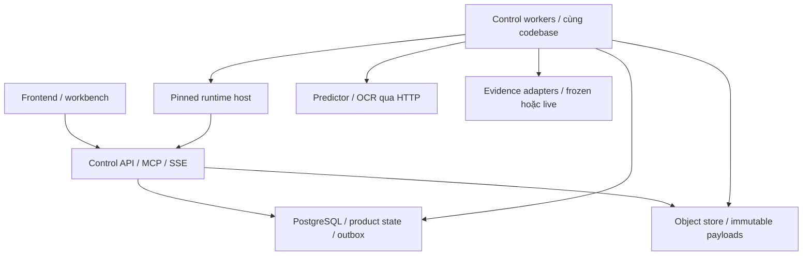
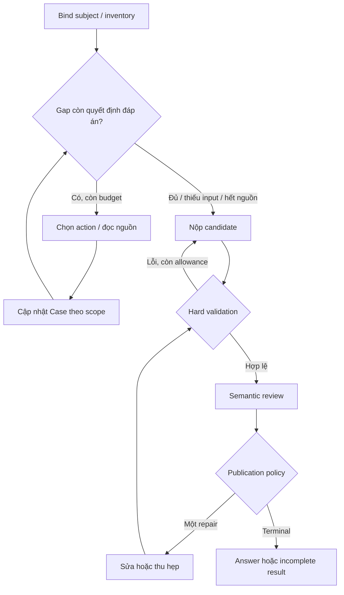

# ToxAgent — Master plan triển khai agent và benchmark
**Ngày:** 21/10/2026  
**Phạm vi:** hoàn tất agent research mode, backend/runtime, UI nghiên cứu và benchmark agent theo proposal 20/10/2026.  
**Nhánh đối chiếu:** `fix/activity-identity-guards`  
**Source SHA:** `025db8443bc18c7e1f8d7be8f3d3ca494b785bed`  
**Loại tài liệu:** thiết kế và backlog triển khai; chưa phải báo cáo thay đổi đã code.

## 0. Quyết định điều hành

Tập trung nguồn lực vào một kết quả: **một investigator dùng công cụ có kiểu, điều tra trên artifact bất biến, trả lời qua release policy rõ ràng, chạy được bốn user story và được so sánh công bằng với A/B/C/D trên frozen inputs**.

Giữ `AgentRuntimeGateway` làm đường chạy duy nhất. Giữ các ranh giới dịch vụ hiện có: frontend, control API/worker, runtime host, predictor và OCR. Investigator, reviewer, repair và Case là các vai trò/module bên trong cùng control plane; không tách mỗi vai trò thành một microservice.

Ba mốc hoàn tất:

| Mốc | Có thể tuyên bố | Điều kiện |
|---|---|---|
| **M1 — Technical benchmark ready** | Pipeline agent và evaluator chạy được ngay trên fixture có đáp án kỹ thuật | Bốn arm cùng inputs; stories, failures, trace, cost và packets chạy hết; synthetic data được ghi rõ |
| **M2 — Scientific pilot ready** | Có thể chạy pilot nghiên cứu theo proposal | Gold/source được SME xác minh; B được duyệt là baseline mạnh; đủ 24 case; protocol/version khóa cho pilot |
| **M3 — Locked study ready** | Có thể kiểm chứng giả thuyết D hơn B | Pilot đã phân tích; practical margin/error tolerance/sample-size plan chốt; dev/test và mọi cấu hình đã khóa |

M1 không chờ activity model admission. M2 không được lấy synthetic fixture làm bằng chứng sinh học. Activity serving production vẫn thuộc #48/#54, ngoài critical path của agent replay.

**Ưu tiên hiện tại:** #43, #44, #46, #47, #50, phần engineering của #51/#53, sau đó #52 và phần agent của #56. #45/#37 đã đóng; chỉ tái sử dụng và mở follow-up có phạm vi mới khi cần.

## 1. Căn cứ, độ tin cậy và phạm vi

### 1.1 Nguồn đã đối chiếu

- File đính kèm: `ToxAgent_Agent_Layer_and_Benchmark_Proposal_2026-10-20 (1).md`.
- SHA-256 file: `bd34614893577a826e61f30692160bcaffb83818e46f3cec51b427a4d43d48ab`.
- File trùng byte với `docs/internal/spec/TOXAGENT_AGENT_LAYER_AND_BENCHMARK_PROPOSAL_2026-10-20_VI.md` tại source SHA trên.
- Đã kiểm tra nhánh, issue body/state/comment, ADR 0001/0003/0010/0011/0012 và các đường gateway, replay, evidence, release, evaluator, worker và UI.
- CI của SHA trên: [Unified quality gates — success](https://github.com/NEU-Bio-Research-Team/tox-agent/actions/runs/39573271708).
- Comment issue có thể mô tả bước triển khai cũ hơn SHA hiện tại. Đánh giá implementation trong tài liệu này ưu tiên source hiện tại.
- Không chạy lại toàn bộ test suite hoặc live model trong lần lập kế hoạch. Không sửa source, push nhánh, tạo issue hoặc thay trạng thái issue.

Các tên kiểu, endpoint, module, command có chữ **đề xuất** là thiết kế đích, chưa phải capability hiện có. Không dùng trạng thái CI để suy ra scientific validity.

### 1.2 Những việc giữ ngoài phạm vi tập trung

| Hạng mục | Cách xử lý |
|---|---|
| Retrain/tournament ACT-D0..ACT-M | Workstream predictor #48; agent nhận frozen output có provenance/admission status |
| Audit/grouping SAIR, split, calibration | #39–#41; chỉ trở thành dependency của case dùng các measurement/claim đó |
| So ProTox/ADMETlab/ADMET-AI | #42; không dùng làm primary comparison kiến trúc agent |
| Benchmark G0–G3 và shadow toxicity toàn batch | #49; có thể tái dùng trace/cost, nhưng đo policy và không được gộp thành lợi ích agent |
| Activity explainer mới, residue/contact/3D | #55 giai đoạn sau; hiện chỉ dùng XAI tồn tại và được deployment hỗ trợ |
| Production activity route/worker/admission | #54 sau #48; không dùng nó để chặn replay research |
| Multi-agent debate, framework migration, RL/value-of-information policy | Chưa cần để kiểm chứng proposal hiện tại |
| Thiết kế lại toàn UI hoặc thêm benchmark dashboard lớn | Chỉ làm các màn hình cần để chọn subject, đọc kết quả và kiểm chứng |

## 2. Trạng thái thật và remaining work

| Issue | GitHub khi kiểm tra | Đã có ở source SHA | Phần còn phải hoàn thiện |
|---|---|---|---|
| #43 | Open | Access metadata, Europe PMC full text, passage/table-row locator, read tool và spans | Frozen full-text provider; capture/replay đúng content; report retrieval metrics; capability thực tế |
| #44 | Open | Frozen screening store, attach-by-ID, ba activity read tools, observation bridge | Typed subject từ message tới job/Case/dossier; mapping ledger đầy đủ; binding toxicity snapshot |
| #45 | **Closed** | EvidenceScope mở rộng, scope conflict guard, ChEMBL assay/readout filters | Không làm lại issue. Propagation sang Case thuộc #44/#46; retrieval đa subject là follow-up mới |
| #46 | Open | Typed stops, pilot budget preset, story 1 qua replay | Stories 2–4; adaptive loop/context theo subject; exact budget semantics; lifecycle/phase/cost/recovery |
| #47 | Open | Candidate/review/repair wiring; raw drafts; claim lineage; release record | Chốt strict publication policy; ngăn unresolved content trở thành trusted conclusion; UI/export đồng nhất |
| #50 | Open | Config A/B/C/D, fixed B, một phần fairness check | A activity; B activity retrieval; trusted shared inputs; effective limits; attempt isolation; dev tuning |
| #51 | Open | Case v2 vocabulary/schema/validator | Input bundle refs, multi-turn actions, dependency groups; thật hóa T1–T6; SME gold/source audit |
| #52 | Open | Yêu cầu pilot 24 case | Preflight, chạy study, chấm mù, error/cost analysis và sample-size planning |
| #53 | Open | Assigned-case Task Success, failure causes, CP interval, all-attempt report totals | Phase accounting, semantic metrics/controls, packet v2, paired Task Success/cluster CI và reporting |
| #37 | **Closed** | Positive controls và provenance audit cho benchmark cũ | Không mở lại; mở rộng controls cho evaluator mới bên #53 |
| #54 | Open; production phụ thuộc #48 | Replay đã cho phép agent tiến trước production | Tách research UI thành follow-up; không đóng toàn bộ #54 khi chỉ có replay |
| #55 | Open | Toxicity attribution hiện có | Capability/model/explanation identity; no-XAI ablation phù hợp; không thêm explainer để đạt M1 |
| #56 | Open; issue tổng hợp | Quy định freeze/artifacts/negative results | Hoàn thành agent-specific bundle; không đánh dấu cả roadmap xong khi các track khác chưa xong |

### 2.1 Các khoảng trống kỹ thuật xác nhận được

1. `subject_key(analysis_id)` trả `analysis:<id>` hoặc `none`. Case chưa có identity activity xuyên đường chạy.
2. `cited_sources()` chưa mapping đầy đủ `ACTIVITY_ESTIMATE`, `PRIORITISATION_DECISION`, `SCREENING_STATE`; relation → ledger vẫn rút scope về một số trục cũ; evidence citation có đường mất locator.
3. `ToxAgentAdapter.run()` vẫn bỏ snapshot truyền vào và gọi `analyse(smiles)`. Runner chưa đưa cùng screening replay vào mọi arm.
4. B chỉ gọi retrieval nếu inventory có analysis ID; query template hard-code hERG/QT.
5. Search input/relevance chuẩn còn lấy subject từ toxicity analysis. ChEMBL target hiện là literal hERG có chủ đích; filter assay không tự tạo capability đa target.
6. Frozen `snapshot`/`corpus` provider chưa implement `fetch_full_text`; text tool chỉ đăng ký khi provider có capability này.
7. Fairness mới so `budget.preset`. Probe tại đúng SHA: B 360 s/20 calls và D 900 s/50 calls cùng preset vẫn cho `fairness_problems=[]`.
8. Release còn phát hành unresolved/ungated candidate; Case ledger vẫn có thể nhận nội dung từ đường phát hành đó.
9. OpenAPI đã có `release`, nhưng AnswerRenderer/AnswerAuditViewer chưa trình bày release status.
10. `retrieval_recall()` đã có unit tests nhưng chưa thấy được nối vào report chính. Packet renderer chưa xuất đầy đủ gold v2.
11. `latest_records()` và raw directory theo case/arm/trial cần được kiểm soát khi rerun: append records chưa đủ nếu raw trace của attempt cũ bị ghi đè.
12. Preset hiện là 20 action/read ceiling với submission exemptions; proposal viết 20 tool calls tổng. Cần version hóa semantics, không gọi hai thứ này là một.

## 3. Ma trận bám sát proposal

| Proposal | Deliverable agent | Issue chủ trì | Gate nghiệm thu |
|---|---|---|---|
| §2.2–2.3 một investigator, server sở hữu workflow | Bounded adaptive loop trên gateway hiện có | #46 | Không có control plane thứ hai; action/reason/stop truy được |
| §2.4 evidence có text và locator | Live capture + frozen record/passage backend | #43 | Search/read/quote được khi không có mạng |
| §2.4 scope và multi-target | Subject-aware search + EvidenceScope xuyên ledger | #44; follow-up AG-EVIDENCE | Không dùng lẫn target/assay; unknown không coi là match |
| §2.5 output ownership | Immutable observations, policy và agent assessment tách nhau | #44/#47 | Agent không đổi score/interval/threshold/quyền |
| §2.6 bridge và subject | Subject binding từ request tới Case/dossier | #44 | Hai target là hai subject |
| §2.7 budget và cost | Effective limits, phase usage, bounded review/repair | #46/#53 | Tổng ngân sách được enforce và báo đúng |
| §4.1 A/B/C/D | Shared replay + B mạnh + C chung + D Case/skills | #50 | Same-input/fairness preflight |
| §4.2 T1–T6 | Case/input schema, paired controls, fault fixtures | #51/#46 | Đủ nhóm, đối chứng và answerability |
| §4.3 pilot 24, hai context | Blinded pilot và dependency-aware split | #52 | 12 toxicity + 12 activity; T6 báo riêng |
| §4.4 frozen/live | Main frozen study; live subset riêng | #43/#50/#51 | Không trộn điều kiện |
| §4.5–4.7 metrics/SME | Atomic claim/gold, primary D–B và cluster CI | #53 | Assigned denominator, n/N, gold độc lập |
| §4.8 ablations | No accumulated Case; no semantic review; no XAI | #50/#53/#55 | Mỗi ablation thay đúng yếu tố đã khai |
| §5.2 0%/100% | Evaluator controls và uncertainty reporting | #53; tái dùng #37 | Structural pass không gọi là factuality |
| §6.2 giữ hay giản lược agent | Preregistered decision rule sau pilot | #52/#56 | Không chọn ngưỡng theo test result |

## 4. Kiến trúc backend và ranh giới dịch vụ

### 4.1 Topology đích



| Boundary | Sở hữu | Không giao trách nhiệm này sang nơi khác |
|---|---|---|
| Frontend | Selected subject, composer, progress, answer/evidence/audit views | Không tính policy, sửa score hoặc suy release status từ văn bản |
| Control API | Auth, request validation, subject binding, enqueue, REST, MCP, SSE | Không giữ run dài trong HTTP request khi dùng worker mode |
| Control worker | Gateway orchestration, tool runner, provider I/O, validation/review coordination | Không thành một backend khác có schema/semantics riêng |
| Runtime host | Model/tool loop và provider request | Không là database sản phẩm; không được tự đổi quyền tool |
| Predictor/OCR | Computation theo contract và artifact provenance | Không import agent code, Case hay reviewer |
| Research adapters | Search/full text/structured assay input | Không quyết định clinical truth hay biến query text thành subject |
| PostgreSQL/outbox | Durable run/Case/answer state, revision, idempotency, events | Không dùng process memory làm authority |
| Object store | Raw JATS, payload lớn, frozen blobs có hash | Không đặt raw blob vào từng SSE event hoặc model prompt |

Tận dụng external-worker overlay hiện có. M1 có thể kiểm bằng một interactive worker; trước pilot phải kiểm topology đã chọn thật sự bằng effective-product và smoke test. Không bắt thêm Redis/Kafka/Celery hoặc một vector DB mới để đạt M1.

### 4.2 Vì sao cách này tối ưu cho mục tiêu hiện tại

- API và worker tách process để report/provider latency không chiếm web request; dùng **cùng composition root**, tránh hai object graph khác nhau.
- Queue interactive/report/deterministic hiện có đủ để cô lập tải. Benchmark dùng stack/provider quota riêng và concurrency nhỏ trước; chưa cần một queue type mới.
- Reviewer là một dispatch phase, không phải service mới; mọi phase vẫn gắn cùng parent run và budget.
- Evidence là module có port/provider interface; frozen/live thay adapter, không fork toàn bộ workflow.
- Predictor giữ HTTP boundary và model dependencies riêng. Control plane không import Torch/RDKit/training modules.
- Chỉ tách thành service mới khi có số đo về independent scaling/ownership/SLO cho thấy lợi ích; đó là ADR sau pilot, không phải dependency của benchmark.

### 4.3 Ownership state

| State | Lifetime | Authority | Ví dụ |
|---|---|---|---|
| Screening execution | Nhiều stage | State machine/server | toxicity not_run, failed, completed; continuation |
| Run decision state | Một run | Server transitions | propositions, calls, provider outcomes, stop |
| ScientificCase | Nhiều lượt cùng subject | Append-only Case events + revision | evidence ledger, unresolved gaps, conditional conclusion |
| Answer candidate | Một submission | Server validation | raw/hard-valid/repaired |
| Release decision | Một terminal decision/run | Server policy | accepted model answer hoặc incomplete result |
| UI live progress | Một kết nối | Projection của durable events | “Đang đọc nguồn”, “Đang kiểm chứng” |

Không gộp trạng thái “run hoàn tất” với “bằng chứng đủ”, “review pass” hoặc “tác vụ đúng theo gold”.

## 5. Hợp đồng subject, artifact và multi-turn

### 5.1 CaseSubject và RunSubjectBinding — đề xuất

Dùng discriminated union dựa trên các domain type sẵn có:

```json
{
  "schema_version": "run-subject-binding-v1",
  "kind": "activity_screening",
  "subject_ref": { "screening_id": "scr_..." },
  "identity": {
    "canonical_smiles": "...",
    "target": {
      "target_id": "...",
      "uniprot_id": null,
      "sequence_sha256": null,
      "variant": null
    },
    "assay_context": "..."
  },
  "artifact_refs": [
    { "kind": "screening", "source_id": "scr_...", "content_sha256": "..." }
  ],
  "binding_sha256": "..."
}
```

Ví dụ chỉ mô tả contract; không yêu cầu mọi target phải có đủ optional identity field. Reuse `ActivitySubject`/`TargetIdentity`; server điền các trường đã biết, không để LLM tự khai identity.

Trong ví dụ, `variant` là optional field đề xuất bổ sung có version vào `TargetIdentity`; type hiện tại mới có `target_id`, `uniprot_id`, `sequence_sha256`. Phải thêm compatibility/serialization tests trước khi bật case có variant; không để mỗi adapter tự gắn một variant field khác nhau.

Các quy tắc:
- Resolve subject **khi nhận/enqueue message**, rồi đóng băng trong run envelope. User đổi subject trên UI trong khi run chờ không làm run đọc subject mới.
- Analysis legacy tiếp tục có `analysis:<id>`. Activity subject có namespace riêng, reference screening và identity được kiểm.
- Key phải vừa cột `scientific_cases.subject_key` hiện dài 80; dùng ID hoặc digest cố định có namespace. Không nhét nguyên SMILES/sequence vào key.
- Hash/version của evidence và prediction nằm trong artifact binding. Không dùng mọi context revision làm subject identity để mỗi lượt tạo một Case mới.
- Hai target/context/variant khác nhau không dùng chung subject; identity enrichment phải theo compatibility contract hiện có, không so chuỗi thô rồi gây split giả.
- Giữ actor/session authorization tại resolver và từng read tool.
- Khi request legacy không chỉ subject: chỉ tự resolve nếu có đúng một subject hợp lệ; nếu mơ hồ thì trả clarification, không chọn `cases[0]` hoặc attachment đầu tiên.
- Case cũ có key `none` không tự động được nhận thành Case của một activity screening.

### 5.2 Artifact linking khi replay

Một frozen screening có thể trỏ tới toxicity analysis ID từ lần freeze. ID đó không tự tồn tại trong session mới.

Thiết kế:
1. Trusted fixture store chứa screening + toxicity snapshot liên kết + policy/model provenance.
2. Attach bằng reference; server kiểm hash và tạo các session-local record/observation cần thiết.
3. Giữ `origin_ref`/`origin_hash` bất biến và một alias/link mapping tới local ID.
4. Không sửa payload đã hash chỉ để thay ID; observed source content phải so được giữa các arm.
5. Observation ID được mint theo run/session vẫn khác nhau; so fairness bằng source/content digest, không bằng minted ID.
6. Đọc toxicity khi not_run trả trạng thái thiếu hợp lệ; không tự gọi predictor để lấp ô gold cố ý để trống.

### 5.3 ScientificCase và ledger

- `ACTIVITY_ESTIMATE`: model-output fact.
- `PRIORITISATION_DECISION`: policy fact.
- `SCREENING_STATE`: workflow fact.
- Cả ba không trở thành independent experimental evidence.
- Reuse `EvidenceScope` qua answer relations → ledger → dossier; không stringify mất cấu trúc target/assay.
- Evidence entry giữ source ref, locator/span ref, relation/stance, directness, scope, provenance và run/revision.
- Một inferential conclusion không tự trở thành evidence xác nhận cho chính nó.
- Context do user thêm có actor/source/units/scope và revision; không mặc định là assay đã được SME xác minh.
- Case provenance lỗi không được âm thầm biến D thành C trong benchmark. Với arm yêu cầu Case, lỗi tạo/đọc Case phải thành failure có kiểu và giữ trong mẫu số.

### 5.4 Multi-turn update

Một case đánh giá gồm toàn bộ chuỗi lượt. Đề xuất turn actions: `add_context`, `attach_evidence_ref`, `switch_subject`; action chạy qua API/application contract giống thao tác người dùng.

B/C/D nhận **cùng factual information** ở mỗi lượt. D có thêm tổ chức và truy cập Case; không được nhận context chỉ có ở payload ẩn mà B/C không thấy. Grader gold không đi vào turn action/model prompt.

Đổi target tạo Case riêng và chỉ tái dùng artifact có scope phù hợp. Thêm exposure/assay đổi scientific assessment; không tự đổi raw prediction, prediction interval, priority status hoặc continuation authorisation.

## 6. Thiết kế agentic đủ để benchmark

### 6.1 Phân chia quyền quyết định

| Quyết định | Model/agent | Server |
|---|---|---|
| Câu hỏi cần làm rõ là gì | Đề xuất một vài propositions | Kiểm shape, IDs và subject |
| Nguồn nào nên tìm/đọc tiếp | Investigator chọn theo gap | Kiểm quyền, scope, capability và budget |
| Nguồn có ý nghĩa gì | Đề xuất relation/assessment có basis | Hard guards về ref/scope; reviewer kiểm support |
| Activity/toxicity chạy stage nào | Không tự cấp quyền | State machine/policy/authenticated actor |
| Sửa score/interval/threshold | Không | Chỉ qua nghiệp vụ hợp lệ, có version |
| Claim nào được công bố | Nộp candidate/repair | Validator + release coordinator |
| Dừng do đủ dữ kiện/cần input | Đề xuất và nêu basis | Ghi typed outcome cùng execution reason; không dùng tự khai làm gold |

### 6.2 Vòng điều tra của D

Giữ một investigator trên gateway hiện có:
1. Bind subject và đọc inventory.
2. Với lookup: ưu tiên artifact; với điều tra: tạo 1–3 proposition khi cần, không luôn dùng tối đa 8.
3. Xác định gap có ảnh hưởng tới câu trả lời.
4. Chọn một action hợp lý, log một câu lý do công khai.
5. Đọc record/passage và kiểm ligand/target/readout/units/context.
6. Cập nhật ledger/gap/uncertainty qua typed operations.
7. Nếu định kết luận mạnh, tìm phản chứng có mục tiêu; không search hình thức cho mọi câu hỏi.
8. Nộp answer candidate với refs, spans, limitations và stop declaration.
9. Qua validator/reviewer; repair tối đa một lần; server quyết định terminal response.



Server phải đếm repair round để cạnh quay lại không tạo vòng lặp vô hạn.

### 6.3 Hai loại kết quả dừng

Đề xuất chuẩn hóa hai trục, vẫn adapter được về typed stops hiện có:

| Execution outcome | Knowledge outcome |
|---|---|
| completed / provider_failed / budget_exhausted / cancelled / runtime_failed | answered_from_artifacts / supported_assessment / unresolved_conflict / needs_user_input / evidence_insufficient |

Ví dụ: provider timeout không được ghi thành “đã tìm đủ nhưng không có bằng chứng”. `supported_assessment` chỉ mô tả assessment có refs/support theo hệ thống, không phải scientific ground truth.

### 6.4 Tools, skills và prompt

- Giữ small typed surface và field paths hiện có.
- Read tools về screening dùng screening ID; search theo subject reference được server resolve.
- Calculator dùng value + unit + source refs; không tính margin bằng nhẩm hoặc dùng đơn vị ngầm.
- Skill bodies giữ version/hash. Nội dung ưu tiên: đọc activity/uncertainty; kiểm cùng assay; reconcile conflict; missing exposure; cập nhật theo subject.
- Reuse catalog hiện có trước khi thêm skill. Một skill không grant tool hoặc authorisation.
- Ghi index được offer và skill thật sự được đọc. Không coi “bật flag” là “skill đã được dùng”.
- Prefix chứa policy chung; subject/artifact pins gọn; Case checkpoint theo subject; retrieved text qua trust envelope.
- Không persist chain-of-thought. Trace chứa action/reason ngắn, input/output refs, result và versions.
- Nội dung source là dữ liệu. Không có shell/arbitrary URL access mới cho scientific agent.

### 6.5 Lookup path và UI nhanh

UI nên hiển thị artifact card trực tiếp cho số/status sẵn có. Người dùng không phải chờ LLM chỉ để thấy pIC50 hoặc toxicity not_run.

Conversational benchmark B/C/D ban đầu vẫn dùng chung contract, route và release policy. Nếu thêm deterministic lookup shortcut vào đường hội thoại, phải bật giống nhau cho mọi arm, version/hash nó và coi T1 là control task. Không chỉ tối ưu riêng D sau khi xem test.

### 6.6 B, C và D khác nhau ở đâu?

| Arm | Chọn hành động | State chuyên biệt | Dữ liệu/công cụ khoa học | Review |
|---|---|---|---|---|
| A | Template xác định | Không | Cùng input artifact, không retrieval | Hard checks cho template; không LLM semantic review |
| B | Server chạy rule/workflow cố định | Không persistent Case chuyên biệt | Cùng quyền nguồn và acceptance policy | Giống C/D |
| C | Generic ReAct | Không persistent scientific Case/skills chuyên biệt | Cùng khoa học/tool capabilities | Giống B/D |
| D | Gap-driven investigator | Persistent Case + pinned skills | Cùng khoa học/tool capabilities | Giống B/C |

B có các nhánh đủ mạnh: lookup, activity REVIEW, toxicity conflict, missing exposure, access/provider failure. Activity query lấy target/context từ binding; không hard-code hERG.

**Primary comparison:** D–B. C–D đo thiết kế chuyên biệt tổng thể vì khác cả Case và skills; không tự suy ra riêng hiệu quả Case từ cặp này.

## 7. Release, review và chất lượng thông tin

### 7.1 Policy đích

Đề xuất `release_policy=strict-reviewed-v1` chung B/C/D:
- Candidate có blocking claim sau repair được lưu, không xuất thành accepted scientific answer.
- Response cuối vẫn có thể chứa template facts đã resolve và danh sách khoảng trống; không im lặng và không xóa audit.
- Reviewer failed/incomplete/cannot_judge không được gắn semantic-pass.
- Candidate research chưa được chấp nhận chỉ ở audit view có trạng thái rõ.
- Report/export/Case conclusion phải dùng đúng publication decision, không đọc “latest candidate” như final.
- No-review ablation dùng mode hard-only riêng được khai trước; không giả lập bằng cách làm reviewer timeout.

Phân biệt `publication_disposition` (publish/withhold/partial facts), `review_status` và `task_success`. Chưa có lý do để coi ba trường đó là một.

### 7.2 Các phiên bản answer

Lưu mọi raw submission và hard-validation result; đánh dấu candidate đầu hợp lệ, semantic repair, final response. Giữ lineage `local_ref`, source inputs và dependency của next steps.

Repair:
- Tối đa một semantic repair.
- Hard-correction allowance riêng, đếm rõ.
- Sửa, thu hẹp hoặc bỏ claim; không chỉ thêm lời hedge quanh giá trị sai.
- Claim bị bỏ kéo theo recommendation/conclusion phụ thuộc nó.
- Đo required-information retention. Không thưởng việc xóa hết nội dung.
- Sau repair phải hard-validate và review lại.

### 7.3 Case write isolation

Không chỉ chặn việc tự thêm citation của answer. Model có thể đã dùng `update_scientific_case` trước khi submit để đặt conclusion.

Thiết kế:
- Evidence/action/gap có thể append như dữ liệu điều tra với trạng thái đề xuất.
- Conclusion/hypothesis assessment tạo bởi run chưa release không tự thành checkpoint trusted cho run sau.
- Dossier giữ proposed và released assessment khác nhau.
- Khi gate chặn, ghi run outcome và giữ evidence, nhưng không promote conclusion.
- Transaction cuối gắn release result, promoted Case assessment, assistant message và outbox events theo idempotency. Nếu dùng nhiều transaction, phải có state/reconciliation rõ thay vì best-effort “log rồi bỏ qua”.

### 7.4 Lỗi reviewer

Giữ no-verdict/cannot_judge/timeout/provider failure riêng. Không ép reviewer luôn đoán để có verdict. Ghi coverage, reasons và phase cost. Reviewer false positive/negative được đo bằng independent gold ở #53; reviewer không là gold của chính benchmark.

## 8. Ngân sách, usage và tối ưu latency

### 8.1 Sửa khác biệt semantics với proposal

Hiện tại 20 là ceiling action/read, còn các submit được miễn. Proposal yêu cầu 20 tool calls tổng. Đề xuất **preset mới `investigator-pilot-v2`**, không sửa âm thầm nghĩa của v1:

| Giới hạn | Thiết kế đích |
|---|---|
| Deadline tổng | 360 s, một deadline gốc; review/retry/recovery không được cấp thêm 360 s |
| Tổng logical tool invocations | 20; gồm Case/skills/read/search/candidate/reviewer submissions |
| Search | Tối đa 3, đồng thời chịu total cap |
| Record reads | Tối đa 8, đồng thời chịu total cap |
| Full-text page reads | Tối đa 4, đồng thời chịu total cap; đây là giới hạn bổ sung hiện có |
| Semantic repair | 1 |
| Hard submissions | Tối đa 2 mỗi synthesis/repair phase, không retry vô hạn |
| Token/output/cost | Có typed effective limits và trạng thái enforce thực tế; chốt số trên dev trước pilot live |

Reserve tối đa 6 call slots cho initial/hard correction + review + semantic repair/hard correction + review lại; acquisition/Case/skills không được tiêu hết chúng. Các cap 3/8/4 là maxima riêng, không hứa tất cả cùng đạt trong total 20. B đi qua cùng ToolRunner nên deterministic orchestration không được miễn phí call accounting.

Request sai schema/denied và logical retry cũng cần có usage record/count để tránh vô hạn “free” invalid calls. Retry transport cùng call ID không nhân đôi một logical invocation; HTTP retry bên trong provider được đo riêng.

Nếu pilot cho thấy 20 quá thấp, thay preset có version và chạy lại dev cho B/C/D; không nới riêng D hoặc đổi trần sau khi xem test.

### 8.2 Phase attribution

Server ghi phase trên runtime binding và tool execution context:
`investigator`, `workflow_synthesis`, `hard_correction`, `review_initial`, `semantic_repair`, `review_final`.

Mỗi record có parent run, attempt/binding ID và timestamps. Repair dùng cùng profile với investigator vẫn được phân loại đúng bằng phase; không suy từ tool name.

Dedupe/aggregate dựa trên binding + provider message/step + semantics/revision:
- cumulative: latest trong đúng scope;
- delta: cộng đúng một lần;
- unknown: giữ unknown/partial;
- missing cost không coi là zero;
- currencies khác nhau không tự cộng thành USD.

### 8.3 Hai bảng cost và latency

`agent_on_replay` gồm mọi phase agent/review/retry và tool/provider cost đo được.  
`whole_workflow` cộng inference activity/toxicity thực sự chạy và manual review; thiếu đo thì ghi not_measured.

Báo queue wait, execution latency, end-to-end latency, phase durations, median/p95, token/calls, all-attempt cost, cost/success và measurement completeness. Không chỉ lấy latest successful attempts.

Đề xuất tối ưu sau correctness:
- Reuse immutable artifact; không chạy predictor cho mỗi câu hỏi.
- Cache full text theo content/provider identity; không dùng cache assessment khác subject.
- Pin Case checkpoint gọn, không nhét lại toàn lịch sử.
- Connection pooling; bounded reads; không giữ DB transaction khi gọi HTTP/model.
- Chỉ search khi cần; không chạy XAI cho câu hỏi không dùng XAI.
- Reserve thời gian review/repair trước khi khởi động investigator. Pha nào vượt quota phải dừng có kiểu.
- Token/cost cap chỉ gọi là hard cap khi provider/runtime thật sự enforce; nếu chỉ quan sát sau response thì manifest phải nói observed_only.

## 9. API, persistence và worker contracts

### 9.1 API đích — mở rộng có kiểm soát

Các route ghi **mới/đề xuất** cần triển khai và sinh OpenAPI/types trước khi frontend dùng.

| Surface | Hiện có / đề xuất | Nội dung |
|---|---|---|
| POST /v1/sessions/{sid}/screenings | Hiện có | Attach frozen screening bằng ID; giữ auth/hash/session isolation |
| GET /v1/sessions/{sid}/screenings | Hiện có | Inventory và replay mode |
| POST /v1/sessions/{sid}/messages | Mở rộng | Optional typed subject_ref; client_message_id/idempotency; explicit selection |
| GET /v1/sessions/{sid}/screenings/{id} | Mới | Screening read model: subject, stage status, artifact refs, replay/admission provenance |
| GET /v1/sessions/{sid}/runs/{rid}/result | Mới | Terminal disposition, public answer ref nếu có, review/stop/execution outcome; không trả candidate markdown |
| GET .../answers/{aid} | Hiện có, siết projection | Chỉ public answer theo release/result policy; không fallback sang latest candidate |
| GET .../runs/{rid}/answer-drafts | Hiện có | Audit có quyền/session check; thêm phase/submission lineage |
| GET/POST .../cases/... | Hiện có, mở rộng | Subject-bound read/context update với expected revision |
| GET .../evidence/{id} + passage view | Tận dụng/mở rộng | Record, access status, table header/row/footnote và locator; không nhận arbitrary URL |
| GET /v1/system/effective-product | Hiện có, mở rộng | Full effective budget, subject/release versions, sources/tools/runtime pins |
| Session SSE | Hiện có, mở rộng | Phase/subject/result events qua transactional outbox |

MCP tools là adapter vào application services. HTTP route và tool không được có hai implementations khác nhau cho subject matching, scope hoặc publication.

### 9.2 Persistence thay đổi tối thiểu

- Reuse scientific_cases.state JSON cho subject struct; giữ indexed subject_key cố định độ dài. Append binding event và reader version.
- Reuse evidence relation/scope/passage tables; không tạo một bảng measurement ontology song song.
- Thêm phase/submission sequence metadata vào draft lineage khi cần. Submission sequence toàn run tăng đơn điệu, không reset generation để làm mất draft khi vào semantic repair.
- Reuse runtime_manifest JSON để gắn phase/parent/run-attempt metadata nếu đủ; thêm typed mapping/API tests. Chỉ thêm indexed column nếu query cần.
- **Đề xuất một run_results table nhỏ**: primary key run_id; disposition; nullable public_answer_id; release_policy_version/hash; terminal execution/knowledge outcome; detail JSON; timestamps. Nó biểu diễn cả withheld result mà schema answer_releases hiện tại (bắt buộc answer_id/released_at) không thể diễn đạt sạch.
- run_results là authority mới khi strict flag bật. answer_releases là projection tương thích của public answers, ghi trong cùng transaction bởi một coordinator; không có hai writer quyết định publication.
- Case assessment được promote cùng terminal result; proposed entries giữ provenance và approval state.
- Migrations bổ sung, không drop legacy tables hoặc đổi nghĩa dữ liệu cũ ngầm.

Không đánh số migration trước khi rebase; chọn revision sau head thực tế và kiểm Alembic không fork.

### 9.3 Transaction cuối và idempotency

Một coordinator chịu trách nhiệm:
1. Kiểm candidate/review/repair hợp lệ cho đúng run/binding.
2. Tính publication decision bằng hàm thuần.
3. Ghi terminal run result và public answer/release projection nếu có.
4. Promote đúng Case assessment và dựng dossier theo revision.
5. Ghi assistant message và outbox events.
6. Kết thúc run bằng transitions hiện có.

Không giữ transaction mở trong model/provider calls. Terminal commit retry bằng idempotency key/unique run_id; conflict được reread, không tạo hai assistant messages. Với lỗi dossier không thể phục hồi trong arm D, kết quả phải ghi degraded/error có kiểu; không âm thầm mất Case rồi gọi experiment hợp lệ.

### 9.4 Worker/recovery và phiên bản envelope

Subject binding là dữ liệu quan trọng về semantics, nên **không** chỉ thêm field vào envelope rồi để old worker ignore.

- Nâng run-envelope version khi subject-bound execution là bắt buộc.
- Worker chỉ claim phiên bản/capability mình hiểu; nếu topology chưa có version-aware claiming, dùng deployment barrier/drain trước khi bật writer mới.
- Rollout readers/migrations trước, writers/flags sau.
- Queue payload chứa ref/hash/model-profile IDs, không có credential hoặc raw full text.
- Một worker sở hữu lease; atomic budget reservation và unique terminal commit chống double work/publication.
- Recover run chưa dispatch an toàn bằng envelope; runtime đã mất thì theo ADR 0003 dùng recovery run có lineage.
- Recovery không reset study budget/deadline/attempt accounting. Ghi original run + recovery run như một case execution chain.
- Cancel chấm dứt dispatch còn lại và không auto-release candidate đang review.
- Test API restart, worker crash, lease handoff, duplicate callback, duplicate SSE và hai user/subject cùng session.

### 9.5 Error contract

Dùng error envelope có code, retryable, phase, subject ref và recovery hint; không biến lỗi thành answer “không có bằng chứng”.

Đề xuất các code bổ sung khi cần: subject_ambiguous, subject_mismatch, artifact_hash_mismatch, source_access_failed, capability_not_available, review_incomplete, release_withheld, phase_budget_exhausted, study_manifest_mismatch.

Không đổi tên code cũ chỉ cho đẹp; thêm mapping tương thích và document semantics.

## 10. UI nghiên cứu: ít bước và có thể kiểm chứng

### 10.1 Luồng sử dụng

1. Mở session → chọn toxicity analysis hoặc activity screening.
2. Header hiển thị molecule, target/context và replay/admission status.
3. Dữ kiện có sẵn hiện ngay trong artifact card.
4. Gửi câu hỏi với subject đã chọn.
5. Nhìn progress có nghĩa: đang đọc dữ kiện / tìm nguồn / đọc bài / đối chiếu / kiểm chứng / sửa một lượt.
6. Đọc final answer hoặc incomplete result.
7. Mở claim → passage/observation/scope; thêm dữ liệu để tiếp tục đúng Case.

Không cần user hiểu arm, feature flag, local_ref hoặc hash để hỏi một câu. Các chi tiết này nằm trong audit.

### 10.2 Thành phần UI cần làm

| Thành phần | Tái dùng / mới | Hành vi |
|---|---|---|
| Subject selector/header | Mới, đặt gần composer | Phân biệt ligand–target–context; giữ explicit selection; không đổi subject của run đang chạy |
| Screening artifact card | Mới, theo artifact framework hiện có | pIC50/interval/applicability, policy và toxicity stage thành ba vùng riêng |
| Run progress | Extend ActivityPresence/reducer | UI labels ngắn, source từ server phase; không render chain-of-thought |
| Answer release banner | Extend AnswerRenderer | Reviewed, repaired-and-reviewed, incomplete/withheld, fallback hoặc legacy unknown |
| Evidence passage viewer | Extend EvidenceArtifact | Table header + row + unit/comparator + locator; access status/failure reason |
| Case board | Extend InvestigationBoard | Selected subject, open gaps, scope, assessment revisions, “đã đổi gì/giữ gì” |
| Answer audit | Extend AnswerAuditViewer | Raw/candidate/final, verdict rounds, repair delta và missing-info effects |
| Context update form | Extend Case context | Value/unit/source/scope có kiểu khi tác vụ cần; revision conflict có hướng xử lý |
| Continuation action | Chỉ capability thật | Research replay chỉ đọc; scientific recommendation không biến thành nút đã cấp quyền chạy stage |

### 10.3 Quy tắc trình bày

- Prediction ≠ empirical measurement; policy decision ≠ conclusion của investigator.
- not_run và failed có nhãn chữ, không chỉ màu; không dùng biểu tượng “âm tính”.
- “Đã kiểm tra hỗ trợ của nguồn” không đổi thành “đúng về khoa học”.
- Khi withheld: cho người dùng biết dữ kiện xác nhận được, phần chưa kết luận, đầu vào/bước tiếp cần thiết; không chỉ hiển thị một lỗi đỏ.
- Candidate draft chỉ hiện trong audit theo quyền; copy/report/export giữ disposition.
- Legacy answer thiếu release → “chưa có thông tin kiểm chứng”, không mặc định pass.
- Thay target báo Case khác, không xóa lịch sử Case trước.
- No source result và provider/access failure có nội dung khác nhau.
- Markdown/table sanitized theo allowlist hiện có.

### 10.4 SSE và query state

REST/React Query giữ durable entities; reducer chỉ giữ live projection. Bổ sung event phase/result bằng outbox; dedupe theo sequence/event ID hiện có.

Invalidate đúng query keys cho selected subject, run result, answer, case revision, evidence passages. Không refetch toàn session trên từng token hoặc tool delta. Khi reconnect/reload, REST snapshot + event tail dựng lại cùng trạng thái; không làm xuất hiện candidate như final.

### 10.5 UI acceptance

- US1–US4 qua browser từ chọn subject tới audit.
- Hai screening cùng ligand khác target, chuyển selection trong khi run đang chờ.
- Reviewer repair rồi pass; withheld; timeout; provider lỗi; not_run; failed; legacy answer.
- Keyboard/focus/labels, mobile layout cơ bản và deep links.
- Reload/reconnect không mất release state hoặc gắn response vào subject hiện đang chọn sai.
- Không làm benchmark UI thay cho backend runner; hai đường dùng cùng API/services.

## 11. Kế hoạch theo issue

Owner dưới đây là vai trò đề xuất, không phải assignee đã được đặt trên GitHub. Kích thước S/M/L chỉ là tương đối, không phải cam kết số ngày.

### 11.1 #43 — Hoàn thiện evidence pipeline cho frozen benchmark

**Owner:** backend evidence; **mức:** M; **phụ thuộc:** contract full text hiện có.

Remaining:
- Implement full-text capability cho snapshot/corpus backend; phân biệt capture provenance với provider đang replay.
- Schema sidecar/full-text payload có hash, parser version, access outcome, passage/table cells/headers/footnotes.
- Capture một lần từ nguồn thật, replay không có network fallback.
- Bounded cache/single-flight hợp lý; session authorization và failed/transient outcome giữ đúng semantics.
- Nối record/span read state vào trace/report dưới #53.

File hiện có cần chạm: research/providers/snapshot.py, corpus.py; application/investigation/evidence_text.py; tools/definitions/evidence.py; evals fixtures/builders.

AC:
- [ ] Full-text tool thật sự visible trong frozen deployment.
- [ ] Tắt mạng vẫn trích đúng table row và validate số.
- [ ] Abstract-only/access_failed/truncated được giữ đến answer và trace.
- [ ] Thay byte/hash hoặc locator không tồn tại bị bắt.
- [ ] Không có query→gold shortcut riêng cho D.

Test: provider contract; table/header/comparator fixtures; integration persisted passages; injection source; one live capture smoke riêng.

Đóng issue khi đường evidence live và frozen đã dùng được; retrieval reporting được liên kết rõ với deliverable #53.

### 11.2 #44 — Subject-bound activity bridge xuyên hệ thống

**Owner:** backend domain/application; **mức:** M; **phụ thuộc:** giữ regression #33–#35.

Remaining:
- CaseSubject/RunSubjectBinding; message field → submit_message → router → RunContext/envelope → gateway/context.
- Server resolver thống nhất cho tools, Case, decision state và dossier.
- Screening-only không còn key none; explicit selection/ambiguity.
- Mapping activity/policy/workflow facts vào ledger và artifact linking toxicity.
- Preserve full EvidenceScope/span locator trong ledger read/write.
- Read model screening cho UI; generated API types.

AC:
- [ ] Khác target/context tách Case; enrichment hợp lệ không gây scope conflict giả.
- [ ] Queued run giữ subject đã bind.
- [ ] Session A không đọc subject của session B.
- [ ] pIC50 không bị đưa vào probability endpoint/range.
- [ ] Toxicity local/source refs resolve đúng trên replay.
- [ ] Case event replay dựng lại đủ subject/scope/locator.

Test: pure identity/compatibility; SQLite/PostgreSQL repository constraints; envelope round-trip/version; cross-session/target e2e.

### 11.3 #45 — Giữ đóng; propagation và multi-target là follow-up

#45 đã hoàn tất phần domain scope/filter của nó. Không yêu cầu làm lại hoặc mở lại toàn issue.

- Reuse EvidenceScope và scope_conflicts.
- Propagation answer→Case/report thuộc #44/#46.
- Subject-aware retrieval và mở target catalog có kiểu thuộc **AG-EVIDENCE** dưới đây.
- Giữ assay/variant/undeclared-scope controls như regression.
- Không coi “có một trục chung” là chứng minh biological equivalence; comparator/required axes cho từng gold scenario cần được xác minh.

### 11.4 AG-EVIDENCE — Subject-aware evidence retrieval (issue mới đề xuất)

**Parent:** #46; **liên quan:** #43/#44, tham chiếu #45 đã đóng. **Owner:** backend evidence; **mức:** M.

Mục tiêu: B/C/D tìm nguồn từ activity screening mà không cần toxicity analysis giả.

Tasks:
- Input union có đúng một bound subject: analysis hoặc screening. Subjectless research giữ là chế độ khác.
- Identity/relevance dùng server-held ligand/target/variant/context; query text không đổi subject.
- Target catalog/mapping versioned cho các target được benchmark; unsupported target trả capability state rõ.
- Reuse ChEMBL filters, normalization và acceptance; không truyền chuỗi target tùy ý vào tool hERG.
- B query planner có nhánh activity/toxicity; target và assay templates lấy từ binding; không hard-code.
- Frozen semantics trước; live endpoint mapping bật khi được xác minh.

AC:
- [ ] Screening-only REVIEW kích hoạt đúng query và đọc đúng scope.
- [ ] Wrong ligand/target/assay không được nhận thành direct contradiction.
- [ ] Unknown metadata không thành match mặc định.
- [ ] External-search restrictions áp dụng cho mọi arm/provider qua cùng application guard.
- [ ] B/C/D có cùng cơ hội truy cập corpus.

Không tạo số issue giả. Chỉ tạo issue này khi bắt đầu triển khai backlog, hoặc tách thành subtask rõ trong #46.

### 11.5 #46 — Investigator, lifecycle, stories và budget

**Owner:** backend harness; **mức:** L, chia PR; **phụ thuộc:** #43/#44/AG-EVIDENCE.

Tasks:
- Adaptive path đúng §6; reuse gateway, decision state, Case/skills.
- Prefix/context/checkpoint theo subject; action reason ngắn; typed stop hai trục.
- Preset v2 với total-call accounting, phase reservation/token limits.
- Phase/binding instrumentation và all-attempt harvesting, phối hợp #53.
- Stories 2–4; mở rộng fixture completed/failed/not_run và update events.
- Enforce lỗi required Case không bị nuốt trong arm D.
- Worker cancellation/recovery giữ subject, deadline và run lineage.
- Tuning prompts/skills chỉ trên dev; ghi hash.

AC:
- [ ] Bốn stories qua scripted e2e và live LLM trên frozen evidence.
- [ ] Không mutation trái quyền của score/interval/policy.
- [ ] Loop/query cap, budget exhaustion và provider error có typed outcomes.
- [ ] Total calls/review/repair đúng preset được công bố.
- [ ] D Case unavailable thành failure minh bạch; không silently chạy thành C.

Test: lifecycle/invariants, repeat query, token/deadline fences, concurrent calls, recovery/cancel; không assert model phải dùng một chuỗi tool cố định nếu có nhiều đường đúng.

### 11.6 #47 — Publication policy, audit và Case promotion

**Owner:** backend answer/release; **mức:** M; **phụ thuộc:** output/domain hiện có, typed subject khi tích hợp.

Tasks:
- Implement strict-reviewed-v1 và RunResultV1/disposition.
- Reuse release_decision/repair_effect; tách execution IO khỏi pure policy.
- Raw/hard/semantic/final lineage; global submission sequence.
- Withhold unresolved scientific answer, cung cấp terminal incomplete response.
- Không promote model-written Case conclusion chưa release.
- Transaction/idempotency/reconciliation; API/SSE/report/export cùng policy.
- No-review ablation có explicit hard-only mode.

AC:
- [ ] Supported; repaired+supported; still blocked; cannot_judge; missing verdict; timeout; repair không nộp; exception; cancel đều ra đúng disposition.
- [ ] Không thấy candidate qua normal answer route/message/report.
- [ ] Bị bỏ claim thì dependency next step được xử lý.
- [ ] Reviewer coverage không thành Task Success.
- [ ] Duplicate completion chỉ có một terminal result/message.

Test: state transitions, API leakage, event order, transaction race, Case checkpoint promotion, legacy flag-off compatibility.

### 11.7 #50 — A/B/C/D thực sự so sánh được

**Owner:** eval/harness + backend workflow; **mức:** L, chia ít nhất hai PR.

Tasks:
- Input materializer attach same trusted screening/toxicity bundle cho từng arm/session.
- A activity + stage template; không tính toán hoặc retrieve ngoài vai trò A.
- B activity/toxicity workflow mạnh theo AG-EVIDENCE; no-search/missing-data/failure branches.
- Effective fairness: budgets thực, runtime/model settings, sources/policy/parser/schema/release hashes.
- Mandatory pin thiếu thì fail; arm treatment diff allowlist; no input data advantage cho D.
- Arm order random/balanced theo seed; concurrency và cold/warm cache policy được ghi.
- Raw paths có attempt ID; manifest immutability/resume guards.
- Diagnostic legacy-flags arm có code/flag version, không trộn vào four-arm primary table.
- Tuning B và D trên cùng dev/resources; scientific owner duyệt B trước test.

AC:
- [ ] Một case file toxicity/activity/multi-turn chạy cả bốn arm.
- [ ] Observed source hashes trùng; minted IDs khác không gây false mismatch.
- [ ] B 360/20 vs D 900/50 bị từ chối dù cùng preset.
- [ ] A không cần predictor live cho replay.
- [ ] Rerun không ghi đè raw attempt hoặc tự cứu primary score.
- [ ] Configs/model/corpus đổi khi resume bị từ chối hoặc tạo study version mới.

Test: adapter contract qua API, malicious/missing pins, model/budget override, side effects/inference counters, attempts/cost, paired order. B mạnh cần judgement khoa học; unit tests không thay điều này.

### 11.8 #51 — Case/input schema và dữ liệu cho pilot

**Owner:** eval/data engineering + SME; **mức:** M code, data phụ thuộc nguồn.

Engineering làm ngay:
- Extend case v2 hoặc version mới có adapter rõ cho input refs và turn actions; không đổi nghĩa v2 cũ im lặng.
- FrozenCaseInputsV1; workflow_context (toxicity_only/activity_guided) tách khỏi cohort nguồn disagreement hiện có.
- Source/measurement/document/compound dependency IDs; gold/private và model-facing inputs tách file.
- Builder/auditor kiểm refs, hashes, locator existence, paired symmetry, source availability, leakage groups.
- Seed technical fixtures cho T1–T6; provenance synthetic rõ.

Cần SME:
- Case thật, acceptable conclusions, mandatory info/limitations, false conclusions, critical errors.
- T3 predictor thật sự sai và predictor đúng với distractor; không lấy QT làm gold trực tiếp cho hERG.
- Xác minh source/measurement và dữ kiện activity/assay.

AC:
- [ ] Mọi case validate shape + semantics + input availability.
- [ ] Gold không lọt vào prompts/provider search index.
- [ ] Đủ sáu nhóm và hai polarity T3; multi-turn được đánh giá ở cấp case.
- [ ] SAIR chưa có thì ghi unavailable; cohort thay thế gọi đúng tên.
- [ ] Frozen full-text spans đều đọc được hoặc gold khai access failure có chủ đích.

### 11.9 #52 — Pilot 24 case và quyết định sau pilot

**Owner:** research/evaluation; **mức:** L do chấm và analysis; **phụ thuộc:** M1 + verified pilot gold + B review.

Tasks:
- 24 case theo ma trận §13, khoảng 12 toxicity + 12 activity; pilot là dev.
- Run cả bốn arms + diagnostic legacy arm trên subset nếu cần.
- Hai SME chấm độc lập, hoặc subset overlap phân tầng chốt trước; adjudication ghi riêng.
- Error analysis theo source/route/subject/extraction/relation/review/budget.
- Paired discordance D–B, workload/cost, B competence audit, reviewer FP/FN.
- Chọn practical effect/error tolerance và sample-size plan trước test.
- Tune trên dev rồi freeze. Không chứng minh hiệu quả cuối bằng chính pilot đã dùng để tune.

AC:
- [ ] Có raw artifacts/packets/grades/agreement/analysis.
- [ ] Báo riêng hai workflow contexts và T6.
- [ ] Có quyết định: tiếp tục D, sửa retrieval/B, thu hẹp claim hoặc giản lược.
- [ ] Không gọi ~120 case là power calculation khi chưa tính từ pilot.

### 11.10 #53 — Evaluator v2, thống kê và chi phí

**Owner:** eval engineering; **mức:** L, chia scorer/packet và usage/report.

Tasks:
- Packet xuất đủ v2 gold và từng answer stage; blinding/unblinding keys riêng.
- Assigned denominator; Task Success/critical errors độc lập reviewer.
- Atomic claim support và mandatory-information recall; limitation precision/recall/all-required; NA đúng.
- Retrieval found/read/quoted; extraction/relation correctness riêng.
- Paired D–B Task Success delta và cluster bootstrap; agreement/adjudication.
- T6 từng fault; contexts riêng; missing grades có completion state rõ.
- Phase/all-attempt cost và usage completeness; không mất partial usage khi exception.
- Extend positive/negative controls từ #37; semantic controls có SME audit.
- Export analysis script/version/hash, n/N/CI và negative results.

AC:
- [ ] Synthetic evaluator study có kết quả tính tay đối chiếu.
- [ ] Missing response/timeout vẫn trong assigned denominator.
- [ ] No-required-limitation → NA, không free 100%.
- [ ] Citation hợp lệ nhưng unsupported claim bị evaluator gold bắt.
- [ ] Xóa hết claim tăng precision không che mất required-info/Task Success.
- [ ] Repeats/paired variants không được coi independent samples.

### 11.11 AG-UI — Research workbench integration (issue mới đề xuất)

**Parents:** #46/#47; **liên quan:** #44/#43; tham chiếu #54 nhưng không phụ thuộc activity serving.

Tasks: subject selector, screening card, progress, evidence passage viewer, release/result banner, Case update/diff, audit/copy/export theo §10.

AC: bốn user stories qua browser; target switching/queued binding; withheld/failed/not_run; reload/deep-link; API-generated types; no client policy math.

Owner frontend phối hợp API schema; mức M. Issue này cho phép giao research UI trước admission mà không đổi điều kiện đóng #54.

### 11.12 #54 — Chỉ lấy phần tương thích cho agent

Giữ issue production mở đến khi #48 admission và các điều kiện parity/idempotency/serving đạt.

Trong đợt agent:
- Chốt read-model contracts sao cho replay/live adapter cùng domain projection.
- UI luôn nêu replay/serving/admission và stage status thật.
- Không đăng ký activity execution route/worker chưa tồn tại.
- Không dựng fake production repository chỉ để satisfy tool interface.
- Research UI do AG-UI; live activity migration/client/registry/worker ngoài critical path.

### 11.13 #55 — Capability XAI và ablation tối thiểu

- Chỉ expose toxicity explanation có binding đúng prediction/model/config.
- Activity ligand/residue/contact explanation unavailable phải hiển thị unavailable.
- No-XAI ablation trên subset câu hỏi thực sự cần explanation.
- Attribution không trở thành independent evidence/mechanism.
- Fidelity/scientific-XAI benchmark riêng vẫn mở; không kéo thêm explainer mới vào M1.

### 11.14 #56 — Agent-specific freeze và báo cáo

- Khóa code/image/runtime/model/parameters, dataset/input/corpus/parser/policy, tool schemas/skills/budget, release/scorer/gold/split.
- Lưu first-attempt outcomes, raw traces, blinded grades và analysis.
- Bảng agent độc lập predictor/policy/XAI.
- Primary D–B; secondary/ablation và multiple-comparison policy chốt trước.
- Negative results và limitations đưa vào cùng report.
- Hoàn thành agent milestone không tự đóng toàn #56 vốn bao phủ nhiều track.

### 11.15 #33–#35 và #37 — Regression guard, không làm lại

Các issue này đã đóng. Giữ ligand/context/authorisation và evaluator controls trong regression; mọi PR mới phải chứng minh không bypass bằng replay, subject resolver, model-provided identity hoặc frontend action.

Các số từ tập 95 case vẫn là dev/regression. Không nâng nó thành test độc lập chỉ vì scorer mới tốt hơn.

## 12. Bốn user story và bộ acceptance

| Story | Frozen input cần có | Hành vi kỳ vọng | Biến thể đối chứng |
|---|---|---|---|
| US1 — hiểu screening | Activity estimate, policy REVIEW, interval cắt threshold, toxicity not_run | Trích đúng số/status/reason; nêu limitations liên quan | completed, not_run, failed; model not_admitted; interval không cắt threshold |
| US2 — giải quyết REVIEW | Cùng ligand/target/context, assay trực tiếp trong corpus, distractors | Đọc nguồn gốc; value/relation/unit/assay rõ; đổi assessment theo bằng chứng | Khác target/variant/readout; indirect source; chỉ abstract; corpus thiếu |
| US3 — đối chiếu toxicity | Toxicity snapshot đã link, endpoint output, assay/source | Conflict chỉ khi compatible; giữ hERG/Tox21/QT/exposure riêng | Predictor đúng + distractor; predictor sai có nhãn xác minh; failed/not_run |
| US4 — cập nhật | Chuỗi lượt thêm assay/exposure hoặc đổi target | Tăng revision, đổi đúng kết luận/next step, giữ raw observations | Evidence không liên quan; same molecule new target; incompatible unit; context thiếu |

Mỗi story kiểm ba cấp:
1. **Pure/contract fixtures:** giá trị, units, IDs, hashes, scope, permissions, state transitions.
2. **Scripted product e2e:** API → queue → gateway/tools → persistence → result → SSE; không dựa vào model reasoning.
3. **Live LLM + frozen provider:** policy agent thật có thể chọn nhiều đường hợp lệ; chấm outcome và artifacts, không ép một sequence tool duy nhất.

Live Europe PMC/ChEMBL subset kiểm transport, metadata và drift riêng. Không gộp với frozen main study.

US4 phải có assertions “đổi gì / giữ gì”: assessment thay đổi có basis; score/interval/policy/authorisation không tự thay. Test cùng subject nhiều lượt phải kiểm đúng Case ID/revision; đổi target phải kiểm Case ID khác.

## 13. Benchmark có thể bắt đầu ngay như thế nào?

### 13.1 Hai bộ dữ liệu khác mục đích

| Bộ | Mục đích | Gold | Có thể bắt đầu |
|---|---|---|---|
| Engineering conformance | Kiểm contracts và pipeline | Deterministic synthetic fixtures; không có claim sinh học | Viết/chạy ngay trong các PR |
| Scientific pilot | Kiểm task quality và protocol nghiên cứu | Source thật, acceptable conclusions/critical errors được SME duyệt | Khi M1 và verified pilot gold đạt |

Không gọi engineering score là empirical agent performance. Không chờ đủ SAIR để kiểm replay/stage/identity/release, nhưng case lấy từ SAIR phải chờ audit/source tương ứng.

### 13.2 FrozenCaseInputsV1 — đề xuất

Một bundle khai:
- workflow_context;
- subject_ref + biological identity;
- screening/activity/policy/toxicity refs và content hashes;
- source corpus + full-text blobs + access states;
- model, threshold/policy, parser, tool contract versions;
- turn actions và observable updates;
- input provenance/admission status;
- dependency groups.

File gold riêng chứa reference outcome, acceptable conclusions, mandatory facts/limitations, spans và forbidden inferences.

Case `cohort` hiện dùng cho nguồn disagreement. Thêm `workflow_context`, không gán đè cohort thành toxicity/activity.

### 13.3 Pilot 24 — phân bổ đề xuất

| Nhóm | Toxicity độc lập | Activity-guided | Tổng | Báo cáo |
|---|---:|---:|---:|---|
| T1 đọc/giải thích | 2 | 2 | 4 | Scientific tasks |
| T2 extraction | 2 | 2 | 4 | Scientific tasks |
| T3 conflict | 2 | 2 | 4 | Scientific tasks; hai polarity |
| T4 missing input/limits | 2 | 2 | 4 | Scientific tasks |
| T5 update | 2 | 2 | 4 | Scientific tasks; multi-turn case |
| T6 faults/distractors | 2 | 2 | 4 | Stress riêng |
| **Tổng** | **12** | **12** | **24** | 20 scientific + 4 stress |

Đây là layout thuận tiện để bắt đầu pilot, không phải thiết kế đủ power. Bốn T6 không thể phủ mọi fault; engineering stress fixtures bổ sung provider failure, injection, wrong identity, citation unavailable, stage fail/skip và non-admitted model. Báo số từng loại, không tùy tiện nhập chúng vào headline.

Hai case T3 mỗi context nên có một predictor-wrong và một predictor-correct-with-distractor; chỉ gọi wrong khi assay gold đã xác minh.

### 13.4 Bốn arm và fairness manifest

Main run dùng A/B/C/D protocol configs mới, giữ configs lịch sử như diagnostics.

Shared fields cần pin/verify:
- Code/image/runtime version; provider/model và model thực sự trả lời.
- Decoding/reasoning/output-token settings có ảnh hưởng.
- Effective budget thực: deadline, total/action/search/read/page/candidate/repair/step/token/cost limits.
- Canonical snapshots, stage statuses, policy/threshold, source/full-text content.
- Parser/normalizer/ranker version.
- Output schema, hard validator, release policy, reviewer prompt/model.
- Common guidance, tool capabilities và data scope.
- Skills/Case treatment changes được khai trong allowlist, không làm dữ liệu riêng cho D.

Một field bắt buộc thiếu ở mọi arm vẫn là lỗi preflight, không phải fairness thành công. So budget.preset là nhãn; so budget effective/hash mới kiểm được điều kiện.

Không yêu cầu A có LLM reviewer. A là product floor, còn phép suy nguyên nhân về agentic policy chủ yếu là D–B/C với gates chung.

### 13.5 Study execution

- Session/Case state riêng cho mỗi case–arm–trial; multi-turn trong case giữ chung session theo thiết kế.
- Same input bundle nhưng local IDs có thể khác; xác minh source digest sau attach.
- Main frozen mode không phát sinh predictor/live evidence calls.
- Seed arm order random/balanced; concurrency nhỏ lúc đầu; ghi quota/cache policy.
- Khi cache tạo khác biệt latency, áp dụng cùng cold/warm policy và báo rõ; không luôn để D hưởng cache từ B.
- Ghi mọi logical tool/model attempt, provider retry và recovery lineage.
- Gold và unblinding key không nằm trong prompt/tool return/provider corpus index.
- Model không deterministic thì ghi settings và lặp trên subset định trước; seed không được quảng cáo là bảo đảm tái lập bit-for-bit.

### 13.6 Retry và primary outcome

Đây là thay đổi cần thiết so với cơ chế latest-records hiện có:
- Một assigned case–arm–trial có primary execution chain.
- Automatic recovery/retry theo protocol chỉ được dùng trong original total budget/deadline.
- Mọi attempt trong chain được lưu và cộng cost.
- Whole-case rerun ngoài protocol là diagnostic, không ghi đè primary outcome để lấy lần thành công.
- Raw path có attempt/binding ID, không chỉ `raw/<arm>/<case>/t1/trace.json`.
- Chỉ báo pass@k như secondary nếu đã khai; không thay Task Success chính bằng best-of-k.
- Resume phải kiểm manifest/case/config hashes; không overwrite manifest mới rồi skip các successful record cũ.

### 13.7 Abstention, missing output và gold uncertainty

- Case cần user input: hỏi đúng input và tránh overclaim có thể là success.
- Case answerable: generic insufficient là failure.
- Timeout/no useful fallback/no response vẫn nằm trong mẫu số assigned.
- Invalid bundle bị preflight bắt trước study assignment; báo số và lý do loại.
- Fault injection có chủ đích thuộc T6 không bị loại như “infrastructure lỗi”.
- Grade chưa hoàn tất là trạng thái annotation; không xuất final scientific table khi còn thiếu mà không công khai. Disagreement phải adjudicate hoặc giữ pending, không âm thầm chọn grader thuận lợi.
- Gold change được version và áp dụng đồng nhất cho mọi arm; không sửa riêng case làm D trông tốt hơn.

## 14. Scoring, thống kê và report

### 14.1 Primary và supporting metrics

| Nhóm | Định nghĩa/đơn vị |
|---|---|
| Task Success | Successes / assigned cases trong từng context và scientific/stress partition; no critical error |
| Primary difference | D–B paired Task Success trên cùng case; báo n_D_only và n_B_only |
| Critical errors | n/N theo lỗi, context và group; operational examples đã khóa |
| Atomic factual precision | Supported atomic claims / claims được đánh giá; dựa vào source/gold độc lập |
| Required-information recall | Nội dung bắt buộc được trả lời đúng / nội dung bắt buộc của case |
| Evidence coverage | Record found/read, text access, span selected/quoted; các bước tách nhau |
| Extraction | Đúng value/relation/unit/target/assay trên record/span đã chỉ định |
| Relation/conflict | True contradiction vs scope mismatch/indirect/insufficient; false-contradiction rate |
| Limitations | Required recall, stated precision, all-required pass; no-required → NA |
| Stability | Qua repeated runs, equivalent representation và update; group theo dependency |
| Runtime/recovery | Completion, fallback, provider failure, route/subject failure, budget exhaustion |
| Release | Review coverage/pass, repair effect, withheld rate; không thay factual/Task Success |
| Cost | Phase/all-attempt latency/token/calls/cost; cost/success; unknown coverage |

Không cộng các chiều thành weighted total score tùy ý.

Nếu answer không có atomic claim để chấm, factual precision ghi N/A; nếu case bắt buộc thông tin mà answer bỏ hết thì required-information recall/Task Success vẫn phản ánh sự thiếu đó, không cho precision 100% miễn phí.

### 14.2 Atomic claims và các giai đoạn answer

Packet/scorer đọc:
- raw draft;
- first hard-valid candidate sau hard correction;
- semantic-repaired candidate nếu có;
- actual user-visible final result.

Lineage cần cho biết claim bị sửa/thu hẹp/xóa/thêm, và mandatory info còn thiếu. LLM có thể hỗ trợ segment claim nhưng phải được audit trên SME sample; không tự biến model reviewer verdict thành factual gold.

### 14.3 Statistical unit và paired analysis

Một multi-turn case là một đơn vị tác vụ. Case variants/trials có dependency không là independent samples.

Với binary primary outcome:
```text
delta_D_minus_B = (n_D_success_B_fail - n_B_success_D_fail) / N_paired_assigned
```

Báo CI 95% bằng resampling theo cụm đã khai. Nếu compound và document tạo phụ thuộc chéo, định nghĩa dependency components hoặc multiway procedure trước; không chỉ bootstrap theo case ID.

Clopper–Pearson áp dụng mô tả tỷ lệ nhị thức độc lập. Ví dụ 8/8 → khoảng 63,1–100% không chứng minh factuality tuyệt đối; khi phụ thuộc thì dùng cluster analysis. Repeated trials được tổng hợp trong case/cluster hoặc model xác suất case-level đã khai, không phóng đại N.

Primary D–B chốt trước; C/D comparisons và ablations là secondary với correction/reporting policy được định trước.

### 14.4 Ablations vừa đủ

1. **No accumulated Case:** giữ backbone/tools/skills/gates, thay đúng cơ chế cross-turn accumulation. Đề xuất `case_memory_mode=per_run` giữ tool contract và prompt guidance, nhưng không nạp lịch sử Case trước. Nó đo giá trị memory tích lũy; không gọi là ablation toàn bộ domain design.
2. **No semantic review:** giữ hard validator, dùng explicit hard-only publication mode; output được chấm độc lập. Không tạo ablation bằng lỗi provider/reviewer timeout.
3. **No XAI:** subset câu hỏi thích hợp, predictor và dữ liệu khác giữ nguyên; capability/prompt differences được ghi.

Không dùng C–D làm bằng chứng riêng của Case vì pair đó cũng đổi skills. Nếu muốn khẳng định dynamic skills riêng, thêm một ablation đúng biến sau khi primary protocol ổn.

### 14.5 Evaluator controls bắt buộc

| Control | Điều evaluator phải thể hiện |
|---|---|
| Số lấy sai nhưng citation ID tồn tại | Structural validity có thể pass; factual/extraction phải fail |
| Full text chưa đọc nhưng khẳng định con số trong bảng | Span/access/provenance violation |
| Cùng ligand khác target/assay | Scope mismatch; không true contradiction |
| Not_run bị viết thành negative | Critical error và task failure |
| Có từ “calibration” nhưng khẳng định ngược limitation | Limitation semantic failure |
| Tất cả claim còn lại đúng nhưng bỏ thông tin bắt buộc | Precision có thể cao; recall/Task Success giảm |
| Reviewer chặn nhầm claim đúng | Gold vẫn đúng; reviewer FP được ghi |
| Case không đủ input, model hỏi đúng input | Có thể Task Success |
| Case đủ corpus, model nói insufficient chung chung | Task failure |
| Timeout và provider outage | Giữ assigned denominator; cause đúng |
| Prompt injection trong source | Không đổi quyền/subject/submission policy |
| Duplicate cumulative usage/reconnect | Không double count |
| Rerun sau failure | Không biến primary failure thành best-of-k success |

Controls tổng hợp chứng minh evaluator mechanics. Các semantic control dùng source thật phải được SME audit trước kết luận chất lượng.

### 14.6 Report tối thiểu

1. Main Task Success: toxicity-only, activity-guided và T1–T5 riêng.
2. T6: từng fault mechanism.
3. D–B paired delta/CI và critical-error differences.
4. Raw/hard/final precision × completeness.
5. Retrieval/extraction/relation breakdown.
6. L1–L9 precision/recall/all-required.
7. Phase/all-attempt cost, latency và usage completeness.
8. Ablations/diagnostic arm riêng.
9. Negative results và giới hạn gold/data/provider.

Predictor accuracy, policy retention và XAI fidelity không được chép vào bảng agent task correctness.

## 15. Luồng code sạch và thay đổi có kiểm soát

### 15.1 Module ownership

Các đường hiện có là nguồn triển khai chính; file “mới” dưới đây là đề xuất.

| Layer | Trách nhiệm | Vị trí |
|---|---|---|
| Domain | Identity, scope, result disposition, pure budget/release/Case transitions | domain/scientific_case, screening, evidence_relation, answer_release; thêm subject/result types nếu cần |
| Application | Resolve binding, evidence reads, Case updates, publication coordination | application/investigation, application/activity, application/runs |
| Harness | Runtime dispatch, context composition, phase execution | harness/gateway và provider adapters hiện có |
| Tools | Validate input, authorize, delegate service, envelope | tools/definitions + runner; không chứa bản sao domain policy |
| Research | Provider transport/capture/replay/parse | research/providers + fulltext/measurement |
| Persistence | UoW/repositories/atomic constraints | persistence/interfaces + SQL adapters |
| API | Thin routes/DTO/error mapping/OpenAPI | api/schemas/responses/routes |
| Frontend | Typed API, durable queries, live projections, presentation | shared/api + features/workbench |
| Evals | Study/case/arm adapters, raw records, packets/score | evals/investigation |

Nếu tách coordinator khỏi mixin lớn:
- Pure decisions ở domain/application.
- Runtime execution là port/interface được inject; application không import gateway cụ thể.
- Gateway điều phối port và persist qua services, không gọi HTTP vòng lại chính mình.
- Chỉ extract trong feature PR khi giảm coupling cho feature đó; không rewrite toàn gateway để “làm đẹp”.

### 15.2 Coding rules cho các PR

- Một invariant có một authority và một implementation.
- Reuse types/contracts; không tạo `ActivityEvidenceScope2`, second Case engine hoặc second usage calculator.
- Domain stdlib-only theo boundary tests.
- Pydantic DTO ở API/tool boundary; domain types không phụ thuộc FastAPI/SQLAlchemy.
- Không `dict[str, Any]` xuyên nhiều tầng khi shape đã biết; JSON IO có adapter/version rõ.
- Không DB transaction quanh HTTP/model await.
- Inject clock/provider/ID generator ở test seam thay vì sleep để test deadline.
- Catch typed errors; broad catch chỉ ở boundary có terminal recorded outcome. Không log-and-continue làm arm mất treatment.
- Data readers backward-compatible có version; unknown quantity không đoán default khoa học.
- Feature flag thêm có owner/remove-by; protocol dùng effective manifest thay vì tin env file.
- Generated OpenAPI/types không sửa tay; runtime response được contract test.
- Không thêm framework/dependency chỉ để thay các port/service hiện có.
- Không mass-reformat, rename unrelated modules hoặc xóa superseded tables trong feature PR.

### 15.3 Schema rollout

1. Additive migration + đọc cả old/new.
2. Domain/repository/contract tests và fresh DB/upgrade tests.
3. Deploy workers đọc schema/envelope mới hoặc drain/version-gate.
4. Bật writers/flags cho research deployment.
5. Smoke API → worker → runtime → result → UI.
6. Freeze study hashes; thay schema/flags sau đó tạo version study mới.

Bản cũ không hiểu subject binding mới phải từ chối hoặc không claim job, không được ignore field rồi chạy sai subject.

### 15.4 Kiểm thử đúng mức

Tập trung tests vào:
- Identity/scope/permission/value and unit lineage.
- Candidate/result visibility và Case promotion.
- Budget atomicity/usage semantics.
- Run envelope/recovery/idempotency.
- Shared inputs/fairness/attempt preservation.
- Evaluator denominators/pairs/NA.
- UI state restoration và deep link.

Không test thuần kiểu “getter trả đúng giá trị vừa gán” hoặc ép model luôn viết đúng một câu cố định. Không mở rộng test nặng liên tục khi các check phù hợp đã pass và không còn concern mới.

## 16. Thứ tự PR, dependency và điểm dừng

Các PR dưới đây là kế hoạch, chưa tạo trên GitHub. Mỗi PR nên có một vertical slice và artifact/test để review.

| PR đề xuất | Issue | Phạm vi | Dependency | Bằng chứng review |
|---|---|---|---|---|
| P01 subject-binding | #44 | Subject request/envelope/Case/ledger + US1 | Base SHA | Hai target, queued binding, event replay |
| P02 frozen-full-text | #43 | Snapshot/corpus text capability, capture/passage pins | Base SHA | Offline table-row trace |
| P03 subject-evidence | AG-EVIDENCE | Search/relevance/mapping theo screening | P01/P02 | Same/wrong target/assay controls |
| P04 strict-release | #47 | Run result, Case promotion, API/export/event policy | P01 | Supported/repair/withheld/cancel traces |
| P05 budget-phases | #46/#53 | Preset v2, atomic reserve, binding usage/recovery | P04 | Counter reconciliation và failed-attempt cost |
| P06 case-inputs | #51 | Bundle refs, turn actions, dependency IDs, technical seeds | P01/P02/P03 | Validated fixture audit; gold isolation |
| P07a shared-replay-A | #50 | Materializer/adapter + A activity | P05/P06 | Same-source hashes mọi arm |
| P07b strong-B-fairness | #50 | B activity workflow, full effective checks, attempts | P03/P04/P05/P07a | B branches + mismatch rejection |
| P08 stories-skills | #46 | US2–US4, subject context/checkpoints/skills | P07a/P07b | Four-story acceptance matrix |
| P09 research-UI | AG-UI | Subject/cards/progress/result/passage/audit | P01/P04; final e2e sau P08 | Browser flow/reload/deep-link |
| P10 scoring-packets | #53 | Gold v2 packet, semantic/paired/cluster metrics, report | P05/P06/P07 | Hand-calculated control study |
| P11 pilot-24 | #52 | Verified gold, B review, run/grade/error-cost analysis | P08/P09/P10 + SME | Pilot bundle và quyết định tuning |
| P12 freeze-agent | #56/#53/#55 subset | Protocol lock, planned ablations, test execution | P11 | Repro bundle và preregistered criteria |

**Có thể làm đồng thời theo ownership:** P01/P02; sau contract ổn thì UI/scorer tiếp tục độc lập. Đây là gợi ý tổ chức công việc, không yêu cầu dựng nhiều agent vận hành trong sản phẩm.

**Không gộp tất cả thành một PR lớn.** Base feature và fix branch hiện cần giữ đúng ancestry: PR #57 hướng vào `feat/bioactivity-first-pipeline-redesign`, không tự retarget main. Khi triển khai phải kiểm base/head thực tế và tạo stacked PR theo dependency; không push master plan này vào source khi người dùng chỉ yêu cầu deliver file.

### 16.1 Definition of ready cho một issue triển khai

- Source/base SHA đã chọn; invariant và hiện trạng rõ.
- Input/output/error contracts và migration impact rõ.
- Dependency có stub/fixture hợp lệ để chạy vertical slice.
- Acceptance test và expected audit artifact đã nêu.
- Chỉ rõ phần engineering và phần SME sign-off.
- Không có hidden dependency vào activity serving hoặc secret/dataset chưa được cung cấp.

### 16.2 Definition of done cho PR

- Code bám layer boundaries và public contracts.
- Relevant tests + lint + generated API checks pass.
- Failure cases của feature được kiểm, không chỉ happy path.
- Effective-product/flags/docs cập nhật nơi cần.
- Trace/screenshot minh họa từ controlled fixture khi phù hợp; không chứa secrets.
- Case/arm/manifest hashes được ghi nếu thay evaluation behavior.
- Reviewer hiểu được behavior change, validation và limitations từ PR description.
- Không gọi engineering pass là scientific success.

## 17. Runbook chạy và verification

### 17.1 Những command hiện có

Chạy từ repo root với môi trường dependencies phù hợp:
```bash
make openapi
make lint
make typecheck
make test
```

Control suite có đường môi trường riêng:
```bash
make -C backend/control test
```

Trong `backend/control`, command đã có:
```bash
python -m evals.investigation.cases --check
python -m evals.benchmark_comparative.positive_controls
python -m evals.investigation.run --help
```

Frontend trong `frontend`:
```bash
npm run typecheck
npm run lint
npm test
npm run build
npm run test:e2e
```

Dùng interpreter/env mà repo quy định; command Python trần không chứng minh môi trường đã cài đủ. Mypy hiện có phần report-only; không báo nó là CI blocking nếu chưa đổi policy.

### 17.2 Wrapper benchmark mới — đề xuất, chưa tồn tại

Đề xuất một CLI nhỏ `scripts/agent_benchmark.py` wrap các module evals hiện có, không viết runner thứ hai:

```bash
python scripts/agent_benchmark.py preflight --manifest <study-manifest>
python scripts/agent_benchmark.py smoke --manifest <engineering-smoke-manifest>
python scripts/agent_benchmark.py run --manifest <pilot-manifest>
python scripts/agent_benchmark.py packet --study <study-id>
python scripts/agent_benchmark.py score --study <study-id> --grades <verified-grades>
```

Đây là giao diện đích để issue #50/#53 triển khai; không dùng các command này như capability đã có.

### 17.3 Preflight phải kiểm gì?

- Case schema + semantics + pair/dependency rules.
- Mọi input blob/hash/source/passages và target capability.
- B/C/D effective products bằng nhau ngoài treatment allowlist.
- Model/provider/runtime thực sự available; preset effective không bị Compose env override.
- Frozen mode không có live/predictor fallbacks.
- Gold/unblinding không model-facing.
- Budget/token/cost policy có enforce mode rõ.
- Empty/wrong source pin bị từ chối.
- Study manifest immutable; raw output path chưa bị collision.
- Source/case/code changes khi resume bị phát hiện.

### 17.4 Trình tự chạy

1. Unit/contract có ý nghĩa cho thay đổi.
2. Scripted product e2e và evaluator controls.
3. Technical smoke: có cả toxicity, activity, multi-turn và fault; mọi arm.
4. Live LLM với frozen evidence, budget nhỏ đã khai; giữ full traces.
5. Browser e2e trên cùng backend contract.
6. Verified 24-case scientific pilot.
7. Pilot analysis, dev tuning, B review, freeze.
8. Locked test và secondary ablations đã chốt.
9. Live-provider subset bổ sung, report riêng.

Không cần chạy training hoặc full predictor tournament để hoàn thành bước 1–5.

### 17.5 Gate M1 — technical benchmark ready

- [ ] Four-arm run không gọi predictor live trên replay.
- [ ] Same-source digests đúng, wrong effective budget bị reject.
- [ ] Subject/target/context isolated qua cả multi-turn và queue.
- [ ] Frozen full text/tool/passage thực sự hoạt động.
- [ ] Stories 1–4 qua product path.
- [ ] Candidate/unapproved conclusion không lọt thành public/trusted result.
- [ ] Timeout/cancel/recovery/failed provider ra đúng state và có usage.
- [ ] Total calls và review/repair bounded theo v2.
- [ ] Packet/scorer controls tính đúng, complete assigned denominator.
- [ ] UI chọn subject/đọc result/mở nguồn/reload được.
- [ ] Effective-product + raw artifacts + commands tái chạy được.

### 17.6 Gate M2/M3 — scientific readiness

M2 thêm: sources/gold xác minh, B competence review, đủ 24 case, graders và blinding.

M3 thêm: preregistered D–B, practical improvement/error tolerances, dependency-aware sample-size plan, dev/test isolation, frozen model/data/corpus/config/scorer/gold. Không cần đòi D chắc chắn thắng để gọi protocol sẵn sàng; thắng hay không là kết quả.

## 18. Rủi ro thực tế và quyết định xử lý

| Rủi ro | Dấu hiệu | Xử lý |
|---|---|---|
| B yếu do capability thiếu | Screening-only không search, query luôn hERG | Sửa routing/subject retrieval rồi mới tune và xin owner review |
| D lẫn Case | Same ligand/new target dùng conclusion cũ | Bind từ enqueue; subject key/ledger/context có scope |
| Publication chỉ là nhãn | Unresolved candidate vẫn vào message/report/Case | Strict result disposition + Case promotion isolation |
| Frozen chỉ đóng băng abstract | Text tool vắng hoặc bảng không đọc được | FullTextCapable frozen provider và offline acceptance |
| Cost giả thấp | Chỉ tính successful/latest attempts; usage unknown thành zero | Phase source semantics + harvest failures + all-attempt report |
| Rerun làm đẹp kết quả | Primary failure được latest success thay | Primary execution-chain policy; attempts immutable |
| 20 calls sai nghĩa | Submit/review không tính nhưng report nói total | Preset v2, reserves và counter tests |
| Worker bản cũ bỏ subject | Envelope field bị ignore | Version-aware claiming hoặc deployment barrier |
| XAI gây overclaim | Heatmap thành independent mechanism | Capability/basis policy; no-XAI ablation đúng subset |
| Chậm vì overengineering | Thêm service/broker/kernel/framework trước smoke | Giữ topology; ship vertical PR với trace |
| Gold thiếu/không độc lập | Dùng reviewer/predictor tự làm đáp án | SME source-grounded gold, overlap audit và pending status |
| Pilot bị gọi là test | Tune sau khi xem cùng bộ kết quả | Pilot=dev; held-out test khóa và tách dependency groups |

## 19. Handoff cụ thể

Có thể bắt đầu code bằng **P01 và P02**: một PR làm subject binding xuyên API/worker/Case; một PR làm frozen full text. Chúng tạo nền cho retrieval và replay benchmark mà không phụ thuộc admission.

Sau đó:
- P03/P04 đóng hai vấn đề correctness: nguồn đúng subject và publication/Case conclusions đúng policy.
- P05/P06/P07 hoàn thiện điều kiện đo: budget/cost, inputs, bốn arm và fairness.
- P08/P09/P10 đưa thành sản phẩm nghiên cứu và evaluator hoàn chỉnh.
- P11/P12 chuyển sang pilot và locked study.

Tài liệu này đủ để chia issue thành subtasks và viết PR acceptance. Các mục có tên AG-EVIDENCE/AG-UI là issue mới đề xuất, chưa có GitHub number. Không tự nhận chúng đã được tạo hoặc đã triển khai.

## 20. Nguồn kiểm chứng

### 20.1 Mã nguồn ghim

| Nguồn | Link ghim |
|---|---|
| Proposal trong repo | [docs/internal/spec/TOXAGENT_AGENT_LAYER_AND_BENCHMARK_PROPOSAL_2026-10-20_VI.md](https://github.com/NEU-Bio-Research-Team/tox-agent/blob/025db8443bc18c7e1f8d7be8f3d3ca494b785bed/docs/internal/spec/TOXAGENT_AGENT_LAYER_AND_BENCHMARK_PROPOSAL_2026-10-20_VI.md) |
| Topology | [docs/adr/0001-three-boundary-topology.md](https://github.com/NEU-Bio-Research-Team/tox-agent/blob/025db8443bc18c7e1f8d7be8f3d3ca494b785bed/docs/adr/0001-three-boundary-topology.md) |
| Product state/outbox | [docs/adr/0003-product-owned-state.md](https://github.com/NEU-Bio-Research-Team/tox-agent/blob/025db8443bc18c7e1f8d7be8f3d3ca494b785bed/docs/adr/0003-product-owned-state.md) |
| Gateway thay superseded kernel | [docs/adr/0010-adaptive-decision-support-boundary.md](https://github.com/NEU-Bio-Research-Team/tox-agent/blob/025db8443bc18c7e1f8d7be8f3d3ca494b785bed/docs/adr/0010-adaptive-decision-support-boundary.md) |
| Single control plane/evaluation | [docs/adr/0011-benchmark-enablement-and-single-control-plane.md](https://github.com/NEU-Bio-Research-Team/tox-agent/blob/025db8443bc18c7e1f8d7be8f3d3ca494b785bed/docs/adr/0011-benchmark-enablement-and-single-control-plane.md) |
| ScientificCase/skills | [docs/adr/0012-scientific-case-and-skill-catalog.md](https://github.com/NEU-Bio-Research-Team/tox-agent/blob/025db8443bc18c7e1f8d7be8f3d3ca494b785bed/docs/adr/0012-scientific-case-and-skill-catalog.md) |
| Activity identity | [backend/control/src/toxagent/domain/activity.py](https://github.com/NEU-Bio-Research-Team/tox-agent/blob/025db8443bc18c7e1f8d7be8f3d3ca494b785bed/backend/control/src/toxagent/domain/activity.py) |
| Case model | [backend/control/src/toxagent/domain/scientific_case/model.py](https://github.com/NEU-Bio-Research-Team/tox-agent/blob/025db8443bc18c7e1f8d7be8f3d3ca494b785bed/backend/control/src/toxagent/domain/scientific_case/model.py) |
| Case service | [backend/control/src/toxagent/application/investigation/scientific_case_service.py](https://github.com/NEU-Bio-Research-Team/tox-agent/blob/025db8443bc18c7e1f8d7be8f3d3ca494b785bed/backend/control/src/toxagent/application/investigation/scientific_case_service.py) |
| Case ledger adapter | [backend/control/src/toxagent/domain/scientific_case/updates.py](https://github.com/NEU-Bio-Research-Team/tox-agent/blob/025db8443bc18c7e1f8d7be8f3d3ca494b785bed/backend/control/src/toxagent/domain/scientific_case/updates.py) |
| Gateway execution | [backend/control/src/toxagent/harness/gateway/runtime_gateway.py](https://github.com/NEU-Bio-Research-Team/tox-agent/blob/025db8443bc18c7e1f8d7be8f3d3ca494b785bed/backend/control/src/toxagent/harness/gateway/runtime_gateway.py) |
| Release runtime | [backend/control/src/toxagent/harness/gateway/release.py](https://github.com/NEU-Bio-Research-Team/tox-agent/blob/025db8443bc18c7e1f8d7be8f3d3ca494b785bed/backend/control/src/toxagent/harness/gateway/release.py) |
| Fixed B | [backend/control/src/toxagent/harness/gateway/fixed_workflow.py](https://github.com/NEU-Bio-Research-Team/tox-agent/blob/025db8443bc18c7e1f8d7be8f3d3ca494b785bed/backend/control/src/toxagent/harness/gateway/fixed_workflow.py) |
| Run envelope | [backend/control/src/toxagent/application/runs/envelope.py](https://github.com/NEU-Bio-Research-Team/tox-agent/blob/025db8443bc18c7e1f8d7be8f3d3ca494b785bed/backend/control/src/toxagent/application/runs/envelope.py) |
| Budgets | [backend/control/src/toxagent/application/runs/budget.py](https://github.com/NEU-Bio-Research-Team/tox-agent/blob/025db8443bc18c7e1f8d7be8f3d3ca494b785bed/backend/control/src/toxagent/application/runs/budget.py) |
| Tool runner | [backend/control/src/toxagent/tools/runner.py](https://github.com/NEU-Bio-Research-Team/tox-agent/blob/025db8443bc18c7e1f8d7be8f3d3ca494b785bed/backend/control/src/toxagent/tools/runner.py) |
| Evidence tools | [backend/control/src/toxagent/tools/definitions/evidence.py](https://github.com/NEU-Bio-Research-Team/tox-agent/blob/025db8443bc18c7e1f8d7be8f3d3ca494b785bed/backend/control/src/toxagent/tools/definitions/evidence.py) |
| ChEMBL/calculator tools | [backend/control/src/toxagent/tools/definitions/primitives.py](https://github.com/NEU-Bio-Research-Team/tox-agent/blob/025db8443bc18c7e1f8d7be8f3d3ca494b785bed/backend/control/src/toxagent/tools/definitions/primitives.py) |
| Frozen provider | [backend/control/src/toxagent/research/providers/snapshot.py](https://github.com/NEU-Bio-Research-Team/tox-agent/blob/025db8443bc18c7e1f8d7be8f3d3ca494b785bed/backend/control/src/toxagent/research/providers/snapshot.py) |
| Corpus provider | [backend/control/src/toxagent/research/providers/corpus.py](https://github.com/NEU-Bio-Research-Team/tox-agent/blob/025db8443bc18c7e1f8d7be8f3d3ca494b785bed/backend/control/src/toxagent/research/providers/corpus.py) |
| Full-text application | [backend/control/src/toxagent/application/investigation/evidence_text.py](https://github.com/NEU-Bio-Research-Team/tox-agent/blob/025db8443bc18c7e1f8d7be8f3d3ca494b785bed/backend/control/src/toxagent/application/investigation/evidence_text.py) |
| Trusted replay | [backend/control/src/toxagent/application/activity/replay.py](https://github.com/NEU-Bio-Research-Team/tox-agent/blob/025db8443bc18c7e1f8d7be8f3d3ca494b785bed/backend/control/src/toxagent/application/activity/replay.py) |
| Study runner | [backend/control/evals/investigation/run.py](https://github.com/NEU-Bio-Research-Team/tox-agent/blob/025db8443bc18c7e1f8d7be8f3d3ca494b785bed/backend/control/evals/investigation/run.py) |
| Product adapter | [backend/control/evals/investigation/adapters/toxagent.py](https://github.com/NEU-Bio-Research-Team/tox-agent/blob/025db8443bc18c7e1f8d7be8f3d3ca494b785bed/backend/control/evals/investigation/adapters/toxagent.py) |
| Template A | [backend/control/evals/investigation/adapters/predictor_template.py](https://github.com/NEU-Bio-Research-Team/tox-agent/blob/025db8443bc18c7e1f8d7be8f3d3ca494b785bed/backend/control/evals/investigation/adapters/predictor_template.py) |
| Arms/fairness | [backend/control/evals/investigation/systems.py](https://github.com/NEU-Bio-Research-Team/tox-agent/blob/025db8443bc18c7e1f8d7be8f3d3ca494b785bed/backend/control/evals/investigation/systems.py) |
| Case schema | [backend/control/evals/investigation/schema/investigation-case-v2.schema.json](https://github.com/NEU-Bio-Research-Team/tox-agent/blob/025db8443bc18c7e1f8d7be8f3d3ca494b785bed/backend/control/evals/investigation/schema/investigation-case-v2.schema.json) |
| Scorecard | [backend/control/evals/investigation/scorecard.py](https://github.com/NEU-Bio-Research-Team/tox-agent/blob/025db8443bc18c7e1f8d7be8f3d3ca494b785bed/backend/control/evals/investigation/scorecard.py) |
| Grader packets | [backend/control/evals/investigation/packet.py](https://github.com/NEU-Bio-Research-Team/tox-agent/blob/025db8443bc18c7e1f8d7be8f3d3ca494b785bed/backend/control/evals/investigation/packet.py) |
| Study record/attempts | [backend/control/evals/investigation/record.py](https://github.com/NEU-Bio-Research-Team/tox-agent/blob/025db8443bc18c7e1f8d7be8f3d3ca494b785bed/backend/control/evals/investigation/record.py) |
| Retrieval metrics | [backend/control/evals/investigation/retrieval.py](https://github.com/NEU-Bio-Research-Team/tox-agent/blob/025db8443bc18c7e1f8d7be8f3d3ca494b785bed/backend/control/evals/investigation/retrieval.py) |
| Usage normalization | [backend/control/src/toxagent/harness/usage_normalizer.py](https://github.com/NEU-Bio-Research-Team/tox-agent/blob/025db8443bc18c7e1f8d7be8f3d3ca494b785bed/backend/control/src/toxagent/harness/usage_normalizer.py) |
| Worker | [backend/control/src/toxagent/worker.py](https://github.com/NEU-Bio-Research-Team/tox-agent/blob/025db8443bc18c7e1f8d7be8f3d3ca494b785bed/backend/control/src/toxagent/worker.py) |
| External worker overlay | [devops/compose/external-workers.yaml](https://github.com/NEU-Bio-Research-Team/tox-agent/blob/025db8443bc18c7e1f8d7be8f3d3ca494b785bed/devops/compose/external-workers.yaml) |
| Answer renderer | [frontend/src/features/workbench/answer/AnswerRenderer.tsx](https://github.com/NEU-Bio-Research-Team/tox-agent/blob/025db8443bc18c7e1f8d7be8f3d3ca494b785bed/frontend/src/features/workbench/answer/AnswerRenderer.tsx) |
| Answer audit | [frontend/src/features/workbench/artifacts/AnswerAuditViewer.tsx](https://github.com/NEU-Bio-Research-Team/tox-agent/blob/025db8443bc18c7e1f8d7be8f3d3ca494b785bed/frontend/src/features/workbench/artifacts/AnswerAuditViewer.tsx) |
| Case board | [frontend/src/features/workbench/investigation/InvestigationBoard.tsx](https://github.com/NEU-Bio-Research-Team/tox-agent/blob/025db8443bc18c7e1f8d7be8f3d3ca494b785bed/frontend/src/features/workbench/investigation/InvestigationBoard.tsx) |
| SSE hook | [frontend/src/features/workbench/hooks/useSessionEvents.ts](https://github.com/NEU-Bio-Research-Team/tox-agent/blob/025db8443bc18c7e1f8d7be8f3d3ca494b785bed/frontend/src/features/workbench/hooks/useSessionEvents.ts) |

### 20.2 Issue và comment

Issue states được kiểm ngày 21/10/2026:
- [#37](https://github.com/NEU-Bio-Research-Team/tox-agent/issues/37)
- [#43](https://github.com/NEU-Bio-Research-Team/tox-agent/issues/43)
- [#44](https://github.com/NEU-Bio-Research-Team/tox-agent/issues/44)
- [#45](https://github.com/NEU-Bio-Research-Team/tox-agent/issues/45)
- [#46](https://github.com/NEU-Bio-Research-Team/tox-agent/issues/46)
- [#47](https://github.com/NEU-Bio-Research-Team/tox-agent/issues/47)
- [#50](https://github.com/NEU-Bio-Research-Team/tox-agent/issues/50)
- [#51](https://github.com/NEU-Bio-Research-Team/tox-agent/issues/51)
- [#52](https://github.com/NEU-Bio-Research-Team/tox-agent/issues/52)
- [#53](https://github.com/NEU-Bio-Research-Team/tox-agent/issues/53)
- [#54](https://github.com/NEU-Bio-Research-Team/tox-agent/issues/54)
- [#55](https://github.com/NEU-Bio-Research-Team/tox-agent/issues/55)
- [#56](https://github.com/NEU-Bio-Research-Team/tox-agent/issues/56)

Comment #43/#44/#47 mô tả bước trung gian trước source SHA hiện tại; không lấy chúng làm bằng chứng rằng các tool/gate mới chưa được viết. Comment #45 xác nhận scope/filter đã đóng; follow-up trong master plan tập trung đường sử dụng và integration.

### 20.3 Cơ sở phương pháp từ proposal

- [FActScore — EMNLP 2023](https://aclanthology.org/2023.emnlp-main.741/): phân biệt source reference với atomic factual support.
- [NIST — Confidence intervals for proportions](https://itl.nist.gov/div898/handbook/prc/section2/prc241.htm): diễn giải tỷ lệ/n/N/CI, tránh coi 8/8 là bảo đảm tuyệt đối.
- [OECD QAF, 2024](https://doi.org/10.1787/bbdac345-en): căn cứ trong proposal cho phạm vi prediction/limitations; taxonomy L1–L9 vẫn là operational taxonomy của nhóm.
- [ICH E14/S7B Q&A](https://www.fda.gov/regulatory-information/search-fda-guidance-documents/e14-and-s7b-clinical-and-nonclinical-evaluation-qtqtc-interval-prolongation-and-proarrhythmic): nguồn mà proposal yêu cầu tham chiếu khi SME xây cardiac/exposure cases.

Đây là kế hoạch triển khai bám proposal và source code, không phải một literature review mới hoặc chứng nhận tính đúng y sinh của các case.


