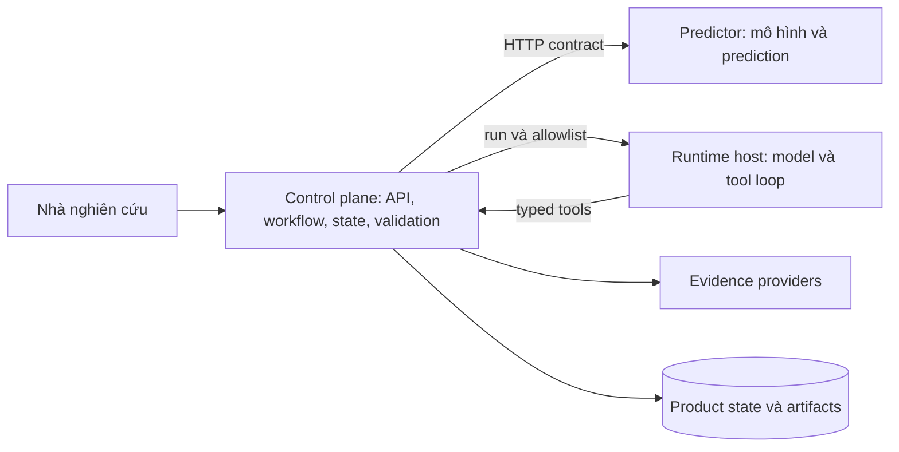
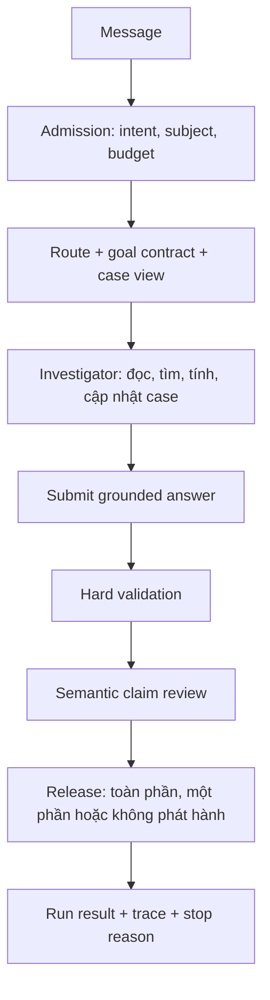

# Kiến trúc agent ToxAgent và cơ sở nghiên cứu

Tài liệu dành cho kỹ sư và người đánh giá thiết kế. Nội dung tổng hợp từ [bản tập hợp kiến trúc và nguồn](../../ToxAgent_Agent_Architecture_Sources_Compiled_2026-11-07.md), đặc biệt phần 2, 5–8 và các ADR. Trạng thái và số liệu dưới đây là **snapshot ngày 30/10/2026**, không phải kết quả kiểm chứng lại deployment hiện tại. Các đường dẫn và flag cần được đối chiếu với cấu hình triển khai trước khi vận hành.

## 1. Mục tiêu và phạm vi

ToxAgent hỗ trợ nhà nghiên cứu khảo sát một câu hỏi về activity hoặc toxicity: đọc kết quả dự đoán, tìm và đánh giá bằng chứng liên quan, trình bày điều kiện và bất định, rồi cho phép kiểm lại từng khẳng định. Agent không thay predictor, không tự thay đổi quyết định policy và không biến các endpoint khác nhau thành một điểm an toàn tổng hợp. Một kết luận chỉ có ý nghĩa trong subject, endpoint và điều kiện được nêu. Xem [ADR 0002](../adr/0002-no-aggregate-verdict.md).

Về mặt nghiên cứu, thiết kế tập trung vào ba giả thuyết: **H1**, biểu diễn measurement đúng identity, đơn vị và comparator cải thiện đánh giá evidence; **H2**, theo dõi dependency giúp cập nhật kết luận khi premise thay đổi; **H3**, chọn hành động theo gap giúp thu thập bằng chứng hiệu quả hơn. Đây là giả thuyết cần đo, không phải lợi ích đã được chứng minh. Chi tiết và controls: [research design](../research/) và phần 3–5 của bản tổng hợp.

Một nguyên tắc xuyên suốt là **model đề xuất; server sở hữu trạng thái và quyết định phát hành**. Tiền lệ cho agent dùng công cụ trong nghiên cứu y sinh gồm [Biomni](https://doi.org/10.1126/science.adz4351); đây là cơ sở tham khảo cho việc thiết kế môi trường hành động, không phải bằng chứng kiến trúc ToxAgent đạt cùng kết quả. Bản tổng hợp ghi rõ bản journal không truy cập đầy đủ và đối chiếu phương pháp với preprint và mã nguồn.

## 2. Ranh giới hệ thống

| Thành phần | Trách nhiệm | Ranh giới |
|---|---|---|
| Predictor | Chuẩn hóa đầu vào theo contract, chạy prediction, trả provenance, applicability và attribution. | Độc lập với control plane; giao tiếp bằng HTTP versioned. |
| Control plane | Auth, session, workflow, subject, state, evidence, tool gateway, validation và release. | Là chủ sở hữu trạng thái sản phẩm và các quyết định thực thi. |
| Runtime host | Chạy vòng model–tool với provider và context được cấp. | Chỉ nhận capability trong phạm vi run; không tự có quyền sản phẩm. |

Ba ranh giới được chọn trong [ADR 0001](../adr/0001-three-boundary-topology.md). Quyết định nền tảng khác là dùng `AgentRuntimeGateway` làm control plane agent đang hoạt động, thay vì hồi sinh `ScientificAgentKernel` thành một đường song song; xem [ADR 0010](../adr/0010-adaptive-decision-support-boundary.md) và [ADR 0011](../adr/0011-benchmark-enablement-and-single-control-plane.md). Việc tách runtime khỏi harness cũng phù hợp với cách phân biệt execution và orchestration trong [mô tả runtime của LangChain](https://www.langchain.com/blog/runtime-behind-production-deep-agents); đây là nguồn vendor, không chứng minh hiệu quả riêng của ToxAgent.

Product state nằm trong store do sản phẩm quản lý. Theo [ADR 0003](../adr/0003-product-owned-state.md), mutation và outbox event cùng transaction, delivery là at-least-once và client khử trùng lặp theo sequence. Transcript runtime không phải nguồn sự thật để khôi phục session. Nguyên tắc phân biệt memory với execution state và xử lý retry/idempotency cũng được thảo luận trong [Temporal: agent memory and state](https://docs.temporal.io/ai/featured/memory-state-stripe); nguồn này không yêu cầu ToxAgent dùng Temporal.

## 3. Đường đi của một câu hỏi

1. **Admission** xác định intent, ràng buộc một subject và cấp budget. Nếu có nhiều subject mà không biết chọn cái nào, hệ thống hỏi lại.
2. **Router** chọn mức điều tra theo câu hỏi và thay đổi trong case. Decision có reason code để phân tích riêng routing và task success.
3. **Goal contract** cố định subject, câu hỏi phải trả lời, tools thực sự có sẵn, budget và điều kiện dừng. Required claims xuất phát từ câu hỏi, không lấy hidden benchmark gold.
4. **Investigator** đọc case view, chọn hành động trong capability profile, ghi các cập nhật có kiểu và nộp answer.
5. **Validation và release** kiểm số liệu và nguồn, review claim theo evidence rồi chỉ phát hành phần vượt qua gate. Trace ghi các hành động, lỗi validation và lý do dừng.

Nguồn chi tiết của luồng và code mapping là [architecture.md](architecture.md). Việc xen kẽ suy luận và hành động có tiền lệ trong [ReAct](https://arxiv.org/abs/2210.03629); ToxAgent bổ sung contract, state và các gate do server quản lý. [OpenScholar](https://www.nature.com/articles/s41586-025-10072-4) là tiền lệ cho retrieval có feedback và kiểm citation, không xác nhận mọi chi tiết của loop này.

### 3.1 Route và subject

| Route | Khi nào dùng | Hành vi chính |
|---|---|---|
| `read_explain` | Subject và artifact đã rõ, câu hỏi chỉ yêu cầu đọc/giải thích. | Đọc artifact và trả lời với profile giới hạn. |
| `investigate` | Câu hỏi cần phán đoán hoặc là trường hợp mặc định. | Chạy điều tra đầy đủ. |
| `update` | Giá trị nhà nghiên cứu hoặc premise đã đổi. | Xác định điều gì thay đổi và điều gì giữ nguyên. |
| `compare_batch` | Yêu cầu so sánh và có nhiều candidate. | So từng candidate bằng artifact riêng theo tiêu chí khai báo. |
| `undetermined` | Chưa xác định subject hoặc yêu cầu so sánh chỉ có một candidate. | Yêu cầu làm rõ. |

Bốn serving route chính cùng nhánh làm rõ `undetermined` được mô tả trong [architecture.md](architecture.md). Dấu hiệu cần assessment được ưu tiên hơn dấu hiệu đọc đơn thuần; premise thay đổi cũng được ưu tiên hơn cách đặt câu. Route là lựa chọn thực thi, không phải kết luận khoa học.

Subject binding ngăn evidence của một analysis hoặc activity screening bị dùng trực tiếp cho subject khác. Với activity, subject bao gồm canonical SMILES, target và assay context; policy được khóa theo target/context và vai trò target. Lý do cụ thể là một triển khai trước từng chấp nhận artifact cho ligand khác và áp threshold ngoài context. [ADR 0014](../adr/0014-activity-subject-identity-and-policy-scope.md) ghi quyết định và các giới hạn so khớp.

## 4. Scientific Case: trạng thái điều tra qua nhiều lượt

Case là đối tượng khoa học bền vững theo session và subject, không chỉ là tóm tắt transcript. Nó chứa câu hỏi, hypotheses, evidence ủng hộ/phản bác, uncertainties, actions, derived claims và conclusion có điều kiện. Evidence entry tham chiếu artifact hoặc context có provenance; một suy luận của agent không tự trở thành nguồn độc lập. Xem [ADR 0012](../adr/0012-scientific-case-and-skill-catalog.md).

Các thay đổi đi qua typed operations và append-only event log; snapshot phải tương ứng với log và được cập nhật dưới revision check. User-supplied context được version hóa và giữ mức `user_asserted` khi chưa được xác minh; model không tự nâng nó thành SME-verified. Điều này cho phép kết luận cũ vẫn truy về đúng tiền đề đã dùng.

### 4.1 Measurement và phạm vi so sánh

Một measurement cần được xét ở ba lớp:

| Lớp | Câu hỏi |
|---|---|
| Identity và context | Cùng subject, endpoint, assay, variant và điều kiện liên quan không? Metadata thiếu là chưa biết. |
| Representation | Các giá trị chỉ khác đơn vị hoặc cách biểu diễn? Giữ raw value, canonical value và conversion. |
| Numeric constraint | Exact value, khoảng hoặc giá trị bị chặn cho phép kết luận nào theo rule? |

Ví dụ `> 30 µM` không thỏa quy tắc “dưới 10 µM”; với `< 30 µM`, chỉ riêng khoảng này chưa đủ để kết luận. Hai con số khác nhau không tự là mâu thuẫn sinh học: phải xét scope và tiêu chuẩn sai khác phù hợp. Cách mô tả endpoint, applicability và uncertainty có thể tham chiếu [OECD (Q)SAR Assessment Framework](https://www.oecd.org/en/publications/q-sar-assessment-framework-guidance-for-the-regulatory-assessment-of-quantitative-structure-activity-relationship-models-and-predictions_d96118f6-en.html); đây là guidance đánh giá mô hình, không phải benchmark agent.

### 4.2 Dependency và cập nhật

Derived claim lưu **tham chiếu** tới input, rule và assumptions thay vì chỉ sao chép con số. Khi input thay đổi, hệ thống đi theo dependency graph và đánh dấu những claim không còn justification hợp lệ là `needs_reassessment`. Nếu một justification khác vẫn đứng vững, claim không tự bị đánh dấu stale. Lịch sử không bị xóa.

Ví dụ một exposure margin phụ thuộc vào measurement, free Cmax, conversion và assumption về context. Sửa Cmax tạo version mới và yêu cầu tính lại margin cùng các kết luận phụ thuộc; prediction không phụ thuộc input đó vẫn giữ nguyên. Đây là ứng dụng có phạm vi của ý tưởng lưu lý do và dependency trong [Doyle, truth maintenance](https://www.sciencedirect.com/science/article/abs/pii/0004370279900080), không phải khẳng định hệ thống thực hiện đầy đủ truth maintenance tổng quát.

### 4.3 Case view và context

Model nhận projection có chọn lọc: subject/contract; observations và IDs; kết luận hiện hành và delta; evidence, counter-evidence và metadata còn thiếu; gaps, lần tìm trước, budget; skills phù hợp. Nội dung dài nằm sau tool và refs; view cho biết số mục bị lược. Summary hỗ trợ navigation nhưng không thay nguồn gốc để verify. Đây là ứng dụng cho ToxAgent của nguyên tắc nạp context đúng lúc trong [Anthropic: context engineering](https://www.anthropic.com/research/effective-context-engineering-for-ai-agents), không phải dự báo tiết kiệm token.

## 5. Investigator, tools và skills

Investigator vận hành theo vòng: đọc case → xác định yêu cầu chưa giải quyết → chọn hành động được phép, hỏi người dùng hoặc dừng → nhận và kiểm artifact → ghi case patch có provenance → lặp khi cần. Các gap phân biệt thiếu identity/scope, thiếu evidence, chưa đọc span quyết định, measurement chưa rõ, bất đồng chưa giải thích, input chỉ user có và lỗi provider/corpus. Provider failure không đồng nghĩa với bằng chứng khoa học không tồn tại.

**Tool profile là tập quyền đóng.** Model không có shell, filesystem hoặc raw web trong conversational profile; thông tin ngoài đi qua tools và trust boundary. Runtime binding, capability token và pinning được mô tả trong [ADR 0004](../adr/0004-runtime-pinning.md). Các chỉ dẫn nhúng trong bài báo hoặc kết quả provider là dữ liệu ngoài, không được coi như policy của hệ thống.

Năm procedure xác định trong snapshot là `normalise_measurements`, `deduplicate_by_origin`, `compare_measurements`, `check_dependencies` và `compare_candidates`. Chúng hoạt động trên records đã đọc, có schema cho input/output, không tự gọi provider và không tự commit conclusion. Investigator chọn procedure; server kiểm và ghi kết quả. Việc dùng xử lý có chương trình cho batch và dữ liệu trung gian có liên hệ với [Anthropic: advanced tool use](https://www.anthropic.com/research/advanced-tool-use), nhưng lựa chọn runner allowlisted là thiết kế riêng của ToxAgent.

**Skill** hướng dẫn phương pháp: khi nào áp dụng, cần kiểm scope gì, failure modes và tiêu chuẩn dừng. Catalog chỉ quảng bá skill tương thích capability, nạp nội dung và reference khi cần, pin hash và ghi skill đã thấy/đã nạp; skill không tự cấp tool. Cấu trúc khám phá dựa trên [Agent Skills specification](https://agentskills.io/specification); manifest kiểm quyền/version là phần mở rộng riêng của ToxAgent. Cách này thay đổi phương pháp dùng năng lực hiện có, còn nguồn dữ liệu, phép tính, quyền và artifact mới vẫn cần code và kiểm thử. Xem [ADR 0012](../adr/0012-scientific-case-and-skill-catalog.md).

Chọn hành động theo gap có thể là hướng H3: chẳng hạn đọc metadata assay để phân biệt khác readout với xung đột thật. Snapshot mới có vocabulary và một phần requirements; **ranking action theo khả năng phân biệt chưa được triển khai**, nên chưa gọi đó là tối ưu information gain. Workers độc lập, cache, model routing và durable resume là các hướng để sau; nếu thử worker, worker trả evidence packet có provenance, investigator vẫn chịu trách nhiệm kết luận và commit.

## 6. Verification, giải thích và release

Ba gate tuần tự, mỗi gate chỉ có thể thu hẹp nội dung phát hành:

1. **Hard validator** kiểm số trong prose có claim và field nguồn tương ứng, phép biến đổi hợp lệ, limitation bắt buộc và locator của trích dẫn. Schema/validator ngăn biến endpoint này thành kết luận của endpoint khác hoặc một verdict an toàn tổng hợp.
2. **Semantic reviewer** nhận bundle do server dựng cho từng claim: passages, giá trị, scope, và với phép tính là công thức cùng inputs và provenance. Reviewer kiểm nội dung hỗ trợ claim trong scope nào; review độc lập là một vai trò kiểm tra, không tự trở thành chuyên gia độc lập.
3. **Release gate** cho phép một vòng sửa có giới hạn theo policy, sau đó phát hành answer được hỗ trợ, `partial_facts`, hoặc không phát hành phần còn thiếu căn cứ. Nếu draft tiếp tục lỗi validation, deterministic fallback chỉ dùng facts từ subject đã khóa và field paths của chúng.

Phải tách ba lớp giải thích trong dossier: **model attribution** mô tả đặc trưng ảnh hưởng output mô hình, **scientific evidence** là bằng chứng độc lập trong phạm vi nguồn, và **agent decisions** là lý do/hoạt động điều tra đã ghi. Attribution không tự chứng minh cơ chế hay quan hệ nhân quả. [ToxReason](https://aclanthology.org/2026.findings-acl.977/) là nguồn tham khảo để phân biệt prediction với mechanistic reasoning; nó không xác nhận cơ chế cụ thể của ToxAgent.

[ALCE](https://aclanthology.org/2023.emnlp-main.398/) cung cấp lý do đo riêng tính đúng và độ đầy đủ của citation; ID tồn tại chưa chứng minh nguồn hỗ trợ claim. [RAGChecker](https://arxiv.org/abs/2408.08067) gợi ý phân tích retrieval và generation riêng để xác định điểm lỗi. Cả hai là tham khảo thiết kế đánh giá, không phải chứng nhận gate đã đúng. Đặc biệt, snapshot cho biết recomputation tự động cho derived numbers còn thiếu và reviewer vẫn chặn một số claim đúng; cần đo cả false accept lẫn false block bằng human gold.

## 7. Budget, trace và khả năng tái lập

Mỗi run có effective budget được ghi lại, đếm logical tool calls và dự phòng cho submit, review, repair; malformed calls cũng bị giới hạn. Trace cần đủ để xác định route, profile, tool calls và phase, artifact được đọc, case revisions, draft bị từ chối, review verdict, cost và stop reason. Không cần lưu chain-of-thought để audit các đối tượng này.

Manifest đánh giá phải mô tả sản phẩm thực sự chạy: commit, runtime/model, flags, profiles, budgets, tool schemas, provider và topology liên quan. Frozen evidence và live provider là các điều kiện khác nhau, không trộn như cùng một phép đo. Quyết định về trạng thái, trace và evaluation contract nằm trong [ADR 0011](../adr/0011-benchmark-enablement-and-single-control-plane.md). Một capability có code không có nghĩa flag đã bật trong deployment; [README agent layer](README.md) mô tả các flag rollout mặc định tắt trong snapshot.

## 8. Đánh giá: đo năng lực và giới hạn riêng

TAB-Suite v3 là evaluation contract trong ADR; việc một pack hoặc grader đã sẵn sàng phải kiểm tra implementation và manifest của lần chạy. Không gộp mọi kết quả thành một điểm ToxAgent.

| Trục | Điều cần đo | Tham khảo thiết kế |
|---|---|---|
| Tool và state | Chọn tool/arguments, final state, policy, multi-turn và consistency nhiều trial. | [τ-bench](https://proceedings.iclr.cc/paper_files/paper/2025/hash/1b126cc38b8638e07bef37e7b2bb72bf-Abstract-Conference.html), [API-Bank](https://arxiv.org/abs/2304.08244). |
| Evidence và answer | Retrieval, nguồn có thực sự hỗ trợ claim, citation completeness, xử lý phản chứng và abstention. | [ALCE](https://aclanthology.org/2023.emnlp-main.398/), [RAGTruth](https://arxiv.org/abs/2401.00396). |
| Scientific task | Task thật, artifact có thể kiểm, case-level rubric và SME adjudication. | [ScienceAgentBench](https://arxiv.org/abs/2410.05080), [HealthBench](https://openai.com/index/healthbench/). |
| Security và reliability | Kết quả dưới input bình thường và indirect prompt injection; state, tool use và containment. | [AgentDojo](https://arxiv.org/abs/2406.13352). |
| Judge | False accept/block, bias và agreement với chuyên gia theo loại lỗi. | [MT-Bench / LLM-as-a-Judge](https://arxiv.org/abs/2306.05685), [JudgeBench](https://arxiv.org/abs/2410.12784). |

Fallback có thể là **containment thành công** đồng thời là **agent capability thất bại**; không tính nó như một câu trả lời điều tra thành công. Grader cần phân biệt `pass`, `fail`, `invalid`, `skipped`, `infra_error` và báo số task được bảo toàn. Không bắt mọi lời giải đi cùng một trajectory nếu nhiều đường hợp lệ; hard policy vẫn là điều kiện riêng.

Để kiểm H1–H3, dùng paired cases và controls có cùng quyền truy cập tools, evidence, budget và kiến thức cần thiết; tách cơ chế đang xét khỏi thay đổi model hoặc reviewer. Gold phải có cả trường hợp “chưa xác định” là đáp án đúng và case còn một justification hợp lệ sau khi premise khác thay đổi. H3 cần action được gắn với gap nó phân biệt trước khi có thể kiểm đúng giả thuyết.

## 9. Kết quả và việc còn mở tại snapshot

Báo cáo ngày 22/10/2026 chạy bốn arms trên **12 case kỹ thuật tổng hợp**, mỗi case một trial. Cả 48 lượt hoàn thành không có lỗi hạ tầng; task success theo hai grader là A2 3, B2 1–3, C2 7–9 và D2 6 trên 12. Trong tập này C2 đạt bằng hoặc hơn D2 với khoảng 60% token, nên chưa có bằng chứng lợi thế cho domain design. Các lượt E ngày 29–30/10 là kiểm tra hệ thống, **không phải nghiên cứu đã chấm điểm**. Các case dùng hợp chất và số liệu giả, grader là model và một grader không blind; không suy ra hiệu quả toxicology thực tế. Nguồn: phần 5 của [bản tổng hợp](../../ToxAgent_Agent_Architecture_Sources_Compiled_2026-11-07.md).

Ưu tiên tiếp theo là hiệu chỉnh semantic reviewer và kiểm số suy ra bằng code; xây bộ gold có SME xác minh; có generic control được cân bằng tool và tuning; tạo case sets cho H1/H2 và action selection cho H3; đo routing; kiểm vì sao model chưa chọn procedures trong live runs; và tăng số cụm case độc lập để đánh giá bất định thống kê. Không xem một cơ chế đã hiện diện là bằng chứng rằng nó cải thiện outcome.

## 10. Bắt đầu từ đâu trong repository

- [Architecture](architecture.md): đường đi một turn, contracts, state ownership và vị trí code.
- [Running](running.md), [extending](extending.md), [benchmark](benchmark.md): vận hành, mở rộng và chạy đánh giá.
- [Research](../research/): câu hỏi, giả thuyết, protocol và giới hạn bằng chứng.
- `backend/control/src/toxagent/application/investigation/`: router, contract, case view, procedures, review và release.
- `backend/control/src/toxagent/domain/scientific_case/`: case, values, operations và dependencies.
- `backend/control/src/toxagent/harness/gateway/`, `tools/`, `validation/`: dispatch, capability surface và kiểm answer.
- `backend/control/evals/investigation/`: thiết lập đánh giá điều tra.

Các trích dẫn nghiên cứu trong tài liệu này giải thích tiền lệ và động cơ thiết kế; lựa chọn route, schema, release và rollout là quyết định của ToxAgent. Với phạm vi đọc và hạn chế từng nguồn, xem phần 6 mục 17 và phần 8 mục 6 của bản tập hợp.
