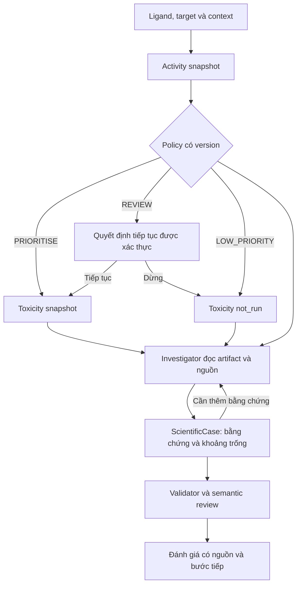

# ToxAgent: agent layer và benchmark cho activity-guided toxicity screening
Cập nhật ngày 20/10/2026 sau khi đọc branch `feat/bioactivity-first-pipeline-redesign`, head `681a1c1b92377071411a832762db4203294931f2` — `feat: add activity-guided SAIR research pipeline`, 11:48:29 giờ Việt Nam. Parent là `aaa5f64132b1337e10d850d5d0480675bf6e6f59`, đúng base của bản kế hoạch trước.

Phạm vi: cập nhật bản thiết kế và protocol; chưa triển khai agent mới hoặc xác nhận lại các kết quả huấn luyện SAIR. Đã đọc diff đủ 21 file của commit, gồm code, tests, ADR và hai tài liệu triển khai. Không thay đổi source code trên GitHub.

## Thay đổi chính so với bản trước

| Nội dung | Bản trước | Bản cập nhật |
|---|---|---|
| Tác vụ sản phẩm | Đánh giá bằng chứng hERG/Tox21 | Giữ tác vụ toxicity độc lập; thêm đánh giá ứng viên theo target trong workflow activity → policy → optional toxicity |
| Quyền điều phối | Agent lựa chọn hành động điều tra | State machine sở hữu thứ tự và quyền chạy stage; agent lựa chọn hành động điều tra trên các artifact hợp lệ |
| Predictor benchmark | Toxicity classification | Hai track riêng: activity regression và toxicity classification |
| Benchmark mới | Task success của agent | Thêm kiểm chứng policy chọn ứng viên trên toàn batch, bao gồm case bị skip |
| XAI | Attribution của predictor toxicity hiện tại | Giữ XAI toxicity; activity ligand/residue/contact XAI là các giai đoạn chưa được triển khai |
| Tiến độ có thể làm ngay | Sửa gold/scorer và dựng baseline | Bổ sung scientific contract SAIR và dùng snapshot/replay để phát triển agent song song trước model admission |

Các nguyên tắc cũ được giữ: cùng backbone và ngân sách khi so kiến trúc agent; citation existence khác semantic support; raw prediction và scientific assessment tách biệt; công bố coverage, n/N và CI; không tạo activity–toxicity fusion score.

## 1. Quyết định kiến trúc và mục tiêu nghiên cứu

Đề xuất giữ ba thành phần predictor, XAI và agent, nhưng gán cho mỗi thành phần một trách nhiệm và một phép kiểm chứng riêng. Agent phục vụ **đánh giá bằng chứng về activity và toxicity cho quyết định nghiên cứu ở giai đoạn sớm**, với scope của từng phép đo được giữ riêng. Một tác vụ hoàn chỉnh bắt đầu bằng phân tử, endpoint và câu hỏi cụ thể; kết thúc bằng nhận định có nguồn, giới hạn có liên quan và bước kiểm chứng tiếp theo.

Use case trung tâm: một nhà nghiên cứu có phân tử và target cần sàng lọc, muốn hiểu ước lượng pIC50, lý do policy đưa vào PRIORITISE/REVIEW/LOW_PRIORITY, và bằng chứng cần bổ sung trước khi tiếp tục. Nếu toxicity đã chạy, agent đánh giá hERG/Tox21 theo từng endpoint; nếu chưa chạy, agent nêu rõ trạng thái đó. Tác vụ toxicity độc lập từ bản trước vẫn được giữ. Câu hỏi này có thể cần những hành động khác nhau: chỉ đọc một score, tìm assay gốc, đối chiếu điều kiện đo, yêu cầu exposure còn thiếu, hoặc cập nhật kết luận sau khi có dữ liệu mới.

Các giả thuyết cần tách:

| Đóng góp | Giả thuyết cần thử | Thực nghiệm chính |
|---|---|---|
| Activity predictor | Ước lượng pIC50 tốt hơn baseline cùng dữ liệu/split và có uncertainty hữu ích | Ligand–target–assay regression, scaffold và protein-cluster views |
| Toxicity predictor | Dự đoán hERG/Tox21 tốt hơn đối thủ có định nghĩa nhãn tương thích | Tập phân tử có nhãn độc lập; không bị chọn lại theo activity gate |
| XAI | Attribution có độ trung thực với mô hình và giúp giải quyết một số tác vụ giải thích | Kiểm tra attribution riêng và ablation bỏ XAI trong tác vụ phù hợp |
| Agent | Điều tra thích ứng dựa trên bằng chứng làm tăng tỷ lệ hoàn thành tác vụ so với workflow cố định và ReAct chung | Cùng LLM, dữ liệu, công cụ và ngân sách; đánh giá câu trả lời có nguồn và lỗi nghiêm trọng |

Mục tiêu “predictive phải tốt hơn công cụ khác” được kiểm chứng riêng trong từng track. Branch mới không retrain hERG/Tox21 trong MVP; kết quả activity tốt hơn không chứng minh toxicity predictor đã hơn ProTox. Phiên bản agent v1 giữ nguyên dự đoán gốc. Nếu agent chỉ trích lại cùng nhãn trên cùng phân tử, accuracy đó không phải một cải thiện dự đoán của agent.

Nếu sau này muốn agent tạo **nhãn hoặc xác suất hợp nhất mới**, cần một nhánh nghiên cứu riêng: định nghĩa đầu ra, xây dữ liệu huấn luyện/validation/test cho bộ hợp nhất, đánh giá calibration và so với predictor gốc trên cùng coverage. Không gán một xác suất mới từ văn bản tổng hợp mà chưa có thực nghiệm này. Khi truy được assay của chính phân tử test, kết quả thuộc đánh giá có hỗ trợ bằng chứng, không còn là dự đoán cấu trúc cho phân tử chưa biết.

## 2. Phạm vi sản phẩm v1

Bốn user story nên triển khai trước, trong hai context activity và toxicity:

1. **Hiểu screening hiện tại:** “M trên target T được REVIEW vì sao? Toxicity đã chạy chưa?” Đọc đúng snapshot, policy, interval và stage status.
2. **Giải quyết REVIEW có mục tiêu:** “Có assay thực nghiệm phù hợp để làm rõ bất định hoặc measurement disagreement không?” Kiểm tra cùng ligand, target/variant và assay context.
3. **Đối chiếu toxicity:** “hERG/Tox21 và nguồn thực nghiệm có thật sự mâu thuẫn không?” Giữ endpoint, exposure và scope riêng.
4. **Cập nhật sau dữ liệu mới:** “Tôi thêm assay hoặc exposure; đánh giá bằng chứng và đề xuất bước tiếp thay đổi thế nào?” Không tự sửa score hoặc quyền chạy stage.

Với batch, bước sau mới mở rộng thành so sánh một số ứng viên trong cùng target/context. Không triển khai thêm một ranking tổng hợp activity–toxicity chưa được xác thực trong MVP.

Các đầu ra R&D như hold/proceed/deprioritize chỉ áp dụng cho phạm vi câu hỏi đã xác định và cần nguồn cùng điều kiện. Không định nghĩa một “overall toxicity score” từ số assay active.

### 2.1. Tận dụng mã hiện tại

Đối chiếu main cũ và head mới cho thấy các khái niệm agent trước đây được giữ nguyên; commit mới chủ yếu thêm research pipeline và domain workflow. Đây là hướng mở rộng trên những hợp đồng hiện có.

Đã có code: schema inspector, ETL Phase-1, descriptor HGB baseline; `ActivitySnapshot`; `TargetPriorityPolicy`; `ActivityGuidedScreening`; wire schema activity và tests. Chưa có activity production route/client/registry integration, persistence migration, worker, UI/report tích hợp hoặc MCP tools đọc activity. Không có thay đổi triển khai XAI mới trong 21 file của commit.

Báo cáo trong commit ghi B0 test MAE 1,024 pIC50, RMSE 1,250, R² 0,143, Pearson 0,406; interval 90% có coverage 0,902 và half-width khoảng 2,040 pIC50. Đây là số do tác giả báo cáo; raw parquet, model và metric JSON ở thư mục `data/` bị Git ignore nên phiên rà soát này không tái lập huấn luyện. Code đặt `admitted=false`.

| Thành phần hiện có | Hướng dùng |
|---|---|
| `ScientificCaseV1` | Lưu câu hỏi, giả thuyết cần phân biệt, bằng chứng, uncertainty, hành động và điều kiện đổi kết luận |
| `DecisionSupportStateV1` | Theo dõi tiến trình một run, nhu cầu nguồn và lý do dừng |
| `EvidenceRelationAssessment` | Gắn một nguồn với một proposition bằng supports/contradicts/contextual/insufficient/not_applicable |
| `DevelopmentPosture` | Khuyến nghị R&D có điều kiện; giữ confidence dạng band có lý do |
| `submit_grounded_answer` và validator | Giữ nguồn gốc giá trị số/nhãn và quyền chấp nhận câu trả lời ở server |
| `evals/investigation` | Tận dụng driver gọi agent thật, manifest, trace, packet chấm mù và so sánh theo cặp |
| `ActivitySnapshot` | Observation activity bất biến: ligand, target, assay context, pIC50, uncertainty và provenance |
| `TargetPriorityPolicy` | Quy tắc xác định với threshold và version; không giao LLM viết lại policy |
| `ActivityGuidedScreening` | Trạng thái chạy activity/toxicity, skip/failure và liên kết snapshot |

Runtime được xem xét phục vụ hERG và 12 head Tox21 bằng ChemBERTa; attribution đang là token gradient × input ánh xạ sang atom. Không mô tả kết quả của runtime này như một thí nghiệm GNNExplainer. Benchmark production chỉ đưa endpoint thực sự được deployment hỗ trợ; nhánh activity offline/replay được báo riêng.

Các cờ tính năng phải được khóa và ghi lại bằng effective-product. Có lớp hoặc tool trong code chưa chứng minh tính năng đó đã hoạt động trong một run.

### 2.2. Sơ đồ điều khiển

Sơ đồ thể hiện kiến trúc đích, chỉ enable serving activity sau admission. Tách hai loại trạng thái: `ActivityGuidedScreening` ghi thực thi và quyền chạy stage; `ScientificCase` ghi đánh giá khoa học. Một trạng thái REVIEW của policy không đồng nghĩa agent đã sai hoặc buộc phải đổi sang PRIORITISE.

Dùng một investigator. Reviewer là một bước kiểm tra giới hạn, không cần một nhóm agent đóng vai chuyên gia để tranh luận. Việc cần chọn thích ứng nằm ở nguồn nào đáng đọc, câu hỏi nào còn thiếu và khi nào dừng.

Nhánh đọc giá trị hoặc stage status đơn giản có thể chạy bằng code và template khi yêu cầu được xác định rõ. Thứ tự activity → policy → toxicity do server thực thi bằng code. LLM không trực tiếp bỏ qua REVIEW, tự khai một người phê duyệt hoặc đổi threshold. Với câu hỏi mơ hồ, một bước phân loại nhỏ có thể chọn route; phải đo cả lỗi route và chi phí phân loại. Không dựa hoàn toàn vào keyword.

### 2.3. Vòng điều tra được đề xuất

**Bước 1 — Xác định điều cần trả lời.** Tách câu hỏi thành tối đa một vài proposition có thể kiểm chứng. Xác định endpoint, use context và dữ liệu cần thiết. Không ép tạo tám giả thuyết cho một câu hỏi tra cứu.

**Bước 2 — Đọc inventory và observation hiện có.** Tái sử dụng prediction, explanation, evidence và report. Ghi phiên bản mô hình, ligand chuẩn hóa, target/sequence hash, assay context, threshold/policy version và tình trạng dữ liệu. XAI giải thích đầu ra của chính predictor, không được tính là nguồn thực nghiệm độc lập xác nhận predictor.

**Bước 3 — Chọn khoảng trống quan trọng nhất.** Mỗi hành động chỉ cần một lý do công khai ngắn như “cần kiểm tra assay có cùng endpoint hay không”. Log này giúp đánh giá policy; không cần lưu chuỗi suy luận nội bộ dài.

**Bước 4 — Truy xuất và đọc nguồn.** Tìm identifier/assay trước khi mở rộng truy vấn; đọc record gốc rồi mới kết luận. Khi câu hỏi về phơi nhiễm và đủ đầu vào, gọi công cụ tính xác định thay vì tính nhẩm. Chỉ đọc attribution nếu nó liên quan tới câu hỏi về mô hình hoặc so sánh cấu trúc.

**Bước 5 — Đối chiếu và cập nhật Case.** Đánh giá của agent có thể đủ bằng chứng hơn trong khi uncertainty của model vẫn giữ nguyên. Không ghi đè interval hoặc chuyển scientific conclusion thành policy override. Một nguồn được gắn stance, scope, locator và chất lượng phù hợp câu hỏi. Cần phân biệt mâu thuẫn thực, khác điều kiện đo, bằng chứng gián tiếp và chưa đủ dữ liệu. Tìm phản chứng có mục tiêu khi đang dự định kết luận mạnh; không bắt mọi tác vụ chạy thêm một vòng search hình thức.

**Bước 6 — Dừng với một kết quả có ích.** Dừng khi đủ bằng chứng cho câu hỏi; cần một đầu vào người dùng có thể cung cấp; nguồn hiện có không giải quyết được; hoặc chạm ngân sách. “Chưa đủ dữ liệu” là đáp án đúng trên case vốn không thể giải quyết, nhưng không tự động đúng trên case có nguồn đủ rõ.

**Bước 7 — Kiểm tra rồi phát hành.** Hard validator kiểm nguồn, quyền truy cập, schema, giá trị, đơn vị và biến đổi số. Semantic reviewer đọc từng claim cùng đoạn nguồn và scope. Cho một lượt sửa có giới hạn; claim chưa được hỗ trợ phải được sửa, thu hẹp hoặc loại bỏ. Ghi tác động của sửa đổi lên độ đầy đủ, không chỉ tỷ lệ pass cuối.

Trong mã hiện tại, kiểm tra citation chủ yếu xác minh nguồn tồn tại và hợp lệ; reviewer tùy chọn được gọi sau khi chấp nhận câu trả lời và lưu verdict. Chuyển việc kiểm tra ngữ nghĩa liên quan sang trước phát hành là **thay đổi được đề xuất**, không phải một bảo đảm hiện có.

### 2.4. Ưu tiên làm lại đường bằng chứng

Europe PMC provider hiện chủ yếu cung cấp abstract. Đọc lại record đã lưu không tự đem về phần kết quả hoặc bảng assay còn thiếu. Vì vậy, tăng timeout đơn thuần không giải quyết được thiếu bằng chứng.

Ưu tiên mở rộng:

- Metadata rõ `abstract_only`, `full_text_available`, `full_text_retrieved` và `access_failed`.
- Fetch chi tiết tài liệu/assay khi được cung cấp công khai; lưu đoạn trích cùng vị trí trong abstract, section hoặc bảng.
- Record chuẩn hóa gồm identifier phân tử, endpoint, assay type, species/cell system, điều kiện liên quan, readout, value, relation như “<”, unit và provenance.
- Không đủ metadata thì dùng `not_assessed`; không suy ra “assay tương đương” chỉ vì cùng nhắc hERG.
- ChEMBL assay record, tài liệu thực nghiệm và nguồn regulatory có vai trò khác nhau tùy proposition. Không dùng một thứ hạng nguồn cứng cho mọi câu hỏi.
- Nội dung nguồn được xem là dữ liệu. Chỉ dẫn bên trong tài liệu không được đổi quyền công cụ, cấu trúc được xét hoặc chính sách nộp câu trả lời.

Mở rộng scope của EvidenceRelation hiện có bằng ligand identity, target/sequence/variant, assay/readout/unit/comparator và experimental context cần thiết; tái dùng locator của Case. `get_chembl_activities` hiện dành cho hERG không tự trở thành công cụ activity đa target; muốn mở rộng phải thêm target/assay filtering có kiểu. Chuẩn hóa một cách biểu diễn ở domain rồi dùng adapter cho report/Case/answer, tránh tiếp tục tạo ontology song song.

### 2.5. Hợp đồng đầu ra

| Phần | Nội dung | Quyền thay đổi |
|---|---|---|
| Activity observation | pIC50, unit, target/context, interval, uncertainty method, model/calibration versions | Activity predictor/server |
| Toxicity observation | Score, nhãn, threshold, model version, applicability theo đúng định nghĩa hiện có | Toxicity predictor/server |
| Policy decision | PRIORITISE/REVIEW/LOW_PRIORITY, threshold/source, policy version và reason codes | Versioned policy/server |
| Model explanation | Attribution và phương pháp; liên kết tới prediction tương ứng | Explainer/server |
| Evidence relations | Claim được nguồn nào hỗ trợ/phản bác, trong phạm vi nào | Agent đề xuất, server kiểm nguồn, reviewer kiểm nội dung |
| Conclusion | Điều có thể kết luận, điều còn chưa xác định và điều kiện thay đổi | Agent tổng hợp có nguồn |
| Development posture | Khuyến nghị R&D có scope, basis và next steps | Agent đề xuất trong hợp đồng hiện có |
| Run outcome | Lý do dừng, lỗi provider, thời gian, usage, fallback/repair | Server |

Phân biệt hai trục: **trạng thái thực thi** và **trạng thái tri thức**. Ví dụ provider lỗi khác với tìm được đầy đủ nguồn nhưng bằng chứng vẫn không đủ. Cả hai có thể tạo câu trả lời thiếu thông tin, nhưng nguyên nhân và cách đánh giá khác nhau.

Không tạo xác suất “độc tính tổng hợp” ở v1. Nếu bằng chứng phản bác predictor, giữ nguyên observation và nêu quan hệ phản bác có scope trong kết luận.

Ví dụ giả định để minh họa: predictor cho M nhãn hERG dương tính. Nguồn A đo IC50 cùng endpoint dưới điều kiện tương thích; nguồn B báo một outcome QT lâm sàng. Agent cần kiểm tra A theo ngưỡng và protocol trước khi gọi là hỗ trợ hoặc phản bác; B có thể là contextual thay vì phủ định trực tiếp nhãn hERG. Nếu câu hỏi là exposure margin mà chưa có exposure, phải xác định thiếu đầu vào đó.

### 2.6. Bridge giữa workflow mới và agent

Bổ sung các read tool `get_screening_state`, `get_activity_snapshot` và `get_prioritisation_decision`; tiếp tục dùng tool đọc toxicity, evidence và explanation hiện có. Các tool này là phần cần triển khai, chưa có trong commit mới. Chỉ mở tool explanation theo capability thực tế của deployment.

Dùng adapter do server quản lý để chiếu activity snapshot/policy decision sang observation có kiểu mà grounded-answer resolver hiểu được. Giữ domain ID `act_*`/`pri_*`, provenance và phiên bản; không nhét pIC50 vào endpoint enum hoặc ràng buộc xác suất [0,1]. Policy decision là một kết quả của quy tắc, không phải một measurement độc lập.

Subject của Case activity phải bao gồm ligand chuẩn hóa + target/sequence identity + assay context + screening reference. Một ligand trên hai target phải có scope riêng. Toxicity snapshot có thể tái sử dụng theo ligand/model/config phù hợp; policy status vẫn phụ thuộc target/context.

Các lỗ hổng cần đóng trước integration:

- `ActivityGuidedScreening.record_activity` hiện kiểm session/run và target ID, nhưng chưa đối chiếu ligand. Probe tổng hợp cho thấy screening CCO nhận snapshot CCN nếu session/run/target trùng. Cần chặn sai ligand, target sequence/variant và context tại application boundary; thêm kiểm tra domain phù hợp.
- `TargetPriorityPolicy` hiện có target ID, chưa có assay-context key hoặc intended target role. Request activity cũng chưa chọn assay context, dù response có trường này. Chốt model theo một context đồng nhất hoặc bổ sung context routing và policy key rõ ràng.
- Domain yêu cầu actor và reason khi tiếp tục thủ công; đây chưa phải RBAC. Actor phải lấy từ authenticated principal và quyền phải được server kiểm, không nhận chuỗi do LLM tự điền.
- `DevelopmentPosture` và `PrioritisationDecision` phải được trình bày riêng. Agent đề xuất điều tra/khuyến nghị; continuation thực thi theo policy hoặc quyết định đã được xác thực.

Agent có thể phát triển ngay bằng frozen snapshot/replay, gắn nhãn offline. Chưa có admitted model không ngăn việc nghiên cứu policy điều tra; vẫn chặn tuyên bố đã có activity serving hoặc end-to-end production.

### 2.7. Ngân sách và điều kiện dừng

Điểm khởi đầu cho pilot, chưa phải cấu hình tối ưu: tối đa 360 giây, 20 tool calls tổng, 3 truy vấn search, 8 record chi tiết và một lần sửa sau review. Đặt thêm trần token/chi phí; tính cả review và retry vào ngân sách. Báo riêng chi phí agent trên snapshot và chi phí toàn workflow, gồm activity inference, toxicity inference và manual review. Sửa sau pilot trên dev rồi khóa trước test.

Đo đường chất lượng–chi phí với vài mức ngân sách định trước thay vì chỉ công bố cấu hình đắt nhất. Giới hạn đọc nguồn và chống lặp truy vấn nên dựa vào khoảng trống chưa giải quyết. Không dùng số lần gọi tool hoặc độ dài câu trả lời làm proxy cho năng lực.

## 3. Benchmark prediction và policy: các phép đo độc lập

### 3.1. Toxicity: dữ liệu và so sánh

Chọn hERG làm endpoint nghiên cứu chính vì đã có predictor và công cụ tra cứu assay; Tox21 là tập mở rộng theo từng assay. Đối thủ dự kiến: ProTox 3.0, ADMETlab 3.0 và ADMET-AI, nhưng chỉ nhận từng endpoint vào bảng sau khi hoàn tất bảng tương thích nhãn.

Trước khi chạy phải lập mapping: endpoint đích, loại assay, định nghĩa positive, cutoff, cách chuẩn hóa cấu trúc và ý nghĩa score đầu ra. Cùng tên hERG chưa chứng minh cùng bài toán. Confidence của nhãn dự đoán không mặc nhiên là xác suất positive.

Mỗi nhãn gold cần identifier phân tử, source ID, assay ID, readout gốc, unit, comparator, quy tắc đổi thành nhãn và người xác minh. Quy tắc xử lý assay bất đồng và giá trị bị censor phải khóa trước khi nhìn kết quả mô hình. Không ép một khoảng giá trị cắt ngang threshold thành nhãn chắc chắn. Với Tox21, missing không được biến thành inactive.

Tách train/validation/test theo scaffold hoặc thời gian khi dữ liệu cho phép. Kiểm tra overlap với train của nhóm; với công cụ ngoài không công bố train, ghi rõ không thể xác nhận hoàn toàn. Dataset đã công khai có thể bị LLM hoặc công cụ ngoài biết trước.

Tập 95 case đã thảo luận phù hợp cho phát triển và kiểm tra hồi quy sau khi sửa nhãn/provenance. Vì đã được xem kết quả và dùng để điều chỉnh, không xem nó là test xác nhận cuối độc lập.

### 3.2. Toxicity: chỉ số

Đề xuất khóa hERG AUROC là primary, Tox21 macro-AUPRC là primary của nhánh Tox21. Báo thêm AUROC/AUPRC còn lại, MCC, balanced accuracy, precision, recall, confusion matrix, và từng assay. Chỉ tổng hợp trên tập endpoint và mẫu hợp lệ đã xác định trước.

Chọn threshold trên validation; đánh giá calibration bằng Brier/ECE và reliability analysis khi có score xác suất phù hợp. Threshold tuning khác calibration. Không thay threshold sau khi xem test và không xem calibration là cách bảo đảm AUROC tăng.

Nếu một công cụ chỉ xuất nhãn thì AUROC có thể không đánh giá được; ghi N/A và vẫn báo chỉ số nhãn. Báo coverage toàn bộ tập cùng kết quả trên phần giao có thể so sánh. Không âm thầm bỏ trường hợp công cụ không trả lời.

Nếu ChatGPT/Gemini là đối chứng bổ sung, báo ít nhất:

- Coverage = số case có dự đoán / tổng case.
- Accuracy khi cam kết = số đúng / số case có dự đoán.
- Strict correct rate = số đúng / tổng case.
- Risk–coverage khi có cơ chế abstention và confidence phù hợp.

Ví dụ đã thảo luận, 36/36 đúng với coverage 36/50 là accuracy khi cam kết 100%, strict correct rate 72%. Không thể chỉ lấy 100% đó so với predictor trả đủ 50 case.

Cải thiện predictor phải đến từ kiểm tra dữ liệu, label, model và quy trình validation. Benchmark agent không thay thế công việc này.

### 3.3. Activity regression: protocol mới

Đơn vị mẫu là ligand–target–assay context sau chuẩn hóa và xử lý replicate. Dataset SAIR cung cấp potency gắn với protein–ligand pairs và cấu trúc được cofold bằng mô hình [R8]; số pose/source rows không phải số phép đo độc lập.

Báo cáo commit ghi 8.803.710 source rows, 1.048.857 pairs, 1.760.742 measurements sau dedup, 35.983 pairs có pIC50 span >1,0 và 1.012.874 eligible rows. Cần kiểm chứng lại các counts từ manifest có version trong lần chạy benchmark chính.

**Data gate trước tournament**

- ETL hiện group theo `entry_id`, lấy median pIC50 và lưu `assay_primary=first` cùng assay count. Chưa filter hoặc group theo context; các giá trị gần nhau vẫn có thể khác phép đo. Khóa quy tắc context/measurement semantics trước khi coi median là gold.
- Chuẩn hóa ligand/protein identity và nhóm replicate trước split. CanonicalActivityRow/generic split contracts đã có, nhưng ETL thực tế vẫn dùng source SMILES và hash raw sequence; sự tồn tại của contract chưa chứng minh chuẩn hóa đã được áp dụng.
- Ngưỡng span 1,0 là policy tạm. Không coi filtered test là phân phối toàn bộ SAIR: baseline hiện lọc `training_eligible` ở cả train, validation và test. Báo tỷ lệ loại theo target/assay và giữ disagreement cohort riêng.
- Split exact sequence hiện chặn trùng sequence; chưa chặn homolog hoặc scaffold mới. Chỉ gọi đúng là exact-sequence cold-target. Similarity-aware splitting có căn cứ phương pháp từ DataSAIL [R9]; không bắt buộc dùng một package cụ thể.

**Hai claim và evaluation view**

1. Claim thực dụng ban đầu: sàng lọc ligand mới cho target catalog đã biết. Primary view là scaffold-heldout theo target/context; primary metric đề xuất macro-target MAE.
2. Claim mở rộng: generalize sang target mới. Muốn đưa claim này vào bài cần protein-cluster holdout làm primary cho claim đó, cùng family/dual-cold stress views phù hợp.
3. Giữ exact-sequence split để đối chiếu B0, random chỉ làm diagnostic. Temporal chỉ dùng khi có timestamp đủ tin cậy.

Báo cả pooled/micro MAE, RMSE, R², Pearson, Spearman; per-target/per-family/context; activity-cliff direction và ranking/enrichment trong cùng target/context. Khóa định nghĩa hit, cliff, k và điều kiện target có đủ mẫu trước test. Không so pIC50 RMSE với RMSE của pKd/KIBA hoặc toxicity probability.

**Baseline tournament**

| ID cố định | Model | Vai trò |
|---|---|---|
| ACT-D0 | Global median; target/context median khi target đã có trong train | Dummy floor, có quy tắc fallback cho target mới |
| ACT-D1 | Ligand-only ECFP + kNN/RF/boosting | Kiểm tra target conditioning có thêm giá trị |
| ACT-D2 | Descriptor ligand + amino-acid composition + HGB | Chính implementation hiện được gọi là B0 |
| ACT-D3 | ECFP + frozen protein embedding + boosted trees/MLP | Baseline ligand–protein mạnh |
| ACT-M | Ligand encoder + frozen protein encoder + regression head | Candidate model |

Tên B0 trong bảng roadmap của branch là median, còn code B0 là descriptor HGB. Dùng model IDs rõ như trên để tránh so nhầm baseline. Huấn luyện mọi arm trên cùng frozen data/split và cùng tuning budget hợp lý. Có thể thêm mô hình DTA đã công bố nếu tái lập được trên cùng nhãn; điểm từ dataset khác chỉ là tham khảo.

**Uncertainty và applicability**

B0 dùng một quantile của absolute residual trên validation làm half-width chung cho mọi cặp. Coverage test 0,902 chưa chứng minh uncertainty thích ứng theo từng target hoặc candidate; half-width khoảng 2,04 làm full width khoảng 4,08 pIC50. Đo đồng thời coverage và width, theo target/context/domain, rồi hiệu quả của chúng lên gate.

Tách model-selection validation và calibration. Nếu dùng split conformal, ghi level, calibration method/data và các giả định cần cho coverage; marginal coverage không tự thành conditional coverage hoặc bảo đảm khi chuyển domain [R10]. Chưa có data xác minh domain thì trả unknown/not_assessed.

Applicability B0 hiện dựa trên tỷ lệ descriptor ngoài bounds train; không phải kiểm chứng target homology hoặc khả năng nhận biết protein OOD. Bổ sung các trục ligand similarity, protein similarity/cluster và joint support, rồi đánh giá quan hệ với lỗi thực tế.

Admission phải dựa trên dữ liệu/split đã khóa, cải thiện có CI so baseline mạnh, uncertainty đủ hữu ích, parity và model card. Chốt margin/gate trên dev với scientific owner; không chọn sau test.

### 3.4. Benchmark policy: activity gate có đáng dùng không?

Đây là nhánh mới bắt buộc khi workflow có quyền skip toxicity. Nó đánh giá policy xác định, không tự chứng minh agent có ích.

So trên **cùng toàn bộ batch held-out**:

| Arm policy | Hành vi |
|---|---|
| G0 | Activity chạy cho mọi ứng viên; toxicity chạy cho mọi ứng viên |
| G1 | Cùng activity model; gate bằng point estimate và threshold cùng target/context |
| G2 | Policy interval + applicability hiện có; quy tắc xử lý REVIEW được khóa |
| G3, nếu nghiên cứu | G2 kèm điều tra REVIEW; continuation vẫn phải đi qua cùng quyền và policy đã khai báo |

G3 là thử nghiệm decision-support có bằng chứng; không nhập nhãn tìm được vào điểm accuracy của raw predictor.

Với gold activity cùng assay context, đặt A_i=1 khi y_i >= threshold_(target,context). Báo P(LOW_PRIORITY | A=1), tỷ lệ PRIORITISE/REVIEW/LOW_PRIORITY và precision của nhóm ưu tiên. Retention ở bước triage là tỷ lệ active không bị LOW_PRIORITY; phải nói rõ REVIEW được giữ để xem xét, chưa chắc đã chạy toxicity.

Đánh giá riêng selective risk theo coverage. Khóa protocol cho REVIEW, gồm số case được giải quyết, số cần người dùng và chi phí. Không tăng retention bằng cách REVIEW toàn bộ mà bỏ qua workload.

Sau khi xử lý REVIEW theo protocol, đặt S_i=1 khi toxicity thực sự được chạy. Báo:

- toxicity-run fraction và mức giảm lượt inference;
- active candidates bị loại trước toxicity;
- endpoint flags bị bỏ sót trên phần không chạy;
- thời gian và tổng chi phí gồm activity + toxicity + review, không chỉ tool calls của agent.

Để đo flags bị bỏ sót, benchmark cần một audit/shadow pass toxicity cho mọi candidate, ẩn khỏi agent khi stage đó chưa chạy trong workflow. Nếu dùng output của ToxPred làm tham chiếu, gọi đúng là missed predictor flags. Chỉ gọi là missed experimentally verified positives khi có nhãn assay độc lập. Không tạo nhãn toxic/non-toxic toàn cục.

Không đặt toxicity-not-run thành negative. Toxicity accuracy vẫn được đánh giá độc lập trên tập đầy đủ; kết quả trên selected subset chỉ là phân tích có điều kiện. So G2 với G0 theo Pareto retention/workload/cost trước khi quyết định gate có lợi. Nếu activity và review đắt hơn phần toxicity tiết kiệm được, không tuyên bố tiết kiệm hệ thống.

Trong chế độ toxicity độc lập do người dùng yêu cầu, không buộc đi qua activity gate. Với target role là off-target hoặc assay mode khác, policy “pIC50 cao → ưu tiên” có thể không phù hợp; chỉ dùng policy sau khi xác định intended role và endpoint semantics.

## 4. Benchmark agent: hoàn thành tác vụ với bằng chứng

### 4.1. Bốn hệ thống trong so sánh chính

| Arm | Thiết kế | Vai trò |
|---|---|---|
| A — Predictor + policy + template | Activity/toxicity observations, priority và stage status dựng bằng code trên cùng workflow | Mốc sản phẩm đơn giản |
| B — Workflow cố định mạnh | Route tra cứu hợp lý; prediction → truy xuất theo quy tắc cố định → trích dữ liệu → đối chiếu → tổng hợp | Đối chứng quan trọng cho nhu cầu agent |
| C — ReAct chung | Cùng LLM và toolset, chọn hành động theo ReAct; không có policy quản lý Case chuyên biệt | Kiểm tra giá trị thiết kế chuyên ngành |
| D — Agent đề xuất | Điều tra theo khoảng trống, Case, scope-aware evidence relations, dừng có lý do | Treatment |

B, C và D dùng cùng model backbone, quyền truy cập, activity/toxicity snapshots, screening status, policy version, corpus, trần ngân sách và kiến thức hướng dẫn chung. Giữ cùng workflow xác định cho mọi arm để cô lập đóng góp điều tra của agent. Cùng output schema, hard validator và bước semantic review giới hạn trong so sánh policy chính. Như vậy không quy lợi thế do format gate hay reviewer riêng cho “điều tra thích ứng”.

Workflow B phải đủ mạnh, gồm nhánh không cần search và quy tắc hỏi dữ liệu còn thiếu. Khóa nó sau tuning dev tương đương; tránh dựng baseline yếu chỉ để agent thắng.

Chạy phiên bản agent hiện tại như một arm chẩn đoán trên pilot để biết cải thiện so với code đang có; không bắt buộc mở rộng mọi arm lịch sử trên toàn bộ test. LLM + snapshot một lần có thể là mốc chi phí phụ.

So sánh consumer ChatGPT/Gemini làm một bảng sản phẩm riêng, ghi ngày, model/mode, web quyền gì và chi phí quan sát được. Bảng đó đo hiệu quả sản phẩm; không đủ để quy nguyên nhân cho kiến trúc agent.

### 4.2. Sáu nhóm tác vụ

| Nhóm | Ví dụ | Gold phải xác định |
|---|---|---|
| T1: đọc và giải thích | Đọc pIC50/interval/priority và toxicity score hoặc not_run | Các trường đúng, diễn giải bắt buộc; có cần nguồn ngoài không |
| T2: trích xuất bằng chứng | Tìm assay activity/toxicity; xác minh ligand, target/variant, readout và unit | Record/đoạn nguồn và phạm vi áp dụng |
| T3: đối chiếu mâu thuẫn | Measurement activity bất đồng; khác target/context; hERG khác QT | Mâu thuẫn thật, không tương đương hay chưa đủ |
| T4: thiếu dữ liệu và giới hạn | REVIEW, interval rộng, thiếu exposure/context hoặc domain chưa đánh giá | Kết luận nào chưa được phép, thông tin nào cần hỏi |
| T5: cập nhật qua nhiều lượt | Thêm assay/exposure hoặc đổi target; xác định artifact nào còn dùng được | Các kết luận phải cập nhật và dữ kiện phải giữ nguyên |
| T6: chịu lỗi và nội dung gây nhiễu | Stage skipped/failed, model không admitted, sai identity, citation hoặc chỉ dẫn trong nguồn | Hành vi khôi phục, nguồn bị loại và phần thông tin vẫn trả lời được |

Trong T3 cần cả **predictor thực sự sai trên nhãn assay đã xác minh** và **predictor đúng nhưng có nguồn gây nhiễu**. Báo riêng tỷ lệ phát hiện bất đồng đúng và tỷ lệ vu cáo predictor sai. Không đặt clinical QT là gold trực tiếp cho mọi nhãn hERG.

Mỗi case chứa: câu hỏi và cấu trúc chuẩn hóa; prediction snapshot; tài liệu có thể truy cập; reference outcome; các kết luận chấp nhận được; evidence spans; giới hạn bắt buộc; những suy diễn bị cấm; trạng thái answerability; và provenance. Một câu hỏi có thể có nhiều câu trả lời hợp lệ.

Disagreement cohort của SAIR là nguồn tạo case T3/T4 đáng xem xét: lấy mẫu có đối chứng từ các nhóm span và assay/context, truy lại measurement/source, rồi SME xác định kết luận chấp nhận được. Không lấy 35.983 pair bị loại làm 35.983 case “model sai”; span lớn có thể phản ánh khác điều kiện đo hoặc dữ liệu.

Thêm paired controls: cùng ligand khác target/context; cùng prediction nhưng toxicity status completed/not_run/failed; point estimate cao nhưng interval cắt threshold; bằng chứng mới có hoặc không liên quan tới target. Chấm xem agent đổi phần đánh giá cần đổi và giữ nguyên dữ kiện cần giữ.

Nhóm T6 là stress set, báo riêng từng cơ chế lỗi. Không để số case prompt injection tùy ý quyết định tỷ lệ thành công của tác vụ khoa học.

### 4.3. Kế hoạch lấy mẫu

Pilot đề xuất: 24 case có đủ sáu nhóm, phân bổ khoảng 12 toxicity độc lập và 12 activity-guided để kiểm tra protocol hai context; chạy cả bốn arm, chấm thủ công và sửa trên dev. Báo riêng hai cohort, không suy rộng từ cách trộn tùy ý. Đánh giá cả scorer bằng các câu trả lời cố ý sai.

Kế hoạch test khởi điểm để dự toán: khoảng 120 case, có thể phân tầng sáu nhóm rồi báo riêng T6. Đây là đề xuất ngân sách, **không phải tính toán power**. Dùng tỷ lệ bất đồng theo cặp và mức chênh lệch có ý nghĩa thực tiễn từ pilot để chốt cỡ mẫu. Nếu chỉ đủ nguồn lực làm một tập nhỏ, công bố đúng là pilot.

Khóa câu hỏi và gold trước khi xem output test. Tách dev/test theo cụm phân tử, target/sequence khi đang kiểm tra target transfer, và tài liệu; các biến thể tên/SMILES/context của một compound phải ở cùng phía. Với câu hỏi nhiều lượt, đơn vị đánh giá là một case gồm chuỗi lượt.

Main study có thể bắt đầu bằng một run/arm/case; lặp thêm hai lần trên một subset phân tầng được chọn trước để đo ổn định. Nếu nguồn lực cho phép, lặp trên toàn test. Không xem các lần lặp hoặc biến thể cùng phân tử là các quan sát độc lập.

Nguồn tạo case: SAIR measurements có provenance và assay-context audit; ChEMBL và dữ liệu assay hERG có provenance; Tox21 với nhãn còn thiếu được mask đúng; dữ liệu công khai FDA/CiPA có endpoint phù hợp; tài liệu thực nghiệm và ví dụ tích hợp bằng chứng. Dataset nhỏ của một nguồn chỉ là seed, không tự thành một benchmark lớn. SAIR đã tổng hợp ChEMBL/BindingDB, nên một test lấy từ hai nguồn đó không mặc nhiên độc lập; audit overlap ở measurement, ligand–target và thời gian.

### 4.4. Hai chế độ nguồn

**Frozen evidence, dùng cho so sánh chính:** khóa corpus, record, activity/toxicity snapshots, policy, stage status và phiên bản tool. Cho tất cả các arm cơ hội truy cập cùng corpus. Agent vẫn tự tìm và chọn nguồn; không phát sẵn đáp án riêng cho D. Test gold chứa những thông tin hệ thống có thể tìm trong corpus và vẫn có case corpus không đủ dữ liệu.

**Live evidence, dùng bổ sung:** chạy một subset với API thật để đo drift, coverage và lỗi nhà cung cấp. Ghi thời điểm và snapshot các nguồn đã đọc. Không gộp số live và frozen như cùng một điều kiện.

Công bố riêng retrieval recall ở mức record/span, extraction accuracy và relation accuracy để biết thất bại xảy ra trước hay sau khi đọc nguồn.

### 4.5. Chỉ số chính và chỉ số hỗ trợ

Chỉ số chính: **Task Success Rate trên toàn bộ case đã giao**.

Một case thành công nếu đáp ứng những yêu cầu đã ghi trong gold cho tác vụ đó, các nhận định quyết định có nguồn phù hợp và không có lỗi nghiêm trọng. Với case vốn không đủ dữ liệu, xác định đúng khoảng trống và không kết luận quá mức có thể là thành công. Với case có đáp án đủ bằng chứng, trả lời “insufficient” chung chung là thất bại.

Tử số và mẫu số phải được công bố. Timeout/fallback không có đáp án hữu ích vẫn nằm trong mẫu số và tính là không thành công. Báo thêm nguyên nhân failure; không chỉ chấm các run đã hoàn tất.

| Nhóm đo | Chỉ số nên báo |
|---|---|
| Chất lượng tác vụ | Task success; từng nhóm T1–T6; rubric chuyên gia đang có |
| Claim | Factual precision theo atomic claim; recall các thông tin bắt buộc; tỷ lệ claim có nguồn |
| Scope và conflict | Relation accuracy; nhận diện mâu thuẫn thật; false contradiction rate |
| Limitation | Recall, precision và tỷ lệ đủ tất cả giới hạn bắt buộc theo case |
| Độ ổn định | Tính nhất quán qua seed, tên/SMILES tương đương và lượt cập nhật |
| Khôi phục | Completion, fallback, retry, budget exhaustion, provider failure |
| Chi phí | Median/p95 latency, token, tool calls, tiền trên toàn tập và tiền trên một case thành công |

Không cộng các chiều thành một điểm tổng có trọng số tùy ý. Tỷ lệ claim có reference khác factual precision: FActScore yêu cầu kiểm tra atomic fact có được nguồn hỗ trợ hay không [R1].

Lỗi nghiêm trọng ví dụ: coi toxicity not_run là âm tính; đổi target mà tái dùng activity sai scope; đồng nhất pIC50 cao với therapeutic efficacy; tự ghi nhận một override chưa được cấp quyền; nhầm phân tử; tạo số/assay không có trong nguồn; đổi nhãn predictor khi đang trích kết quả; kết luận mâu thuẫn dù khác endpoint; quy số assay active thành severity; dùng attribution như chứng minh cơ chế; hoặc kết luận clinical/regulatory vượt dữ liệu. Cần định nghĩa vận hành và ví dụ dương/âm trước khi chấm.

Tách đánh giá `raw draft`, sau hard repair, và câu trả lời cuối sau semantic review. Một hệ thống loại hết claim có thể tăng factual precision nhưng mất task success/required-information recall; vì vậy phải xem đồng thời.

### 4.6. Định nghĩa lại “limitation awareness”

Dùng taxonomy vận hành theo case, dựa trên model card, bằng chứng validation và tài liệu đánh giá prediction như OECD QAF; phần liên hệ cardiac/exposure tham chiếu ICH E14/S7B. Bộ mã dưới đây do nhóm đề xuất, không phải một thang đo chính thức đã được OECD xác nhận.

| Mã | Khi cần nói | Lỗi phải phát hiện |
|---|---|---|
| L1: calibration | Người dùng diễn giải model score thành xác suất rủi ro thực | Khẳng định đã calibrated khi chưa có kiểm chứng cho mục đích đó |
| L2: applicability | Cấu trúc ngoài phạm vi đã biết hoặc chưa có đánh giá domain phù hợp | Xem element check là chứng minh phân tử in-distribution |
| L3: endpoint/scope | Câu hỏi chuyển từ assay sang outcome khác hoặc clinical inference | Đồng nhất Tox21/hERG với độc tính cơ thể hay QT |
| L4: attribution | Người dùng hỏi cơ chế hoặc muốn coi heatmap là bằng chứng độc lập | Biến feature attribution thành chứng minh sinh học |
| L5: missing context | Kết luận phụ thuộc exposure, assay protocol hoặc dữ liệu còn thiếu | Tự điền giá trị, tính margin từ đầu vào không tương thích |
| L6: evidence coverage/conflict | Nguồn chỉ có abstract, thông tin bất đồng hoặc không trực tiếp | Nói “không có bằng chứng” khi chỉ mới search thất bại |
| L7: activity uncertainty | Interval/marginal coverage bị diễn giải như confidence riêng cho target/candidate | Coi coverage 90% là xác suất prediction đúng hoặc bảo đảm OOD |
| L8: workflow status | Toxicity chưa chạy/failed hoặc activity artifact chưa admitted | Biến thiếu prediction thành negative; tuyên bố có production capability chưa enable |
| L9: target/assay semantics | Khác target, variant, assay, intended role hoặc functional outcome | Dùng pIC50 chung để suy hiệu quả điều trị, activity ở target khác hoặc cơ chế |

Mỗi case được chuyên gia ghi: giới hạn bắt buộc, giới hạn áp dụng nhưng tùy chọn, giới hạn không áp dụng và những khẳng định sai. Chấm nội dung, scope và ảnh hưởng lên kết luận; sự có mặt của từ “calibration” hay “screening” không đủ.

Báo limitation recall trên tập bắt buộc, precision của các giới hạn đã nêu và all-required pass theo case. Với case không có giới hạn bắt buộc cho câu hỏi, không tự cho điểm recall 100%; báo N/A và kiểm tra cảnh báo sai. Không gộp trung bình tỷ lệ theo từng tiêu chí với tỷ lệ pass trọn case trong cùng một cột.

### 4.7. Người chấm và thống kê

Dùng đánh giá mù cho task success và critical error. Mục tiêu là hai chuyên gia chấm độc lập tập so sánh chính; nếu ngân sách chỉ đủ chấm chồng một phần, chọn subset phân tầng trước, công bố tỷ lệ đó và adjudicate bất đồng. LLM có thể hỗ trợ tách claim và tìm đoạn nguồn, nhưng phải được kiểm chứng trên mẫu chuyên gia, không là thẩm phán duy nhất.

Không đưa verdict của reviewer nội bộ vào gold. Không dùng chính predictor hoặc chính agent tạo reference outcome cuối. Bất đồng hoặc gold mới phát hiện phải được xử lý đồng nhất cho mọi arm mà không chọn theo kết quả.

Báo chênh lệch theo cặp cùng khoảng tin cậy 95%; bootstrap theo cụm phân tử/tài liệu khi có phụ thuộc. Báo agreement giữa người chấm và từng nhóm nhiệm vụ. Khóa primary comparison D so với B trước; các so sánh/ablation khác được ghi là secondary và xử lý nhiều phép thử phù hợp.

Để nói người dùng tiết kiệm thời gian, làm thêm nghiên cứu nhỏ có kiểm soát: cùng người làm các case khác nhau, thứ tự cân bằng, so predictor+template với agent; đo thời gian xác minh tới đáp án đúng và lỗi. Rubric “hữu ích” đơn lẻ chưa chứng minh giảm thời gian.

### 4.8. Ablation ưu tiên

1. **Không có Case tích lũy:** giữ công cụ và các gate, loại cơ chế quản lý trạng thái bằng chứng chuyên biệt; đo tác vụ nhiều lượt/conflict.
2. **Không có semantic review:** giữ hard validator; đo claim precision, completeness và chi phí trước/sau review. Tất cả call của reviewer đều tính vào chi phí.
3. **Không có XAI:** chạy trên subset có câu hỏi phù hợp để xem attribution giúp, không ảnh hưởng hay làm lệch diễn giải.

So D với B đã kiểm tra lợi ích điều tra thích ứng so với workflow. Giữ gate và quyền continuation cố định trong ablation agent; ablation uncertainty/applicability của gate nằm ở §3.4. Chỉ làm thêm ablation dynamic skills nếu đó là đóng góp muốn tuyên bố. Không mở ma trận nhiều backbone và nhiều cờ trước khi protocol chính ổn.

## 5. Benchmark XAI và xử lý các kết quả 0%/100%

### 5.1. XAI

Commit mới chưa có activity explainer hoặc protein/contact attribution. Chỉ benchmark capability đang có. Tách bốn artifact:

- Toxicity atom attribution hiện tại: giữ kiểm tra riêng trên hERG/Tox21.
- Activity ligand attribution: chỉ thêm sau khi activity model đạt gate.
- Activity residue attribution: phải chỉ rõ sequence/encoder/model; kiểm tra faithfulness và matched/random controls trên residue.
- Contact/3D attribution: giai đoạn sau, kèm pose-quality policy. Cấu trúc cofold dự đoán không tự là cấu trúc thực nghiệm; pose confidence cũng khác potency uncertainty.

Mỗi explanation phải gắn đúng prediction ID, model hash, ligand/target identity, method và validation status. Tool inventory và ablation nhận biết phương pháp nào thực sự tồn tại. Khi model đổi, explanation cũ không được tự tái dùng.

Tách ba thứ: tính đúng của ánh xạ atom; độ trung thực của attribution với mô hình; và diễn giải sinh học của agent. Hai thứ đầu không tự chứng minh thứ ba.

Đo determinism và tương đương SMILES sau khi align atom; dùng perturbation/deletion so với random hoặc baseline phù hợp, ghi rõ đây là proxy cho model faithfulness và perturbation có thể tạo mẫu ngoài phân phối. Khi có annotation chuyên gia độc lập thì đánh giá overlap, nhưng không xem mọi functional group được tô là gold cơ chế.

Ablation bỏ XAI trong agent trả lời câu hỏi thứ ba: attribution có giúp hoàn thành tác vụ và giữ scope không? Nếu không giúp, vẫn có thể giữ làm công cụ hiển thị tùy chọn, nhưng không coi XAI→agent là đóng góp đã được chứng minh.

### 5.2. Không đặt mục tiêu làm biến mất 0% hoặc 100%

100% có thể đúng với một metric cấu trúc. XGrammar-2 báo schema validity 100% khi tool call được tạo, đồng thời task-level call correctness thấp hơn [R5]. Tiền lệ đó phù hợp để giải thích sự khác biệt giữa tuân thủ schema và làm đúng tác vụ; không chứng minh ToxAgent có 100% factuality hay clinical safety.

Mỗi tỷ lệ cần tên rõ, n/N, phạm vi và khoảng tin cậy. Với 8/8 quan sát độc lập, khoảng Clopper–Pearson hai phía 95% xấp xỉ 63,1%–100%; 0/8 lỗi có cận trên xấp xỉ 36,9% [R6]. Nếu case liên quan nhau, cần phân tích cụm thay vì giả định độc lập.

Kiểm tra scorer bằng positive controls:

| Output cố ý sai | Điều scorer phải đánh dấu |
|---|---|
| Citation có ID nhưng không tồn tại | Reference invalid |
| Nguồn thật nhưng không hỗ trợ claim | Unsupported claim |
| Nguồn đo endpoint khác | Scope mismatch hoặc quan hệ sai |
| “Probability đã calibrated hoàn hảo” khi chưa có dữ liệu | Limitation claim sai |
| “Nhiều assay active chứng minh cực độc” | Overinterpretation nghiêm trọng |
| Đáp án đúng nhưng không có nội dung bắt buộc | Task incomplete |

Báo false positive/false negative của evaluator trên tập kiểm chứng riêng. Không chỉ chạy hệ thống rồi tin điểm số do scorer trả.

Trong bảng mới, metric không áp dụng ghi N/A; metric chưa được chấm ghi “not evaluated”. Predictor JSON không có phần diễn giải tự do không được cộng điểm thắng nhờ “0 hallucination” theo một phép đo chỉ dành cho văn bản.

## 6. Kết nối nghiên cứu, triển khai và tiêu chí quyết định

ToxReason là một benchmark đã công bố cho suy luận cơ chế độc tính theo AOP và cho thấy prediction tốt chưa đủ bảo đảm reasoning tốt [R7]. Nó phù hợp làm tham chiếu và có thể bổ sung thử nghiệm ngoài; không thay thế bộ tác vụ activity-guided screening, hERG/Tox21, đối chiếu assay và cập nhật bằng chứng của đề xuất này. Nếu sửa câu hỏi, chọn subset hoặc chuyển endpoint, phải ghi là adapted benchmark, không công bố như native leaderboard result.

Các kết quả cần nằm ở những bảng riêng: activity regression; toxicity classification; policy retention/workload/cost; XAI; hoàn thành tác vụ của agent và ablation. Không chép accuracy của predictor vào hàng full agent khi chưa chạy cùng protocol.

### 6.1. Thứ tự thực hiện

| Gói việc | Nội dung | Điều kiện hoàn tất |
|---|---|---|
| P0: scientific/data contracts | Audit aggregation SAIR, target/context identity, split views, calibration semantics; sửa gold/scorer cũ và positive controls | Ghi rõ phần đã làm, policy tạm và blocker; không lặp lại việc tải data đã được báo cáo |
| P1: evidence và observation bridge | Fetch chi tiết; activity/policy read projections; scope có target/context; capability inventory | Agent trích số/nhãn/status đúng qua resolver, replay được bằng frozen snapshots |
| P2: agent offline và guard | REVIEW investigation; Case subject mới; semantic review; identity và server-authorisation guards | Bốn user story chạy được trong research mode; không cần giả vờ có activity production |
| P3: baseline và pilot | Tournament activity, policy G0–G2; workflow B/ReAct C; pilot 24 case hai context | Có error analysis, workload/cost, SME agreement và cơ sở cỡ mẫu |
| P4: admission và integration | Predictor đạt gate; persistence/client/worker/routes; parity và idempotency; UI/report | End-to-end thực tế được tách khỏi offline; not_run/failed luôn hiển thị rõ |
| P5: test khóa | Freeze model/data/corpus/policy/config/scorer; chấm mù và ablation | Công bố được kết quả riêng từng đóng góp, n/N, CI và manifest |

Tách hai luồng công việc có thể chạy song song: nhóm predictor đóng scientific/model admission gates của branch; nhóm agent phát triển read projections, case gold và eval trên replay. Chỉ cần đồng bộ chặt ở hợp đồng artifact và capability; production integration phụ thuộc admission.

Các mốc trong branch tương ứng: M0–M1 cho dữ liệu/split, M2–M3 cho model, M4–M6 cho serving/orchestration/UI và M7 cho XAI/3D. Phần inspector, ETL, B0 và domain types đã có; các bước tiếp theo cần đóng gap khoa học và wiring, không tạo lại chúng.

Tận dụng `evals/investigation` cho full agent. Runner comparative đang gọi `/v1/predict` chỉ được dùng làm nhánh predictor; cần driver tương tác agent thật cho tác vụ có câu hỏi, bằng chứng và nhiều lượt.

Đồ tạo tác nên có trong repo: endpoint compatibility manifest; dataset kèm provenance và hash; eval protocol; arm configs/effective-product; frozen evidence manifest; raw run records; blinded grader packets; gold và scorer version; analysis script; báo cáo negative results. Không commit secret hoặc dữ liệu nguồn không có quyền phân phối.

### 6.2. Tiêu chí giữ hay giản lược agent

Giữ agent như đóng góp nghiên cứu chính khi D tăng task success so với workflow B trong so sánh đã khóa, không đổi lấy gia tăng lỗi nghiêm trọng không chấp nhận được, và có lý do chi phí thực tế. Chọn ngưỡng cải thiện và giới hạn lỗi với chuyên gia sau pilot, trước test; không chọn theo p-value cuối.

Nếu D chỉ thắng predictor+template nhưng không hơn B, kết quả ủng hộ một workflow có bằng chứng và tổng hợp tốt; chưa đủ để nói tính agentic tạo lợi ích. Nếu Case chỉ giúp T5, thu hẹp claim vào tác vụ cập nhật. Nếu reviewer chỉ làm văn bản ngắn đi, xem cả recall nội dung trước khi gọi là cải thiện.

Ba kết luận “activity predictor tốt hơn baseline”, “toxicity predictor hơn đối thủ” và “agent có ích hơn baseline mạnh” được kiểm chứng độc lập. Hiệu quả gate là một kết luận bổ sung về workflow, không được tính hai lần thành đóng góp agent. Các kết luận này có thể cùng đạt, chỉ một phần đạt, hoặc chưa đạt. Báo riêng sẽ giúp quyết định đầu tư tiếp vào mô hình, retrieval hay orchestration, và giữ lập luận bài báo kiểm chứng được.

### 6.3. Phạm vi xác minh của lần cập nhật

Đã đọc toàn bộ thay đổi của commit, bao gồm các tests được thêm và hai tài liệu triển khai. Đã chạy probe Python chỉ trên domain snapshot: xác nhận thiếu guard ligand ở record_activity và policy chưa gắn assay-context key. Fixture hoàn toàn tổng hợp, không phải dữ liệu độc tính hay kết quả inference thực.

Không chạy lại 8,8 triệu source rows hoặc huấn luyện B0 vì dữ liệu/artifact bị Git ignore và không hiện diện trong snapshot. Môi trường rà soát thiếu pytest, RDKit và PyArrow nên không chạy lại các suite của tác giả. Các con số “1901 passed”, “233 passed” hoặc “19 passed” trong báo cáo commit là kết quả do tác giả ghi, không phải verification của lần cập nhật này.

Tài liệu branch còn các đoạn lịch sử về dataset chưa tải và worktree chưa commit. Trạng thái dùng cho kế hoạch là source tại SHA đã pin và phần báo cáo chạy thật mới nhất, không suy luận từ những đoạn lịch sử đó.

## Nguồn và căn cứ

Các chi tiết “hiện có” dựa trên repository ở commit đã nêu; các phần ghi “đề xuất” là thiết kế cần được thử.

### Mã nguồn liên quan

- [Harness và scientific invariants](https://github.com/NEU-Bio-Research-Team/tox-agent/blob/aaa5f64132b1337e10d850d5d0480675bf6e6f59/backend/control/src/toxagent/harness/context.py)
- [ScientificCase](https://github.com/NEU-Bio-Research-Team/tox-agent/blob/aaa5f64132b1337e10d850d5d0480675bf6e6f59/backend/control/src/toxagent/domain/scientific_case/model.py)
- [Evidence relations](https://github.com/NEU-Bio-Research-Team/tox-agent/blob/aaa5f64132b1337e10d850d5d0480675bf6e6f59/backend/control/src/toxagent/domain/evidence_relation.py)
- [Development posture](https://github.com/NEU-Bio-Research-Team/tox-agent/blob/aaa5f64132b1337e10d850d5d0480675bf6e6f59/backend/control/src/toxagent/domain/development_posture.py)
- [Investigation evaluation](https://github.com/NEU-Bio-Research-Team/tox-agent/blob/aaa5f64132b1337e10d850d5d0480675bf6e6f59/backend/control/evals/investigation/README.md)

### Mã nguồn và báo cáo của branch mới

- [Commit được rà soát](https://github.com/NEU-Bio-Research-Team/tox-agent/commit/681a1c1b92377071411a832762db4203294931f2)
- [Báo cáo triển khai và kết quả B0](https://github.com/NEU-Bio-Research-Team/tox-agent/blob/681a1c1b92377071411a832762db4203294931f2/docs/internal/spec/ACTIVITY_GUIDED_PIPELINE_IMPLEMENTATION_REPORT_VI.md)
- [Kế hoạch activity-guided của branch](https://github.com/NEU-Bio-Research-Team/tox-agent/blob/681a1c1b92377071411a832762db4203294931f2/docs/internal/spec/ACTIVITY_GUIDED_TOXICITY_SCREENING_IMPLEMENTATION_PLAN_VI.md)
- [ETL và aggregation hiện tại](https://github.com/NEU-Bio-Research-Team/tox-agent/blob/681a1c1b92377071411a832762db4203294931f2/backend/predictor/research/sair/prepare_phase1.py)
- [Baseline và interval/applicability](https://github.com/NEU-Bio-Research-Team/tox-agent/blob/681a1c1b92377071411a832762db4203294931f2/backend/predictor/research/sair/baseline.py)
- [Priority policy](https://github.com/NEU-Bio-Research-Team/tox-agent/blob/681a1c1b92377071411a832762db4203294931f2/backend/control/src/toxagent/domain/prioritisation.py)
- [Screening state machine](https://github.com/NEU-Bio-Research-Team/tox-agent/blob/681a1c1b92377071411a832762db4203294931f2/backend/control/src/toxagent/domain/screening.py)
- [Activity wire schema](https://github.com/NEU-Bio-Research-Team/tox-agent/blob/681a1c1b92377071411a832762db4203294931f2/backend/control/src/toxagent/predictor/activity_schemas.py)

### Tài liệu phương pháp

- [R1 — FActScore, EMNLP 2023](https://aclanthology.org/2023.emnlp-main.741/): chấm atomic facts theo hỗ trợ của nguồn; không đồng nhất có citation với factuality.
- [R2 — OECD QAF, second edition, 2024](https://doi.org/10.1787/bbdac345-en): khung đánh giá model, prediction và kết quả nhiều prediction; nguồn tham chiếu cho thiết kế đánh giá phạm vi sử dụng.
- [R3 — ICH E14/S7B Q&A, FDA, 2022](https://www.fda.gov/regulatory-information/search-fda-guidance-documents/e14-and-s7b-clinical-and-nonclinical-evaluation-qtqtc-interval-prolongation-and-proarrhythmic): tham chiếu khi xây các case cardiac và thông tin exposure phù hợp.
- [R4 — SelectiveNet, ICML 2019](https://proceedings.mlr.press/v97/geifman19a.html): cơ sở cho việc xem xét đồng thời error/risk và coverage khi hệ thống được từ chối.
- [R5 — XGrammar-2, Appendix I, phiên bản v3](https://arxiv.org/html/2601.04426v3#A9): tiền lệ cụ thể cho schema validity hoàn hảo, tách với task correctness.
- [R6 — NIST, confidence intervals](https://itl.nist.gov/div898/handbook/prc/section2/prc241.htm): tham chiếu cho khoảng tin cậy tỷ lệ.
- [R7 — ToxReason, Findings of ACL 2026](https://aclanthology.org/2026.findings-acl.977/): benchmark reasoning độc tính dựa trên AOP, khác với benchmark điều tra bằng chứng theo use case ở đây.
- [ProTox 3.0, NAR 2024](https://doi.org/10.1093/nar/gkae303), [ADMETlab 3.0](https://admetlab3.scbdd.com/), [ADMET-AI](https://github.com/swansonk14/admet_ai): ứng viên đối chứng prediction, cần xác minh tương thích từng endpoint và cấu hình khi chạy.

- [R8 — SAIR, dataset card của nhóm phát hành](https://huggingface.co/datasets/SandboxAQ/SAIR): nguồn gốc protein–ligand potency và cấu trúc cofold; khác biệt giữa pairs và structures.
- [R9 — DataSAIL, Nature Communications 2025](https://www.nature.com/articles/s41467-025-58606-8): căn cứ cho kiểm tra similarity leakage theo ligand và protein; không xem exact identity split là đủ cho mọi OOD claim.
- [R10 — Angelopoulos & Bates, conformal prediction tutorial](https://arxiv.org/abs/2107.07511): phân biệt marginal/conditional coverage và điều kiện của uncertainty guarantees.

