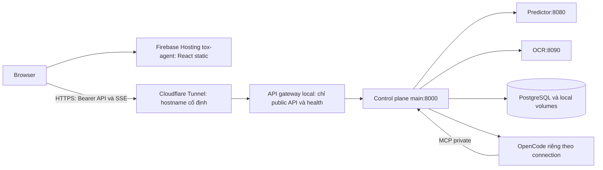

# Plan hợp nhất UI production vào main và chạy backend tại máy qua tunnel

Ngày khảo sát: **12/11/2026 — Asia/Shanghai**.

Phạm vi phiên này: điều tra và lập kế hoạch. Chưa commit WIP, chuyển nhánh, sửa ứng dụng, khởi động lại dịch vụ hoặc deploy. File này là tài liệu bàn giao của phiên khảo sát.

## 1. Kết quả cần đạt

1. Lưu toàn bộ công việc chưa commit ở nhánh hiện tại, gồm cả file untracked và file tracked đã sửa; sau đó quay về `main` và cập nhật đúng remote.
2. Giữ code, API contract, hành vi khoa học và tính năng của `main` mới nhất. Đưa thiết kế trang phân tích và các nút taskbar của `agent_test` vào kiến trúc frontend hiện tại.
3. Firebase project `tox-agent` phục vụ frontend. Backend, predictor, OCR, database, file và agent runtime chạy trên máy; browser gọi API HTTPS qua tunnel.
4. Có bằng chứng kiểm thử UI, API, đăng nhập, streaming và khôi phục sau restart trước khi chuyển site live.

## 2. Những gì đã xác minh

### 2.1. Git và các working tree

| Thành phần | Trạng thái khi bắt đầu khảo sát | Hệ quả |
|---|---|---|
| Nhánh đang mở | `feat/core-agent-loop`, HEAD `7e741a6` | Không commit WIP vào nhánh khác trước khi lưu công việc này. |
| Untracked | 68 file, tổng 2.770.975 byte, khoảng 2,64 MiB | Bao gồm tài liệu, script benchmark và kết quả JSON trong hai thư mục runs. Không chỉ có vài tài liệu ở root. |
| Tracked đã sửa | `docs/results/agent-benchmark-briefing-2026-10-22.md`, +64/-1 dòng | Cũng phải lưu trước khi chuyển nhánh. |
| `main` local | `8171e06` | Chậm hơn `origin/main` 11 commit. |
| `main` trên remote | `f008caa6ff1ed67ff8d2e1ac7fc0a97b0e1b671e` | Đã kiểm tra bằng `git ls-remote`, không chỉ dựa vào ref cache. Đây là baseline của plan. |
| `agent_test` trên remote | `12c3aa532a21d901e35081caee27e13eb051d2d4` | Là nguồn UI theo yêu cầu. |
| Quan hệ nhánh | HEAD hiện tại là ancestor của remote main; `agent_test` cũng là ancestor của remote main | Merge `agent_test` thông thường không khôi phục UI cũ. Cần port có chọn lọc phần trình bày. |
| Working tree bổ sung | `/home/minhquang/tox-agent-deploy` ở `f008caa`; một tree benchmark trong `.cache` | Giữ nguyên các tree này khi lưu WIP và chuyển nhánh. Tree deploy có liên kết `.env` và `.data` về repo chính. |

Số file trên là trước khi thêm tài liệu plan này. Phải kiểm kê lại khi triển khai vì workspace có thể tiếp tục thay đổi.

Kiểm tra tài liệu toàn workspace hiện báo **62 link hỏng**, đều thuộc file untracked có sẵn `ToxAgent_Agent_Architecture_Sources_Compiled_2026-11-07.md`. Đây là lỗi baseline cần ghi nhận khi lưu WIP; không được ghi nhận nhầm là regression của UI/deploy. Nếu muốn đưa tài liệu biên soạn này vào main ở đợt riêng thì cần chuẩn hóa các link theo vị trí file mới.

### 2.2. UI và khác biệt hành vi

Nguồn UI cũ đã đọc:

- `agent_test:frontend/src/app/pages/index-page.tsx`.
- `agent_test:frontend/src/app/components/hero-section.tsx`.
- `agent_test:frontend/src/app/components/navbar.tsx`.
- Các component nhập/vẽ/tải ảnh, progress, quick verdict, history và Documents liên quan.

Baseline main đã đọc từ tree `f008caa`:

- `frontend/src/features/quick-predict/QuickPredictPage.tsx`.
- `frontend/src/features/analysis/AnalysisPanel.tsx` và các card kết quả.
- `frontend/src/app/shell/Navbar.tsx`, `WorkspaceLayout.tsx`, `AppSidebar.tsx`.
- `frontend/src/router.tsx`, API client, API endpoints, auth, SSE/event bus và các test liên quan.

Khác biệt quan trọng:

- Trang cũ `/analyze` chạy agent stream, nhận `final_report`, ghi history qua logic cũ và có verdict tổng hợp.
- Trang nhanh main `/predict` là **stateless**: single, batch, compare model, OCR, giải thích; không tự tạo session hoặc lưu kết quả.
- Main có workbench/session, model picker, BYO AI, investigation, report và trace mới. Những tính năng này phải tiếp tục hoạt động sau thay UI.
- Main dùng capability API để quyết định endpoint/model nào khả dụng. Không đưa danh sách ensemble/model hardcode từ giao diện cũ sang.
- ADR-0002 và `frontend/scripts/policy-lint.mjs` của main cấm verdict/score độc tính tổng hợp. Card cũ cần đổi binding và nội dung theo endpoint, dù dùng lại kiểu trình bày.
- Navbar cũ có logo/tagline, version/Beta/release notes, About, Settings, Documents, Rate us, GitHub, đổi theme, tài khoản/logout và menu mobile. Navbar main đơn giản hơn; một số đích cũ chưa có route tương ứng.

### 2.3. Site live và lỗi đường dẫn

Đã đọc HTTP công khai từ site thực tế:

| URL | Kết quả |
|---|---|
| `https://tox-agent.web.app/` | 200, trả HTML frontend. |
| `https://tox-agent.web.app/analyze` | 404 khi mở trực tiếp. |
| `https://tox-agent.web.app/predict` | 404 khi mở trực tiếp. |

Đã tải asset công khai `/assets/index-page-DTH5fBfB.js`: có `Drug Toxicity Analysis`, `Type SMILES`, `Draw Molecule`, `Upload Image`, `Quick Examples`, `Advanced options`, phù hợp hướng UI trong source `agent_test`.

`agent_test:firebase.json` rewrite `/analyze` và `/predict` sang Cloud Run trước SPA fallback. Đây là một nguyên nhân khả dĩ cho lỗi deep link; chưa đọc cấu hình Hosting đang deploy bằng API quản trị nên chưa kết luận tuyệt đối rằng cấu hình live trùng file đó.

Chưa xác minh trực quan toàn bộ trang phân tích bằng một phiên production đã đăng nhập. Ảnh `frontend/src/assets/documents/1-interface.png` trong nhánh cũ là ảnh lịch sử, không dùng làm bằng chứng cho UI live hiện tại. Khi triển khai phải dựng nguồn `agent_test` tại môi trường tham chiếu riêng để chụp đủ trạng thái.

### 2.4. Tham chiếu tunnel từ các project khác

Đã tìm trong các phiên Codex trên máy và đối chiếu với file thực tế:

- Phiên `01a1a05b-cc04-77e1-bb58-45cf81c6abed`, project `G1_Web_Design`: Firebase frontend, backend local qua Quick Tunnel, biến `PUBLIC_API_URL`, script cập nhật Hosting.
- Phiên `01a1cb32-9ad4-7710-8c85-a3d12fd17bad`, project `G1_AI66A_SE`: frontend Firebase, API local qua tunnel, biến `MARKETPLACE_API_ORIGIN`, kiểm tra CORS và persistence.
- File tham chiếu: `G1_Web_Design/docs/firebase-hosting-setup.md`, `scripts/start-cloud-demo.sh`, `scripts/publish-quick-tunnel.sh`; `G1_AI66A_SE/docs/deployment.md`, `docs/operations.md`, `scripts/export_frontend.py`.

Áp dụng lại cách tách static frontend và backend local, cấu hình API origin riêng, readiness trước deploy, và vận hành/backup riêng backend. ToxAgent cần điều chỉnh loại tunnel vì có SSE.

Theo [Cloudflare Quick Tunnels](https://developers.cloudflare.com/tunnel/get-started/quick-tunnels/), Quick Tunnel không hỗ trợ SSE, hostname thay đổi khi tạo lại và không có bảo đảm uptime. Vì vậy không chọn Quick Tunnel cho bản thay thế production này.

### 2.5. Các điểm hạ tầng cần sửa cùng đợt

1. Main không còn `firebase.json` và `.firebaserc`. Workflow `.github/workflows/deploy.yml` hiện mô tả deploy/promotion bốn service lên Cloud Run. Cần thay đường deploy để phù hợp mục tiêu mới.
2. `VITE_API_BASE_URL` đã có trong main và SSE cũng dùng biến này. Có thể dùng API origin HTTPS khác Firebase mà không thay protocol API.
3. CORS main hiện cho `GET, POST, OPTIONS`; API thực tế có `PATCH` và `DELETE` cho session/settings/model connections. Chỉ mở CORS origin sẽ chưa đủ cho bản cross-origin.
4. `SecuritySettings` production yêu cầu OIDC/JWKS, capability secret, encryption key và `egress_policy=hosted`; từ chối static token. `.env` hiện có static token nhưng chưa thấy các key cấu hình OIDC/CORS cần thiết.
5. Compose base bắt buộc static token và chưa truyền các biến OIDC vào control container. Cần chỉnh interpolation/pass-through và thêm cấu hình public production tương thích; không chỉ đổi `TOXAGENT_ENV`.
6. Compose base là predictor-only (`runtime=none`). Muốn đầy đủ agent phải dùng topology user-AI của main, tương ứng `devops/compose/user-ai.yaml`, OpenCode được pin và runtime riêng theo connection.
7. Main dùng PostgreSQL và volume lưu attachments/model secrets. Không thay chúng bằng Firestore, SQLite hoặc storage của nhánh cũ.
8. Công khai web cho nhiều người dùng vẫn phải dùng egress policy hosted, dù backend nằm trên máy cá nhân. Khả năng dùng AI/OAuth trong Settings phải phản ánh capability thật của chế độ này.

## 3. Quyết định triển khai đề xuất

### 3.1. Cách đưa UI vào main

**Base là remote main đã pin; port presentation có chọn lọc từ agent_test.** Không merge ngược toàn bộ frontend hoặc restore nguyên file trang cũ kèm imports cũ.

Giữ main làm nguồn sự thật cho API, validation, state, model capability, kết quả khoa học, auth verifier, session/workbench, agent và persistence. Tách view khỏi controller ở các component cần thay để có thể so sánh UI độc lập với request/response.

Các biến theme/style cần đưa vào phải được giới hạn phạm vi hoặc ánh xạ với token hiện tại. Không thay toàn bộ `theme.css`, vì sẽ làm đổi cả landing, workbench và settings ngoài phạm vi.

### 3.2. Topology đích

Firebase giữ project/site `tox-agent`. Browser gọi `https://<api-hostname>/v1/...` trực tiếp. API hostname là cấu hình triển khai; chưa chọn domain vì chưa xác minh quyền DNS/tunnel.

Đề xuất gateway chỉ bind loopback, ví dụ `127.0.0.1:18080` sau khi kiểm tra port trống. Predictor, OCR, database, runtime, MCP và metrics không được public qua tunnel. Gateway trả 404 cho route không nằm trong allowlist.

Chọn **Cloudflare Tunnel có tên và hostname cố định**, connector chạy như service có restart policy. Điều kiện là tài khoản và domain được quản lý trong Cloudflare; tham khảo [hướng dẫn setup chính thức](https://developers.cloudflare.com/tunnel/get-started/). Tunnel mở kết nối outbound; không cần NAT port forwarding từ router.

Firebase Hosting không đóng vai trò proxy tới một origin HTTPS tùy ý bằng `rewrites.destination`: trường này phục vụ file local; các integration động chuẩn là Functions/Cloud Run. Vì mục tiêu backend local, frontend cần API origin riêng và CORS. [Firebase Hosting configuration](https://firebase.google.com/docs/hosting/full-config).

### 3.3. Đăng nhập

Main hiện hỗ trợ OIDC authorization-code/PKCE; production cũ dùng Firebase Auth. Hai cách này không thể nối bằng cách chỉ đổi tên nút Sign in.

Đề xuất ưu tiên giữ tài khoản Firebase project `tox-agent`, với một adapter nhận/refresh Firebase ID token ở frontend rồi gửi Bearer qua client hiện tại. Backend tiếp tục dùng cơ chế xác thực và phân quyền của main. Trước khi chọn chính thức phải chứng minh token/key format, issuer, audience, UID và role mapping phù hợp verifier main; kiểm tra token hết hạn và tài khoản bị thu hồi/vô hiệu hóa. Không copy AuthProvider cũ kèm các side effect ghi Firestore vào main.

Firebase ID token yêu cầu issuer `https://securetoken.google.com/tox-agent`, audience `tox-agent`, chữ ký hợp lệ và subject là UID. Đây là yêu cầu từ [Firebase token verification](https://firebase.google.com/docs/auth/admin/verify-id-tokens), không phải bằng chứng adapter đã hoạt động.

Nếu project đã có OIDC provider phù hợp main thì giữ luồng đó và map user menu vào danh tính hiện tại. Đây là quyết định phải chốt ở gate tích hợp auth; không giả định Firebase là generic PKCE provider và không đặt URL authorize/token giả vào `VITE_OIDC_*`.

## 4. Các pha triển khai và tiêu chí hoàn thành

### P0 — Lưu WIP, cập nhật main, đóng băng baseline

1. Chụp lại branch/SHA, status, diff và danh sách untracked đệ quy; kiểm tra file sinh mới từ lúc khảo sát.
2. Rà các file sẽ commit cho credential/private key, nội dung ngoài phạm vi và giới hạn kích thước. Đánh giá script benchmark bằng lint phù hợp; không chạy lại benchmark/model inference chỉ để lưu kết quả.
3. Tạo commit lưu tài liệu, scripts và benchmark outputs trên **nhánh hiện tại**; lưu cả tracked briefing đã sửa. Có thể tách commit theo nhóm để dễ review nhưng phải bao phủ đủ inventory. Không dùng `git add .` thiếu kiểm tra.
4. Kiểm tra status sạch và commit thực sự chứa toàn bộ inventory. Giữ SHA snapshot để tìm lại; không tự cherry-pick WIP benchmark vào main trong đợt UI/deploy.
5. Fetch remote, switch `main`, cập nhật bằng fast-forward only. Nếu remote đã khác `f008caa`, đọc delta và cập nhật baseline trước khi port.
6. Tạo nhánh triển khai từ main mới, ví dụ `feat/production-ui-local-backend`; giữ tree deploy/benchmark hiện có.
7. Ghi baseline test hiện tại, chụp UI main và tham chiếu agent_test trong môi trường riêng, thống kê route/nút/capability. Tách failure đã có khỏi regression mới.

Lưu ý kiểm tra docs trước khi chọn commit nào đưa vào main: file tài liệu compiled đang có 62 relative link hỏng; bảo toàn snapshot gốc và xử lý link bằng thay đổi riêng nếu cần. Không bỏ qua lỗi hoặc sửa hàng loạt tài liệu WIP chỉ để làm xanh baseline của đợt UI.

**Gate:** có snapshot SHA, không mất WIP, main đúng remote, nguồn UI/baseline đã pin. Main local hiện cũ nên chỉ switch main mà không cập nhật chưa đạt gate.

### P1 — Port giao diện trang phân tích

| Phần UI lấy từ agent_test | Logic/binding dùng từ main | Cách triển khai |
|---|---|---|
| Hero gradient, khoảng cách, input card, examples, Analyze | State/validation của quick predict | Port view và assets cần thiết; giữ thông báo lỗi thực. |
| Tabs Type SMILES / Draw Molecule / Upload Image | Composer helpers, StructureEditorDialog, recognizeStructure | Có thể đổi dialog thành nội dung tab, nhưng giữ bước người dùng kiểm tra/sửa SMILES sau OCR. |
| Molecule preview | Cơ chế depiction của main | Hiển thị canonical SMILES; xử lý debounce, request cũ và lỗi preview; không gọi `/smiles/...` API legacy. |
| Advanced options | `/v1/predict/capabilities`, endpoint/model selection, expert threshold | Dữ liệu động; chỉ option được backend hỗ trợ và quyền cho phép. |
| Result card, typography và bố cục | AnalysisPanel, hERG/ClinTox/Tox21, applicability, XAI | Mỗi endpoint giữ kết quả riêng; không đưa risk_level/final_report/fusion_result cũ trở lại. |
| Vùng progress | Trạng thái thực của request nhanh | Không dựng agent pipeline hoặc phần trăm giả cho stateless predict. Trace agent vẫn ở workbench main. |
| Khu vực history của UI cũ | Chính sách stateless main | Thay bằng lối vào Sessions và hướng dẫn lưu/audit; không tự lưu prediction hoặc khôi phục history Firestore cũ. |

Các tính năng main phải còn truy cập được: single, batch có lỗi theo từng item, compare theo model, chọn endpoint/model, expert override có role check, OCR, vẽ cấu trúc, XAI, trạng thái endpoint không khả dụng.

Giữ `/predict` hoạt động; bổ sung `/analyze` làm URL tương thích tới cùng màn hình/controller. Xác định canonical URL và active navigation nhất quán; không duy trì hai bản page riêng.

**Gate:** input/empty/loading/error/success, desktop/mobile và dark/light đạt tham chiếu thiết kế; request/response và semantics main giữ nguyên. Phần nội dung scientific hoặc history khác UI cũ được ghi rõ trong bản đối chiếu.

### P2 — Taskbar, các nút và route

| Nút/nhóm | Giao diện cần giữ | Hành vi đích |
|---|---|---|
| Logo + tagline | Như navbar agent_test | Vào màn phân tích đã thống nhất. |
| Version / Beta / build time | Badge và release notes modal | Version, SHA và build time của bản mới; không mang metadata cũ. |
| About | Vị trí/style cũ | About main hiện tại. |
| Settings | Vị trí/style cũ | Settings main, bao gồm AI connections. |
| Documents | Giữ nút và trang đọc tài liệu | Bổ sung route/page trình bày tài liệu đúng main; cập nhật hình và mô tả workflow lỗi thời. |
| Rate us | Màu, icon, link và tương tác cũ | Giữ destination hiện hữu sau kiểm tra link. |
| GitHub | Link/icon cũ | Repository hiện tại. |
| Theme | Nút và menu mobile cũ | Theme main, lưu preference và áp dụng được cả trang nhanh/workspace. |
| User / Sign in / Logout | User dropdown/menu cũ | Danh tính và token lifecycle của auth đã tích hợp; logout xóa token/cache/subscription và giữ ownership checks. |
| Mobile menu | Sheet, trạng thái active và đóng khi điều hướng | Mọi đích thật, không để button chết. |

Giữ sidebar/workspace, Sessions, workbench và các route `/s/:sessionId/...` của main. Đưa navbar mới vào các trang có navbar hiện tại trước; không phủ taskbar mới lên workspace làm đổi bố cục toàn ứng dụng. Nếu một nút cũ cần thêm route, bổ sung route mỏng hoặc trang mới phù hợp main; không restore nguyên settings/chat/report legacy.

**Gate:** kiểm thử từng nút desktop/mobile, đăng nhập/chưa đăng nhập, active route, theme, keyboard focus và deep link. Các tính năng main không mất lối truy cập.

### P3 — Public API và auth cross-origin

1. Chốt luồng đăng nhập theo mục 3.3; xác minh login, refresh/re-login, logout, subject ownership, role expert/operator và 401/403. Giữ generic OIDC hiện có nếu thêm Firebase adapter.
2. Nếu dùng PKCE main, callback phải được xử lý tại route thực sự mount auth handler; mặc định quay về `/` hiện là landing nên cần kiểm chứng và cấu hình callback đúng. Đồng thời khôi phục route người dùng đang mở sau login.
3. Cấu hình origin cụ thể: `https://tox-agent.web.app`, `https://tox-agent.firebaseapp.com` nếu dùng và origin preview được cấp rõ ràng.
4. Cho các method thực có `GET, POST, PATCH, DELETE, OPTIONS`; chỉ thêm header mà request thật cần, bao gồm Bearer, JSON và event cursor. Kiểm tra PATCH/DELETE từ browser, không chỉ GET /health.
5. Giữ API client, blob fetch và SSE fetch cùng một API origin. Không đưa Bearer token vào query string hoặc href asset.
6. Giữ cơ chế event cursor, reconnect và REST reconciliation của main; không coi reconciliation là phương án thay SSE cho Quick Tunnel.

**Gate:** browser Firebase/preview truy cập API bằng auth thật và thực hiện được thao tác thay đổi session/model connection. Login test không dùng static token production.

### P4 — Backend local và named tunnel

1. Chuẩn bị release tree pin SHA và cấu hình/Compose project riêng. Không restart hoặc overwrite runtime hiện có trong bước thử nghiệm; không dùng volume production cho test ghi dữ liệu.
2. Dùng base backend main + user-AI overlay + public-production overlay. Forward đầy đủ biến identity, CORS, egress, secrets và runtime. Bỏ ràng buộc bắt buộc static token trong cấu hình public production nhưng giữ local development hoạt động.
3. Kiểm tra model artifacts và OCR checkpoint theo manifest/checksum hiện tại. Dùng dữ liệu và image đã có nếu hợp lệ; không tải/rebuild nặng trước khi inventory.
4. Bật đủ control, predictor, OCR, PostgreSQL và runtime riêng từng connection. Readiness phải phản ánh cả trạng thái model/runtime; `/health/ready` không được chỉ báo predictor-only trong bản đầy đủ agent.
5. Với production public, set `TOXAGENT_ENV=production`, `TOXAGENT_EGRESS_POLICY=hosted`, static token rỗng và cấu hình các secret bắt buộc. Settings phải phản ánh nguồn AI người dùng thật; không giả định host có AI key dùng chung.
6. Đánh giá capability ChatGPT OAuth khi chuyển sang hosted; main có gate riêng. Không bật giả capability chỉ để giữ nút. Luồng kết nối AI khác vẫn giữ nguyên main.
7. Thêm gateway chỉ public `/v1/...` và health cần thiết. Chặn `/internal/mcp`, metrics, runtime/admin và path khác. Dành MCP cho runtime private.
8. Tạo named tunnel và DNS hostname thuộc domain được phép quản lý. Connector chỉ trỏ tới gateway. Lưu credential ở cấu hình private ngoài Git.
9. Cấu hình stream: không proxy-buffer/cache SSE, giữ Content-Type, heartbeat và timeout phù hợp. Kiểm tra đường truyền thực bằng `curl -N` và browser trong lúc có run.
10. Quản lý connector/backend bằng service/restart policy; kiểm tra port/GPU/RAM trước khi chạy cạnh các project khác. Cấu hình máy không suspend trong thời gian phục vụ.
11. Backup nhất quán PostgreSQL + attachments + model secrets + encryption key; restore thử vào môi trường riêng. Volume restart/rebuild phải giữ được cả DB lẫn file.

**Gate:** API public HTTPS, private routes bị chặn, dữ liệu còn sau restart, agent chạy được bằng AI connection của người dùng, SSE tới browser tăng dần theo sự kiện thay vì dồn cuối response.

### P5 — Firebase Hosting và pipeline

1. Tạo `.firebaserc` trỏ project `tox-agent` và `firebase.json` chỉ deploy static build `frontend/dist` với SPA fallback, cache asset hash dài hạn và HTML revalidate.
2. Bỏ rewrite Cloud Run cho `/analyze`, `/predict` và API legacy. Đảm bảo hard refresh `/analyze`, `/predict`, `/settings`, `/documents`, `/s/...` trả app đúng.
3. Build frontend bằng `VITE_API_BASE_URL=https://<api-hostname>`. Theo thiết kế hiện tại biến được nhúng ở build; đổi API origin cần build/deploy lại. Không thêm runtime config nếu chưa có nhu cầu.
4. Thay workflow Cloud Run ở main bằng deploy frontend Firebase sau các gate CI liên quan. Vô hiệu đường auto deploy Cloud Run trong workflow mới; không tác động workflow cũ trên agent_test khi chưa cutover.
5. Tái sử dụng WIF/Hosting deploy identity nếu hợp lệ, kiểm tra quyền tối thiểu, biến project/site/API origin và deploy từ commit còn là HEAD được chọn. CI không tự triển khai backend trên máy nếu chưa có đường vận hành tương ứng.
6. Deploy preview trước. Thêm origin preview cụ thể vào cấu hình cần thiết và auth authorized domains; verify cấu hình từ browser thật.
7. Chỉ chuyển Hosting live sau gate preview; lưu Hosting release ID, frontend artifact, backend image/SHA, cấu hình tunnel và backup ứng với release.
8. Chưa xóa Cloud Run cũ/Firestore hoặc đổi agent_test trước khi hoàn tất cutover và kiểm tra rollback. Ngăn workflow agent_test ghi đè site live sau cutover; giữ artifact cũ để rollback có chủ đích.

**Gate:** site live gọi backend local, không còn đường deploy/routing vô tình đưa request về Cloud Run; reload deep link thành công và pipeline khớp topology đích.

### P6 — Kiểm thử chấp nhận và bàn giao

| Nhóm | Bằng chứng cần có |
|---|---|
| UI reference | Ảnh/đối chiếu old-reference và bản mới ở desktop/mobile, dark/light; navbar, tabs, advanced và trạng thái lỗi/kết quả. |
| Quick predict | Single; batch có invalid item; compare giữ riêng model; model/endpoint theo capabilities; expert đúng quyền; OCR sửa được; draw; XAI. Không phát sinh request tạo session cho quick predict. |
| Auth/CORS | Login thật, refresh/token expiry, logout, reload, 401/403, ownership, PATCH session/settings và DELETE connection từ origin Firebase. |
| Main regressions | Sessions, composer/model picker, agent trace, investigation/report, cancel, artifact deep links và Settings AI connections. |
| Tunnel/SSE | Event tới trong lúc chạy, reconnect có cursor và không duplicate, mất mạng/recovery, restart connector giữ hostname. |
| Persistence | Restart backend và dựng lại container giữ DB, attachments, encrypted credentials; restore thử riêng không ghi đè production. |
| Deployment | Preview/live đúng SHA, không request Cloud Run legacy, HTML/asset cache đúng, hard refresh từng route. |
| Rollback | Frontend cũ + backend/config tương thích khôi phục được; nếu schema đổi thì restore theo backup sau khi dừng writes. |

Chạy các check frontend hiện có: typecheck, lint/policy lint, unit, build/bundle budget và Playwright; cập nhật selectors theo semantics mới. Với thay đổi CORS/auth/Compose/CI, thêm test có giá trị cho cross-origin, production config và routing/deploy target. Chạy backend contract/unit và gate CI liên quan; không đổi chỉ tiêu khoa học hoặc chạy lại toàn bộ benchmark nghiên cứu trong đợt UI/deploy này.

Không dùng mỗi `/health` hoặc việc build thành công để kết luận release đã sẵn sàng.

## 5. Phạm vi file dự kiến

| Nhóm | File/thư mục chính |
|---|---|
| Quick analysis | `frontend/src/features/quick-predict/`, presentation components mới nếu cần; dùng lại composer/analysis hiện tại. |
| Navigation | `frontend/src/app/shell/Navbar.tsx`, route, theme mapping, build info/release notes; trang Documents nếu cần. |
| Auth/public API | `frontend/src/features/auth/`, `shared/api/client.ts` khi cần lifecycle token; `backend/control/src/toxagent/api/app.py`; config/verifier chỉ khi adapter yêu cầu. |
| Local production | `devops/compose/compose.yaml`, `user-ai.yaml` nếu cần, overlay public mới, gateway/tunnel config mẫu, scripts vận hành và backup. |
| Firebase/CI | `.firebaserc`, `firebase.json`, workflow Hosting mới/thay thế, `devops/release/deploy_target.py` và test tương ứng nếu còn tham chiếu Cloud Run target cũ. |
| Tài liệu | Runbook release/restart/backup/rollback, kết quả acceptance và plan này. |

Mọi sửa đổi ngoài nhóm UI phải gắn với yêu cầu public backend local hoặc lỗi tích hợp được chứng minh. Không refactor engine/khoa học hoặc di chuyển dữ liệu cũ trong cùng đợt.

## 6. Chia commit và thứ tự phụ thuộc

1. Commit lưu WIP ở nhánh hiện tại, tách tài liệu/kết quả và scripts khi phù hợp.
2. Nhánh triển khai từ main: port quick-analysis view và giữ API semantics.
3. Navbar/taskbar, route tương thích, theme và Documents/release info.
4. Tích hợp auth/CORS cho browser khác origin.
5. Public local backend overlay, gateway, named-tunnel/service và persistence/runbook.
6. Firebase Hosting/pipeline thay đường Cloud Run.
7. Hoàn thiện test hồi quy, acceptance evidence và release/rollback docs.

P0 → P1/P2 và khảo sát tài khoản/DNS → P3/P4 → P5 preview → P6 → Hosting live.

Ước lượng sơ bộ **4–6 ngày công**, phụ thuộc độ khớp UI tham chiếu và tình trạng auth/domain/runtime. Phải cập nhật ước lượng sau P0 và spike auth/tunnel; thời gian chờ quyền tài khoản/DNS không nằm trong số này.

## 7. Thông tin cần chốt khi bắt đầu triển khai

- **Domain/API hostname và quyền Cloudflare:** chưa tìm được cấu hình named tunnel cho ToxAgent trong các vị trí đã đọc. Các phiên project tham chiếu dùng Quick Tunnel, không chứng minh hiện có domain phù hợp. Không thể tự gán subdomain bên dưới `web.app` cho tunnel.
- **Identity provider:** xác nhận giữ Firebase Auth production hay dùng OIDC provider đã có. Ưu tiên kiểm chứng Firebase adapter để giữ UID/tài khoản; chưa thể xem đây là việc đã hoàn tất.
- **Môi trường vận hành:** xác minh runtime nào đang phục vụ từ tree deploy, port và tài nguyên hiện tại trước khi chọn release tree/Compose project/volumes. Chưa khởi động lại runtime trong phiên khảo sát.
- **Khớp UI chính xác:** cần reference render đủ trạng thái từ agent_test hoặc phiên live có sẵn được phép sử dụng. Asset công khai đã khớp các phần chính nhưng chưa chứng minh toàn bộ trạng thái sau login.

Những mục này là đầu vào của các gate, không cản trở việc lưu WIP hoặc port view trên baseline đã pin. Nếu chưa có named tunnel/domain thì tiếp tục hoàn thiện và kiểm thử local; không coi bản Quick Tunnel là release production đầy đủ.
